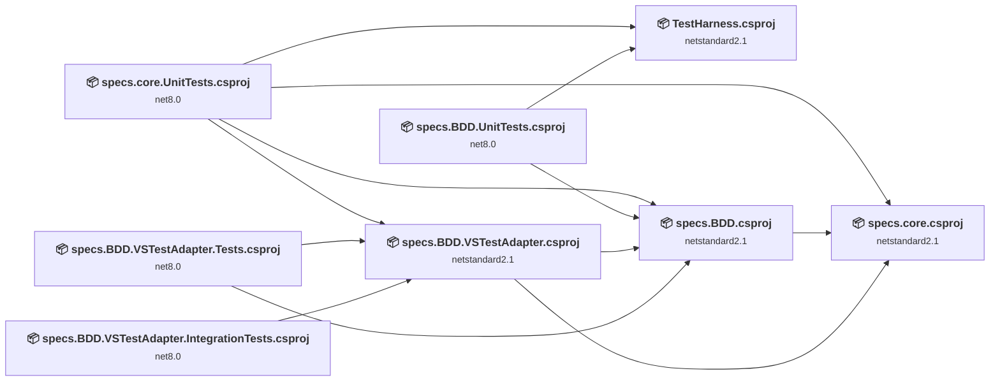
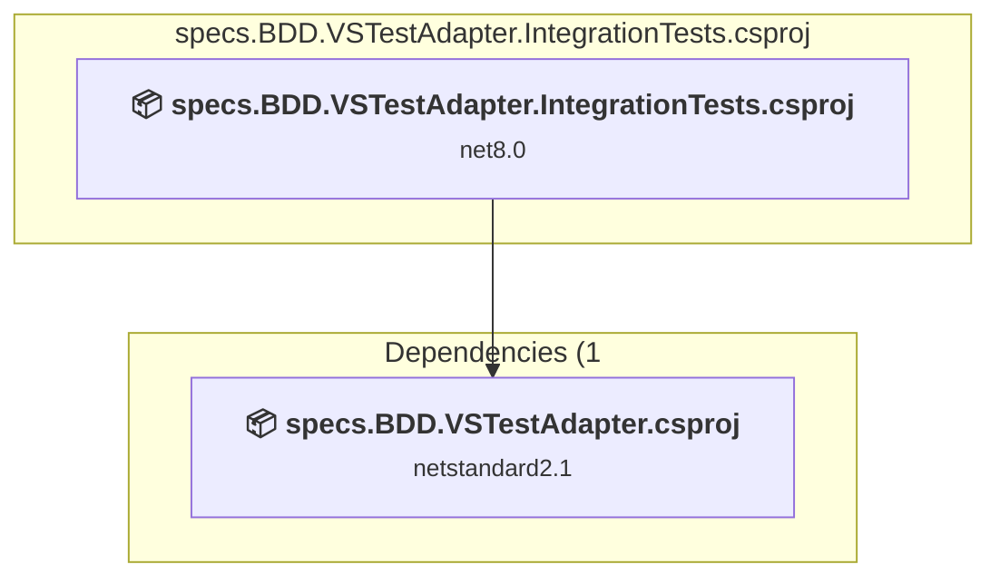
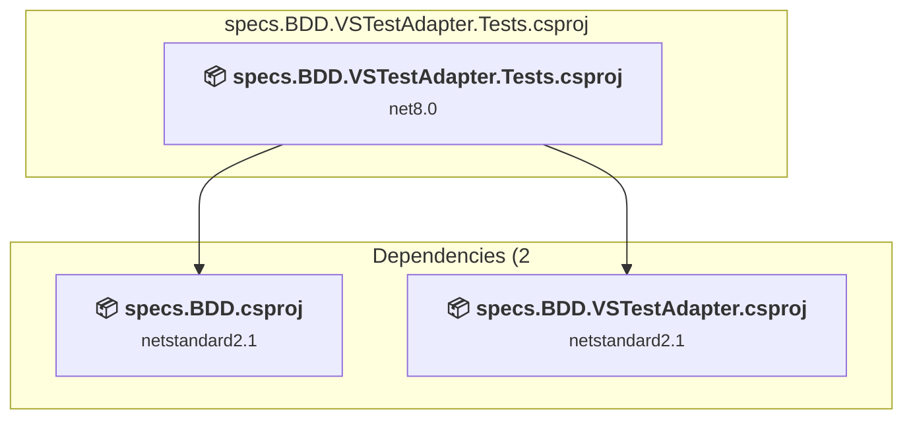
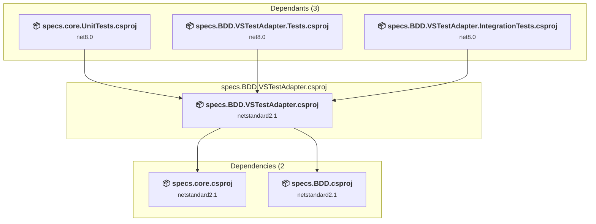
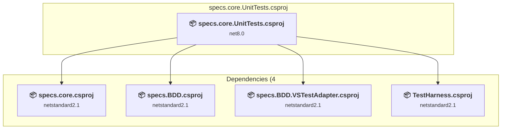
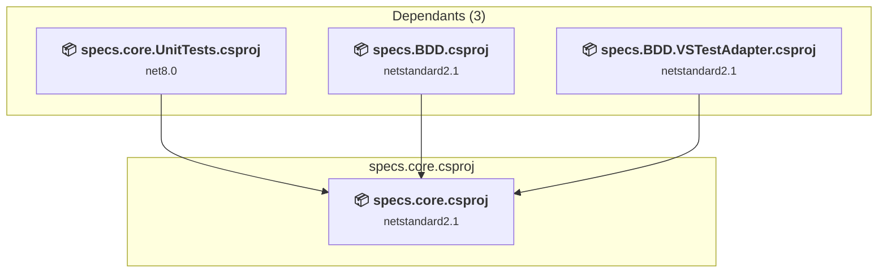
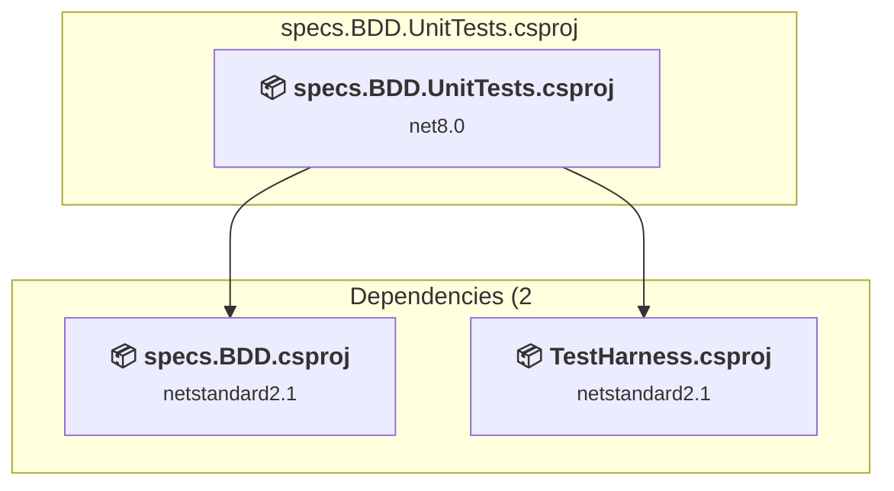
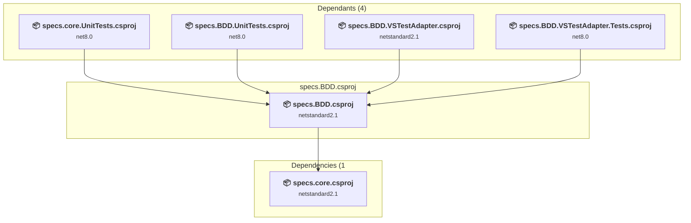
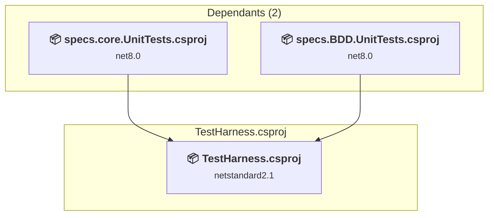

# Projects and dependencies analysis

This document provides a comprehensive overview of the projects and their dependencies in the context of upgrading to .NETCoreApp,Version=v10.0.

## Table of Contents

- [Executive Summary](#executive-Summary)
  - [Highlevel Metrics](#highlevel-metrics)
  - [Projects Compatibility](#projects-compatibility)
  - [Package Compatibility](#package-compatibility)
  - [API Compatibility](#api-compatibility)
  - [Binding Redirect Configuration](#binding-redirect-configuration)
- [Aggregate NuGet packages details](#aggregate-nuget-packages-details)
- [Top API Migration Challenges](#top-api-migration-challenges)
  - [Technologies and Features](#technologies-and-features)
  - [Most Frequent API Issues](#most-frequent-api-issues)
- [Projects Relationship Graph](#projects-relationship-graph)
- [Project Details](#project-details)

  - [specs.BDD.VSTestAdapter.IntegrationTests\specs.BDD.VSTestAdapter.IntegrationTests.csproj](#specsbddvstestadapterintegrationtestsspecsbddvstestadapterintegrationtestscsproj)
  - [specs.BDD.VSTestAdapter.Tests\specs.BDD.VSTestAdapter.Tests.csproj](#specsbddvstestadaptertestsspecsbddvstestadaptertestscsproj)
  - [specs.BDD.VSTestAdapter\specs.BDD.VSTestAdapter.csproj](#specsbddvstestadapterspecsbddvstestadaptercsproj)
  - [specs.core.UnitTests\specs.core.UnitTests.csproj](#specscoreunittestsspecscoreunittestscsproj)
  - [specs.core\specs.core.csproj](#specscorespecscorecsproj)
  - [specs.specification.UnitTests\specs.BDD.UnitTests.csproj](#specsspecificationunittestsspecsbddunittestscsproj)
  - [specs.specification\specs.BDD.csproj](#specsspecificationspecsbddcsproj)
  - [TestHarness\TestHarness.csproj](#testharnesstestharnesscsproj)

## Executive Summary

### Highlevel Metrics

| Metric | Count | Status |
| :--- | :---: | :--- |
| Total Projects | 8 | 6 require upgrade |
| Total NuGet Packages | 98 | 2 need upgrade |
| Total Code Files | 94 |  |
| Total Code Files with Incidents | 9 |  |
| Total Lines of Code | 15544 |  |
| Total Number of Issues | 22 |  |
| Estimated LOC to modify | 14+ | at least 0.1% of codebase |

### Projects Compatibility

| Project | Target Framework | Difficulty | Package Issues | API Issues | Binding Issues | Est. LOC Impact | Description |
| :--- | :---: | :---: | :---: | :---: | :---: | :---: | :--- |
| [specs.BDD.VSTestAdapter.IntegrationTests\specs.BDD.VSTestAdapter.IntegrationTests.csproj](#specsbddvstestadapterintegrationtestsspecsbddvstestadapterintegrationtestscsproj) | net8.0 | 🟢 Low | 0 | 0 | 0 |  | DotNetCoreApp, Sdk Style = True |
| [specs.BDD.VSTestAdapter.Tests\specs.BDD.VSTestAdapter.Tests.csproj](#specsbddvstestadaptertestsspecsbddvstestadaptertestscsproj) | net8.0 | 🟢 Low | 0 | 12 | 0 | 12+ | DotNetCoreApp, Sdk Style = True |
| [specs.BDD.VSTestAdapter\specs.BDD.VSTestAdapter.csproj](#specsbddvstestadapterspecsbddvstestadaptercsproj) | netstandard2.1 | 🟢 Low | 1 | 2 | 0 | 2+ | ClassLibrary, Sdk Style = True |
| [specs.core.UnitTests\specs.core.UnitTests.csproj](#specscoreunittestsspecscoreunittestscsproj) | net8.0 | 🟢 Low | 1 | 0 | 0 |  | DotNetCoreApp, Sdk Style = True |
| [specs.core\specs.core.csproj](#specscorespecscorecsproj) | netstandard2.1 | ✅ None | 0 | 0 | 0 |  | ClassLibrary, Sdk Style = True |
| [specs.specification.UnitTests\specs.BDD.UnitTests.csproj](#specsspecificationunittestsspecsbddunittestscsproj) | net8.0 | 🟢 Low | 1 | 0 | 0 |  | DotNetCoreApp, Sdk Style = True |
| [specs.specification\specs.BDD.csproj](#specsspecificationspecsbddcsproj) | netstandard2.1 | ✅ None | 0 | 0 | 0 |  | ClassLibrary, Sdk Style = True |
| [TestHarness\TestHarness.csproj](#testharnesstestharnesscsproj) | netstandard2.1 | 🟢 Low | 1 | 0 | 0 |  | ClassLibrary, Sdk Style = True |

### Package Compatibility

| Status | Count | Percentage |
| :--- | :---: | :---: |
| ✅ Compatible | 96 | 98.0% |
| ⚠️ Incompatible | 0 | 0.0% |
| 🔄 Upgrade Recommended | 2 | 2.0% |
| ***Total NuGet Packages*** | ***98*** | ***100%*** |

### API Compatibility

| Category | Count | Impact |
| :--- | :---: | :--- |
| 🔴 Binary Incompatible | 0 | High - Require code changes |
| 🟡 Source Incompatible | 5 | Medium - Needs re-compilation and potential conflicting API error fixing |
| 🔵 Behavioral change | 9 | Low - Behavioral changes that may require testing at runtime |
| ✅ Compatible | 15227 |  |
| ***Total APIs Analyzed*** | ***15241*** |  |

## Aggregate NuGet packages details

| Package | Current Version | Suggested Version | Projects | Description |
| :--- | :---: | :---: | :--- | :--- |
| Autofac | 8.1.0 |  | [specs.core.UnitTests.csproj](#specscoreunittestsspecscoreunittestscsproj) | ✅Compatible |
| Autofac.Extras.Moq | 7.0.0 |  | [specs.core.UnitTests.csproj](#specscoreunittestsspecscoreunittestscsproj) | ✅Compatible |
| Castle.Core | 5.1.1 |  | [specs.BDD.VSTestAdapter.Tests.csproj](#specsbddvstestadaptertestsspecsbddvstestadaptertestscsproj) [specs.core.UnitTests.csproj](#specscoreunittestsspecscoreunittestscsproj) | ✅Compatible |
| coverlet.collector | 6.0.4 |  | [specs.BDD.UnitTests.csproj](#specsspecificationunittestsspecsbddunittestscsproj) [specs.core.UnitTests.csproj](#specscoreunittestsspecscoreunittestscsproj) | ✅Compatible |
| Microsoft.ApplicationInsights | 2.22.0 |  | [specs.BDD.UnitTests.csproj](#specsspecificationunittestsspecsbddunittestscsproj) | ✅Compatible |
| Microsoft.CodeCoverage | 17.8.0 |  | [specs.BDD.UnitTests.csproj](#specsspecificationunittestsspecsbddunittestscsproj) [specs.BDD.VSTestAdapter.IntegrationTests.csproj](#specsbddvstestadapterintegrationtestsspecsbddvstestadapterintegrationtestscsproj) [specs.BDD.VSTestAdapter.Tests.csproj](#specsbddvstestadaptertestsspecsbddvstestadaptertestscsproj) [specs.core.UnitTests.csproj](#specscoreunittestsspecscoreunittestscsproj) | ✅Compatible |
| Microsoft.NET.Test.Sdk | 17.8.0 |  | [specs.BDD.UnitTests.csproj](#specsspecificationunittestsspecsbddunittestscsproj) [specs.BDD.VSTestAdapter.IntegrationTests.csproj](#specsbddvstestadapterintegrationtestsspecsbddvstestadapterintegrationtestscsproj) [specs.BDD.VSTestAdapter.Tests.csproj](#specsbddvstestadaptertestsspecsbddvstestadaptertestscsproj) [specs.core.UnitTests.csproj](#specscoreunittestsspecscoreunittestscsproj) | ✅Compatible |
| Microsoft.NETCore.Platforms | 1.1.0 |  | [specs.BDD.UnitTests.csproj](#specsspecificationunittestsspecsbddunittestscsproj) [specs.BDD.VSTestAdapter.Tests.csproj](#specsbddvstestadaptertestsspecsbddvstestadaptertestscsproj) [specs.core.UnitTests.csproj](#specscoreunittestsspecscoreunittestscsproj) [TestHarness.csproj](#testharnesstestharnesscsproj) | ✅Compatible |
| Microsoft.NETCore.Targets | 1.0.1 |  | [specs.BDD.UnitTests.csproj](#specsspecificationunittestsspecsbddunittestscsproj) [TestHarness.csproj](#testharnesstestharnesscsproj) | ✅Compatible |
| Microsoft.NETCore.Targets | 1.1.0 |  | [specs.core.UnitTests.csproj](#specscoreunittestsspecscoreunittestscsproj) | ✅Compatible |
| Microsoft.Testing.Extensions.Telemetry | 1.5.3 |  | [specs.BDD.UnitTests.csproj](#specsspecificationunittestsspecsbddunittestscsproj) | ✅Compatible |
| Microsoft.Testing.Extensions.TrxReport.Abstractions | 1.5.3 |  | [specs.BDD.UnitTests.csproj](#specsspecificationunittestsspecsbddunittestscsproj) | ✅Compatible |
| Microsoft.Testing.Extensions.VSTestBridge | 1.5.3 |  | [specs.BDD.UnitTests.csproj](#specsspecificationunittestsspecsbddunittestscsproj) | ✅Compatible |
| Microsoft.Testing.Platform | 1.5.3 |  | [specs.BDD.UnitTests.csproj](#specsspecificationunittestsspecsbddunittestscsproj) | ✅Compatible |
| Microsoft.Testing.Platform.MSBuild | 1.5.3 |  | [specs.BDD.UnitTests.csproj](#specsspecificationunittestsspecsbddunittestscsproj) | ✅Compatible |
| Microsoft.TestPlatform.ObjectModel | 17.12.0 |  | [specs.BDD.UnitTests.csproj](#specsspecificationunittestsspecsbddunittestscsproj) | ✅Compatible |
| Microsoft.TestPlatform.ObjectModel | 17.8.0 |  | [specs.BDD.VSTestAdapter.csproj](#specsbddvstestadapterspecsbddvstestadaptercsproj) [specs.BDD.VSTestAdapter.IntegrationTests.csproj](#specsbddvstestadapterintegrationtestsspecsbddvstestadapterintegrationtestscsproj) [specs.BDD.VSTestAdapter.Tests.csproj](#specsbddvstestadaptertestsspecsbddvstestadaptertestscsproj) [specs.core.UnitTests.csproj](#specscoreunittestsspecscoreunittestscsproj) | ✅Compatible |
| Microsoft.TestPlatform.TestHost | 17.8.0 |  | [specs.BDD.UnitTests.csproj](#specsspecificationunittestsspecsbddunittestscsproj) [specs.BDD.VSTestAdapter.IntegrationTests.csproj](#specsbddvstestadapterintegrationtestsspecsbddvstestadapterintegrationtestscsproj) [specs.BDD.VSTestAdapter.Tests.csproj](#specsbddvstestadaptertestsspecsbddvstestadaptertestscsproj) [specs.core.UnitTests.csproj](#specscoreunittestsspecscoreunittestscsproj) | ✅Compatible |
| Moq | 4.18.4 |  | [specs.core.UnitTests.csproj](#specscoreunittestsspecscoreunittestscsproj) | ✅Compatible |
| Moq | 4.20.72 |  | [specs.BDD.VSTestAdapter.Tests.csproj](#specsbddvstestadaptertestsspecsbddvstestadaptertestscsproj) | ✅Compatible |
| NETStandard.Library | 2.0.0 |  | [specs.BDD.UnitTests.csproj](#specsspecificationunittestsspecsbddunittestscsproj) [specs.BDD.VSTestAdapter.Tests.csproj](#specsbddvstestadaptertestsspecsbddvstestadaptertestscsproj) [specs.core.UnitTests.csproj](#specscoreunittestsspecscoreunittestscsproj) [TestHarness.csproj](#testharnesstestharnesscsproj) | ✅Compatible |
| Newtonsoft.Json | 13.0.1 |  | [specs.BDD.UnitTests.csproj](#specsspecificationunittestsspecsbddunittestscsproj) [specs.BDD.VSTestAdapter.IntegrationTests.csproj](#specsbddvstestadapterintegrationtestsspecsbddvstestadapterintegrationtestscsproj) [specs.BDD.VSTestAdapter.Tests.csproj](#specsbddvstestadaptertestsspecsbddvstestadaptertestscsproj) [specs.core.UnitTests.csproj](#specscoreunittestsspecscoreunittestscsproj) | ✅Compatible |
| NFluent | 3.0.0 |  | [specs.BDD.VSTestAdapter.Tests.csproj](#specsbddvstestadaptertestsspecsbddvstestadaptertestscsproj) | ✅Compatible |
| NFluent | 3.1.0 |  | [specs.BDD.UnitTests.csproj](#specsspecificationunittestsspecsbddunittestscsproj) [specs.BDD.VSTestAdapter.IntegrationTests.csproj](#specsbddvstestadapterintegrationtestsspecsbddvstestadapterintegrationtestscsproj) [specs.core.UnitTests.csproj](#specscoreunittestsspecscoreunittestscsproj) | ✅Compatible |
| NSpec | 3.1.0 |  | [specs.BDD.UnitTests.csproj](#specsspecificationunittestsspecsbddunittestscsproj) [specs.core.UnitTests.csproj](#specscoreunittestsspecscoreunittestscsproj) [TestHarness.csproj](#testharnesstestharnesscsproj) | ✅Compatible |
| NuGet.Frameworks | 6.5.0 |  | [specs.BDD.VSTestAdapter.csproj](#specsbddvstestadapterspecsbddvstestadaptercsproj) [specs.BDD.VSTestAdapter.IntegrationTests.csproj](#specsbddvstestadapterintegrationtestsspecsbddvstestadapterintegrationtestscsproj) [specs.BDD.VSTestAdapter.Tests.csproj](#specsbddvstestadaptertestsspecsbddvstestadaptertestscsproj) [specs.core.UnitTests.csproj](#specscoreunittestsspecscoreunittestscsproj) | ✅Compatible |
| NUnit | 3.14.0 |  | [specs.BDD.UnitTests.csproj](#specsspecificationunittestsspecsbddunittestscsproj) [specs.BDD.VSTestAdapter.Tests.csproj](#specsbddvstestadaptertestsspecsbddvstestadaptertestscsproj) [specs.core.UnitTests.csproj](#specscoreunittestsspecscoreunittestscsproj) [TestHarness.csproj](#testharnesstestharnesscsproj) | ✅Compatible |
| NUnit.Analyzers | 4.6.0 |  | [specs.BDD.UnitTests.csproj](#specsspecificationunittestsspecsbddunittestscsproj) | ✅Compatible |
| NUnit3TestAdapter | 4.5.0 |  | [specs.BDD.VSTestAdapter.Tests.csproj](#specsbddvstestadaptertestsspecsbddvstestadaptertestscsproj) | ✅Compatible |
| NUnit3TestAdapter | 5.0.0 |  | [specs.BDD.UnitTests.csproj](#specsspecificationunittestsspecsbddunittestscsproj) | ✅Compatible |
| System.Buffers | 4.5.1 |  | [specs.BDD.VSTestAdapter.csproj](#specsbddvstestadapterspecsbddvstestadaptercsproj) [TestHarness.csproj](#testharnesstestharnesscsproj) | ✅Compatible |
| System.Collections | 4.0.11 |  | [specs.BDD.UnitTests.csproj](#specsspecificationunittestsspecsbddunittestscsproj) [TestHarness.csproj](#testharnesstestharnesscsproj) | ✅Compatible |
| System.Collections | 4.3.0 |  | [specs.core.UnitTests.csproj](#specscoreunittestsspecscoreunittestscsproj) | ✅Compatible |
| System.Collections.Concurrent | 4.0.12 |  | [specs.BDD.UnitTests.csproj](#specsspecificationunittestsspecsbddunittestscsproj) [specs.core.UnitTests.csproj](#specscoreunittestsspecscoreunittestscsproj) [TestHarness.csproj](#testharnesstestharnesscsproj) | ✅Compatible |
| System.Collections.Immutable | 6.0.0 |  | [specs.BDD.VSTestAdapter.csproj](#specsbddvstestadapterspecsbddvstestadaptercsproj) [specs.BDD.VSTestAdapter.IntegrationTests.csproj](#specsbddvstestadapterintegrationtestsspecsbddvstestadapterintegrationtestscsproj) [specs.BDD.VSTestAdapter.Tests.csproj](#specsbddvstestadaptertestsspecsbddvstestadaptertestscsproj) [specs.core.UnitTests.csproj](#specscoreunittestsspecscoreunittestscsproj) | ✅Compatible |
| System.Collections.NonGeneric | 4.3.0 |  | [specs.core.UnitTests.csproj](#specscoreunittestsspecscoreunittestscsproj) | ✅Compatible |
| System.Collections.Specialized | 4.3.0 |  | [specs.core.UnitTests.csproj](#specscoreunittestsspecscoreunittestscsproj) | ✅Compatible |
| System.ComponentModel | 4.3.0 |  | [specs.core.UnitTests.csproj](#specscoreunittestsspecscoreunittestscsproj) | ✅Compatible |
| System.ComponentModel.Primitives | 4.3.0 |  | [specs.core.UnitTests.csproj](#specscoreunittestsspecscoreunittestscsproj) | ✅Compatible |
| System.ComponentModel.TypeConverter | 4.3.0 |  | [specs.core.UnitTests.csproj](#specscoreunittestsspecscoreunittestscsproj) | ✅Compatible |
| System.Diagnostics.Debug | 4.0.11 |  | [specs.BDD.UnitTests.csproj](#specsspecificationunittestsspecsbddunittestscsproj) [TestHarness.csproj](#testharnesstestharnesscsproj) | ✅Compatible |
| System.Diagnostics.Debug | 4.3.0 |  | [specs.core.UnitTests.csproj](#specscoreunittestsspecscoreunittestscsproj) | ✅Compatible |
| System.Diagnostics.DiagnosticSource | 5.0.0 |  | [specs.BDD.UnitTests.csproj](#specsspecificationunittestsspecsbddunittestscsproj) | ✅Compatible |
| System.Diagnostics.DiagnosticSource | 8.0.1 |  | [specs.core.UnitTests.csproj](#specscoreunittestsspecscoreunittestscsproj) | ✅Compatible |
| System.Diagnostics.EventLog | 6.0.0 |  | [specs.BDD.VSTestAdapter.Tests.csproj](#specsbddvstestadaptertestsspecsbddvstestadaptertestscsproj) [specs.core.UnitTests.csproj](#specscoreunittestsspecscoreunittestscsproj) | ✅Compatible |
| System.Diagnostics.Tracing | 4.1.0 |  | [specs.BDD.UnitTests.csproj](#specsspecificationunittestsspecsbddunittestscsproj) [specs.core.UnitTests.csproj](#specscoreunittestsspecscoreunittestscsproj) [TestHarness.csproj](#testharnesstestharnesscsproj) | ✅Compatible |
| System.Globalization | 4.0.11 |  | [specs.BDD.UnitTests.csproj](#specsspecificationunittestsspecsbddunittestscsproj) [TestHarness.csproj](#testharnesstestharnesscsproj) | ✅Compatible |
| System.Globalization | 4.3.0 |  | [specs.core.UnitTests.csproj](#specscoreunittestsspecscoreunittestscsproj) | ✅Compatible |
| System.Globalization.Extensions | 4.3.0 |  | [specs.core.UnitTests.csproj](#specscoreunittestsspecscoreunittestscsproj) | ✅Compatible |
| System.IO | 4.1.0 |  | [specs.BDD.UnitTests.csproj](#specsspecificationunittestsspecsbddunittestscsproj) [TestHarness.csproj](#testharnesstestharnesscsproj) | ✅Compatible |
| System.IO | 4.3.0 |  | [specs.core.UnitTests.csproj](#specscoreunittestsspecscoreunittestscsproj) | ✅Compatible |
| System.IO.FileSystem | 4.0.1 |  | [specs.BDD.UnitTests.csproj](#specsspecificationunittestsspecsbddunittestscsproj) [specs.core.UnitTests.csproj](#specscoreunittestsspecscoreunittestscsproj) [TestHarness.csproj](#testharnesstestharnesscsproj) | ✅Compatible |
| System.IO.FileSystem.Primitives | 4.0.1 |  | [specs.BDD.UnitTests.csproj](#specsspecificationunittestsspecsbddunittestscsproj) [specs.core.UnitTests.csproj](#specscoreunittestsspecscoreunittestscsproj) [TestHarness.csproj](#testharnesstestharnesscsproj) | ✅Compatible |
| System.Linq | 4.1.0 |  | [specs.BDD.UnitTests.csproj](#specsspecificationunittestsspecsbddunittestscsproj) [TestHarness.csproj](#testharnesstestharnesscsproj) | ✅Compatible |
| System.Linq | 4.3.0 |  | [specs.core.UnitTests.csproj](#specscoreunittestsspecscoreunittestscsproj) | ✅Compatible |
| System.Memory | 4.5.4 |  | [specs.BDD.VSTestAdapter.csproj](#specsbddvstestadapterspecsbddvstestadaptercsproj) | ✅Compatible |
| System.Memory | 4.5.5 |  | [TestHarness.csproj](#testharnesstestharnesscsproj) | ✅Compatible |
| System.Numerics.Vectors | 4.4.0 |  | [specs.BDD.VSTestAdapter.csproj](#specsbddvstestadapterspecsbddvstestadaptercsproj) [TestHarness.csproj](#testharnesstestharnesscsproj) | ✅Compatible |
| System.Private.DataContractSerialization | 4.1.1 |  | [specs.BDD.UnitTests.csproj](#specsspecificationunittestsspecsbddunittestscsproj) [specs.core.UnitTests.csproj](#specscoreunittestsspecscoreunittestscsproj) [TestHarness.csproj](#testharnesstestharnesscsproj) | ✅Compatible |
| System.Reflection | 4.1.0 |  | [specs.BDD.UnitTests.csproj](#specsspecificationunittestsspecsbddunittestscsproj) [TestHarness.csproj](#testharnesstestharnesscsproj) | ✅Compatible |
| System.Reflection | 4.3.0 |  | [specs.core.UnitTests.csproj](#specscoreunittestsspecscoreunittestscsproj) | ✅Compatible |
| System.Reflection.Emit | 4.0.1 |  | [specs.BDD.UnitTests.csproj](#specsspecificationunittestsspecsbddunittestscsproj) [specs.core.UnitTests.csproj](#specscoreunittestsspecscoreunittestscsproj) [TestHarness.csproj](#testharnesstestharnesscsproj) | ✅Compatible |
| System.Reflection.Emit.ILGeneration | 4.0.1 |  | [specs.BDD.UnitTests.csproj](#specsspecificationunittestsspecsbddunittestscsproj) [specs.core.UnitTests.csproj](#specscoreunittestsspecscoreunittestscsproj) [TestHarness.csproj](#testharnesstestharnesscsproj) | ✅Compatible |
| System.Reflection.Emit.Lightweight | 4.0.1 |  | [specs.BDD.UnitTests.csproj](#specsspecificationunittestsspecsbddunittestscsproj) [specs.core.UnitTests.csproj](#specscoreunittestsspecscoreunittestscsproj) [TestHarness.csproj](#testharnesstestharnesscsproj) | ✅Compatible |
| System.Reflection.Extensions | 4.0.1 |  | [specs.BDD.UnitTests.csproj](#specsspecificationunittestsspecsbddunittestscsproj) [TestHarness.csproj](#testharnesstestharnesscsproj) | ✅Compatible |
| System.Reflection.Extensions | 4.3.0 |  | [specs.core.UnitTests.csproj](#specscoreunittestsspecscoreunittestscsproj) | ✅Compatible |
| System.Reflection.Metadata | 1.6.0 |  | [specs.BDD.UnitTests.csproj](#specsspecificationunittestsspecsbddunittestscsproj) | ✅Compatible |
| System.Reflection.Metadata | 6.0.0 | 10.0.13 | [specs.BDD.VSTestAdapter.csproj](#specsbddvstestadapterspecsbddvstestadaptercsproj) [specs.BDD.VSTestAdapter.IntegrationTests.csproj](#specsbddvstestadapterintegrationtestsspecsbddvstestadapterintegrationtestscsproj) [specs.BDD.VSTestAdapter.Tests.csproj](#specsbddvstestadaptertestsspecsbddvstestadaptertestscsproj) [specs.core.UnitTests.csproj](#specscoreunittestsspecscoreunittestscsproj) | NuGet package upgrade is recommended |
| System.Reflection.Primitives | 4.0.1 |  | [specs.BDD.UnitTests.csproj](#specsspecificationunittestsspecsbddunittestscsproj) [TestHarness.csproj](#testharnesstestharnesscsproj) | ✅Compatible |
| System.Reflection.Primitives | 4.3.0 |  | [specs.core.UnitTests.csproj](#specscoreunittestsspecscoreunittestscsproj) | ✅Compatible |
| System.Reflection.TypeExtensions | 4.1.0 |  | [specs.BDD.UnitTests.csproj](#specsspecificationunittestsspecsbddunittestscsproj) [TestHarness.csproj](#testharnesstestharnesscsproj) | ✅Compatible |
| System.Reflection.TypeExtensions | 4.3.0 |  | [specs.core.UnitTests.csproj](#specscoreunittestsspecscoreunittestscsproj) | ✅Compatible |
| System.Resources.ResourceManager | 4.0.1 |  | [specs.BDD.UnitTests.csproj](#specsspecificationunittestsspecsbddunittestscsproj) [TestHarness.csproj](#testharnesstestharnesscsproj) | ✅Compatible |
| System.Resources.ResourceManager | 4.3.0 |  | [specs.core.UnitTests.csproj](#specscoreunittestsspecscoreunittestscsproj) | ✅Compatible |
| System.Runtime | 4.1.0 |  | [specs.BDD.UnitTests.csproj](#specsspecificationunittestsspecsbddunittestscsproj) [TestHarness.csproj](#testharnesstestharnesscsproj) | ✅Compatible |
| System.Runtime | 4.3.0 |  | [specs.core.UnitTests.csproj](#specscoreunittestsspecscoreunittestscsproj) | ✅Compatible |
| System.Runtime.CompilerServices.Unsafe | 6.0.0 |  | [specs.BDD.VSTestAdapter.csproj](#specsbddvstestadapterspecsbddvstestadaptercsproj) [specs.BDD.VSTestAdapter.IntegrationTests.csproj](#specsbddvstestadapterintegrationtestsspecsbddvstestadapterintegrationtestscsproj) [specs.BDD.VSTestAdapter.Tests.csproj](#specsbddvstestadaptertestsspecsbddvstestadaptertestscsproj) [specs.core.UnitTests.csproj](#specscoreunittestsspecscoreunittestscsproj) [TestHarness.csproj](#testharnesstestharnesscsproj) | ✅Compatible |
| System.Runtime.Extensions | 4.1.0 |  | [specs.BDD.UnitTests.csproj](#specsspecificationunittestsspecsbddunittestscsproj) [TestHarness.csproj](#testharnesstestharnesscsproj) | ✅Compatible |
| System.Runtime.Extensions | 4.3.0 |  | [specs.core.UnitTests.csproj](#specscoreunittestsspecscoreunittestscsproj) | ✅Compatible |
| System.Runtime.Handles | 4.0.1 |  | [specs.BDD.UnitTests.csproj](#specsspecificationunittestsspecsbddunittestscsproj) [TestHarness.csproj](#testharnesstestharnesscsproj) | ✅Compatible |
| System.Runtime.Handles | 4.3.0 |  | [specs.core.UnitTests.csproj](#specscoreunittestsspecscoreunittestscsproj) | ✅Compatible |
| System.Runtime.InteropServices | 4.1.0 |  | [specs.BDD.UnitTests.csproj](#specsspecificationunittestsspecsbddunittestscsproj) [TestHarness.csproj](#testharnesstestharnesscsproj) | ✅Compatible |
| System.Runtime.InteropServices | 4.3.0 |  | [specs.core.UnitTests.csproj](#specscoreunittestsspecscoreunittestscsproj) | ✅Compatible |
| System.Runtime.Serialization.Primitives | 4.1.1 |  | [specs.BDD.UnitTests.csproj](#specsspecificationunittestsspecsbddunittestscsproj) [specs.core.UnitTests.csproj](#specscoreunittestsspecscoreunittestscsproj) [TestHarness.csproj](#testharnesstestharnesscsproj) | ✅Compatible |
| System.Runtime.Serialization.Xml | 4.1.1 |  | [specs.BDD.UnitTests.csproj](#specsspecificationunittestsspecsbddunittestscsproj) [specs.core.UnitTests.csproj](#specscoreunittestsspecscoreunittestscsproj) [TestHarness.csproj](#testharnesstestharnesscsproj) | ✅Compatible |
| System.Text.Encoding | 4.0.11 |  | [specs.BDD.UnitTests.csproj](#specsspecificationunittestsspecsbddunittestscsproj) [TestHarness.csproj](#testharnesstestharnesscsproj) | ✅Compatible |
| System.Text.Encoding | 4.3.0 |  | [specs.core.UnitTests.csproj](#specscoreunittestsspecscoreunittestscsproj) | ✅Compatible |
| System.Text.Encoding.Extensions | 4.0.11 |  | [specs.BDD.UnitTests.csproj](#specsspecificationunittestsspecsbddunittestscsproj) [specs.core.UnitTests.csproj](#specscoreunittestsspecscoreunittestscsproj) [TestHarness.csproj](#testharnesstestharnesscsproj) | ✅Compatible |
| System.Text.Encodings.Web | 9.0.11 | 10.0.13 | [specs.BDD.UnitTests.csproj](#specsspecificationunittestsspecsbddunittestscsproj) [specs.core.UnitTests.csproj](#specscoreunittestsspecscoreunittestscsproj) [TestHarness.csproj](#testharnesstestharnesscsproj) | NuGet package upgrade is recommended |
| System.Text.RegularExpressions | 4.1.0 |  | [specs.BDD.UnitTests.csproj](#specsspecificationunittestsspecsbddunittestscsproj) [specs.core.UnitTests.csproj](#specscoreunittestsspecscoreunittestscsproj) [TestHarness.csproj](#testharnesstestharnesscsproj) | ✅Compatible |
| System.Threading | 4.0.11 |  | [specs.BDD.UnitTests.csproj](#specsspecificationunittestsspecsbddunittestscsproj) [TestHarness.csproj](#testharnesstestharnesscsproj) | ✅Compatible |
| System.Threading | 4.3.0 |  | [specs.core.UnitTests.csproj](#specscoreunittestsspecscoreunittestscsproj) | ✅Compatible |
| System.Threading.Tasks | 4.0.11 |  | [specs.BDD.UnitTests.csproj](#specsspecificationunittestsspecsbddunittestscsproj) [TestHarness.csproj](#testharnesstestharnesscsproj) | ✅Compatible |
| System.Threading.Tasks | 4.3.0 |  | [specs.core.UnitTests.csproj](#specscoreunittestsspecscoreunittestscsproj) | ✅Compatible |
| System.Threading.Tasks.Extensions | 4.0.0 |  | [specs.BDD.UnitTests.csproj](#specsspecificationunittestsspecsbddunittestscsproj) [specs.core.UnitTests.csproj](#specscoreunittestsspecscoreunittestscsproj) [TestHarness.csproj](#testharnesstestharnesscsproj) | ✅Compatible |
| System.Xml.ReaderWriter | 4.0.11 |  | [specs.BDD.UnitTests.csproj](#specsspecificationunittestsspecsbddunittestscsproj) [specs.core.UnitTests.csproj](#specscoreunittestsspecscoreunittestscsproj) [TestHarness.csproj](#testharnesstestharnesscsproj) | ✅Compatible |
| System.Xml.XmlDocument | 4.0.1 |  | [specs.BDD.UnitTests.csproj](#specsspecificationunittestsspecsbddunittestscsproj) [specs.core.UnitTests.csproj](#specscoreunittestsspecscoreunittestscsproj) [TestHarness.csproj](#testharnesstestharnesscsproj) | ✅Compatible |
| System.Xml.XmlSerializer | 4.0.11 |  | [specs.BDD.UnitTests.csproj](#specsspecificationunittestsspecsbddunittestscsproj) [specs.core.UnitTests.csproj](#specscoreunittestsspecscoreunittestscsproj) [TestHarness.csproj](#testharnesstestharnesscsproj) | ✅Compatible |

## Top API Migration Challenges

### Technologies and Features

| Technology | Issues | Percentage | Migration Path |
| :--- | :---: | :---: | :--- |

### Most Frequent API Issues

| API | Count | Percentage | Category |
| :--- | :---: | :---: | :--- |
| T:System.Uri | 8 | 57.1% | Behavioral Change |
| M:System.TimeSpan.FromMilliseconds(System.Double) | 4 | 28.6% | Source Incompatible |
| M:System.Uri.#ctor(System.String) | 1 | 7.1% | Behavioral Change |
| M:System.TimeSpan.FromSeconds(System.Double) | 1 | 7.1% | Source Incompatible |

## Projects Relationship Graph

Legend:
📦 SDK-style project
⚙️ Classic project

## Project Details

### specs.BDD.VSTestAdapter.IntegrationTests\specs.BDD.VSTestAdapter.IntegrationTests.csproj

#### Project Info

- **Current Target Framework:** net8.0
- **Proposed Target Framework:** net10.0
- **SDK-style**: True
- **Project Kind:** DotNetCoreApp
- **Dependencies**: 1
- **Dependants**: 0
- **Number of Files**: 7
- **Number of Files with Incidents**: 1
- **Lines of Code**: 483
- **Estimated LOC to modify**: 0+ (at least 0.0% of the project)

#### Dependency Graph

Legend:
📦 SDK-style project
⚙️ Classic project

### API Compatibility

| Category | Count | Impact |
| :--- | :---: | :--- |
| 🔴 Binary Incompatible | 0 | High - Require code changes |
| 🟡 Source Incompatible | 0 | Medium - Needs re-compilation and potential conflicting API error fixing |
| 🔵 Behavioral change | 0 | Low - Behavioral changes that may require testing at runtime |
| ✅ Compatible | 630 |  |
| ***Total APIs Analyzed*** | ***630*** |  |

### specs.BDD.VSTestAdapter.Tests\specs.BDD.VSTestAdapter.Tests.csproj

#### Project Info

- **Current Target Framework:** net8.0
- **Proposed Target Framework:** net10.0
- **SDK-style**: True
- **Project Kind:** DotNetCoreApp
- **Dependencies**: 2
- **Dependants**: 0
- **Number of Files**: 15
- **Number of Files with Incidents**: 3
- **Lines of Code**: 3112
- **Estimated LOC to modify**: 12+ (at least 0.4% of the project)

#### Dependency Graph

Legend:
📦 SDK-style project
⚙️ Classic project

### API Compatibility

| Category | Count | Impact |
| :--- | :---: | :--- |
| 🔴 Binary Incompatible | 0 | High - Require code changes |
| 🟡 Source Incompatible | 5 | Medium - Needs re-compilation and potential conflicting API error fixing |
| 🔵 Behavioral change | 7 | Low - Behavioral changes that may require testing at runtime |
| ✅ Compatible | 4548 |  |
| ***Total APIs Analyzed*** | ***4560*** |  |

### specs.BDD.VSTestAdapter\specs.BDD.VSTestAdapter.csproj

#### Project Info

- **Current Target Framework:** netstandard2.1✅
- **SDK-style**: True
- **Project Kind:** ClassLibrary
- **Dependencies**: 2
- **Dependants**: 3
- **Number of Files**: 22
- **Number of Files with Incidents**: 2
- **Lines of Code**: 2481
- **Estimated LOC to modify**: 2+ (at least 0.1% of the project)

#### Dependency Graph

Legend:
📦 SDK-style project
⚙️ Classic project

### API Compatibility

| Category | Count | Impact |
| :--- | :---: | :--- |
| 🔴 Binary Incompatible | 0 | High - Require code changes |
| 🟡 Source Incompatible | 0 | Medium - Needs re-compilation and potential conflicting API error fixing |
| 🔵 Behavioral change | 2 | Low - Behavioral changes that may require testing at runtime |
| ✅ Compatible | 1735 |  |
| ***Total APIs Analyzed*** | ***1737*** |  |

### specs.core.UnitTests\specs.core.UnitTests.csproj

#### Project Info

- **Current Target Framework:** net8.0
- **Proposed Target Framework:** net10.0
- **SDK-style**: True
- **Project Kind:** DotNetCoreApp
- **Dependencies**: 4
- **Dependants**: 0
- **Number of Files**: 20
- **Number of Files with Incidents**: 1
- **Lines of Code**: 6204
- **Estimated LOC to modify**: 0+ (at least 0.0% of the project)

#### Dependency Graph

Legend:
📦 SDK-style project
⚙️ Classic project

### API Compatibility

| Category | Count | Impact |
| :--- | :---: | :--- |
| 🔴 Binary Incompatible | 0 | High - Require code changes |
| 🟡 Source Incompatible | 0 | Medium - Needs re-compilation and potential conflicting API error fixing |
| 🔵 Behavioral change | 0 | Low - Behavioral changes that may require testing at runtime |
| ✅ Compatible | 5357 |  |
| ***Total APIs Analyzed*** | ***5357*** |  |

### specs.core\specs.core.csproj

#### Project Info

- **Current Target Framework:** netstandard2.1✅
- **SDK-style**: True
- **Project Kind:** ClassLibrary
- **Dependencies**: 0
- **Dependants**: 3
- **Number of Files**: 20
- **Lines of Code**: 1248
- **Estimated LOC to modify**: 0+ (at least 0.0% of the project)

#### Dependency Graph

Legend:
📦 SDK-style project
⚙️ Classic project

### API Compatibility

| Category | Count | Impact |
| :--- | :---: | :--- |
| 🔴 Binary Incompatible | 0 | High - Require code changes |
| 🟡 Source Incompatible | 0 | Medium - Needs re-compilation and potential conflicting API error fixing |
| 🔵 Behavioral change | 0 | Low - Behavioral changes that may require testing at runtime |
| ✅ Compatible | 654 |  |
| ***Total APIs Analyzed*** | ***654*** |  |

### specs.specification.UnitTests\specs.BDD.UnitTests.csproj

#### Project Info

- **Current Target Framework:** net8.0
- **Proposed Target Framework:** net10.0
- **SDK-style**: True
- **Project Kind:** DotNetCoreApp
- **Dependencies**: 2
- **Dependants**: 0
- **Number of Files**: 8
- **Number of Files with Incidents**: 1
- **Lines of Code**: 1325
- **Estimated LOC to modify**: 0+ (at least 0.0% of the project)

#### Dependency Graph

Legend:
📦 SDK-style project
⚙️ Classic project

### API Compatibility

| Category | Count | Impact |
| :--- | :---: | :--- |
| 🔴 Binary Incompatible | 0 | High - Require code changes |
| 🟡 Source Incompatible | 0 | Medium - Needs re-compilation and potential conflicting API error fixing |
| 🔵 Behavioral change | 0 | Low - Behavioral changes that may require testing at runtime |
| ✅ Compatible | 2043 |  |
| ***Total APIs Analyzed*** | ***2043*** |  |

### specs.specification\specs.BDD.csproj

#### Project Info

- **Current Target Framework:** netstandard2.1✅
- **SDK-style**: True
- **Project Kind:** ClassLibrary
- **Dependencies**: 1
- **Dependants**: 4
- **Number of Files**: 9
- **Lines of Code**: 546
- **Estimated LOC to modify**: 0+ (at least 0.0% of the project)

#### Dependency Graph

Legend:
📦 SDK-style project
⚙️ Classic project

### API Compatibility

| Category | Count | Impact |
| :--- | :---: | :--- |
| 🔴 Binary Incompatible | 0 | High - Require code changes |
| 🟡 Source Incompatible | 0 | Medium - Needs re-compilation and potential conflicting API error fixing |
| 🔵 Behavioral change | 0 | Low - Behavioral changes that may require testing at runtime |
| ✅ Compatible | 139 |  |
| ***Total APIs Analyzed*** | ***139*** |  |

### TestHarness\TestHarness.csproj

#### Project Info

- **Current Target Framework:** netstandard2.1✅
- **SDK-style**: True
- **Project Kind:** ClassLibrary
- **Dependencies**: 0
- **Dependants**: 2
- **Number of Files**: 1
- **Number of Files with Incidents**: 1
- **Lines of Code**: 145
- **Estimated LOC to modify**: 0+ (at least 0.0% of the project)

#### Dependency Graph

Legend:
📦 SDK-style project
⚙️ Classic project

### API Compatibility

| Category | Count | Impact |
| :--- | :---: | :--- |
| 🔴 Binary Incompatible | 0 | High - Require code changes |
| 🟡 Source Incompatible | 0 | Medium - Needs re-compilation and potential conflicting API error fixing |
| 🔵 Behavioral change | 0 | Low - Behavioral changes that may require testing at runtime |
| ✅ Compatible | 121 |  |
| ***Total APIs Analyzed*** | ***121*** |  |

