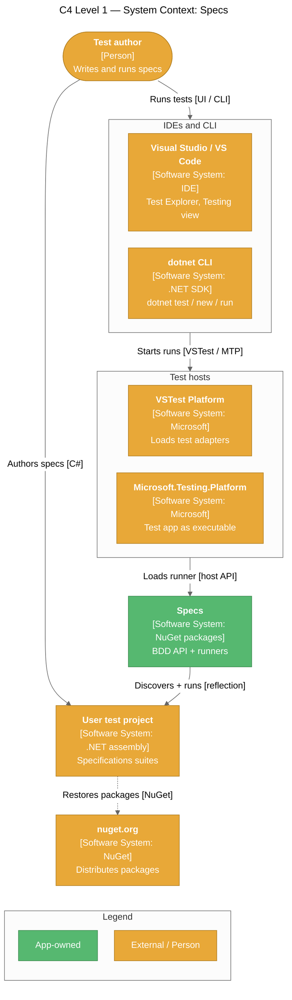
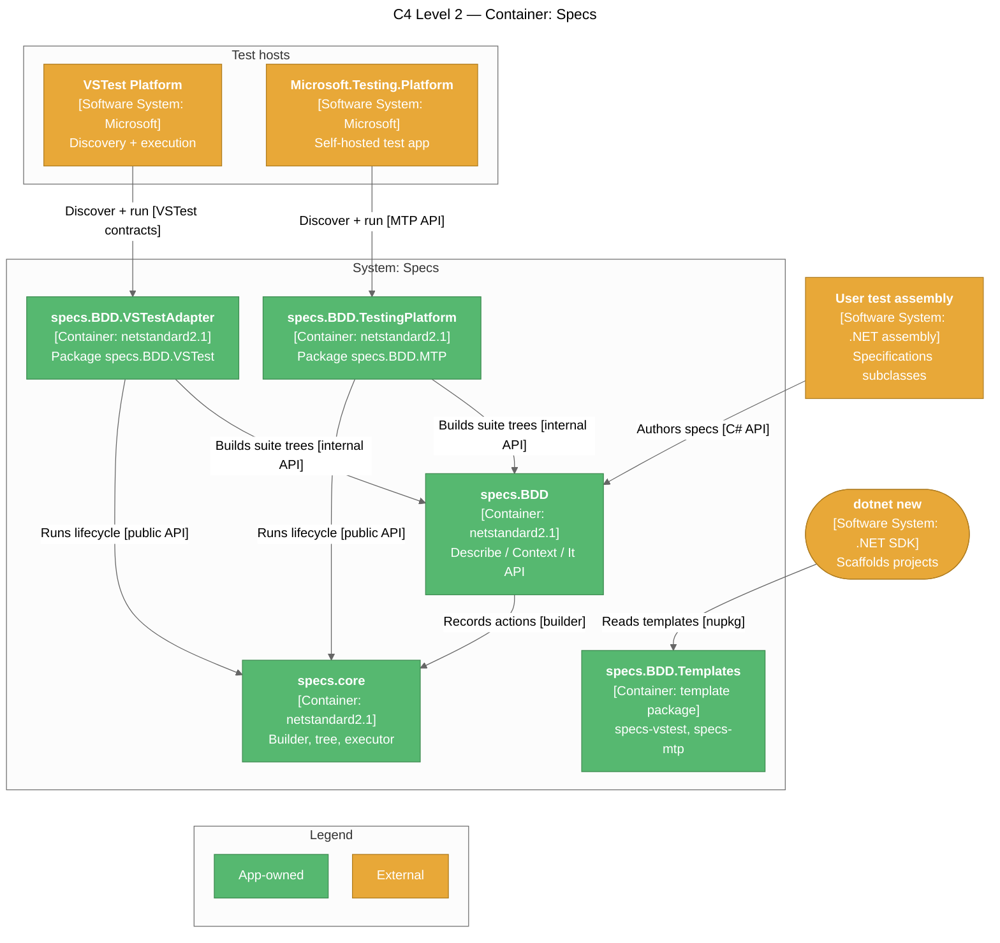
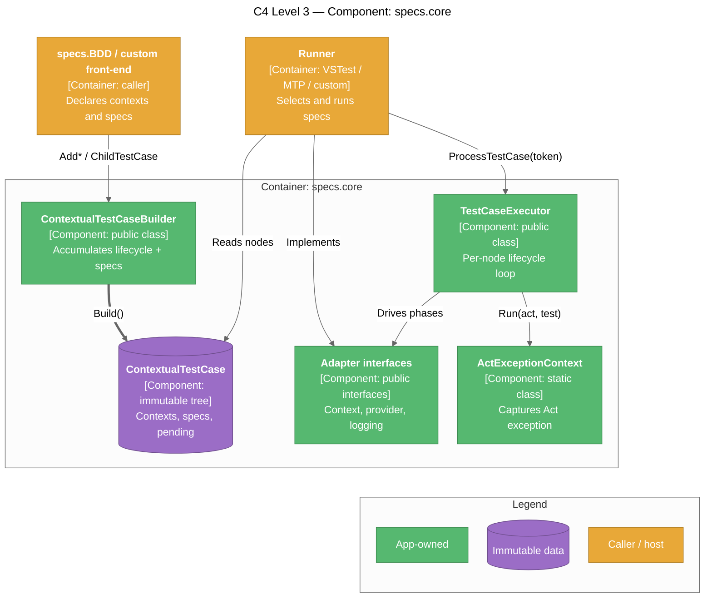
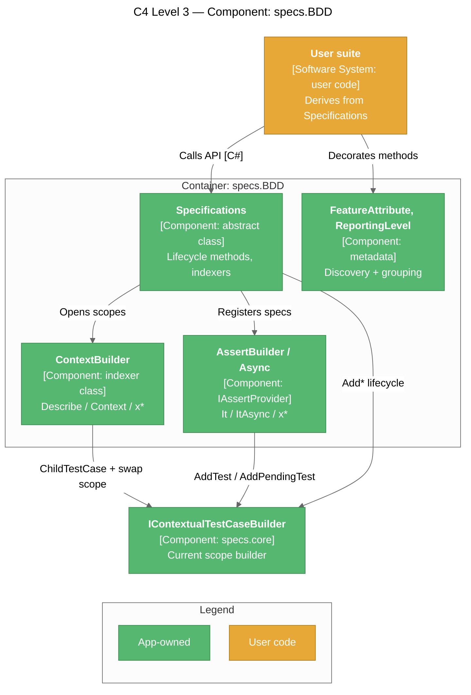
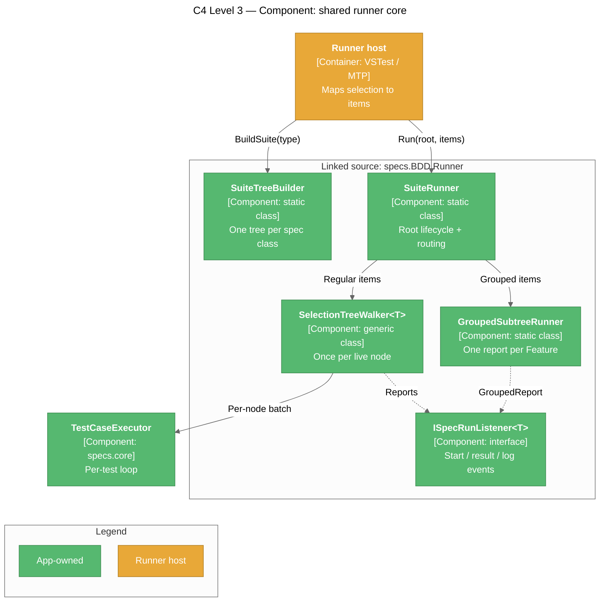
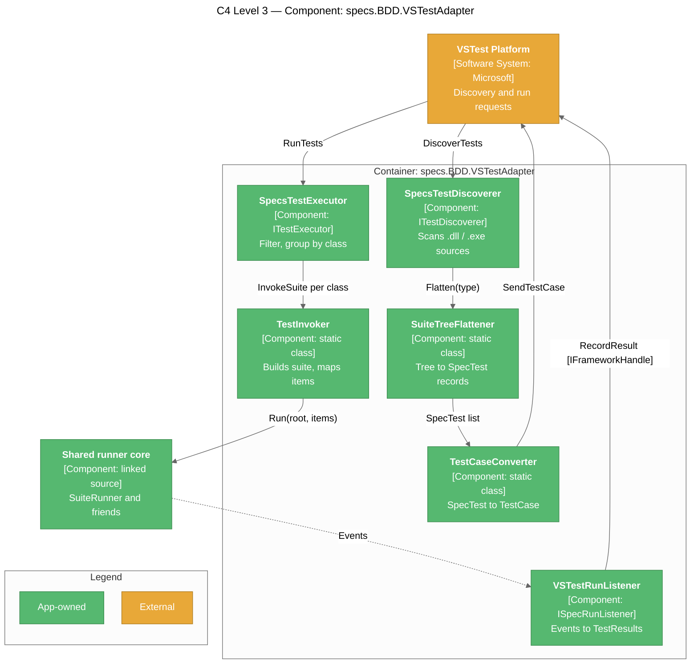
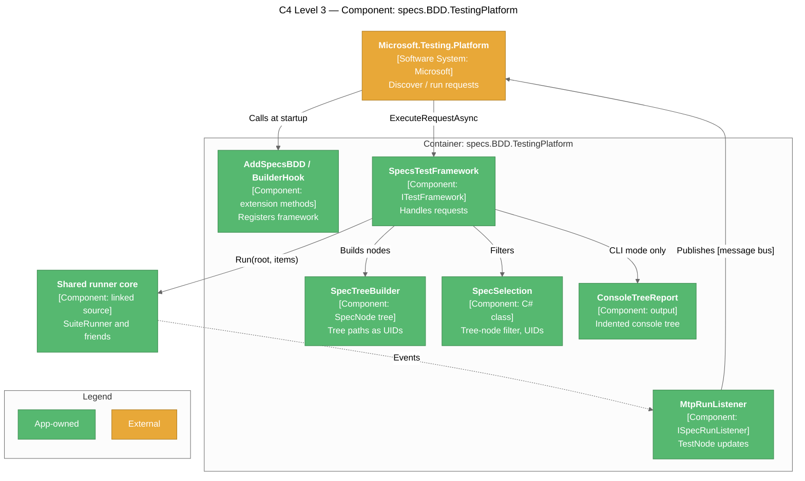
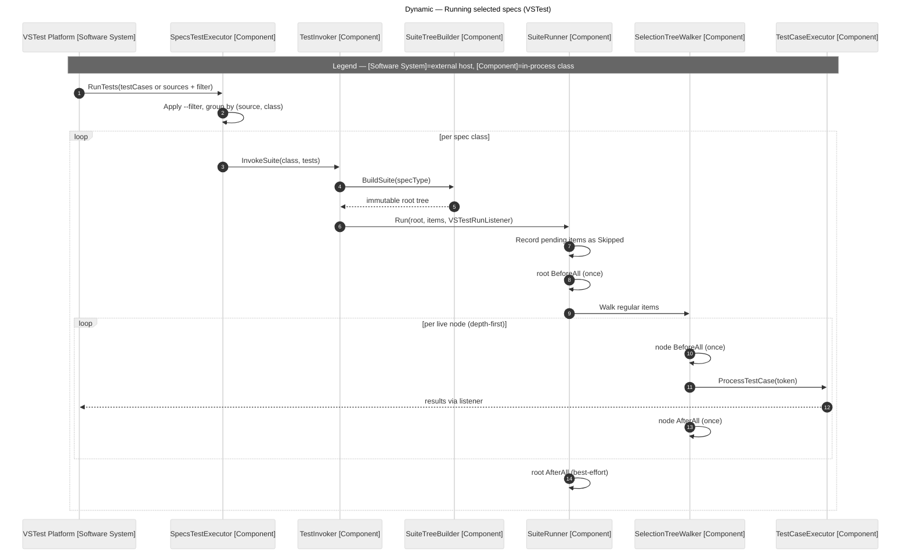
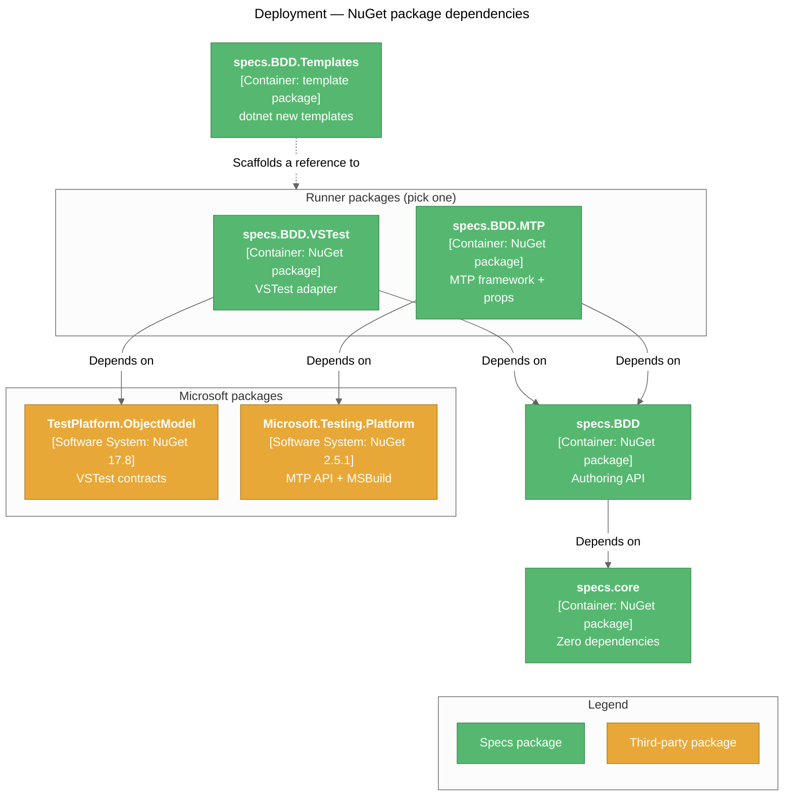

# Architecture

> A layered .NET library: a framework-agnostic core, a BDD authoring API on top of it, and two thin runners (VSTest and Microsoft.Testing.Platform) that share one execution core.

## System Overview

Specs is consumed as NuGet packages by **test projects**. A test author derives a class from `Specifications`, declares `[Feature]` methods, and writes `Describe` / `Context` / `It` blocks inside them. A test host (VSTest or Microsoft.Testing.Platform) loads one of the Specs runners, which reflects over the test assembly, builds an immutable tree of contexts and specs, and executes the selected specs with the five-phase lifecycle.

The system has two layers and two runners:

- **`specs.core`** — the builder, the immutable test-case tree, and `TestCaseExecutor`, the single implementation of the lifecycle. No third-party runtime dependencies; its executor and adapter interfaces are public so other runners can host the same lifecycle.
- **`specs.BDD`** — the `Specifications` base class and the `[Feature]` / `[ReportingLevel]` attributes. It translates `BeforeEach(...)`, `It[...] = ...`, and friends into builder calls.
- **`specs.BDD.VSTestAdapter`** (package `specs.BDD.VSTest`) and **`specs.BDD.TestingPlatform`** (package `specs.BDD.MTP`) — host-specific discovery and result reporting. Everything runner-agnostic (suite-tree building, root lifecycle, grouped / pending routing, source locations) lives in `src/shared/specs.BDD.Runner/` and is compiled into both runners as linked source.

A fifth, content-only package, **`specs.BDD.Templates`**, ships the `dotnet new specs-vstest` / `specs-mtp` templates.

## C4 Level 1 — System Context



| Actor / System | Relationship to Specs |
|----------------|----------------------|
| Test author | Writes `Specifications` suites; runs them from an IDE or the CLI |
| Visual Studio / VS Code | Show discovered specs; run and debug them through the host |
| VSTest Platform | Loads `specs.BDD.VSTestAdapter.dll` (`ITestDiscoverer` + `ITestExecutor`) |
| Microsoft.Testing.Platform | Runs the test project as an executable with the Specs test framework registered via `AddSpecsBDD()` |
| nuget.org | Distribution channel for all five packages (published by the release workflow) |

## C4 Level 2 — Container



| Container | Folder | Package ID | Runtime dependencies |
|-----------|--------|------------|----------------------|
| `specs.core` | [src/specs.core](../../src/specs.core) | `specs.core` | None |
| `specs.BDD` | [src/specs.specification](../../src/specs.specification) | `specs.BDD` | `specs.core` |
| `specs.BDD.VSTestAdapter` | [src/specs.BDD.VSTestAdapter](../../src/specs.BDD.VSTestAdapter) | `specs.BDD.VSTest` | `specs.BDD`, Microsoft.TestPlatform.ObjectModel, System.Reflection.Metadata |
| `specs.BDD.TestingPlatform` | [src/specs.BDD.TestingPlatform](../../src/specs.BDD.TestingPlatform) | `specs.BDD.MTP` | `specs.BDD`, Microsoft.Testing.Platform (+ MSBuild), System.Reflection.Metadata |
| `specs.BDD.Templates` | [src/specs.BDD.Templates](../../src/specs.BDD.Templates) | `specs.BDD.Templates` | None (content only) |

> The VSTest assembly keeps the name `specs.BDD.VSTestAdapter.dll` because VSTest only loads assemblies ending in `TestAdapter.dll`; only the package ID differs.

## C4 Level 3 — Components

### specs.core



| Component | Responsibility | Source |
|-----------|---------------|--------|
| `ContextualTestCaseBuilder` / `IContextualTestCaseBuilder` | Fluent `AddSetupOnce`, `AddSetupEach`, `AddAct`, `AddTest`, `AddPendingTest`, `AddTestLocation`, `AddTeardownEach`, `AddTeardownOnce`, `ChildTestCase`, `Build` | [ContextualTestCaseBuilder.cs](../../src/specs.core/Framework/Processors/TestCases/ContextualTestCaseBuilder.cs) |
| `ContextualTestCase` / `ITestCase` | Immutable node: cascaded and own once-actions, `Tests`, `PendingTests`, `TestLocations`, `ChildContexts` | [ITestCase.cs](../../src/specs.core/Framework/Processors/TestCases/ITestCase.cs) |
| `TestCaseExecutor` | `SetupOnce` → per test (`SetupEach` → `Act` + test → `TeardownEach`) → `TeardownOnce`; honours `StopOnAssertFailure` and a `CancellationToken` | [TestCaseExecutor.cs](../../src/specs.core/Framework/Processors/TestExecutors/TestCaseExecutor.cs) |
| `ActExceptionContext` | Runs `Act` + test together; an `Act` exception fails only that spec unless a `ShouldThrow<T>` verifier handles it | [ActExceptionContext.cs](../../src/specs.core/Framework/Processors/TestExecutors/ActExceptionContext.cs) |
| `ITestContextAdapter`, `ITestProviderAdapter`, `ILoggingAdapter`, `TestContextAdapter`, `TestInstance` | Host-supplied lifecycle, selected tests, and result logging | [Adapters/](../../src/specs.core/Framework/Adapters) |

### specs.BDD



`Specifications` keeps a pointer to the builder of the currently open scope. Opening `Describe[...]` / `Context[...]` swaps the pointer to a child builder while the block runs and restores it afterwards, so `BeforeEach(...)` or `It[...]` inside a block attach to that block. See [Specifications.cs](../../src/specs.specification/Specifications.cs).

### Shared runner core (`specs.BDD.Runner`)

Linked source in [src/shared/specs.BDD.Runner](../../src/shared/specs.BDD.Runner), compiled (as `internal` types) into both runners. It has no `.csproj`.



| Component | Responsibility |
|-----------|---------------|
| `SpecificationClassScanner`, `ContextMethodScanner` | Find non-abstract `Specifications` subclasses and their `[Feature]` methods; a class with none raises `InvalidSpecificationException` |
| `SuiteTreeBuilder` | Instantiates the suite once and registers each `[Feature]` method as a named child context (description, or method name when none). Used by both discovery and execution |
| `SuiteRunner` | Splits a selection into grouped / pending / regular items; runs the root (constructor-registered) `BeforeAll` / `AfterAll` once per class |
| `SelectionTreeWalker<TTest>` | Depth-first walk that fires each live node's own `BeforeAll` / `AfterAll` exactly once and delegates the per-test loop to `TestCaseExecutor` |
| `GroupedSubtreeRunner` | Runs a whole `[Feature]` subtree and returns a `GroupedReport` (NSpec-style tree, tallies, failures) |
| `GroupingSettings` | Resolves the effective `ReportingLevel` and marker style |
| `PendingSpecs` | `IsPending`, `HasRunnableTests`, `HasAnyTests` over a built tree |
| `SourceLocationReader` | Portable-PDB lookups for "Go to Source"; falls back to the declared `It[...]` line |
| `TestFinder`, `ContextPathFormat` | Re-locate a spec by its context path (separator `" → "`) |

### specs.BDD.VSTestAdapter



- Each spec becomes a VSTest `TestCase` whose `FullyQualifiedName` is `Class.FeatureMethod` (shared by all specs of a `[Feature]`, so IDEs attach CodeLens to the method). Uniqueness comes from a deterministic `TestCase.Id` (SHA-256 of source + spec address).
- `TestCase.Hierarchy` is `[assembly, namespace, class, [Feature]]`; the display name carries the rest of the path (`Feature → context → spec`).
- Custom `TestProperties` (`ClassName`, `ContextMethod`, `ContextPath`, `TestDescription`, `IsGrouped`, `IsPending`) survive VSTest serialization and let execution re-find each spec. They are also the `--filter` properties.

### specs.BDD.TestingPlatform



- Every node's UID is its tree path: `/<assembly>/<namespace>/<class>/<Feature>/<context>/…/<spec>`. Group nodes end in `/` so a group and a spec with the same name never collide. Segments escape `%` → `%25` and `/` → `%2F`.
- IDE clients (`--server` / `--server jsonrpc`) receive group nodes with parent UIDs; `dotnet test` and console runs get flat full-path names plus a `ConsoleTreeReport`.
- `build/specs.BDD.MTP.props` (packed into the NuGet `build/` folder) sets `OutputType=Exe`, `IsTestProject`, `IsTestingPlatformApplication`, and registers `TestingPlatformBuilderHook`, so the MTP MSBuild package generates an entry point that calls `AddSpecsBDD()`.

## Dynamic View — Running a Selection

The same flow applies to both runners; only the entry point and the listener differ.



Discovery and execution each build the tree independently (VSTest serializes `TestCase` objects between the two phases). Because both go through `SuiteTreeBuilder`, the context path recorded at discovery always resolves at execution.

## Packaging View



All packages are versioned together from git tags and published by the release workflow. See [Deployment](Deployment).

## Project Structure

```
Specs/
├── Specs.sln                        — main solution (VSTest mode): 5 deliverables + 4 test projects
├── Specs.Mtp.slnx                   — MTP solution: core, BDD, MTP runner + 2 MTP test projects
├── global.json                      — SDK 10.0.400 pin
├── Directory.Build.props            — shared MSBuild settings, package metadata, MinVer
├── Directory.Packages.props         — central package versions
├── .github/workflows/               — ci.yml, release.yml
├── src/
│   ├── specs.core/                  — framework-agnostic core
│   ├── specs.specification/         — specs.BDD authoring API (folder name differs from assembly)
│   ├── specs.BDD.VSTestAdapter/     — VSTest runner (Discovery/, Conversion/, Execution/)
│   ├── specs.BDD.TestingPlatform/   — MTP runner (Discovery/, Execution/, Output/, build/)
│   ├── specs.BDD.Templates/         — dotnet new templates (content only)
│   └── shared/specs.BDD.Runner/     — linked source compiled into both runners
└── tests/
    ├── Directory.Build.props        — IsPackable=false for test projects
    ├── specs.core.UnitTests/        — self-hosted (Specs)
    ├── specs.BDD.UnitTests/         — self-hosted (Specs)
    ├── specs.BDD.VSTestAdapter.Tests/ — NUnit + Moq
    ├── specs.BDD.IntegrationTests/  — end-to-end through VSTest
    └── mtp/
        ├── global.json              — switches dotnet test to MTP mode
        ├── specs.BDD.TestingPlatform.Tests/            — NUnit on MTP
        └── specs.BDD.TestingPlatform.IntegrationTests/ — same specs as the VSTest integration project
```

## Key Design Decisions

| Decision | Rationale | Alternatives Considered |
|----------|-----------|------------------------|
| Immutable test-case tree after `Build()` | Predictable, shareable, safe to execute repeatedly | Mutable runtime state (the NSpec model) |
| `Action`-based public surface; async hooks run via `GetAwaiter().GetResult()` | One uniform API for sync and async | A parallel async-only pipeline |
| `TestCaseExecutor` is the single lifecycle implementation and is public | Every runner, including third-party ones, gets identical semantics | Re-implementing the lifecycle in each adapter |
| `[Feature]` methods are registered as named child contexts | They become tree nodes that can own `BeforeAll` / `AfterAll` | Invoking `[Feature]` methods directly |
| Runner-agnostic code shared as linked source, not a separate assembly | Avoids a sixth package and a public API for implementation details | A shared `specs.BDD.Runner` package |
| MTP identifies nodes by tree path | Stable across discovery/execution, readable, and what `--treenode-filter` matches | Opaque generated IDs |
| Pending is tree metadata in the core; skipping is runner policy | The builder knows `xContext` inheritance; reporting is host-specific | Teaching `TestCaseExecutor` about pending |

The full history is in the [Decision Log](Decision-Log).

## Related Pages

- [Design Patterns](Design-Patterns)
- [Usage Guide](Usage-Guide)
- [Testing](Testing)
- [Deployment](Deployment)
