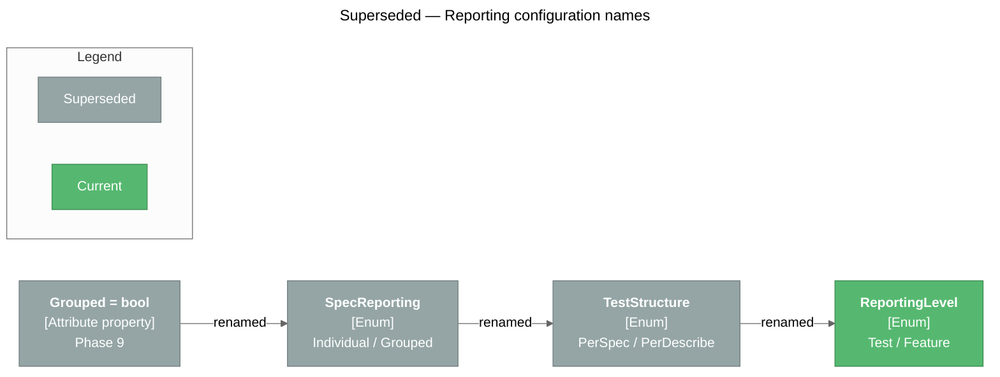

# Decision Log

> Architectural and technical decisions with context, rationale, and alternatives considered.

## How to Read This Log

Each decision records **what** was decided, **when**, **why**, the **alternatives** rejected, and the **consequences**. Dates are the month the decision landed. Decision numbers (`#N`) match the decision table in the memory bank (`memory-bank/systemPatterns.md`).

---

## Decisions

### 2026-02 — Consolidate execution in `TestCaseExecutor` (#7)

**Status:** Accepted

**Context:** The VSTest adapter had its own hand-rolled copy of the lifecycle, duplicating `specs.core`.

**Decision:** All per-test execution goes through `TestCaseExecutor.ProcessTestCase`; hosts supply adapters for context, tests, and logging.

**Rationale:** One lifecycle implementation, one place to fix ordering or failure semantics.

**Alternatives Considered:**

| Alternative | Rejected Because |
|-------------|-----------------|
| Keep separate lifecycle code per runner | Semantics drift between hosts |

**Consequences:**

- The adapter became a thin host; later runners reuse the same executor.
- Every new execution feature (cancellation, `Act` capture) is implemented once.

---

### 2026-10 — `SuiteTreeBuilder` is the single source of tree construction; `[Feature]` methods become named contexts (#9, #11)

**Status:** Accepted

**Context:** The tree was rebuilt per selected test and `[Feature]` methods were invoked directly, so `BeforeAll` / `AfterAll` ran once **per test** instead of once per context, and `[Feature]` methods could not own once-actions.

**Decision:** Build the suite once per class via `SuiteTreeBuilder`, registering each `[Feature]` method as a named child context. Expose `OwnSetupOnce` / `OwnTeardownOnce` on `ITestCase`, and walk only "live" nodes (`SelectionTreeWalker`) firing each node's own once-actions exactly once.

**Rationale:** Discovery and execution must agree on every path, and partial runs must honour `BeforeAll` semantics.

**Consequences:**

- Correct once-per-context lifecycle for any selection.
- Discovery and execution each build the tree; the context path is the address that ties them together.

---

### 2026-10 — Grouped execution is opt-in and resolved at discovery (#13, #14, #15, #17)

**Status:** Accepted (configuration names later revised — see [Superseded Decisions](#superseded-decisions))

**Context:** Large suites with hundreds of fine-grained specs can swamp Test Explorer; NSpec users expected a single tree-formatted result per feature.

**Decision:** A root `[Feature]` can run as one result with an NSpec-style tree report. The setting is layered (method → class → assembly → runner setting → default), resolved before test cases are serialized. The grouped runner is a separate component, not a mode flag on the walker. A class-level setting is not inherited.

**Rationale:** Granularity must be fixed before discovery output leaves the process; grouped mode has a different failure policy (keep going, aggregate).

**Consequences:**

- Default stays one result per spec.
- A grouped `[Feature]` counts as one test in run totals.

---

### 2026-10 — Constructor-registered `BeforeAll` / `AfterAll` run once per class (#18)

**Status:** Accepted (ownership later moved to the shared `SuiteRunner`, #37)

**Context:** Hooks registered in the suite constructor attach to the root node, whose once-actions were never fired.

**Decision:** The runner owns the root once-lifecycle: run root `BeforeAll` once before any work for the class, root `AfterAll` once in a `finally`. A root `BeforeAll` failure fails every selected runnable spec and skips root `AfterAll`.

---

### 2026-10 — The adapter applies `--filter` itself for source-based runs (#21)

**Status:** Accepted

**Context:** VSTest hands `RunTests(sources)` runs to the adapter unfiltered; ignoring the filter ran every spec.

**Decision:** `SpecsTestExecutor` re-discovers, applies `IRunContext.GetTestCaseFilter` over `FullyQualifiedName`, `DisplayName`, `ContextMethod`, `ContextPath`, `TestDescription`, and `IsPending`, and reports invalid expressions as errors.

---

### 2026-10 — Pending specs: metadata in the core, skipping in the runners (#22, #23, #24)

**Status:** Accepted

**Context:** Unwritten or parked specs had to be commented out, disappearing from Test Explorer.

**Decision:** `TODO` / `TODOAsync`, `xIt` / `xItAsync`, `xContext` / `xDescribe` record pending descriptions in the tree (`ITestCase.PendingTests`). Bodies are kept for navigation. Runners report them Skipped and run no lifecycle for pending-only selections.

**Alternatives Considered:**

| Alternative | Rejected Because |
|-------------|-----------------|
| Teach `TestCaseExecutor` about pending | Reporting a pending spec is host policy |
| Drop pending bodies | Specs must still be addressable and navigable |

---

### 2026-10 — `Act` exceptions via an ambient context; `ShouldThrow<T>` (#25–#28)

**Status:** Accepted

**Context:** Exception specs needed boilerplate, and an unexpected `Act` exception aborted the rest of a context and skipped teardown.

**Decision:** `ActExceptionContext.Run(act, test)` captures the `Act` exception in an `AsyncLocal`. `ShouldThrow<T>()` / `ShouldThrow<T>(verify)` match by assignability. An unhandled `Act` exception fails only its spec, replacing any `It` exception. No `ShouldThrowAsync`.

**Consequences:**

- Exception specs read like any other spec.
- Behavior change: `Act` failures no longer abort the node; `AfterEach` / `AfterAll` still run.

---

### 2026-10 — `specs.core`'s execution surface is public (#29)

**Status:** Accepted

**Context:** Only the in-repo adapter could reach `TestCaseExecutor` (via `InternalsVisibleTo`).

**Decision:** `TestCaseExecutor`, the adapter interfaces, `TestContextAdapter` (5-phase constructor + `FromTestCase`), and `TestInstance` are public; the adapter's `InternalsVisibleTo` grant was removed.

**Consequences:** The built-in runners consume exactly the surface third parties see.

---

### 2026-10 — Legacy `Spec` API removed; `Specifications` is the only authoring API (#31)

**Status:** Accepted (supersedes #5, "two coexisting API styles")

**Context:** Two styles doubled documentation and maintenance; the core now self-hosts on `Specifications`.

**Decision:** Delete the property-based `Spec` class, its `Domain/` layer, `Specs.csproj`, and the console example.

---

### 2026-10 — `src/` + `tests/` split; framework tests itself (#33)

**Status:** Accepted

**Decision:** Deliverables in `src/`, test projects in `tests/`, `Specs.sln` at the root. `specs.BDD.UnitTests` rewritten on Specs; the nspec-based `TestHarness` removed. Only the adapter tests stay on NUnit.

**Rationale:** A broken adapter must not hide its own failures, but everything else should dog-food the framework.

---

### 2026-10 — Central build configuration and tag-driven releases (#34, #35)

**Status:** Accepted

**Decision:** Shared settings in `Directory.Build.props`, versions in `Directory.Packages.props`, SDK in `global.json`. Versions come from `v*` git tags via MinVer; releases publish to nuget.org through Trusted Publishing (OIDC).

**Alternatives Considered:**

| Alternative | Rejected Because |
|-------------|-----------------|
| Per-project versions and metadata | Had already drifted (NFluent 3.0 vs 3.1, mixed `LangVersion`) |
| Stored NuGet API key | Long-lived secret; OIDC needs none |

**Consequences:** `ImplicitUsings` forced C# 10 on the netstandard2.1 deliverables; XML docs make undocumented public API a warning.

---

### 2026-11 — Microsoft.Testing.Platform runner over a shared runner core (#36–#40)

**Status:** Accepted

**Context:** VSTest's four-level tree can't show contexts as nodes, and the .NET 10 SDK and C# Dev Kit can run tests through MTP.

**Decision:** Add `specs.BDD.TestingPlatform`. Move runner-agnostic code to `src/shared/specs.BDD.Runner/` as linked source; report through `ISpecRunListener<TTest>`. Identify MTP nodes by tree path (also the `--treenode-filter` target). Give IDEs a tree and the CLI flat paths plus a console tree. Keep MTP tests in a separate `Specs.Mtp.slnx` with its own `global.json`.

**Alternatives Considered:**

| Alternative | Rejected Because |
|-------------|-----------------|
| Shared runner assembly / package | A sixth package and a public API for implementation details |
| Copying execution code into the MTP runner | Lifecycle semantics would drift |

**Consequences:** Same specs, same totals on both hosts (34 / 29 passed / 5 pending).

---

### 2026-11 — Declared `It[...]` locations for navigation (#42)

**Status:** Accepted

**Decision:** `It` / `ItAsync` indexers take `[CallerFilePath]` / `[CallerLineNumber]`; navigation order is body PDB → declared line → `[Feature]` method.

**Rationale:** `TODO` and parameterless `ShouldThrow<T>()` share delegates defined in `specs.BDD`, so only the call site knows their line.

---

### 2026-11 — Tests identify the `[Feature]` method (#43)

**Status:** Accepted

**Decision:** VSTest `FullyQualifiedName` = `Class.FeatureMethod` with RFC-0017 managed names and a deterministic hashed `TestCase.Id`; MTP method identifier = the `[Feature]` method name.

**Consequences:**

- CodeLens and symbol navigation work on `[Feature]` methods.
- **Breaking:** `--filter FullyQualifiedName~<context or spec text>` no longer matches; use `ContextPath` / `TestDescription`.

---

### 2026-11 — Packages named for their host; templates package (#45, #46)

**Status:** Accepted

**Decision:** Runner package IDs are `specs.BDD.VSTest` and `specs.BDD.MTP` (assemblies unchanged; VSTest only loads `*TestAdapter.dll`). The MTP props file is `build/specs.BDD.MTP.props` because NuGet auto-imports only `build/<PackageId>.props`. A content-only `specs.BDD.Templates` package ships `specs-vstest` / `specs-mtp` (C# and VB), stamped with its own version and smoke-tested on CI.

---

## Other Decisions

| # | Decision | Rationale |
|---|----------|-----------|
| 1 | Immutable `ContextualTestCase` after `Build()` | Predictable, shareable, cacheable |
| 2 | `Action`-based public surface; async run synchronously | Uniform API; blocking is acceptable in tests |
| 3 | Setup parent → child, teardown child → parent | Matches construction / disposal |
| 4 | Adapter-driven host integration | Core has zero test-framework dependencies |
| 10 | Cancellation via `CancellationToken` parameter | BCL convention; flows from `ITestExecutor.Cancel()` |
| 12 | Navigate to the `It[...]` lambda, not the `[Feature]` method | "Go to Source" lands where the developer clicked |
| 19 | Async test wrapper bound to the user's `Func<Task>` | Lets PDB lookup find the async body |
| 20 | Marker style depends on host | Visual Studio shows raw ANSI escapes |
| 41 | VSTest `Hierarchy[3]` is the `[Feature]` only | One Test Explorer group per `[Feature]`, not per context path |

---

## Superseded Decisions

### ~~Two coexisting API styles (#5)~~ → Replaced by `Specifications` only (#31)

**Original rationale:** Backward compatibility for property-based `Spec` suites while introducing the method-based API.

**Why superseded:** The maintenance and documentation cost outweighed the benefit once the core self-hosted on `Specifications`.

### ~~`[Context]` → `[Describe]` attribute~~ → Replaced by `[Feature]` (#30, #44)

**Original rationale:** Mark the root block of a suite with BDD vocabulary.

**Why superseded:** `[Context]` and then `[Describe]` collided with the `Context[...]` / `Describe[...]` indexers, so authors couldn't tell the top-level marker from a nested block.

### ~~`bool` grouping flags → `SpecReporting` → `TestStructure`~~ → Replaced by `ReportingLevel` (#16, #32, #44)

**Original rationale:** Name the grouping choice and leave room for more modes.

**Why superseded:** `PerSpec` / `PerDescribe` described VSTest mechanics rather than what one result represents. `ReportingLevel.Test` / `ReportingLevel.Feature` says it directly. Old `.runsettings` keys are no longer read.

## Related Pages

- [Architecture](Architecture) — Current architecture reflecting these decisions
- [Design Patterns](Design-Patterns) — Patterns that emerged from decisions
