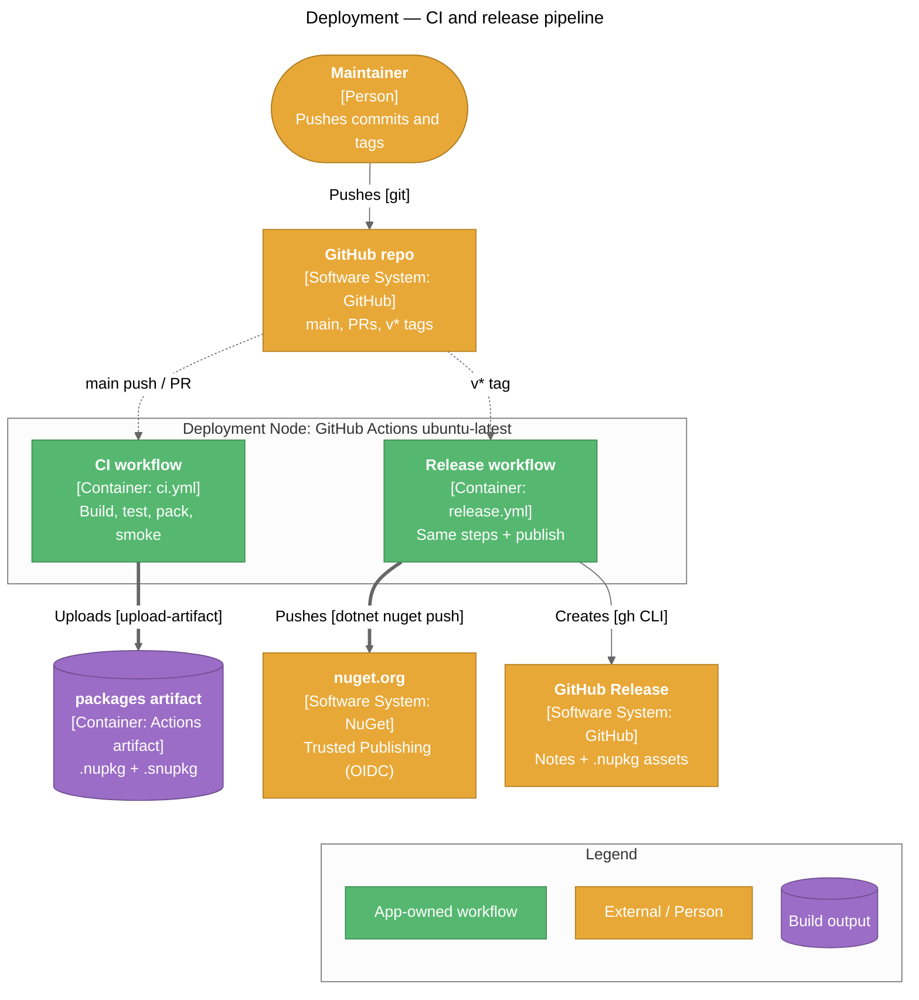

# Deployment

> How Specs is built, versioned, packaged, and published to nuget.org.

Specs has no runtime environments. Its deliverables are four NuGet packages, built and published by GitHub Actions.

## Deployment Pipeline



## Pipeline Files

| Pipeline | Trigger | Purpose |
|----------|---------|---------|
| [.github/workflows/ci.yml](../../.github/workflows/ci.yml) | Push to `main`, any pull request | Restore → build (Release) → test `Specs.sln` → test `Specs.Mtp.slnx` (from `tests/mtp`) → pack → smoke-test templates → upload `packages` artifact |
| [.github/workflows/release.yml](../../.github/workflows/release.yml) | Push of a `v*` tag | Same build / test / pack / smoke test, then NuGet login (OIDC) → push all `.nupkg` (+ `.snupkg`) to nuget.org with `--skip-duplicate` → create a GitHub Release (`--prerelease` when the tag contains `-`) |
| [.github/workflows/wiki.yml](../../.github/workflows/wiki.yml) | Push to `main` touching `documents/wiki/**`, or manual dispatch | Mirror `documents/wiki/` (minus `wiki-preferences.md`) into the GitHub Wiki, rewriting repo-relative source links to `github.com/.../blob/main/...` |

Both workflows check out with `fetch-depth: 0` (MinVer needs tags and history) and use `actions/setup-dotnet` with `global-json-file: global.json`. Every root command names `Specs.sln` because the root holds two solutions.

### Template smoke test

Before uploading or publishing, both workflows prove the packed packages work outside the repo:

1. Add `artifacts/` as a local NuGet source and install the packed `specs.BDD.Templates`.
2. Scaffold `specs-vstest` and `specs-mtp` in C# and VB.
3. Run them: `dotnet test` for the VSTest projects, `dotnet run` for the MTP projects.

A broken template or package fails CI and blocks the release.

## Packages

| Package ID | Project | Contents |
|------------|---------|----------|
| `specs.core` | `src/specs.core` | Core library, XML docs, symbols |
| `specs.BDD.VSTest` | `src/specs.BDD.VSTestAdapter` | VSTest adapter (assembly `specs.BDD.VSTestAdapter.dll`) + embedded `specs.BDD.dll` |
| `specs.BDD.MTP` | `src/specs.BDD.TestingPlatform` | MTP framework + embedded `specs.BDD.dll` + `build/specs.BDD.MTP.props` (also in `buildMultiTargeting/`) |
| `specs.BDD.Templates` | `src/specs.BDD.Templates` | `PackageType=Template`; content only (no assembly, dependencies, or symbols) |

The authoring API (`src/specs.specification`) is `IsPackable=false`. Both runners reference it with `PrivateAssets="all"`, and a target in [Directory.Build.props](../../Directory.Build.props) packs its `.dll` and `.xml` into each runner's `lib/` folder and its `.pdb` into the runner's `.snupkg`. In-repo projects that use the authoring API must reference `specs.BDD.csproj` directly, because it no longer flows through the runner reference.

Shared package metadata comes from [Directory.Build.props](../../Directory.Build.props): author, MIT license expression, repository/project URL, `.snupkg` symbols with SourceLink, XML documentation, and `ContinuousIntegrationBuild` when running on GitHub Actions.

> NuGet only auto-imports `build/<PackageId>.props`, which is why the MTP props file is named `specs.BDD.MTP.props` rather than after the assembly.

## Versioning

Versions come from git tags via [MinVer](https://github.com/adamralph/minver) (tag prefix `v`). There are no version-bump commits; all packages ship at the same version.

| Git state | Package version |
|-----------|-----------------|
| Commit tagged `v1.2.0` | `1.2.0` |
| Commit tagged `v1.3.0-beta.1` | `1.3.0-beta.1` (GitHub Release marked prerelease) |
| N commits after `v1.2.0` | `1.2.1-alpha.0.N` |
| No `v*` tag reachable (current state) | `0.0.0-alpha.0.N` |

`specs.BDD.Templates` stamps its own version into each `template.json` at pack time (`StampTemplateVersion` target), so a template defaults to runner packages from the same release.

## Releasing

### One-time setup (not yet done)

| Requirement | Where |
|-------------|-------|
| Repository secret `NUGET_USER` = the nuget.org **profile name** (not email) | GitHub repo › Settings › Secrets |
| nuget.org Trusted Publishing policy for this repository and `release.yml` | nuget.org account settings |
| Optional: `nuget` environment with required reviewers (manual approval gate) | GitHub repo › Settings › Environments |

No API key is stored: the workflow exchanges its OIDC token for a short-lived key. `release.yml` declares `contents: write` and `id-token: write`.

### Cutting a release

```powershell
git checkout main
git pull
git tag v1.0.0
git push origin v1.0.0
```

Use a hyphenated tag (e.g. `v1.1.0-beta.1`) for a prerelease.

### Local pack (no publish)

```powershell
dotnet pack Specs.sln -c Release -o artifacts
```

## Rollback Procedure

Published NuGet versions cannot be overwritten.

1. Identify the bad version from the GitHub Release or nuget.org.
2. Unlist it on nuget.org so it no longer appears in search or floating-version restores.
3. Fix forward on `main` and push a new, higher `v*` tag.

## Post-Release Verification

| Check | Command | Expected |
|-------|---------|----------|
| Packages visible | `dotnet package search specs.BDD --exact-match` | The new version is listed for each package |
| Template installs | `dotnet new install specs.BDD.Templates::<version>` | Templates `specs-vstest` / `specs-mtp` listed |
| Scaffold runs | `dotnet new specs-vstest -n Check.Specs; dotnet test Check.Specs` | 1 passed |

## Related Pages

- [Architecture](Architecture) — Packaging view and package dependencies
- [Getting Started](Getting-Started) — Building and packing locally
- [Troubleshooting](Troubleshooting) — Consumer-side issues after installing
