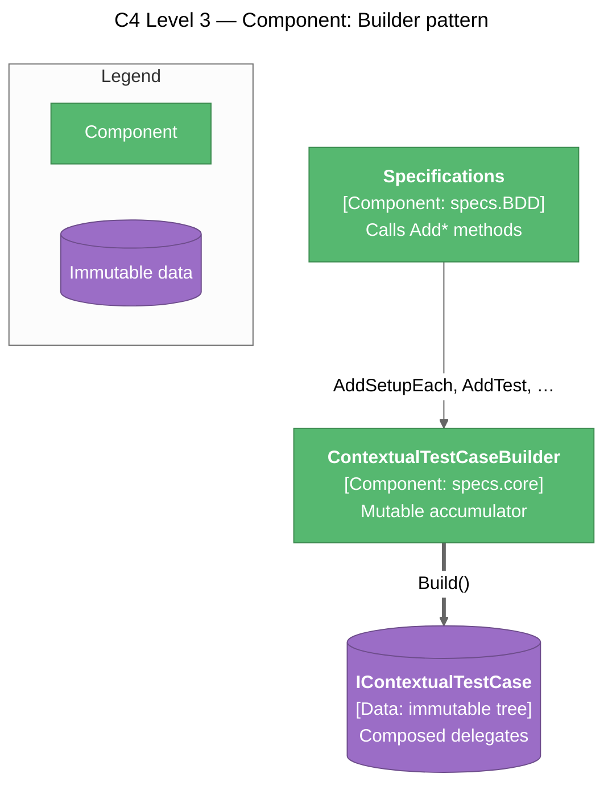
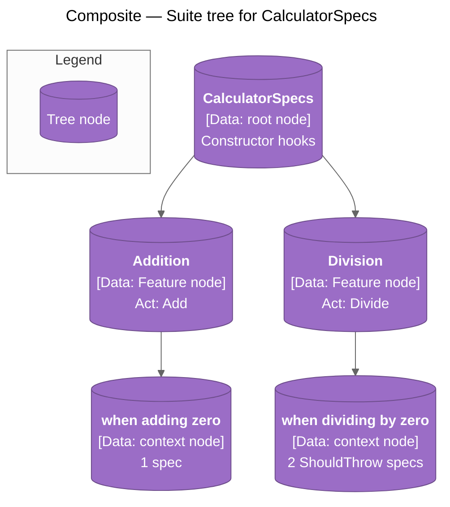
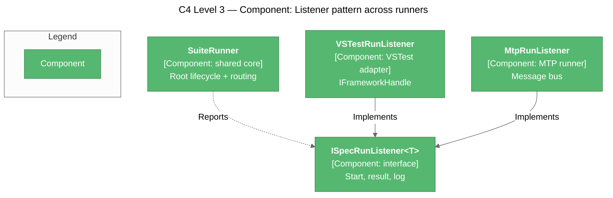
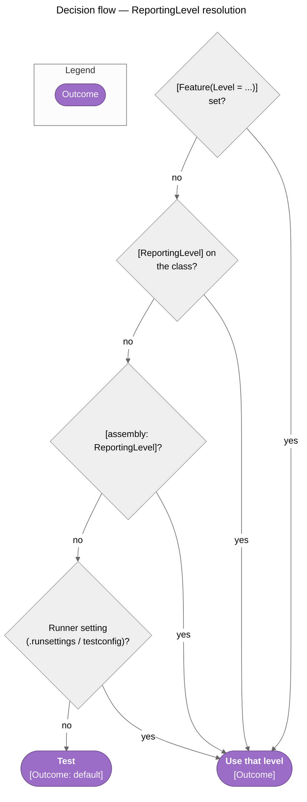

# Design Patterns

> The patterns that shape Specs' core, authoring API, and runners.

## Pattern Summary

| Pattern | Purpose | Location |
|---------|---------|----------|
| Builder | Accumulate lifecycle and specs, then freeze them | `ContextualTestCaseBuilder` in `specs.core` |
| Composite | Nested contexts that inherit setup from ancestors | `ContextualTestCase` / `ITestCaseContext` tree |
| Scoped builder (context-switching callback) | Make hooks inside `Describe` / `Context` attach to that block | `Specifications.contextCallBack` in `specs.BDD` |
| Template Method | One fixed lifecycle order for every spec | `TestCaseExecutor.ProcessTestCase` |
| Adapter | Keep the core free of any test-host dependency | `ITestContextAdapter`, `ITestProviderAdapter`, `ILoggingAdapter` |
| Listener (observer) | Share execution between runners; vary only result reporting | `ISpecRunListener<TTest>` → `VSTestRunListener`, `MtpRunListener` |
| Ambient context | Hand the `Act` exception to the spec without new API | `ActExceptionContext` (`AsyncLocal`) |
| Layered configuration | Resolve `ReportingLevel` from method → class → assembly → runner settings | `GroupingSettings` |

---

## Builder

### Problem

A spec tree is declared imperatively (calls in any order, across nested blocks) but must execute predictably and be safe to share between discovery and execution.

### Solution

`IContextualTestCaseBuilder` is the only mutable surface. `Build()` produces an immutable `IContextualTestCase` whose lifecycle actions are pre-composed delegates.



### Implementation

From [ContextualTestCaseBuilder.cs](../../src/specs.core/Framework/Processors/TestCases/ContextualTestCaseBuilder.cs) — ancestors' actions are collected first, then composed into single delegates:

```csharp
setupEach.AddRange(CollectAncestorAndSelfSetupEachActions());
act.AddRange(CollectAncestorAndSelfActActions());

return ContextualTestCase.CreateTestCase(
    setupOnce: () => { foreach (var action in setupOnce) { action.Invoke(); } },
    setupEach: () => { foreach (var action in setupEach) { action.Invoke(); } },
    act: () => { foreach (var action in act) { action.Invoke(); } },
    // ...
    ownSetupOnce: ownSetupOnce,
    ownTeardownOnce: ownTeardownOnce,
    tests: new List<(string description, Action test)>(this.testActions),
    childContexts: childBuilders.ConvertAll(builder => this.BuildAsContext(builder)),
    pendingTests: this.pendingTests,
    testLocations: this.testLocations);
```

### Usage

```csharp
IContextualTestCase root = new ContextualTestCaseBuilder()
    .AddSetupEach(() => result = 0)
    .AddAct(() => result = 2 + 3)
    .AddTest("returns the sum", () => { if (result != 5) throw new Exception(); })
    .Build();
```

### Why This Pattern

Separates definition from execution. Discovery and execution can build the same tree independently and agree on every path, and the built tree can be walked or executed repeatedly without hidden state.

---

## Composite

### Problem

BDD scenarios nest arbitrarily (`Feature → Describe → Context → …`), and each level must inherit its ancestors' setup.

### Solution

Every node is an `ITestCase`; `IContextualTestCase.ChildContexts` holds `ITestCaseContext` children (an `ITestCase` with a `Description`). Each node exposes both **cascaded** actions (`SetupOnce`, `SetupEach`, `Act`, `TeardownEach`, `TeardownOnce` — ancestors included) and **own** once-actions (`OwnSetupOnce`, `OwnTeardownOnce`).



### Why This Pattern

Runners treat every level uniformly. The once-per-node walk only needs `OwnSetupOnce` / `OwnTeardownOnce`; `TestCaseExecutor` only needs a node's cascaded per-test actions.

---

## Scoped Builder (Context-Switching Callback)

### Problem

`BeforeEach(...)` and `It[...]` are instance members of `Specifications`, yet a call inside `Context["..."] = () => { ... }` must attach to that context, not the outer one.

### Solution

`Specifications` holds a pointer to the active builder. `ContextBuilder` creates a child builder and calls back; the callback swaps the pointer for the duration of the block.

### Implementation

From [Specifications.cs](../../src/specs.specification/Specifications.cs):

```csharp
private void contextCallBack(IContextualTestCaseBuilder childCoreBuilder, Action action)
{
    var previousCoreBuilder = this.coreBuilder;
    this.coreBuilder = childCoreBuilder;
    try
    {
        action.ThrowIfNull(nameof(action)).Invoke();
    }
    finally
    {
        this.coreBuilder = previousCoreBuilder;
    }
}
```

### Why This Pattern

Gives the readable NSpec-style grammar without passing a context object into every lambda.

---

## Template Method

### Problem

Every runner, and every mode within a runner, must run hooks in exactly the same order.

### Solution

`TestCaseExecutor.ProcessTestCase(CancellationToken)` is the single fixed algorithm; hosts supply only the steps (`ITestContextAdapter`), the tests (`ITestProviderAdapter`), and reporting (`ILoggingAdapter`).

### Implementation

From [TestCaseExecutor.cs](../../src/specs.core/Framework/Processors/TestExecutors/TestCaseExecutor.cs):

```csharp
testContext.SetupOnce();

foreach (var test in tests)
{
    if (cancellationToken.IsCancellationRequested)
        break;

    testContext.SetupEach();

    try
    {
        ActExceptionContext.Run(testContext.Act, test.Test);
        logger.LogAssertSuccess(test.Description);
    }
    catch (Exception ex)
    {
        logger.LogAssertFailure(ex, test.Description);
        if (settings.StopOnAssertFailure)
        {
            throw;
        }
    }

    testContext.TeardownEach();
}

testContext.TeardownOnce();
```

### Why This Pattern

One implementation of the lifecycle means one place to get it right. It is public so third-party runners get the same semantics.

---

## Adapter

### Problem

The core must not depend on VSTest, Microsoft.Testing.Platform, or any other host.

### Solution

Three small public interfaces in [specs.core/Framework/Adapters](../../src/specs.core/Framework/Adapters):

| Interface | Responsibility | Built-in implementation |
|-----------|---------------|-------------------------|
| `ITestContextAdapter` | Lifecycle phases | `TestContextAdapter` (5 delegates, or `FromTestCase(node)`) |
| `ITestProviderAdapter` | Selected `TestInstance`s | `SelectionTestProvider<TTest>` (shared runner core) |
| `ILoggingAdapter` | Pass / fail / exception reporting | `SelectionLoggingAdapter<TTest>` → `ISpecRunListener<TTest>` |

### Why This Pattern

`specs.core` has zero runtime dependencies, and adding a host means implementing three interfaces.

---

## Listener (Shared Runner Core)

### Problem

Two runners need identical discovery, root lifecycle, pending/grouped routing, and grouped reports, but report results through completely different host APIs.

### Solution

The runner-agnostic code in [src/shared/specs.BDD.Runner](../../src/shared/specs.BDD.Runner) is generic over the host's test handle and reports through `ISpecRunListener<TTest>`. Each runner contributes only a listener.



The shared code is **linked source** (each runner `.csproj` includes `..\shared\specs.BDD.Runner\**\*.cs`), not an assembly, so its types stay `internal` and no extra package is needed.

### Why This Pattern

Lifecycle, pending, grouped, and `ShouldThrow` semantics cannot diverge between hosts; the same integration specs produce the same totals on both.

---

## Ambient Context (`ActExceptionContext`)

### Problem

Specs asserting on an `Act` exception needed `try/catch` in `Act`, a shared local, and a reset hook. An unexpected `Act` exception also aborted the rest of the context.

### Solution

`ActExceptionContext.Run(act, test)` captures the `Act` exception in an `AsyncLocal` slot, then runs the test. `ShouldThrow<T>` returns a delegate that reads the slot and marks it handled; if nothing handles it, the `Act` exception is rethrown as the spec's failure.

### Usage

```csharp
Act(() => calculator.Divide(1, 0));

It["throws"] = ShouldThrow<DivideByZeroException>();
It["explains why"] = ShouldThrow<DivideByZeroException>(ex =>
    Check.That(ex.Message.ToLowerInvariant()).Contains("zero"));
```

### Why This Pattern

`It` stays an `Action`; no new builder API or lifecycle phase is needed, and every execution path (per-spec, grouped, single invoke) shares the same capture code.

---

## Layered Configuration

`GroupingSettings` resolves each root `[Feature]`'s `ReportingLevel`, first match wins:



`FeatureAttribute` uses a nullable backing field (`LevelSetting`) so an explicit `Level = ReportingLevel.Test` overrides a grouped class or assembly. The class-level attribute is not inherited by derived suites.

## Error Handling Strategy

| Layer | Strategy | Example |
|-------|----------|---------|
| Builder / public API | Validate arguments eagerly | `ThrowIfNull` / `ThrowIfNullOrWhiteSpace` on descriptions, delegates, and executor constructor arguments |
| Per spec | Fail only that spec; continue | `Act` or `It` exceptions → `LogAssertFailure`; `AfterEach` still runs |
| Per context | `BeforeAll` failure fails the subtree | Selected specs under the node are reported failed; that node's `AfterAll` is skipped |
| Cleanup | Best-effort | `AfterAll` exceptions are swallowed |
| Discovery | Never abort the run | `InvalidSpecificationException` and other per-class errors become host warnings; `ReflectionTypeLoadException` keeps the types that loaded; a missing PDB yields no location |
| Unreached specs | Report explicitly | Specs not reached because of a lifecycle fault are reported failed, never left "not run" |

## Related Pages

- [Architecture](Architecture) — How the patterns fit together
- [Testing](Testing) — How patterns affect testability
- [Decision Log](Decision-Log) — Why these patterns were chosen
