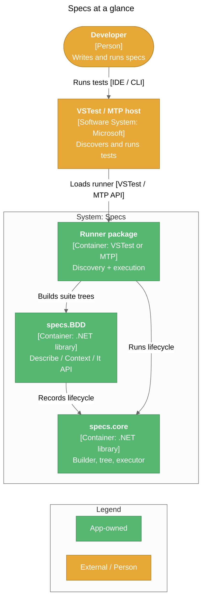

# Specs

<!--
  PUBLISHING: .github/workflows/wiki.yml syncs documents/wiki/ to the GitHub Wiki on every push to main
  that touches this folder (or on manual dispatch). One-time setup: enable the Wiki tab and create any
  first page so the wiki repository exists.
-->

> `describe` / `context` / `it`-style specs for .NET, in plain C# or VB. They run right in Visual Studio, VS Code, or `dotnet test`.

## Quick Links

| Resource | Link |
|----------|------|
| Source code | [github.com/yozepi/Specs](https://github.com/yozepi/Specs) |
| Start writing specs | [Usage Guide](Usage-Guide) |
| Build the repo | [Getting Started](Getting-Started) |
| CI workflow | `.github/workflows/ci.yml` (push to `main`, pull requests) |
| Release workflow | `.github/workflows/release.yml` (push of a `v*` tag) |
| NuGet packages | `specs.core`, `specs.BDD.VSTest`, `specs.BDD.MTP`, `specs.BDD.Templates` (first release pending) |

## What Is This?

Ever written an RSpec or Jest test and wished .NET felt like that? That's Specs.

You know how it goes with flat test methods. Ten tests share most of their setup, differ in one tiny detail, and you end up with either a pile of copy-paste or a helper method nobody can follow. Specs lets you write tests as a tree instead. You nest `Describe` and `Context` blocks, set things up once at the right level, and every `It` underneath picks that setup up automatically. Your tests end up reading like a description of how the code behaves, because that's literally what they are.

If you've used any of these, you already get the idea:

| If you know… | Then Specs is… |
|--------------|----------------|
| **RSpec** (Ruby), **Jasmine / Jest / Mocha** (JavaScript) | That same `describe` → `context` → `it` style, in C# and VB |
| **NSpec** | Its closest .NET relative. Same grammar, plus first-class async, pending specs, and both of .NET's test hosts |
| **xUnit / NUnit / MSTest** | A different shape. Instead of flat `[Test]` methods with one setup/teardown, you get nested contexts and five lifecycle hooks |
| **SpecFlow / Reqnroll** | BDD without the Gherkin. No `.feature` files and no step-definition glue, just code you can refactor like any other code |

Here's a taste:

```csharp
using NFluent;
using specs.BDD;
using specs.BDD.Attributes;

public class CalculatorSpecs : Specifications
{
    int num1, num2, result;

    [Feature("Addition")]
    public void describe_addition()
    {
        Act(() => result = num1 + num2);

        Context["when adding two positive numbers"] = () =>
        {
            BeforeEach(() => { num1 = 2; num2 = 3; });

            It["returns the sum"] = () => Check.That(result).IsEqualTo(5);
        };
    }
}
```

```vb
Imports NFluent
Imports specs.BDD
Imports specs.BDD.Attributes

Public Class CalculatorSpecs
    Inherits Specifications

    Private num1 As Integer
    Private num2 As Integer
    Private result As Integer

    <Feature("Addition")>
    Public Sub describe_addition()
        Act(Sub() result = num1 + num2)

        Context("when adding two positive numbers") =
            Sub()
                BeforeEach(
                    Sub()
                        num1 = 2
                        num2 = 3
                    End Sub)

                It("returns the sum") = Sub() Check.That(result).IsEqualTo(5)
            End Sub
    End Sub
End Class
```

What else comes in the box:

- **Pick your host.** Add `specs.BDD.VSTest` for the classic `dotnet test` / Test Explorer setup, or `specs.BDD.MTP` for Microsoft.Testing.Platform. Your specs behave the same either way.
- **Async everywhere.** Every hook and spec takes an `async` lambda.
- **Pending specs.** `TODO`, `xIt`, and `xContext` keep unfinished work visible as Skipped, so you don't have to comment it out.
- **Exception specs without the boilerplate.** `It["throws"] = ShouldThrow<DivideByZeroException>();`
- **One-command start.** `dotnet new specs-vstest` (or `specs-mtp`, add `-lang VB` for VB) gives you a project that's already green.

Oh, and Specs is tested with Specs. Its own unit tests are Specs suites.

Ready to try it? Head over to the [Usage Guide](Usage-Guide).

## Architecture at a Glance



See [Architecture](Architecture) for the full C4 views.

## Pages

### Using Specs

- [Usage Guide](Usage-Guide) — Quick launch, installation, writing specs, running and filtering, settings, cheat sheet
- [Troubleshooting](Troubleshooting) — Specs not discovered, MTP not used, Test Explorer differences

### Development

- [Getting Started](Getting-Started) — Prerequisites, clone, build, and test the repo
- [Architecture](Architecture) — C4 context, container, and component views
- [Design Patterns](Design-Patterns) — Builder, composite, adapter, template method, and more
- [Testing](Testing) — How the framework's own test suites are organized and run

### Operations

- [Deployment](Deployment) — Packaging, versioning, CI, and NuGet releases
- [Decision Log](Decision-Log) — Architectural decisions and rationale

## Tech Stack

| Layer | Technology |
|-------|-----------|
| Deliverables | .NET Standard 2.1, C# 10 (C# 12 for the MTP runner), nullable reference types, implicit usings |
| VSTest runner | Microsoft.TestPlatform.ObjectModel 17.8.0, System.Reflection.Metadata 6.0.0 |
| MTP runner | Microsoft.Testing.Platform 2.5.1 + Microsoft.Testing.Platform.MSBuild 2.5.1 |
| Test projects | net10.0; Specs itself, NUnit 3.14 (runner tests), NFluent 3.1, Moq 4.20, Autofac.Extras.Moq 7.0 |
| Build | .NET SDK 10.0.400 (`global.json`), central package management, MinVer 8.0 (git-tag versions) |
| CI/CD | GitHub Actions; nuget.org Trusted Publishing (OIDC) |

## Status

| Metric | Value |
|--------|-------|
| Build | 0 warnings (Release, XML docs on) |
| VSTest results (`Specs.sln`) | 800 — 787 passed, 13 pending (reported as Skipped by design) |
| MTP results (`Specs.Mtp.slnx`) | 104 — 99 passed, 5 pending |
| Package version | `0.0.0-alpha.0.N` until the first `v*` tag is pushed |
| Last Updated | 2026-11-09 |
