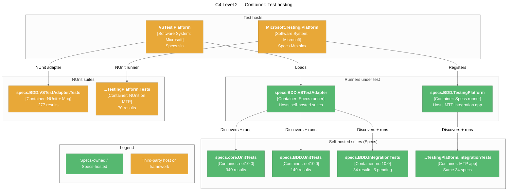

# Testing

> How the framework's own test suites are organized, hosted, and run. Specs is largely tested **with Specs**.

## Test Architecture

Three of the four VSTest-mode projects are written as `Specifications` suites and run through the Specs VSTest adapter. The adapter's own tests stay on NUnit so a broken adapter cannot hide its own failures. The MTP runner is tested with NUnit on MTP plus an MTP test app that compiles the same integration specs as the VSTest integration project.



## Test Projects

| Project | Type | Framework | Covers |
|---------|------|-----------|--------|
| [tests/specs.core.UnitTests](../../tests/specs.core.UnitTests) | Unit | Specs (`Specifications` + `[Feature]`), NFluent, Autofac.Extras.Moq | Builder, immutable tree, `TestCaseExecutor`, `ActExceptionContext`, adapters, pending metadata, test locations |
| [tests/specs.BDD.UnitTests](../../tests/specs.BDD.UnitTests) | Unit | Specs, NFluent | `Specifications`, `ContextBuilder`, `AssertBuilder` / `AssertBuilderAsync`, `FeatureAttribute`, pending syntax, `ShouldThrow` |
| [tests/specs.BDD.VSTestAdapter.Tests](../../tests/specs.BDD.VSTestAdapter.Tests) | Unit | NUnit 3.14, NFluent, Moq 4.20 | Discovery, conversion, execution, grouping, filtering, source locations |
| [tests/specs.BDD.IntegrationTests](../../tests/specs.BDD.IntegrationTests) | Integration | Specs, NFluent | End-to-end VSTest pipeline: `CalculatorSpecs`, `StringSpecs`, `AsyncAndExceptionSpecs`, `PendingSpecs` |
| [tests/mtp/specs.BDD.TestingPlatform.Tests](../../tests/mtp/specs.BDD.TestingPlatform.Tests) | Unit + E2E | NUnit on MTP (`NUnit3TestAdapter` 6.3.1), NFluent, Moq | Tree building, paths, selection, node factory, console report, settings; launches the MTP integration app |
| [tests/mtp/specs.BDD.TestingPlatform.IntegrationTests](../../tests/mtp/specs.BDD.TestingPlatform.IntegrationTests) | Integration | Specs MTP runner | Links `tests/specs.BDD.IntegrationTests/*.cs`; must match the VSTest totals (34 / 29 passed / 5 pending) |

All test projects target `net10.0` and are non-packable via [tests/Directory.Build.props](../../tests/Directory.Build.props).

## Running Tests

### All VSTest-mode suites

```powershell
dotnet test Specs.sln
```

Expected: 800 results — 787 passed, 13 skipped (pending specs, by design).

### All MTP-mode suites

```powershell
cd tests/mtp
dotnet test --solution ../../Specs.Mtp.slnx
```

Expected: 104 results — 99 passed, 5 skipped.

### Specific project

```powershell
dotnet test tests/specs.core.UnitTests/specs.core.UnitTests.csproj
```

### Filtering self-hosted suites

The self-hosted projects use the Specs VSTest adapter, so the Specs filter properties apply:

```powershell
dotnet test tests/specs.core.UnitTests/specs.core.UnitTests.csproj --filter "ContextPath~TestCaseExecutor"
dotnet test Specs.sln --filter IsPending=true
```

### With coverage

`coverlet.collector` is referenced by the core and BDD test projects:

```powershell
dotnet test tests/specs.core.UnitTests/specs.core.UnitTests.csproj --collect:"XPlat Code Coverage"
```

## Frameworks & Libraries

Versions are centrally managed in [Directory.Packages.props](../../Directory.Packages.props).

| Library | Purpose | Version |
|---------|---------|---------|
| Specs (this repo) | Test framework for the self-hosted suites | project reference |
| NUnit / NUnit3TestAdapter | Adapter tests (VSTest); MTP runner tests override the adapter to 6.3.1 | 3.14.0 / 4.5.0 |
| Microsoft.NET.Test.Sdk | VSTest host for the VSTest-mode projects | 17.8.0 |
| NFluent | Assertions | 3.1.0 |
| Moq | Mocking (`IFrameworkHandle`, `IRunContext`, `ITestCaseFilterExpression`, MTP services) | 4.20.72 |
| Autofac.Extras.Moq | Auto-mocking in core tests | 7.0.0 |
| coverlet.collector | Coverage | 6.0.4 |

## Conventions

### Naming

| Element | Convention | Example |
|---------|-----------|---------|
| Test file / class | `<TypeUnderTest>_Tests` | `ContextBuilder_Tests`, `TestCaseExecutor_Tests` |
| Root `[Feature]` method (self-hosted) | Named after the type under test | `[Feature] public void ContextBuilder()` |
| NUnit test method | `Method_Scenario_Expectation` | `Invoke_PassingTest_ReturnsPassed` |
| Shared spec bodies | Abstract base deriving `Specifications`, concrete `[Feature]` per subclass | `BaseAssertBuilderSpecs<TSubject, TDelegate>` → `AssertBuilder_Tests` / `AssertBuilderAsync_Tests` |

### Self-hosted structure

From [ContextBuilder_Tests.cs](../../tests/specs.BDD.UnitTests/ContextBuilder_Tests.cs):

```csharp
public class ContextBuilder_Tests : Specifications
{
    [Feature]
    public void ContextBuilder()
    {
        Describe["ContextBuilder"] = () =>
        {
            BDD.ContextBuilder subject = null!;
            ContextCallBack callBack = null!;

            BeforeEach(() => callBack = (childBuilder, action) => { });

            Act(() => subject = new BDD.ContextBuilder(new ContextualTestCaseBuilder(), callBack));

            Context["when using indexer syntax"] = () =>
            {
                Context["with null description"] = () =>
                {
                    It["should throw ArgumentNullException"] = () =>
                    {
                        Check.ThatCode(() => subject[null!] = () => { })
                            .Throws<ArgumentNullException>()
                            .WithProperty(ex => ex.ParamName, "description");
                    };
                };
            };
        };
    }
}
```

Local state is declared inside the `[Feature]` method and reset in `BeforeEach`, so every spec starts clean.

### File organization

```
tests/
├── specs.core.UnitTests/Framework/        — mirrors src/specs.core/Framework
│   ├── Adapters/
│   ├── Assertions/
│   └── Processors/{TestCases,TestExecutors}/
├── specs.BDD.UnitTests/                   — one file per specs.BDD type, Attributes/
├── specs.BDD.VSTestAdapter.Tests/         — Discovery/, Conversion/, Execution/, TestFixtures/
├── specs.BDD.IntegrationTests/            — end-to-end suites + Calculator subject
└── mtp/specs.BDD.TestingPlatform.Tests/   — Discovery/, Execution/, Output/, TestFixtures/
```

## Mocking Patterns

### Auto-mocking in core specs

[TestCaseExecutor_Tests.cs](../../tests/specs.core.UnitTests/Framework/Processors/TestExecutors/TestCaseExecutor_Tests.cs) creates a fresh `AutoMock` per spec:

```csharp
BeforeEach(() =>
{
    mocker = AutoMock.GetLoose();
    mocker.Mock<ILoggingAdapter>();
    mocker.Mock<ITestContextAdapter>();

    tests = new List<TestInstance>();
    tests.Add(new TestInstance(testCaseDescription, testCaseTest));
});
```

### Real fixtures in adapter tests

Adapter tests avoid mocking the Specs pipeline itself. They build real VSTest `TestCase` objects pointing at small fixture suites in `TestFixtures/`, then run them. From [TestInvoker_Tests.cs](../../tests/specs.BDD.VSTestAdapter.Tests/Execution/TestInvoker_Tests.cs):

```csharp
[Test]
public void Invoke_PassingTest_ReturnsPassed()
{
    var testCase = MakeTestCase<SimpleSpec>(
        "describe_something", "simple context", "test one");

    var result = TestInvoker.Invoke(testCase);

    Check.That(result.Outcome).IsEqualTo(TestOutcome.Passed);
}
```

Host boundaries (`IFrameworkHandle`, `IRunContext`, `ITestCaseFilterExpression`) are mocked with Moq.

## Integration Tests

### Prerequisites

| Dependency | How It's Provided |
|-----------|-------------------|
| VSTest host | `Microsoft.NET.Test.Sdk` via `dotnet test Specs.sln` |
| MTP host | The integration app is an `Exe`; it imports `build/specs.BDD.MTP.props` directly (project references don't import package props) |
| External services | None — `AsyncDataService` and `Calculator` are in-process fakes |

Both integration projects run the **same source files**, so lifecycle, pending, grouped, and `ShouldThrow` behavior is verified identically on both hosts. `CalculatorSpecs` is class-level `ReportingLevel.Test` with one grouped `[Feature]` (`Subtraction (grouped)`), so both reporting modes are exercised.

## Related Pages

- [Getting Started](Getting-Started) — Building the repo and running tests as part of setup
- [Architecture](Architecture) — The components under test
- [Design Patterns](Design-Patterns) — Patterns that shape testability
