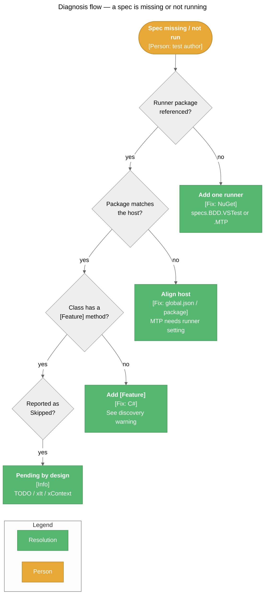

# Troubleshooting

> Common problems when writing and running Specs suites, with causes and fixes.

Specs is a library, so there are no health endpoints. Diagnostics come from the test host's output: discovery warnings, test results, and grouped reports.

## Diagnostics at a Glance



## Common Issues

### Discovery

#### Symptom: A suite's specs don't appear in Test Explorer or `dotnet test --list-tests`

**Cause:** The class has no `[Feature]`-decorated method. Discovery starts from `[Feature]` methods; specs declared only in the constructor or in undecorated methods are never registered.

**Diagnosis:** The VSTest output (Tests output pane, or `dotnet test -v normal`) shows:

```text
[specs.BDD.VSTestAdapter] Specification class 'MyApp.Specs.CartSpecs' has no methods decorated with [Feature] attribute. All Specification classes must have at least one [Feature] method.
```

**Resolution:**

1. Add `using specs.BDD.Attributes;`.
2. Move the specs into a method decorated with `[Feature("...")]`.
3. Rebuild and refresh Test Explorer.

---

#### Symptom: No Specs tests are discovered at all

**Cause:** No runner package, or the package doesn't match the host. `specs.BDD` alone has no runner. A VSTest project needs `specs.BDD.VSTest` **and** `Microsoft.NET.Test.Sdk`; an MTP project needs `specs.BDD.MTP`.

**Diagnosis:**

```powershell
dotnet list package
```

**Resolution:**

1. VSTest: `dotnet add package Microsoft.NET.Test.Sdk` and `dotnet add package specs.BDD.VSTest`.
2. MTP: `dotnet add package specs.BDD.MTP` (and remove `specs.BDD.VSTest` — reference one runner per project).
3. See [Usage Guide › Installation](Usage-Guide#installation).

---

#### Symptom: Warning `Error processing '<class>'` during discovery

**Cause:** The runner could not instantiate the suite or run a `[Feature]` method body. Common reasons: no public parameterless constructor, a constructor that throws, or code in a `[Feature]` body (outside hooks and specs) that throws.

**Resolution:**

1. Give the suite a public parameterless constructor.
2. Move work out of the `[Feature]` body and into `BeforeAll` / `BeforeEach` / `Act`. The method body runs at discovery time; only hooks and specs are deferred.

---

#### Symptom: "Go to Source" lands on the `[Feature]` method instead of the `It[...]` line

**Cause:** The PDB for the test assembly is missing or not portable, so neither the spec body nor the declared `It[...]` line can be resolved.

**Resolution:** Build with portable PDBs (the SDK default, `DebugType=portable`) and make sure the `.pdb` sits next to the test `.dll`.

### Microsoft.Testing.Platform

#### Symptom: `dotnet test` on an MTP project runs nothing, or tries to use VSTest

**Cause:** On the .NET 10 SDK, `dotnet test` uses VSTest mode unless the governing `global.json` opts into MTP.

**Resolution:**

1. Add to the `global.json` that applies to the project's folder:

    ```json
    {
      "test": {
        "runner": "Microsoft.Testing.Platform"
      }
    }
    ```

2. Or run the test app directly: `dotnet run --project MyApp.Specs`.

---

#### Symptom: `--treenode-filter` matches nothing

**Cause:** The path doesn't match the tree, or a name contains filter operators or `/`.

**Diagnosis:** List the real paths:

```powershell
dotnet run --project MyApp.Specs -- --list-tests
```

**Resolution:**

1. Paths are `/<assembly>/<namespace>/<class>/<Feature>/<context>/…/<spec>`; use `*` per segment and `**` for any depth.
2. Escape `(`, `)`, `*`, `|`, `&`, `[`, `]` in names with `\`, e.g. `"Subtraction \(grouped\)"`.
3. Write `/` in a name as `%2F` and `%` as `%25`.
4. Classes outside a namespace use `global`; nested classes are `Outer+Inner`.

### Command Line

#### Symptom: `MSB1011: Specify which project or solution file to use because this folder contains more than one project or solution file.`

**Cause:** The folder holds more than one solution or project (the Specs repo root has both `Specs.sln` and `Specs.Mtp.slnx`).

**Resolution:** Name one explicitly: `dotnet test Specs.sln`, or `dotnet test --solution ../../Specs.Mtp.slnx` from `tests/mtp`.

---

#### Symptom: `dotnet test --filter "FullyQualifiedName~when adding"` matches nothing

**Cause:** A spec's `FullyQualifiedName` is `Namespace.Class.FeatureMethod` — it names the `[Feature]` method, not the context or spec text.

**Resolution:** Use `ContextPath` or `TestDescription`:

```powershell
dotnet test --filter "ContextPath~when adding"
dotnet test --filter "TestDescription~returns the sum"
```

### Test Explorer

#### Symptom: Visual Studio and VS Code show different trees for the same project

**Cause:** Visual Studio nests four levels (`namespace › class › [Feature]`) and puts the rest of the path in each test's name. VS Code ignores that hierarchy hint and lists specs under their class with the full `describe → context → spec` name.

**Resolution:** Expected behavior. Both show the full path in the test name, so filtering and searching by context text works in either IDE.

---

#### Symptom: Grouped output shows escape codes like `[32m✓`

**Cause:** ANSI colors rendered by a host that can't display them.

**Resolution:** Turn color off: `<ColorOutput>false</ColorOutput>` in the `.runsettings` `SpecsBDD` section (VSTest) or `SpecsBDD__ColorOutput=false` (MTP). Visual Studio is detected automatically (`VSAPPIDNAME=devenv.exe`) and gets emoji markers.

### Execution

#### Symptom: Specs show as Skipped

**Cause:** They are pending — `It["..."] = TODO`, `xIt`, `xItAsync`, or inside `xContext` / `xDescribe`. Skipped with reason `Pending` is by design.

**Diagnosis:** `dotnet test --filter IsPending=true` (VSTest) lists them.

**Resolution:** Implement the spec body, or remove the `x` prefix.

---

#### Symptom: Every spec in a context fails with the same exception

**Cause:** That context's `BeforeAll` threw. A failing `BeforeAll` fails every selected spec at or below its context and skips that context's `AfterAll`. A failing class-level (constructor) `BeforeAll` fails every selected spec in the class.

**Resolution:** Fix the `BeforeAll`; the reported exception is the original cause.

---

#### Symptom: A spec fails with an exception from `Act`, not its own assertion

**Cause:** `Act` threw, and the spec didn't expect it. The `Act` exception is reported as the root cause (it replaces any exception the `It` body would have thrown).

**Resolution:** If the exception is expected, assert on it with `It["..."] = ShouldThrow<T>();`. Otherwise fix the code under test.

---

#### Symptom: `ExpectedExceptionNotThrownException`

**Cause:** A `ShouldThrow<T>` spec ran, but `Act` threw nothing or an exception not assignable to `T` (kept as `InnerException`).

**Resolution:** Check the `Act` and the expected type; base types (e.g. `ArithmeticException` for `DivideByZeroException`) are accepted.

---

#### Symptom: An `AfterAll` failure isn't reported

**Cause:** `AfterAll` failures are swallowed by design (best-effort cleanup), so they never mask real spec failures.

**Resolution:** Log inside `AfterAll` if you need visibility, or move critical cleanup assertions into `AfterEach`.

---

#### Symptom: A test run hangs inside an async hook or spec

**Cause:** Async hooks run synchronously via `GetAwaiter().GetResult()`. Code under test that captures a synchronization context can deadlock.

**Resolution:** Use `ConfigureAwait(false)` in library code awaited by the specs.

## Key Log Messages

| Message Pattern | Severity | Meaning | Action |
|----------------|----------|---------|--------|
| `[specs.BDD.VSTestAdapter] Specification class '…' has no methods decorated with [Feature] attribute…` | Warning | Suite skipped at discovery | Add a `[Feature]` method |
| `[specs.BDD.VSTestAdapter] Error processing '…'` | Warning | Suite could not be instantiated or its `[Feature]` methods threw | See [Discovery](#discovery) |
| `[specs.BDD.VSTestAdapter] Error extracting tests from '…'` | Warning | Tree flattening failed for a suite | Check `[Feature]` bodies for exceptions |
| `[specs.BDD.VSTestAdapter] Skipping '…' (cannot load)` | Informational | A source assembly couldn't be loaded | Usually harmless for non-test assemblies |
| `No specs found under this context.` | Grouped result (Skipped) | A grouped `[Feature]` has no specs | Add specs or remove the `[Feature]` |
| `All specs are pending.` | Grouped result (Skipped) | Every spec in a grouped `[Feature]` is pending | Expected while specs are `TODO` |
| `Specs could not determine the test assembly.` | Error (MTP) | The MTP framework couldn't find the entry assembly | Run the project as a test app (`OutputType=Exe`) with `specs.BDD.MTP` referenced |

## Related Pages

- [Usage Guide](Usage-Guide) — Installation, filtering, and settings reference
- [Architecture](Architecture) — How discovery and execution work
- [Getting Started](Getting-Started) — Repo build issues for contributors
