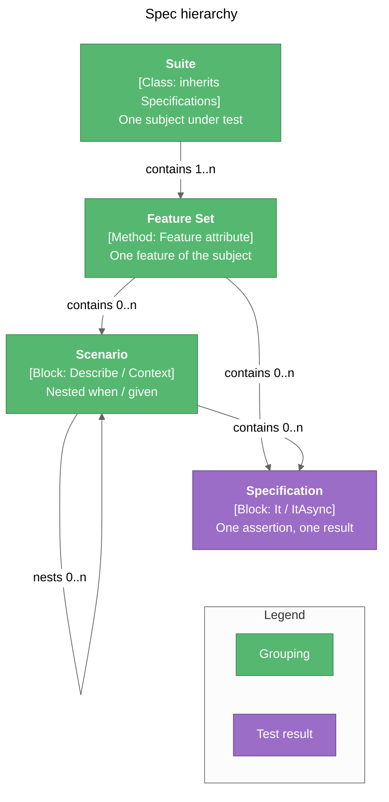
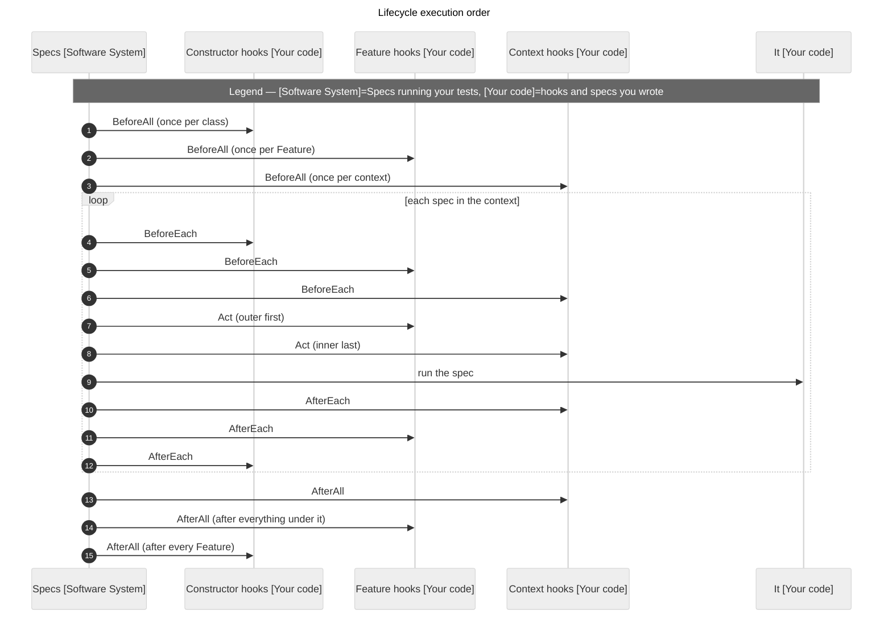

# Usage Guide

> Everything you need to write and run specs with Specs — from your first green test to filtering a thousand of them.

Each section builds on the last one, so if you're new, read top to bottom. If you're just here for a reminder, jump straight to the [Cheat Sheet](#cheat-sheet). Every example comes in C# and VB.

## Contents

1. [Quick Launch](#quick-launch)
2. [Installation](#installation)
3. [Core Concepts](#core-concepts)
4. [Writing Specs](#writing-specs)
5. [Running and Filtering](#running-and-filtering)
6. [Runner Settings](#runner-settings)
7. [Cheat Sheet](#cheat-sheet)

---

## Quick Launch

Want to see it work first? Four commands:

```powershell
dotnet new install specs.BDD.Templates
dotnet new specs-vstest -n MyApp.Specs          # add -lang VB for Visual Basic
cd MyApp.Specs
dotnet test
```

You'll get a project with one suite already in it:

```csharp
using NFluent;
using specs.BDD;
using specs.BDD.Attributes;

namespace MyApp.Specs;

public class CalculatorSpecs : Specifications
{
    int num1;
    int num2;
    int result;

    public CalculatorSpecs()
    {
        BeforeEach(() => num1 = num2 = result = 0);
    }

    [Feature("Addition")]
    public void describe_addition()
    {
        Act(() => result = num1 + num2);

        Context["when adding two positive numbers"] = () =>
        {
            BeforeEach(() => { num1 = 2; num2 = 3; });

            It["returns the sum"] = () => Check.That(result).IsEqualTo(5);
        };
    }
}
```

```vb
Imports NFluent
Imports specs.BDD
Imports specs.BDD.Attributes

Public Class CalculatorSpecs
    Inherits Specifications

    Private num1 As Integer
    Private num2 As Integer
    Private result As Integer

    Public Sub New()
        BeforeEach(
            Sub()
                num1 = 0
                num2 = 0
                result = 0
            End Sub)
    End Sub

    <Feature("Addition")>
    Public Sub describe_addition()
        Act(Sub() result = num1 + num2)

        Context("when adding two positive numbers") =
            Sub()
                BeforeEach(
                    Sub()
                        num1 = 2
                        num2 = 3
                    End Sub)

                It("returns the sum") = Sub() Check.That(result).IsEqualTo(5)
            End Sub
    End Sub
End Class
```

And `dotnet test` should say something like (abridged):

```text
Passed!  - Failed: 0, Passed: 1, Skipped: 0, Total: 1 - MyApp.Specs.dll (net10.0)
```

That's it — you're writing specs. Read on for the other way to host them, or skip to [Core Concepts](#core-concepts) to see what just happened.

---

## Installation

### Pick a Test Host

Specs runs on either of .NET's two test hosts. You reference **one** runner package per test project, and it pulls in everything else.

| Test host | Package | Template | Go with it if… |
|-----------|---------|----------|----------------|
| VSTest | `specs.BDD.VSTest` | `specs-vstest` | You want the classic `dotnet test` / Test Explorer setup with zero fuss, or you rely on `--filter` and `.runsettings` |
| Microsoft.Testing.Platform (MTP) | `specs.BDD.MTP` | `specs-mtp` | You want the whole spec tree as nodes in your IDE, filtering by path, a pretty console tree, or a test project you can just `dotnet run` |

Not sure? Start with VSTest. Your specs don't care which one you pick — they behave exactly the same on both, so switching later is just a package swap.

### From the Command Line

**Starting fresh?** Use a template:

```powershell
dotnet new install specs.BDD.Templates

dotnet new specs-vstest -n MyApp.Specs              # VSTest, C#
dotnet new specs-vstest -n MyApp.Specs -lang VB     # VSTest, VB
dotnet new specs-mtp -n MyApp.Specs                 # MTP, C#
dotnet new specs-mtp -n MyApp.Specs -lang VB        # MTP, VB
```

**Adding Specs to an existing project?** For VSTest you need the test SDK plus the runner:

```powershell
dotnet add package Microsoft.NET.Test.Sdk
dotnet add package specs.BDD.VSTest
dotnet add package NFluent          # optional — bring whatever assertion library you like
```

Your project file ends up looking like the template's:

```xml
<!-- MyApp.Specs.csproj -->
<Project Sdk="Microsoft.NET.Sdk">
  <PropertyGroup>
    <TargetFramework>net10.0</TargetFramework>
    <Nullable>enable</Nullable>
    <ImplicitUsings>enable</ImplicitUsings>
    <IsTestProject>true</IsTestProject>
  </PropertyGroup>
  <ItemGroup>
    <PackageReference Include="Microsoft.NET.Test.Sdk" Version="17.14.1" />
    <PackageReference Include="NFluent" Version="3.1.0" />
    <PackageReference Include="specs.BDD.VSTest" Version="<version>" />
  </ItemGroup>
</Project>
```

```xml
<!-- MyApp.Specs.vbproj -->
<Project Sdk="Microsoft.NET.Sdk">
  <PropertyGroup>
    <TargetFramework>net10.0</TargetFramework>
    <RootNamespace>MyApp.Specs</RootNamespace>
    <ImplicitUsings>enable</ImplicitUsings>
    <IsTestProject>true</IsTestProject>
  </PropertyGroup>
  <ItemGroup>
    <PackageReference Include="Microsoft.NET.Test.Sdk" Version="17.14.1" />
    <PackageReference Include="NFluent" Version="3.1.0" />
    <PackageReference Include="specs.BDD.VSTest" Version="<version>" />
  </ItemGroup>
</Project>
```

For MTP it's even shorter — just the runner:

```powershell
dotnet add package specs.BDD.MTP
```

The package turns your project into a little test app (an `Exe`) for you, so `dotnet run` runs your specs. If you'd rather keep typing `dotnet test` on the .NET 10 SDK, drop this into the `global.json` that covers your project:

```json
{
  "test": {
    "runner": "Microsoft.Testing.Platform"
  }
}
```

### In Visual Studio

1. Create the project with one of the templates above and open it — or open your existing test project.
2. Right-click the project › **Manage NuGet Packages** › **Browse**, and add `specs.BDD.VSTest` or `specs.BDD.MTP` (plus `Microsoft.NET.Test.Sdk` if you went with VSTest).
3. Build.
4. Open **Test › Test Explorer** and hit run. Right-click anything to debug it. Double-click a spec and you land right on its `It` line. You'll also get CodeLens run/debug links above each `[Feature]` method.

Visual Studio only nests tests four levels deep, so your tree looks like this:

```text
MyApp.Specs (project)
└── MyApp.Specs (namespace)
    └── CalculatorSpecs (class)
        └── Addition ([Feature])
            └── Addition → when adding two positive numbers → returns the sum
```

Everything below the `[Feature]` shows up in the spec's name, so you never lose the context. Grouped reports use emoji (`✅` / `❌`) here, since Visual Studio doesn't do colored console output.

### In VS Code

You'll want the **C# Dev Kit** extension (`ms-dotnettools.csdevkit`).

1. Open the folder with your test project.
2. Add the package: `dotnet add package specs.BDD.VSTest` (or `specs.BDD.MTP`) in the terminal, or **NuGet: Add NuGet Package** from the Command Palette.
3. Open the **Testing** view (the beaker) and run or debug away. Breakpoints work anywhere — inside `It`, `Act`, and every hook.

One difference from Visual Studio: VS Code doesn't nest by `[Feature]`, so your specs sit right under their class with the full `describe → context → spec` path as their name. Grouped reports get nice green/red markers.

---

## Core Concepts

Here's the mental model. A Specs project is a tree, and each level is something you already know how to write:

| Concept | You write (C#) | You write (VB) | What it's for |
|---------|----------------|----------------|---------------|
| **Suite** | `class X : Specifications` | `Class X` / `Inherits Specifications` | One subject under test. Its constructor can hold hooks for the whole class |
| **Feature Set** | `[Feature("...")]` method | `<Feature("...")>` method | One feature of that subject — the top of a branch |
| **Scenario** | `Describe[...]` / `Context[...]` | `Describe(...)` / `Context(...)` | A "what" or "when/given" block. Nest as deep as you need |
| **Specification** | `It[...]` / `ItAsync[...]` | `It(...)` / `ItAsync(...)` | One assertion. One test result |



A few house rules so your specs actually show up:

- **Every suite needs at least one `[Feature]` method.** That's where Specs starts looking. No `[Feature]`, no tests — you'll get a warning instead.
- The class must be non-abstract and have a public parameterless constructor (Specs creates it for you).
- `[Feature]` without a description? No problem — the method name is used instead.
- Specs runs your `[Feature]` method body to *find* your specs, but doesn't run any hooks or specs while it's looking. So keep real work inside `BeforeAll`, `BeforeEach`, `Act`, and friends — not loose in the method body.

---

## Writing Specs

All the examples below test this tiny calculator:

```csharp
public class Calculator
{
    public int Add(int a, int b) => a + b;
    public int Subtract(int a, int b) => a - b;
    public int Multiply(int a, int b) => a * b;

    public int Divide(int a, int b)
    {
        if (b == 0) throw new DivideByZeroException("Cannot divide by zero.");
        return a / b;
    }
}
```

```vb
Public Class Calculator
    Public Function Add(a As Integer, b As Integer) As Integer
        Return a + b
    End Function

    Public Function Subtract(a As Integer, b As Integer) As Integer
        Return a - b
    End Function

    Public Function Multiply(a As Integer, b As Integer) As Integer
        Return a * b
    End Function

    Public Function Divide(a As Integer, b As Integer) As Integer
        If b = 0 Then Throw New DivideByZeroException("Cannot divide by zero.")
        Return a \ b
    End Function
End Class
```

### Act and It

`Act` is the thing you're testing. Each `It` checks one thing about what happened. Here's the nice part: `Act` runs fresh before *every* `It`, so specs never trip over each other's results.

```csharp
using NFluent;
using specs.BDD;
using specs.BDD.Attributes;

public class CalculatorSpecs : Specifications
{
    Calculator calculator = null!;
    int num1, num2;
    int? result;

    [Feature("Addition")]
    public void describe_addition()
    {
        BeforeEach(() => { calculator = new Calculator(); num1 = 2; num2 = 3; });

        Act(() => result = calculator.Add(num1, num2));

        It["returns the sum"] = () => Check.That(result).IsEqualTo(5);
        It["is not zero"] = () => Check.That(result).IsNotEqualTo(0);
    }
}
```

```vb
Imports NFluent
Imports specs.BDD
Imports specs.BDD.Attributes

Public Class CalculatorSpecs
    Inherits Specifications

    Private calculator As Calculator
    Private num1 As Integer
    Private num2 As Integer
    Private result As Integer?

    <Feature("Addition")>
    Public Sub describe_addition()
        BeforeEach(
            Sub()
                calculator = New Calculator()
                num1 = 2
                num2 = 3
            End Sub)

        Act(Sub() result = calculator.Add(num1, num2))

        It("returns the sum") = Sub() Check.That(result).IsEqualTo(5)
        It("is not zero") = Sub() Check.That(result).IsNotEqualTo(0)
    End Sub
End Class
```

The rule is simple: if the spec's body finishes, it passes. If it throws, it fails.

### Nested Scenarios

`Describe` and `Context` do the same thing — pick whichever reads better out loud. Hooks in an outer block apply to everything inside it, and inner blocks can add their own on top.

```csharp
[Feature("Multiplication")]
public void describe_multiplication()
{
    Act(() => { result = calculator.Multiply(num1, num2); });

    Context["positive operands"] = () =>
    {
        Context["small numbers"] = () =>
        {
            BeforeEach(() => { num1 = 3; num2 = 4; });

            It["returns the correct product"] = () => Check.That(result).IsEqualTo(12);
        };

        Context["large numbers"] = () =>
        {
            BeforeEach(() => { num1 = 100; num2 = 200; });

            It["returns the correct product"] = () => Check.That(result).IsEqualTo(20000);
        };
    };

    Context["when multiplying by zero"] = () =>
    {
        BeforeEach(() => { num1 = 99; num2 = 0; });

        It["always returns zero"] = () => Check.That(result).IsEqualTo(0);
    };
}
```

```vb
<Feature("Multiplication")>
Public Sub describe_multiplication()
    Act(Sub() result = calculator.Multiply(num1, num2))

    Context("positive operands") =
        Sub()
            Context("small numbers") =
                Sub()
                    BeforeEach(
                        Sub()
                            num1 = 3
                            num2 = 4
                        End Sub)

                    It("returns the correct product") = Sub() Check.That(result).IsEqualTo(12)
                End Sub

            Context("large numbers") =
                Sub()
                    BeforeEach(
                        Sub()
                            num1 = 100
                            num2 = 200
                        End Sub)

                    It("returns the correct product") = Sub() Check.That(result).IsEqualTo(20000)
                End Sub
        End Sub

    Context("when multiplying by zero") =
        Sub()
            BeforeEach(
                Sub()
                    num1 = 99
                    num2 = 0
                End Sub)

            It("always returns zero") = Sub() Check.That(result).IsEqualTo(0)
        End Sub
End Sub
```

Notice the two `"returns the correct product"` specs? That's fine — they live in different contexts. One thing to avoid: the character sequence `" → "` in your descriptions. Specs uses it to join context names.

### Lifecycle Hooks

Five hooks, and they do what they say:

| Hook | When it runs | Order when nested |
|------|--------------|-------------------|
| `BeforeAll` | Once per context, before its first spec | Outside → in |
| `BeforeEach` | Before every spec in the context (and anything nested) | Outside → in |
| `Act` | After all the `BeforeEach`es, right before every spec | Outside → in |
| `AfterEach` | After every spec | Inside → out |
| `AfterAll` | Once per context, after its last spec | Inside → out |

Hooks you register in the **constructor** belong to the whole class. A constructor `BeforeAll` / `AfterAll` runs once per class; a constructor `BeforeEach` / `Act` / `AfterEach` wraps every spec in every `[Feature]`.

```csharp
public class CalculatorSpecs : Specifications
{
    Calculator calculator = null!;
    int num1 = 0;
    int num2 = 0;
    int? result = null;

    public CalculatorSpecs()
    {
        BeforeAll(() => calculator = new Calculator());   // once for the whole class
        BeforeEach(() =>                                   // before every spec everywhere
        {
            num1 = num2 = 0;
            result = null;
        });
    }

    [Feature("Addition")]
    public void describe_addition()
    {
        Act(() => { result = calculator.Add(num1, num2); });

        Context["when adding two positive numbers"] = () =>
        {
            BeforeEach(() => { num1 = 2; num2 = 3; });
            It["returns the correct sum"] = () => Check.That(result).IsEqualTo(5);
        };
    }
}
```

```vb
Public Class CalculatorSpecs
    Inherits Specifications

    Private calculator As Calculator
    Private num1 As Integer
    Private num2 As Integer
    Private result As Integer?

    Public Sub New()
        BeforeAll(Sub() calculator = New Calculator())     ' once for the whole class
        BeforeEach(                                         ' before every spec everywhere
            Sub()
                num1 = 0
                num2 = 0
                result = Nothing
            End Sub)
    End Sub

    <Feature("Addition")>
    Public Sub describe_addition()
        Act(Sub() result = calculator.Add(num1, num2))

        Context("when adding two positive numbers") =
            Sub()
                BeforeEach(
                    Sub()
                        num1 = 2
                        num2 = 3
                    End Sub)
                It("returns the correct sum") = Sub() Check.That(result).IsEqualTo(5)
            End Sub
    End Sub
End Class
```

Here's the full running order for one spec sitting inside a nested context:



**Running just a few specs?** No worries. Whether you click one spec in Test Explorer or filter down from the command line, each context's `BeforeAll` / `AfterAll` still runs exactly once. Contexts with nothing selected don't run any hooks at all.

**When things go wrong:**

- A spec (or its `Act`) blows up → only that spec fails. `AfterEach` still runs, and the rest carry on.
- A `BeforeAll` blows up → every spec under that context fails with that exception, and that context's `AfterAll` is skipped. Sibling contexts still run.
- An `AfterAll` blows up → it's quietly ignored, so cleanup trouble never hides real failures.

### Async Specs

Async just works. Every hook takes an async lambda, and `ItAsync` gives you an async spec. (`AsyncDataService` below is a stand-in for your own async code.)

```csharp
[Feature("Async fetch")]
public void describe_async_fetch()
{
    AsyncDataService service = null!;
    string result = string.Empty;

    BeforeAll(() => { service = new AsyncDataService(); });

    Context["when fetching an existing key"] = () =>
    {
        Act(async () => { result = await service.FetchAsync("greeting"); });

        It["returns the expected value"] = () => Check.That(result).IsEqualTo("Hello, World!");

        ItAsync["can also assert asynchronously"] = async () =>
        {
            var fetched = await service.FetchAsync("greeting");
            Check.That(fetched).IsEqualTo("Hello, World!");
        };
    };
}

[Feature("Async lifecycle")]
public void describe_async_lifecycle()
{
    bool initialized = false;

    BeforeAll(async () =>
    {
        await Task.Delay(1);
        initialized = true;
    });

    AfterAll(async () => await Task.Delay(1));

    It["was initialized asynchronously"] = () => Check.That(initialized).IsTrue();
}
```

```vb
<Feature("Async fetch")>
Public Sub describe_async_fetch()
    Dim service As AsyncDataService = Nothing
    Dim result As String = String.Empty

    BeforeAll(Sub() service = New AsyncDataService())

    Context("when fetching an existing key") =
        Sub()
            Act(Async Function()
                    result = Await service.FetchAsync("greeting")
                End Function)

            It("returns the expected value") = Sub() Check.That(result).IsEqualTo("Hello, World!")

            ItAsync("can also assert asynchronously") =
                Async Function()
                    Dim fetched = Await service.FetchAsync("greeting")
                    Check.That(fetched).IsEqualTo("Hello, World!")
                End Function
        End Sub
End Sub

<Feature("Async lifecycle")>
Public Sub describe_async_lifecycle()
    Dim initialized As Boolean = False

    BeforeAll(Async Function()
                  Await Task.Delay(1)
                  initialized = True
              End Function)

    AfterAll(Async Function()
                 Await Task.Delay(1)
             End Function)

    It("was initialized asynchronously") = Sub() Check.That(initialized).IsTrue()
End Sub
```

> **VB heads-up:** use multi-line `Async Function() … End Function` for async hooks, not `Async Sub()`. An `Async Sub` lambda is fire-and-forget, so Specs can't wait for it to finish.

One gotcha: Specs waits for async work synchronously, so if the code you're testing captures a synchronization context, add `ConfigureAwait(false)` there to dodge deadlocks.

### Expected Exceptions

Testing that something throws? Skip the `try/catch` dance. Point `It` at `ShouldThrow`, and it checks whatever `Act` threw. Base types count too, so `ArithmeticException` would also catch a `DivideByZeroException`.

```csharp
[Feature("Division")]
public void describe_division()
{
    Act(() => { result = calculator.Divide(num1, num2); });

    Context["when dividing evenly"] = () =>
    {
        BeforeEach(() => { num1 = 10; num2 = 2; });

        It["returns the correct quotient"] = () => Check.That(result).IsEqualTo(5);
    };

    Context["when dividing by zero"] = () =>
    {
        It["throws DivideByZeroException"] = ShouldThrow<DivideByZeroException>();

        It["exception message mentions zero"] = ShouldThrow<DivideByZeroException>(ex =>
        {
            Check.That(ex.Message.ToLowerInvariant()).Contains("zero");
        });
    };
}
```

```vb
<Feature("Division")>
Public Sub describe_division()
    Act(Sub() result = calculator.Divide(num1, num2))

    Context("when dividing evenly") =
        Sub()
            BeforeEach(
                Sub()
                    num1 = 10
                    num2 = 2
                End Sub)

            It("returns the correct quotient") = Sub() Check.That(result).IsEqualTo(5)
        End Sub

    Context("when dividing by zero") =
        Sub()
            It("throws DivideByZeroException") = ShouldThrow(Of DivideByZeroException)()

            It("exception message mentions zero") = ShouldThrow(Of DivideByZeroException)(
                Sub(ex) Check.That(ex.Message.ToLowerInvariant()).Contains("zero"))
        End Sub
End Sub
```

What to expect:

| What happened | Result |
|---------------|--------|
| `Act` threw the expected type (or a subtype), and your check passed | ✅ Pass |
| `Act` didn't throw, or threw something unrelated | ❌ Fails with `ExpectedExceptionNotThrownException` (the unrelated exception is tucked into `InnerException`) |
| `Act` threw, but the spec is a regular `It` | ❌ That spec fails with the `Act` exception — the real root cause. `AfterEach` still runs and the other specs carry on |

`ShouldThrow` works whether `Act` is sync or async. Just use it with `It`, not `ItAsync`.

### Pending Specs

Got specs you haven't written yet, or one you want to park for a bit? Don't comment it out — mark it pending. It still shows up in your test list; it just doesn't run.

```csharp
public class PendingSpecs : Specifications
{
    [Feature("pending specs")]
    public void describe_pending_specs()
    {
        It["runs a regular spec"] = () => { };

        It["reports a TODO spec as skipped"] = TODO;

        ItAsync["reports a TODOAsync spec as skipped"] = TODOAsync;

        xIt["never runs an excluded spec"] = () => throw new Exception("pending body must not run");

        xContext["a pending context"] = () =>
        {
            BeforeAll(() => throw new Exception("pending context BeforeAll must not run"));

            It["never runs specs inside it"] = () => throw new Exception("pending body must not run");
        };
    }
}
```

```vb
Public Class PendingSpecs
    Inherits Specifications

    <Feature("pending specs")>
    Public Sub describe_pending_specs()
        It("runs a regular spec") = Sub()
                                    End Sub

        It("reports a TODO spec as skipped") = TODO

        ItAsync("reports a TODOAsync spec as skipped") = TODOAsync

        xIt("never runs an excluded spec") = Sub() Throw New Exception("pending body must not run")

        xContext("a pending context") =
            Sub()
                BeforeAll(Sub() Throw New Exception("pending context BeforeAll must not run"))

                It("never runs specs inside it") = Sub() Throw New Exception("pending body must not run")
            End Sub
    End Sub
End Class
```

| Write this | When you mean |
|------------|---------------|
| `It[...] = TODO` / `ItAsync[...] = TODOAsync` | "I'll write this one later" |
| `xIt[...]` / `xItAsync[...]` | "Keep the code, but don't run it right now" |
| `xContext[...]` / `xDescribe[...]` | "Park this whole block" — everything inside, at any depth, is pending |

(In VB, swap the square brackets for parentheses.)

How pending specs show up:

- As **Skipped** with the reason `Pending` — in Test Explorer, the Testing view, and `dotnet test`.
- None of their hooks run. If *everything* in a context is pending, even its `BeforeAll` / `AfterAll` stay quiet. So a half-built `xContext` with a broken `BeforeAll` can't wreck your run.
- In grouped reports (see [Reporting Levels](#reporting-levels)) they appear as `○ <description> - PENDING`, with an `N pending` count at the bottom.
- Double-clicking one still takes you straight to its line.

### Assertions

Specs doesn't come with its own assertion library, and that's on purpose. A spec fails when its body throws — *any* exception — so bring whichever library you like. The templates use [NFluent](https://www.nuget.org/packages/NFluent):

```csharp
It["returns the net value"] = () => Check.That(result).IsEqualTo(7);

It["throws when dividing by zero"] = () =>
    Check.ThatCode(() => calculator.Divide(1, 0)).Throws<DivideByZeroException>();
```

```vb
It("returns the net value") = Sub() Check.That(result).IsEqualTo(7)

It("throws when dividing by zero") =
    Sub() Check.ThatCode(Function() calculator.Divide(1, 0)).Throws(Of DivideByZeroException)()
```

Rather keep it bare-bones? Plain old exceptions work just as well:

```csharp
It["returns an empty string"] = () =>
{
    if (!string.IsNullOrEmpty(text))
        throw new Exception($"Expected empty string but got '{text}'");
};
```

```vb
It("returns an empty string") =
    Sub()
        If Not String.IsNullOrEmpty(text) Then
            Throw New Exception($"Expected empty string but got '{text}'")
        End If
    End Sub
```

---

## Running and Filtering

### Running

| Host | Command | Notes |
|------|---------|-------|
| VSTest | `dotnet test` | Works anywhere |
| MTP | `dotnet run` | Your test project is an app — just run it |
| MTP | `dotnet test` | Needs the `global.json` runner setting from [Installation](#installation) |

If your folder has more than one project or solution in it, tell `dotnet` which one: `dotnet test MyApp.sln`.

### Filtering on VSTest (`--filter`)

| Property | Matches | Example |
|----------|---------|---------|
| `FullyQualifiedName` | `Namespace.Class.FeatureMethod` (every spec in a `[Feature]` shares it) | `--filter "FullyQualifiedName~CalculatorSpecs.describe_addition"` |
| `ContextMethod` | The `[Feature]` method's name | `--filter ContextMethod=describe_division` |
| `ContextPath` | The `Feature → context → …` path | `--filter "ContextPath~when adding"` |
| `TestDescription` | The spec's own description | `--filter "TestDescription~returns"` |
| `DisplayName` | The whole path, spec included | `--filter "DisplayName~by zero"` |
| `IsPending` | `true` / `false` | `--filter IsPending=true` |

A couple of handy ones:

```powershell
dotnet test --filter IsPending=true                       # what's left to write?
dotnet test --filter IsPending=false                      # everything that actually runs
dotnet test --filter "ContextPath~when dividing by zero"  # just one scenario
```

Typo in your filter? You'll get an error and nothing runs, rather than a surprise full run. Heads-up: `FullyQualifiedName` only goes as deep as the `[Feature]` method, so use `ContextPath` or `TestDescription` to zero in on specific contexts or specs.

### Filtering on MTP (`--treenode-filter`)

On MTP, every spec has a path, and that path is what you filter on:

```text
/<assembly>/<namespace>/<class>/<Feature>/<context>/…/<spec>
/MyApp.Specs/MyApp.Specs/CalculatorSpecs/Addition/when adding two positive numbers/returns the sum
```

`*` matches one level, `**` matches any depth:

```powershell
dotnet test --treenode-filter "/*/*/CalculatorSpecs/Addition/**"   # a whole [Feature]
dotnet test --treenode-filter "/*/*/*/*/when dividing by zero/*"    # specs in every matching context
dotnet run -- --treenode-filter "/*/*/CalculatorSpecs/**"            # same idea, via dotnet run
dotnet run -- --list-tests                                          # show me all the paths
```

Got funny characters in your names? Here's how to write them in a filter:

| In the name | In the filter |
|-------------|---------------|
| `/` | `%2F` |
| `%` | `%25` |
| `(` `)` `*` `\|` `&` `[` `]` | Put a `\` in front, e.g. `Subtraction \(grouped\)` |

```powershell
dotnet test --treenode-filter "/*/*/CalculatorSpecs/Subtraction \(grouped\)"
```

Classes outside any namespace use `global` for that segment, and nested classes are written `Outer+Inner`.

### Reporting Levels

By default, every spec is its own test result. That's usually what you want — but in a big suite with hundreds of tiny specs, your test list can get noisy. Flip a `[Feature]` to `ReportingLevel.Feature` and the whole thing shows up as **one** result, with a neat tree in its output.

```csharp
[assembly: ReportingLevel(ReportingLevel.Feature)]      // the whole assembly

[ReportingLevel(ReportingLevel.Test)]                    // just this class (derived classes don't inherit it)
public class CalculatorSpecs : Specifications
{
    [Feature("Subtraction (grouped)", Level = ReportingLevel.Feature)]   // just this [Feature]
    public void describe_subtraction() { /* ... */ }
}
```

```vb
<Assembly: ReportingLevel(ReportingLevel.Feature)>      ' the whole assembly

<ReportingLevel(ReportingLevel.Test)>                    ' just this class (derived classes don't inherit it)
Public Class CalculatorSpecs
    Inherits Specifications

    <Feature("Subtraction (grouped)", Level:=ReportingLevel.Feature)>   ' just this [Feature]
    Public Sub describe_subtraction()
        ' ...
    End Sub
End Class
```

The most specific setting wins: `[Feature(Level = ...)]` → class `[ReportingLevel]` → assembly `[ReportingLevel]` → [runner settings](#runner-settings) → the default (`Test`). So `Level = ReportingLevel.Test` on one `[Feature]` opts it back out of a grouped class or assembly.

A grouped result's output looks like this:

```text
Specs
  when adding
    ✓ returns the sum
    ✗ handles overflow - FAILED:
      Expected 1 but got -2147483648

1 passed, 1 failed, 2 total
```

You get green/red markers in VS Code and the terminal, emoji (`✅` / `❌` / `⏸️`) in Visual Studio, and plain `✓` / `✗` / `○` when color is turned off. Hooks behave exactly the same either way — just remember a grouped `[Feature]` counts as one test in your totals.

---

## Runner Settings

There are three knobs, and they work the same no matter which language you write in.

| Setting | Default | What it does |
|---------|---------|--------------|
| `ReportingLevel` | unset (→ `Test`) | The fallback [reporting level](#reporting-levels) when nothing in code says otherwise. Takes `Test` or `Feature` (case doesn't matter) |
| `ShowSourceLocations` | `false` | Adds an `at <file>:line <n>` under each spec in grouped reports |
| `ColorOutput` | `true` | Set to `false` for plain markers — handy if your CI log shows escape codes |

### On MTP

Put a `[appname].testconfig.json` next to your test app (e.g. `MyApp.Specs.testconfig.json`):

```json
{
  "SpecsBDD": {
    "ReportingLevel": "Feature",
    "ShowSourceLocations": true,
    "ColorOutput": false
  }
}
```

Or use environment variables, which is great for CI:

```powershell
$env:SpecsBDD__ReportingLevel = "Feature"
$env:SpecsBDD__ShowSourceLocations = "true"
$env:SpecsBDD__ColorOutput = "false"
dotnet run
```

### On VSTest

Same settings, in a `.runsettings` file:

```xml
<RunSettings>
  <SpecsBDD>
    <ReportingLevel>Feature</ReportingLevel>
    <ShowSourceLocations>true</ShowSourceLocations>
    <ColorOutput>false</ColorOutput>
  </SpecsBDD>
</RunSettings>
```

```powershell
dotnet test --settings specs.runsettings
```

If a value is missing or doesn't make sense, Specs just falls back to the default.

---

## Cheat Sheet

C# syntax shown. In VB, swap `[...]` for `(...)`, `<T>` for `(Of T)`, and `[Feature]` for `<Feature>`.

| Keyword / Member | What it does | Section |
|------------------|--------------|---------|
| `Specifications` | Base class for a suite | [Core Concepts](#core-concepts) |
| `[Feature("...")]` | Marks a feature-set method — required to be discovered | [Core Concepts](#core-concepts) |
| `Describe[...]` / `Context[...]` | A nested scenario block | [Nested Scenarios](#nested-scenarios) |
| `It[...] = () => ...` | A spec | [Act and It](#act-and-it) |
| `ItAsync[...] = async () => ...` | An async spec | [Async Specs](#async-specs) |
| `Act(...)` | The behavior under test; runs before every spec | [Act and It](#act-and-it) |
| `BeforeAll(...)` / `AfterAll(...)` | Once per context (once per class from the constructor) | [Lifecycle Hooks](#lifecycle-hooks) |
| `BeforeEach(...)` / `AfterEach(...)` | Around every spec | [Lifecycle Hooks](#lifecycle-hooks) |
| `ShouldThrow<T>()` / `ShouldThrow<T>(ex => ...)` | Checks the exception `Act` threw | [Expected Exceptions](#expected-exceptions) |
| `TODO` / `TODOAsync` | "Write me later" placeholder | [Pending Specs](#pending-specs) |
| `xIt` / `xItAsync` | Park a spec, keep its code | [Pending Specs](#pending-specs) |
| `xContext` / `xDescribe` | Park a whole block | [Pending Specs](#pending-specs) |
| `[Feature(Level = ReportingLevel.Feature)]` | Report one `[Feature]` as a single grouped result | [Reporting Levels](#reporting-levels) |
| `[ReportingLevel(...)]` | Set the reporting level for a class or assembly | [Reporting Levels](#reporting-levels) |
| `--filter IsPending=true` | VSTest: show me what's pending | [Filtering on VSTest](#filtering-on-vstest---filter) |
| `--treenode-filter "/*/*/Class/Feature/**"` | MTP: run a branch by path | [Filtering on MTP](#filtering-on-mtp---treenode-filter) |
| `SpecsBDD:*` / `SpecsBDD__*` / `<SpecsBDD>` | Runner settings | [Runner Settings](#runner-settings) |

## Related Pages

- [Troubleshooting](Troubleshooting) — When specs don't show up or don't run the way you expect
- [Home](Home) — What Specs is and how it compares to frameworks you might know
