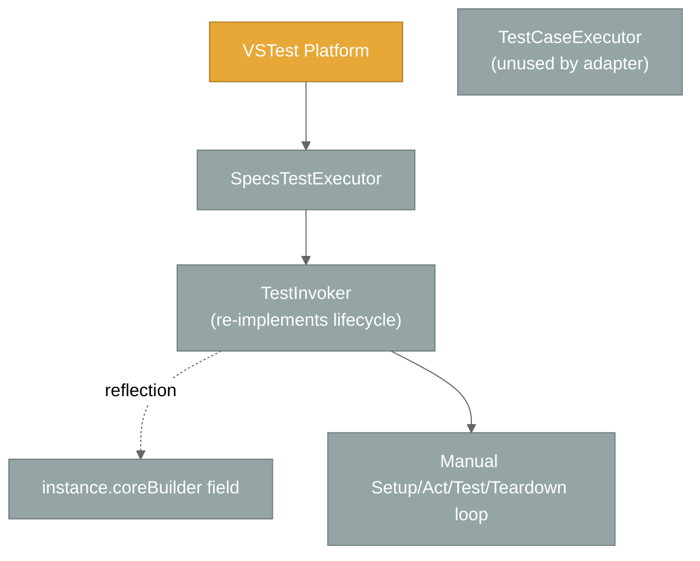

# Active Context: Specs

## Current Focus

**📌 NEW — .NET 10 test-project upgrade (commits `ba0a0f9`, `b496376`, `a4ad8cc`, `4affb1b`)** — the four `net8.0` test projects (`specs.core.UnitTests`, `specs.BDD.UnitTests`, `specs.BDD.VSTestAdapter.Tests`, `specs.BDD.VSTestAdapter.IntegrationTests`) now target `net10.0`, upgraded top-down one project at a time and validated with a full solution build/test. The `netstandard2.1` deliverables (`specs.core`, `specs.BDD`, `specs.BDD.VSTestAdapter`, `TestHarness`) are unchanged, so no multi-targeting was needed. The explicit `System.Text.Encodings.Web 9.0.11` reference was removed from `specs.core.UnitTests` and `specs.BDD.UnitTests`. Upgrade assessment, plan, and per-task logs live under `.github/upgrades/scenarios/dotnet-version-upgrade/`. See `techContext.md` section "Target Frameworks".

**📌 NEW — Legacy `Spec` API removed** — the property-based `Spec` class, its `Domain/` runtime layer (`AbstractSpecDefinition`, `ActionRunner`, `TaskRunner`, `IRunContext`, `IRunContainer`, `ISpecDefinition`, `IndexedRunnerDelegate`, `Runner`, `Action/TaskSpecDefinition`, `Exceptions/*`), `Global.cs`, the `Specs.csproj` stub, and the `Examples/ConsoleExample` sample are deleted (22 files, 1,395 lines). `Specifications` is now the only authoring API. See `systemPatterns.md` decision #31.

**📌 NEW — `[Context]` → `[Describe]` attribute rename** — `ContextAttribute` is now `DescribeAttribute` across `specs.BDD`, the VSTest adapter, tests, integration fixtures, and `README.md`. The members (`Description`, `Reporting`, `ReportingSetting`) and the `Context[...]` indexers are unchanged; a suite still needs at least one `[Describe]` method to be discovered. This memory bank uses the new name throughout (older entries describing past commits were rewritten to match). See `systemPatterns.md` decision #30.

**📌 NEW — Public execution surface in `specs.core`** — `TestCaseExecutor`, `ITestContextAdapter`, `ITestProviderAdapter`, `TestContextAdapter`, and `TestInstance` are now `public`, so custom runners can drive the canonical lifecycle without `InternalsVisibleTo`. `specs.core` no longer grants the adapter internals access; `TestContextAdapter` gained `FromTestCase(ITestCase)` and lost its unused `test` parameter; the dead `Settings/TestSettings` class was deleted.

**📌 `ShouldThrow<T>` + `Act` exception capture (committed `61c96ea`)** — `It["..."] = ShouldThrow<T>()` / `ShouldThrow<T>(ex => ...)` verifies the exception thrown by `Act`. `Act` + `It` now run through `specs.core`'s public `ActExceptionContext.Run` in every execution path, so an unexpected `Act` exception fails only its own spec (with teardown still running) instead of aborting the context.

**📌 Pending specs (committed `5c5d942`)** — specs can be marked pending with `TODO` / `TODOAsync` placeholders or `xIt` / `xItAsync` / `xContext` / `xDescribe`. They are discovered, reported as **Skipped**, never run any lifecycle, render as `○ ... - PENDING` in grouped reports, and are filterable via `--filter IsPending=true|false`.

**📌 `dotnet test --filter` support (committed `b94d3a6`)** — `SpecsTestExecutor.RunTests(sources)` applies the VSTest filter expression to re-discovered test cases instead of running the whole assembly.

**📌 `SpecReporting` API + root lifecycle (October 2026, committed `124ba8c`)** — the grouped-execution feature was reshaped and hardened:

- The `bool` grouping switches became a `SpecReporting` enum (`Individual` / `GroupedByRootContext`) configurable at **method, class, assembly, or `.runsettings`** level.
- Constructor-registered `BeforeAll` / `AfterAll` now actually run (once per class) — previously they were silently skipped.
- Grouped reports gained host-aware pass/fail markers and optional per-`It` source locations.
- `ItAsync[...]` source navigation now lands on the async body.

This builds on **grouped root-context execution** (Phase 9): a root `[Describe]` can run as a **single test result** with an NSpec-style tree report in its output, while the default stays one result per `It[...]`.

It builds directly on the two threads completed just before it:

1. **Suite-tree execution** — `SuiteTreeBuilder` + `SelectionTreeWalker` replace the per-test rebuild so `BeforeAll` / `AfterAll` fire exactly once per context, even when only part of a suite is selected. `[Describe]` methods are registered as named child contexts rather than invoked directly.
2. **Self-hosting `specs.core.UnitTests`** — the core unit-test project was migrated off NUnit fixtures onto `Specifications` + `[Describe]` and is discovered/run by `specs.BDD.VSTestAdapter`. Specs now tests its own core with itself.

Alongside these: Test Explorer renders a real tree (RFC-0033 `TestCase.Hierarchy`), "Go to Source" navigates to the `It[...]` line, and display names now embed the context path so VS Code (which ignores `Hierarchy`) still shows context.

## Project Status Snapshot

| Area | State |
|------|-------|
| `specs.core` | Stable; `ITestCase.OwnSetupOnce` / `OwnTeardownOnce` added for the selection walker; 📌 `AsyncTestExtensions.RunSync` binds async test wrappers to the user delegate; 📌 `AddPendingTest`, `ChildTestCase(..., isPending)`, `ITestCase.PendingTests`; 📌 `ActExceptionContext`, `ActExceptionAssertions`, `ExpectedExceptionNotThrownException`; 📌 public `TestCaseExecutor` + adapter types, `TestContextAdapter.FromTestCase`, no `InternalsVisibleTo` for the adapter |
| `specs.BDD` | Stable; `CoreBuilder` exposed as `internal protected`; 📌 `SpecReporting` enum, `DescribeAttribute.Reporting`, `SpecReportingAttribute` (assembly/class); 📌 `TODO` / `TODOAsync`, `xIt` / `xItAsync` / `xContext` / `xDescribe`; 📌 `ShouldThrow<T>` |
| `specs.BDD.VSTestAdapter` | Discovery + execution complete; grouped mode via `GroupingSettings` + `GroupedContextRunner`; 📌 root lifecycle in `TestInvoker`, `MarkerStyle`; 📌 `--filter` honoured in `RunTests(sources)`; 📌 pending specs via `PendingSpecs` + `IsPending` property; 📌 `Act` capture in `TestInvoker` / `GroupedContextRunner`; 272 adapter unit-test results + 28 integration results passing (13 Skipped = pending) |
| `specs.core.UnitTests` | Self-hosted; 📌 333 results passing (`TestContextAdapter` suite runs grouped, collapsing 27 `It`s into 1 result) |
| Legacy `Spec` API | 📌 REMOVED — `Specifications` is the only API; `Examples/ConsoleExample` removed too |
| TestHarness | Internal-only; now a retirement candidate (core no longer needs it to self-test) |
| Documentation | Core files refreshed October 2026; memory bank consolidated to 6 core files + 4 supplementary references (`architecture.md`, `core-components.md`, `test-patterns.md`, `glossary.md`) |

## Recent Architectural Changes

### 📌 NEW — Public execution surface in `specs.core`

BEFORE/AFTER diagrams live in `systemPatterns.md` section "Adapter Pattern — Framework independence"; decision #29 records the rationale.

| Layer | File(s) | What changed |
|-------|---------|--------------|
| `specs.core` | `Processors/TestExecutors/TestCaseExecutor.cs` | `internal` → `public`; ctor parameter `tests` renamed `testProvider` and now null-guarded (`ArgumentNullException`); XML docs added |
| `specs.core` | `Adapters/ITestContextAdapter.cs`, `ITestProviderAdapter.cs`, `TestInstance.cs` | `internal` → `public` with XML docs (`ILoggingAdapter` was already public) |
| `specs.core` | `Adapters/TestContextAdapter.cs` | `internal` → `public`. **Signature change**: ctor is now `(setupOnce, setupEach, act, teardownEach, teardownOnce)` — the unused, unvalidated `test` parameter was dropped and parameters lost their `Action` suffix (`ParamName` values changed accordingly). New `static FromTestCase(ITestCase)` adopts a built node's **cascaded** `SetupOnce` / `SetupEach` / `Act` / `TeardownEach` / `TeardownOnce` |
| `specs.core` | `Settings/TestSettings.cs` 📌 DELETED | Unused public class duplicating `TestCaseExecutorSettings.StopOnAssertFailure` |
| `specs.core` | `Processors/TestExecutors/TestCaseExecutorSettings.cs` | Stale `IsCancelled` reference removed from the ctor XML doc |
| `specs.core` | `specs.core.csproj` | `<InternalsVisibleTo Include="specs.BDD.VSTestAdapter" />` removed — the adapter now compiles against the public surface only |
| Adapter / Execution | `SelectionTreeWalker.cs` | Uses the new 5-argument `TestContextAdapter` ctor |
| Tests | `specs.core.UnitTests/Framework/Adapters/TestContextAdapter.cs` | Suite rewritten: local `Create()` helper, `Check.ThatCode(...).Throws<ArgumentNullException>().WithProperty("ParamName", ...)` instead of `try/catch`, new `FromTestCase` specs (null arg; mocked `ITestCase` via Moq runs all five phases in order); still 27 `It`s in one grouped result |
| Tests | `TestCaseExecutor_Tests.cs` | New "Constructor validation..." spec — null `testProvider` throws (core 332 → 333) |

### 📌 `ShouldThrow<T>` + `Act` exception capture (committed `61c96ea`, 19 files)

BEFORE/AFTER diagrams and the outcome contract live in `systemPatterns.md` section "Act Exception Capture (`ShouldThrow<T>`)"; decisions #25–28 record the rationale.

| Layer | File(s) | What changed |
|-------|---------|--------------|
| `specs.core` | `Processors/TestExecutors/ActExceptionContext.cs` 📌 NEW | Public static class: `Run(act, test)` catches the `Act` exception, publishes it in an `AsyncLocal` outcome while `test` runs, and rethrows it (`ExceptionDispatchInfo`) unless the test called `MarkHandled()`; an unhandled `Act` exception replaces any `test` exception; nested runs restore the enclosing outcome |
| `specs.core` | `Assertions/ActExceptionAssertions.cs`, `Assertions/ExpectedExceptionNotThrownException.cs` 📌 NEW | `VerifyActException<T>(this Action<T> verify)` — marks handled, throws `ExpectedExceptionNotThrownException` when nothing / an unrelated type was thrown (actual kept as `InnerException`), else calls `verify` |
| `specs.core` | `TestCaseExecutor.cs` | `Act()` moved inside the per-test `try` via `ActExceptionContext.Run(testContext.Act, test.Test)` |
| `specs.BDD` | `Specifications.cs` | `public static Action ShouldThrow<T>()` and `ShouldThrow<T>(Action<T> verify)` returning the bound `verifier.VerifyActException` |
| Adapter / Execution | `TestInvoker.cs`, `GroupedContextRunner.cs` | `RunLifecycle` / `RunTest` call `ActExceptionContext.Run(node.Act, test)` |
| Adapter / Discovery | `SourceLocationReader.cs` | `GetTestMethod` loops through nested `Delegate.Target`s (async wrapper and `ShouldThrow` verifier) |
| Tests | `ActExceptionContext_Tests.cs`, `ActExceptionAssertions_Tests.cs` 📌 NEW, `TestCaseExecutor_Tests.cs` | Self-hosted core specs for `Run` / `MarkHandled` / nesting / null args and verifier outcomes; executor `Act`-throws context rewritten (logs `LogAssertFailure`, does not throw, still tears down; rethrows with `StopOnAssertFailure`; handled exception logs success) |
| Tests | `specs.specification.UnitTests/Specifications.cs` | Harness specs for `ShouldThrow` (null verifier, bound target, assignable pass, verifier receives exception, no-throw fails) |
| Tests | Adapter `TestInvoker_Tests`, `GroupedContextRunner_Tests`, `SourceLocationReader_Tests`, `SampleSpecifications.cs` | Fixtures `ShouldThrowSpec`, `GroupedShouldThrowSpec` (`TriggerFailure`-gated); tests for pass / no-throw / wrong-type / verifier failure, plain spec failing with the `Act` exception while teardown runs, suite-level isolation, grouped tallies, verifier source navigation |
| Integration | `CalculatorSpecs.cs`, `AsyncAndExceptionSpecs.cs` | Manual `try/catch` + captured locals replaced by `ShouldThrow<T>`; division `Act` hoisted to the `[Describe]` level; new `names the offending parameter` spec |
| Docs | `README.md` | "Expected exceptions" section |

### 📌 Pending specs (committed `5c5d942`)

BEFORE/AFTER routing diagrams and the runtime contract live in `systemPatterns.md` section "Pending Specs"; decisions #22–24 record the rationale.

| Layer | File(s) | What changed |
|-------|---------|--------------|
| `specs.core` | `ITestCase.cs`, `ContextualTestCase.cs` | New `IReadOnlyCollection<string> PendingTests` (ordinal `HashSet`) passed through `CreateTestCase` / `CreateTestCaseContext` (optional `pendingTests` arg) |
| `specs.core` | `IContextualTestCaseBuilder.cs`, `ContextualTestCaseBuilder.cs` | `AddPendingTest(string, Action)` / `AddPendingTest(string, Func<Task>)` (body kept in `Tests`, description recorded as pending); `ChildTestCase(description, configure, bool isPending)` — a pending builder propagates `isPending` to every descendant, so `AddTest` inside it records pending too |
| `specs.BDD` | `Specifications.cs` | `public static readonly Action TODO` / `Func<Task> TODOAsync`; `xIt`, `xItAsync`, `xContext`, `xDescribe` properties |
| `specs.BDD` | `AssertBuilder.cs`, `AssertBuilderAsync.cs`, `ContextBuilder.cs` | Internal `isPending` ctor arg; assert builders route to `AddPendingTest` when pending or when the value is `ReferenceEquals` to `TODO` / `TODOAsync` |
| Adapter / Discovery | `PendingSpecs.cs` 📌 NEW, `TestStructureExtractor.cs` | Helpers `IsPending` / `HasRunnableTests` / `HasAnyTests`; `SpecTest.IsPending` set per spec, and for grouped records only when the subtree is non-empty and fully pending |
| Adapter / Conversion | `SpecTest.cs`, `TestProperties.cs`, `TestCaseConverter.cs` | `IsPending` POCO field + `SpecsBDD.IsPending` `TestProperty` written onto each `TestCase` |
| Adapter / Execution | `TestInvoker.cs` | Three-way split (grouped / pending / regular); pending recorded `Skipped` up front; root once-lifecycle runs only when something runnable is selected; `Invoke` returns `Skipped` for a pending case |
| Adapter / Execution | `GroupedContextRunner.cs` | `PendingMark` (`○` / yellow ANSI / `⏸️`), `Pending` tally in summary, `RenderPendingSubtree` skips once-actions for nodes without runnable specs, all-pending result → `Skipped` ("All specs are pending."), root-setup failure leaves pending specs pending |
| Adapter / Execution | `ResultReporter.cs`, `SpecsTestExecutor.cs` | `ResultReporter.Skipped(...)` + `PendingMessage = "Pending"`; `IsPending` added to `FilterProperties` |
| Tests | `ContextualTestCaseBuilder_Tests/Pending.cs` 📌 NEW, `ContextualTestCase_Tests.cs` | +14 self-hosted core specs (pending builder API, propagation, argument validation, `PendingTests` default/dedup) |
| Tests | `specs.specification.UnitTests/Specifications.cs` | Harness specs for `TODO`, `TODOAsync`, `xIt`, `xItAsync`, `xContext`, `xDescribe` |
| Tests | Adapter `*_Tests.cs`, `SampleSpecifications.cs` | Fixtures `SpecWithPending`, `AllPendingSpec`, `PendingWithFailingRootBeforeAll`, `GroupedSpecWithPending`; tests for discovery flags, converter property, grouped pending output/outcomes, `ResultReporter.Skipped`, `IsPending` filter, `TestInvoker` pending routing and root lifecycle suppression |
| Integration | `PendingSpecs.cs` 📌 NEW, `StringSpecs.cs` | Individual + grouped pending suites whose pending bodies / `BeforeAll` throw; `StringSpecs` gains a `TODO` spec |
| Docs | `README.md` | "Pending specs" section + Key Features bullet |

### 📌 `--filter` support in `RunTests(sources)` (committed `b94d3a6`)

Flow diagram, BEFORE/AFTER behaviour, and supported property table live in `systemPatterns.md` section "Test Case Filtering (`dotnet test --filter`)".

| File | What changed |
|------|--------------|
| `Execution/SpecsTestExecutor.cs` | New static `FilterProperties` map (case-insensitive: `FullyQualifiedName`, `DisplayName`, `ContextMethod`, `ContextPath`, `TestDescription`). `RunTests(sources)` calls `runContext.GetTestCaseFilter(...)` after re-discovery, filters with `MatchTestCase`, and on `TestPlatformFormatException` sends an `Error` message and returns without running anything. A `null` filter (or `null` run context) runs everything as before |
| `Tests/Execution/SpecsTestExecutor_Tests.cs` 📌 NEW | 4 NUnit + Moq tests: filter limits results to `MultiContextSpec`; property-value provider returns the same values as the `TestCase` (case-insensitive, unknown → `null`); supported names are passed to `GetTestCaseFilter`; invalid filter reports the error and runs nothing |

Verified end-to-end: `--filter "FullyQualifiedName~Calculator"` on the integration project runs 4 results instead of 20.

### 📌 `SpecReporting` API, root lifecycle, report polish (committed `124ba8c`, 25 files)

BEFORE/AFTER diagrams live in `systemPatterns.md` sections "Root (class-level) Lifecycle" and "Grouped Root-Context Execution → Configuration API"; `.runsettings` keys in `techContext.md` section "Adapter Configuration".

| Layer | What changed |
|-------|--------------|
| `specs.BDD` | 📌 **Breaking**: `DescribeAttribute.Grouped` / `GroupedSetting` → `Reporting` / `ReportingSetting` (`SpecReporting?` backing). `GroupSpecsByRootContextAttribute` deleted; new `SpecReporting` enum + `SpecReportingAttribute` (`AttributeTargets.Assembly \| Class`, `Inherited = false`) |
| `specs.core` | `AddTest(string, Func<Task>)` wraps via `AsyncTestExtensions.RunSync` (extension-method-bound) so `Action.Target` is the user's `Func<Task>` |
| Adapter / Discovery | `GroupingSettings.Resolve` takes 4 layers (method → class → assembly → runsettings); `ReadRunSettings` reads `SpecsBDD/SpecReporting` (names only); new `ReadShowSourceLocations`, `ReadColorOutput`, `ResolveMarkerStyle`. `SourceLocationReader.GetTestMethod` + state-machine `MoveNext` lookup + cross-assembly guard. `SpecsTestDiscoverer` / `TestStructureExtractor` signatures switched to `SpecReporting?` |
| Adapter / Conversion | `TestCaseConverter` resolves `It` locations through `GetTestMethod` |
| Adapter / Execution | `TestInvoker.InvokeSuite` runs root `OwnSetupOnce` / `OwnTeardownOnce` and passes `rootSetupFailure`; `GroupedContextRunner` takes `rootSetupFailure`, `showSourceLocations`, `MarkerStyle`; new internal `MarkerStyle` enum; `SpecsTestExecutor` resolves settings + `VSAPPIDNAME` once per run |
| Tests | +64 adapter tests (runsettings parsing, marker styles, source locations incl. async, root lifecycle order/failure, class-level + non-inherited precedence); fixtures `GroupedAsyncSpec`, `ClassGroupedSpec`, `DerivedFromClassGroupedSpec`, `SpecWithRootLifecycle`, `SpecWithFailingRootBeforeAll`; Moq 4.20.72 added to adapter tests |
| Integration | `GroupedCalculatorSpecs` deleted; `CalculatorSpecs` is class-level grouped, shares a constructor `BeforeAll` / `BeforeEach`, names its contexts, and adds a `Subtraction (grouped)` context using `Calculator.Subtract` |
| Self-hosted core | `TestContextAdapter` suite migrated to `[Describe(Reporting = SpecReporting.GroupedByRootContext)]` |

### 📌 Grouped root-context execution (Phase 9)

A root `[Describe]` can collapse into one VSTest `TestCase` / `TestResult`. Full precedence diagram, runtime contract table, and dynamic view live in `systemPatterns.md` section "Grouped Root-Context Execution". *(Attribute names below were superseded by the `SpecReporting` API above.)*

| Layer | What was added |
|-------|----------------|
| `specs.BDD` | `DescribeAttribute.Grouped` (tri-state `bool?` backing, exposed as `GroupedSetting`); `[assembly: GroupSpecsByRootContext(bool enabled = true)]` |
| Adapter / Discovery | `GroupingSettings` (`ReadRunSettings`, `Resolve`); `SpecsTestDiscoverer` reads `IDiscoveryContext.RunSettings`; `TestStructureExtractor.ExtractTests(type, bool? runSettingsGrouping)` yields one `IsGrouped` record per grouped root |
| Adapter / Conversion | `SpecTest.IsGrouped`, `TestProperties.IsGrouped`; FQN `Class::Method::[grouped]`; display name = root context description |
| Adapter / Execution | `GroupedContextRunner` (once-per-node walk + NSpec-style output); `TestInvoker` splits the selection by `IsGrouped`; `SpecsTestExecutor` forwards `IRunContext` into re-discovery; `ResultReporter.Unwrap` made `internal` |
| Tests | `GroupingSettings_Tests` (precedence + XML parsing), `GroupedContextRunner_Tests` (pass/fail/BeforeAll-fail/empty/cancel), new `TestStructureExtractor_Tests` / `TestCaseConverter_Tests` cases, `GroupedSpecWithFailure` fixture, `GroupedCalculatorSpecs` integration suite (currently `Grouped = false`, exercising the per-context override; its 3 `It`s run individually) |

Side effects of the change:

- `specs.core.UnitTests.Framework.Adapters.TestContextAdapter` runs grouped, so the self-hosted count reads **289 results** (27 `It`s became 1).
- `CalculatorSpecs` in the integration project switched from hand-rolled `throw` checks to NFluent (`NFluent 3.1.0` package added).
- `.vscode/settings.json` pins `dotnet.defaultSolution` to `src/Specs.sln`.

### 📌 UPDATED — Display names embed the context path

VS Code's test UI ignores the RFC-0033 `Hierarchy` property, so `TestCaseConverter.BuildDisplayName` now returns `ContextPath → TestDescription` (or just `TestDescription` when there is no path). Visual Studio continues to nest via `Hierarchy`; the FQN format is unchanged.

### NEW — `SuiteTreeBuilder` + `SelectionTreeWalker`

Suite construction and once-per-node lifecycle moved behind two new adapter components. Full BEFORE/AFTER diagrams and the failure contract live in `systemPatterns.md` section "Once-Per-Node Lifecycle (selection-tree walk)".

Key points:

- `SuiteTreeBuilder.BuildSuite(type)` instantiates the suite **once** and registers every `[Describe]` method as a named child context (`instance.Context[name] = () => method.Invoke(instance, null)`), then returns `CoreBuilder.Build()`. Discovery and execution both go through it.
- `SelectionTreeWalker` walks the immutable tree depth-first, entering only **live** nodes (those with a selected test at or beneath them) and firing `OwnSetupOnce` / `OwnTeardownOnce` exactly once per node.
- Per-test loops still delegate to `TestCaseExecutor`, which receives no-op once-actions so it never double-fires `BeforeAll` / `AfterAll`.

### 📌 NEW — `ITestCase.OwnSetupOnce` / `OwnTeardownOnce`

The existing `SetupOnce` / `TeardownOnce` cascade ancestor actions into the node. The walker needs a node's *own* actions in isolation, so `specs.core` now exposes both forms.

### 📌 NEW — Test Explorer tree + precise navigation

- `TestCaseConverter` sets the VSTest RFC-0033 `TestCase.Hierarchy` property (`[null, Namespace, Class, ContextPath]`) so Test Explorer nests `[Describe]` and `Describe[...]` levels.
- `SpecTest.ItAction` captures the `It[...]` lambda at discovery; `SourceLocationReader` resolves its PDB sequence point, falling back to the `[Describe]` method.

### 📌 UPDATED — Cancellation is a `CancellationToken`, not a setting

`TestCaseExecutorSettings.IsCancelled` was **removed**. `TestCaseExecutor.ProcessTestCase(CancellationToken)` now takes the token directly and checks it before each test instance. `SpecsTestExecutor` owns a `CancellationTokenSource` that `ITestExecutor.Cancel()` trips.

### 📌 NEW — Self-hosting migration (`specs.core.UnitTests`)

| Before | After |
|--------|-------|
| `[TestFixture]` / `[Test]` NUnit classes | Classes derive from `Specifications` with `[Describe]` methods |
| `NUnit3TestAdapter` + `NUnit.Analyzers` package references | Removed; `ProjectReference` to `specs.BDD.VSTestAdapter` instead |
| `TestContextAdapter_Tests.cs` (NUnit) | `TestContextAdapter.cs` (Specs-style suite) |
| 2 test projects discovered by NUnit's adapter | `specs.core.UnitTests` is discovered by the Specs adapter |

315 core tests pass under the Specs adapter. `Autofac.Extras.Moq` + `NFluent` are unchanged; only the *host* changed.

### 📌 UPDATED — Execution consolidated in `TestCaseExecutor`

#### BEFORE (duplicated lifecycle)

Problems:

- Lifecycle was implemented twice (once in `TestCaseExecutor`, once in `TestInvoker`).
- `TestInvoker` reached the builder via reflection on a private field.
- Cancellation handling was ad-hoc in the adapter.

#### AFTER (single execution authority)

Benefits:

- One canonical lifecycle implementation (`TestCaseExecutor`) shared by all hosts.
- No reflection — `Specifications.CoreBuilder` exposed via `InternalsVisibleTo("specs.BDD.VSTestAdapter")`.
- Cancellation flows as a `CancellationToken` parameter on `ProcessTestCase`.
- Adapter contributes two small `I*Adapter` implementations (`VSTestLoggingAdapter`, `VSTestTestProvider`) — no execution logic.

### 📌 CLARIFIED — Suite → Feature Set → Scenario → Specification

`[Describe]` (attribute on a method) and `Context[...]` (indexer inside a method body) are **levels of the same hierarchy**, not separate paradigms. The earlier documentation that described them as alternatives has been corrected throughout the memory bank.

### 📌 CLARIFIED — TestHarness is not a deliverable

TestHarness is an internal nspec bridge used only to test Specs while it could not yet test itself. It is not packed and not shipped. Now that `specs.core.UnitTests` runs on Specs, TestHarness survives only as a transitive dependency of the remaining NUnit projects and is a retirement candidate.

### 📌 UPDATED — Memory bank consolidated

The memory bank was trimmed from 17 files to 10: the 6 core files plus `architecture.md`, `core-components.md`, `test-patterns.md`, and `glossary.md`.

Removed as redundant or superseded:

| Removed | Reason |
|---------|--------|
| `project-overview.md` | Duplicated `projectbrief.md` and contradicted it (claimed 5 projects, no adapter, nspec in the shipped stack) |
| `VSTestAdapter-Plan.md` | Completed implementation plan; phase history now lives in `progress.md`, and its usage examples duplicated `test-patterns.md` |
| `VSTestAdapter-DeepDive.md` | Per-class detail duplicated the adapter responsibilities table in `systemPatterns.md`; its one unique insight was folded in as "The tree is built twice" |
| `refactoring-plan-testcaseexecutor.md` | Completed plan; outcome recorded as decision #7 in `systemPatterns.md` and Phase 5 in `progress.md` |
| `roles.md`, `devops-formatting.md` | Agent/process instructions, not project knowledge |
| `README.md` | Navigation index; the 6-core-file reading order is documented in the root `README.md` and `.clinerules/default-rules.md` |

## Next Steps

### Immediate

- Consider an integration-level `--filter` check (e.g. `ContextPath` / `TestDescription` / `IsPending` filters through the real VSTest pipeline).
- Decide whether the leftover `<Using Include="NUnit.Framework" />` and transitive NUnit dependency can be dropped from `specs.core.UnitTests`.
- Fold the remaining overlap between `architecture.md` / `core-components.md` and `systemPatterns.md`, which still describe the same material from two angles.
- Refresh `glossary.md` / `test-patterns.md` with the reporting vocabulary (`SpecReporting`, `Reporting =`, `[SpecReporting]`, `ShowSourceLocations`, `ColorOutput`, `[grouped]` FQN suffix), the pending vocabulary (`TODO`, `xIt`, `xContext`, `IsPending`), 📌 `ShouldThrow<T>` / `ActExceptionContext`, and a class-level `BeforeAll` example.
- Update the root `README.md` / user docs for the breaking attribute rename.

### Short term

- Migrate `specs.BDD.UnitTests` to self-hosting as well (only 5 tests remain there).
- Extend `IntegrationTests` to cover the once-per-node contract explicitly (partial selection, failing `BeforeAll`, cancellation mid-run) and add an individually-reported suite back alongside the class-grouped `CalculatorSpecs`.
- Decide whether grouped results should expose a per-`It` count to VSTest (currently one grouped context = one test in the totals).
- Document a `dotnet new` template once one exists.

### Long term

- Retire TestHarness entirely.
- Consider parallel execution support (currently sequential by design).
- Publish the adapter as a NuGet package.

## Active Decisions

### Why three deliverables instead of two

- `specs.core` and `specs.BDD` could be consumed without an IDE, but real users almost always want Test Explorer integration.
- Keeping the adapter separate preserves the rule that **`specs.core` has zero external NuGet references** — only the adapter takes a dependency on `Microsoft.TestPlatform.ObjectModel`.

### Why `Action`-based public surface

- A single uniform shape across sync/async hooks.
- Lifecycle ordering remains deterministic; no need to track outstanding `Task`s between phases.
- Trade-off: async work blocks via `GetAwaiter().GetResult()`, which is acceptable for tests but unsuitable for production code.

### Why callbacks for nested-context scope switching

- Avoids thread-local state or explicit context stacks in user code.
- The `try/finally` around the swap guarantees the parent scope is restored even if the user's block throws.

### Why `[Describe]` methods are registered instead of invoked

- Invoking them directly merged their contents into the class root, erasing the feature-set level from the tree.
- Registering them as named child contexts (`instance.Context[name] = () => method.Invoke(...)`) makes each feature set a real node that can own `BeforeAll` / `AfterAll`, appears in `ContextPath`, and renders as a Test Explorer tree node.

### 📌 Why grouped mode is a separate runner, resolved at discovery

- Grouped mode changes *granularity* (how many `TestCase`s exist), which VSTest fixes at discovery time — so the decision must be made in the adapter before serialization, not in the core.
- Its failure policy differs from per-`It` mode (keep running after a failed test; aggregate into one result) and its output channel differs (tree in `StandardOutCategory`), so a dedicated `GroupedContextRunner` is clearer than threading a mode flag through `SelectionTreeWalker` and `TestCaseExecutor`.
- `specs.core` stays unaware of VSTest granularity; `specs.BDD` only carries pure metadata attributes.

### 📌 UPDATED — Why `DescribeAttribute.Reporting` has a nullable backing

- A class, assembly, or `.runsettings` opt-in needs a per-context escape hatch; a non-nullable default of `Individual` cannot distinguish "author said Individual" from "author said nothing".
- `ReportingSetting` (`SpecReporting?`) feeds `GroupingSettings.Resolve`; the public `Reporting` property keeps attribute syntax simple.

### 📌 Why the root once-lifecycle lives in `TestInvoker`

- Both runners (`SelectionTreeWalker`, `GroupedContextRunner`) start *below* the suite root, so neither could own it without double-firing when a class mixes grouped and per-`It` contexts.
- `TestInvoker.InvokeSuite` already owns the per-class tree instance, making it the one place that sees the whole selection.

### 📌 Why pending is recorded in the core but skipped in the adapter

- Only the builder knows that a spec sits under an `xContext` (pending propagates through child builders), so the fact must be captured at build time as tree metadata (`PendingTests`).
- Reporting a pending spec is host policy (VSTest `Skipped`, grouped `○` marker), so `TestCaseExecutor` is untouched and the adapter decides via `PendingSpecs`.
- Execution re-reads pending state from the rebuilt tree rather than the serialized `IsPending` property, keeping the tree the single source of truth.

### 📌 Why `ShouldThrow` reads an ambient `Act` exception instead of wrapping `Act`

- `Act` is shared by every `It` in its context; only the individual spec knows whether it *expects* an exception, so the decision must be made when the `It` runs.
- Exposing the captured exception through `ActExceptionContext` (an `AsyncLocal`) keeps `It` an `Action` and needs no new builder API — `ShouldThrow<T>` is just a pre-built `It` body.
- The capture lives in `specs.core` (public) so `TestCaseExecutor`, both adapter runners, and third-party runners share one implementation.

### 📌 NEW — Why the executor surface is public instead of `InternalsVisibleTo`

- `specs.core` is an extensibility library: a custom runner needs `TestCaseExecutor` plus the adapter interfaces to get the canonical lifecycle, and `InternalsVisibleTo` only ever helped the in-repo adapter.
- Making the adapter compile against the public surface proves that surface is sufficient — the same contract third parties get.
- Going public forced an API tidy-up first: the dead `test` ctor parameter and the duplicate `TestSettings` class would otherwise have become permanent public baggage.

## Patterns & Preferences

### Naming

| Concept | specs.BDD |
|---------|-----------|
| Setup once | `BeforeAll(...)` / `BeforeAll(Func<Task>)` |
| Setup each | `BeforeEach(...)` / `BeforeEach(Func<Task>)` |
| Action | `Act(...)` / `Act(Func<Task>)` |
| Teardown each | `AfterEach(...)` |
| Teardown once | `AfterAll(...)` |
| Describe | `Describe["..."] = () => { }` |
| Context (block) | `Context["..."] = () => { }` |
| Context (feature set) | `[Describe("...")] public void M()` |
| Grouped feature set 📌 | `[Describe("...", Reporting = SpecReporting.GroupedByRootContext)] public void M()` |
| Grouped suite / assembly 📌 | `[SpecReporting(SpecReporting.GroupedByRootContext)]` on class or `[assembly: ...]` |
| Assertion | `It["..."] = () => { }` / `ItAsync[...] = async () => { }` |
| Pending spec 📌 | `It["..."] = TODO` / `ItAsync["..."] = TODOAsync` / `xIt[...]` / `xItAsync[...]` |
| Pending scope 📌 | `xContext["..."] = () => { }` / `xDescribe["..."] = () => { }` |
| Expected exception 📌 | `It["..."] = ShouldThrow<T>()` / `ShouldThrow<T>(ex => ...)` |

### Style

- NFluent (`Check.That(...).IsEqualTo(...)`) in the self-hosted core tests, the integration tests, and in user-facing examples.
- NUnit constraint-based assertions (`Assert.That(..., Is.EqualTo(...))`) in the remaining NUnit projects (`specs.BDD.UnitTests`, `specs.BDD.VSTestAdapter.Tests`).
- `null!` suppression only on fields initialized in `BeforeEach`.
- Builder methods return `IContextualTestCaseBuilder` to enable fluent chaining.

## Recent Insights

1. **One executor to rule them all** — folding the adapter's hand-rolled lifecycle into `TestCaseExecutor` eliminated a large class of subtle differences between Test Explorer behavior and internal unit tests. New lifecycle features now need to land in one place.
2. **One tree builder, too** — discovery and execution must produce *byte-identical* context paths, or `TestFinder` silently fails to locate tests. `SuiteTreeBuilder` makes that structural rather than a convention.
3. **`BeforeAll` only means something if the tree knows about contexts** — invoking `[Describe]` methods directly flattened them out of the tree, which made once-per-context semantics impossible. Registering them as named child contexts fixed the semantics *and* gave Test Explorer its tree nodes for free.
4. **Discovery must be side-effect free** — instantiating a `Specifications` class and invoking its `[Describe]` methods is enough to enumerate tests, *provided* no setup actually executes. The builder API enforces this naturally because hooks accumulate `Action`s rather than running them.
5. 📌 UPDATED **Internal visibility is a stepping stone** — `InternalsVisibleTo` let us delete reflection-based shims and gave the adapter a typed contract; once that contract stabilised in `specs.core` it was promoted to `public` and the grant removed. Only `specs.BDD` still grants the adapter internals (`Specifications.CoreBuilder`).
6. **Self-hosting is the best integration test** — running 315 core tests through the adapter surfaced lifecycle and path-matching bugs that the adapter's own unit tests could not.
7. 📌 UPDATED **The two API styles really were the same paradigm** — they only differed syntactically, which is why the legacy `Spec` API could be removed without losing any capability.
8. 📌 **Granularity is a discovery-time contract** — VSTest counts whatever discovery emitted. Grouping a context silently changes headline test totals (315 → 289 in the core suite), so grouped mode must stay opt-in and visible in the display name.
9. 📌 **VS Code and Visual Studio disagree on `Hierarchy`** — only VS honours RFC-0033; anything that must be visible in both IDEs has to live in `DisplayName`.
10. 📌 **"Never ran" is worse than "failed"** — constructor-level `BeforeAll` / `AfterAll` were silently skipped because the walker excluded the root node and nothing else picked it up. A fixture that logs lifecycle order (`SpecWithRootLifecycle`) caught it.
11. 📌 **Closures hide the user's lambda** — wrapping a `Func<Task>` in a lambda makes `Action.Method` a compiler-generated closure; binding an extension method keeps the original delegate reachable through `Action.Target`.
12. 📌 **Visual Studio's Test Explorer does not render ANSI** — output formatting must detect the host (`VSAPPIDNAME`) rather than assume a terminal.
13. 📌 **Source-based runs arrive unfiltered** — VSTest only hands the `--filter` expression to the adapter through `IRunContext.GetTestCaseFilter`; an adapter that re-discovers without applying it silently runs the whole assembly.
14. 📌 **"Pending" must reach the once-actions too** — skipping a pending spec's body is not enough; if its context's `BeforeAll` still runs, a parked `xContext` can fail the run. Liveness has to be computed from *runnable* specs, for both the root and every node.
15. 📌 **An `Act` exception is a spec outcome, not a run fault** — calling `Act()` outside the per-test `try` let one throwing `Act` skip its siblings and every teardown. Moving it inside the failure boundary is what made `ShouldThrow` possible *and* fixed the teardown leak.
16. 📌 **Report the root cause** — when `Act` throws and the `It` then trips over the missing result, the `It` exception is a symptom; the unverified `Act` exception must win.
17. 📌 **Publishing an API is when dead parameters get noticed** — `TestContextAdapter`'s unvalidated `test` argument and `TestCaseExecutor`'s unchecked provider survived while internal; reviewing them as public API surfaced both.

## Health Indicators

- **Builds**: clean across all 8 projects — 0 errors, 0 build warnings (one expected discovery warning from the `SpecWithNoContextMethods` fixture at test time).
- **Tests**: 📌 638 results — 625 passed, 13 skipped (all pending specs), 0 failed.
  - `specs.core.UnitTests` — 📌 333 results (run by the Specs adapter; one grouped suite)
  - `specs.BDD.VSTestAdapter.Tests` — 272 results (264 passed, 8 pending fixture specs skipped)
  - `specs.BDD.VSTestAdapter.IntegrationTests` — 28 results (23 passed, 5 pending skipped; `CalculatorSpecs` reports one result per root context)
  - `specs.BDD.UnitTests` — 5
- **Open bugs**: none known.
- **Known limitations**: sequential test execution; async-blocking via `GetAwaiter().GetResult()`; no data-driven tests yet.

## Open Questions

1. Should the adapter ship as a standalone NuGet package, or remain a project reference until 1.0?
2. Should `TestCaseExecutorSettings` expose a `MaxParallelism` knob (or do we keep things sequential)?
3. ~~Can we retire the legacy `Spec` class?~~ 📌 RESOLVED — removed.
4. Should `SelectionTreeWalker`'s best-effort `OwnTeardownOnce` (exceptions swallowed) instead surface as a run-level warning?
5. Can `specs.BDD.UnitTests` and `specs.BDD.VSTestAdapter.Tests` also move to self-hosting, or does the adapter need an independent NUnit safety net?
6. 📌 Should a grouped `[Describe]` be allowed below the root (nested `Describe`/`Context` blocks), or stay root-only as today?
7. 📌 Should grouped results report the inner pass/fail tally to VSTest somehow (e.g. via `TestResult.Messages` only, as now, or via additional synthetic results)?
8. 📌 Should `MarkerStyle` detection cover other non-ANSI hosts (e.g. Rider) beyond `VSAPPIDNAME=devenv.exe`?
9. 📌 Should `TestCaseExecutor` honour `ITestCase.PendingTests` so non-VSTest hosts skip pending specs too?
10. ~~Should the legacy `Spec` API gain `TODO` / `xIt` equivalents?~~ 📌 MOOT — API removed.
11. 📌 Should the parameterless `ShouldThrow<T>()` navigate to the `It[...]` line (e.g. by capturing a caller location), rather than falling back to the `[Describe]` method?
12. ~~Should the legacy `Spec.ShouldThrow` helpers converge on `ActExceptionContext`?~~ 📌 MOOT — API removed.
13. 📌 Should the rest of the builder/runner surface (`ContextualTestCase`, `RunAllBuilder`, `RunAllRunner`) stay `internal`, now that the executor and adapter types are public?
