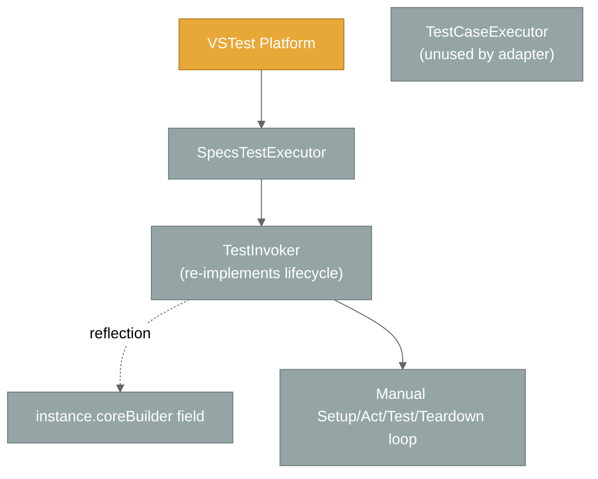

# Active Context: Specs

## Current Focus

**📌 `dotnet test --filter` support** — `SpecsTestExecutor.RunTests(sources)` now applies the VSTest filter expression to re-discovered test cases instead of running the whole assembly. Follows the committed `SpecReporting` / root-lifecycle work below.

**📌 `SpecReporting` API + root lifecycle (October 2026, committed `124ba8c`)** — the grouped-execution feature was reshaped and hardened:

- The `bool` grouping switches became a `SpecReporting` enum (`Individual` / `GroupedByRootContext`) configurable at **method, class, assembly, or `.runsettings`** level.
- Constructor-registered `BeforeAll` / `AfterAll` now actually run (once per class) — previously they were silently skipped.
- Grouped reports gained host-aware pass/fail markers and optional per-`It` source locations.
- `ItAsync[...]` source navigation now lands on the async body.

This builds on **grouped root-context execution** (Phase 9): a root `[Context]` can run as a **single test result** with an NSpec-style tree report in its output, while the default stays one result per `It[...]`.

It builds directly on the two threads completed just before it:

1. **Suite-tree execution** — `SuiteTreeBuilder` + `SelectionTreeWalker` replace the per-test rebuild so `BeforeAll` / `AfterAll` fire exactly once per context, even when only part of a suite is selected. `[Context]` methods are registered as named child contexts rather than invoked directly.
2. **Self-hosting `specs.core.UnitTests`** — the core unit-test project was migrated off NUnit fixtures onto `Specifications` + `[Context]` and is discovered/run by `specs.BDD.VSTestAdapter`. Specs now tests its own core with itself.

Alongside these: Test Explorer renders a real tree (RFC-0033 `TestCase.Hierarchy`), "Go to Source" navigates to the `It[...]` line, and display names now embed the context path so VS Code (which ignores `Hierarchy`) still shows context.

## Project Status Snapshot

| Area | State |
|------|-------|
| `specs.core` | Stable; `ITestCase.OwnSetupOnce` / `OwnTeardownOnce` added for the selection walker; 📌 `AsyncTestExtensions.RunSync` binds async test wrappers to the user delegate |
| `specs.BDD` | Stable; `CoreBuilder` exposed as `internal protected`; 📌 `SpecReporting` enum, `ContextAttribute.Reporting`, `SpecReportingAttribute` (assembly/class) |
| `specs.BDD.VSTestAdapter` | Discovery + execution complete; grouped mode via `GroupingSettings` + `GroupedContextRunner`; 📌 root lifecycle in `TestInvoker`, `MarkerStyle`; 📌 `--filter` honoured in `RunTests(sources)`; 217 adapter unit tests + 20 integration results passing |
| `specs.core.UnitTests` | Self-hosted; 289 results passing (`TestContextAdapter` suite runs grouped, collapsing 27 `It`s into 1 result) |
| Legacy `Spec` API | Maintained for backward compatibility |
| TestHarness | Internal-only; now a retirement candidate (core no longer needs it to self-test) |
| Documentation | Core files refreshed October 2026; memory bank consolidated to 6 core files + 4 supplementary references (`architecture.md`, `core-components.md`, `test-patterns.md`, `glossary.md`) |

## Recent Architectural Changes

### 📌 NEW — `--filter` support in `RunTests(sources)`

Flow diagram, BEFORE/AFTER behaviour, and supported property table live in `systemPatterns.md` section "Test Case Filtering (`dotnet test --filter`)".

| File | What changed |
|------|--------------|
| `Execution/SpecsTestExecutor.cs` | New static `FilterProperties` map (case-insensitive: `FullyQualifiedName`, `DisplayName`, `ContextMethod`, `ContextPath`, `TestDescription`). `RunTests(sources)` calls `runContext.GetTestCaseFilter(...)` after re-discovery, filters with `MatchTestCase`, and on `TestPlatformFormatException` sends an `Error` message and returns without running anything. A `null` filter (or `null` run context) runs everything as before |
| `Tests/Execution/SpecsTestExecutor_Tests.cs` 📌 NEW | 4 NUnit + Moq tests: filter limits results to `MultiContextSpec`; property-value provider returns the same values as the `TestCase` (case-insensitive, unknown → `null`); supported names are passed to `GetTestCaseFilter`; invalid filter reports the error and runs nothing |

Verified end-to-end: `--filter "FullyQualifiedName~Calculator"` on the integration project runs 4 results instead of 20.

### 📌 `SpecReporting` API, root lifecycle, report polish (committed `124ba8c`, 25 files)

BEFORE/AFTER diagrams live in `systemPatterns.md` sections "Root (class-level) Lifecycle" and "Grouped Root-Context Execution → Configuration API"; `.runsettings` keys in `techContext.md` section "Adapter Configuration".

| Layer | What changed |
|-------|--------------|
| `specs.BDD` | 📌 **Breaking**: `ContextAttribute.Grouped` / `GroupedSetting` → `Reporting` / `ReportingSetting` (`SpecReporting?` backing). `GroupSpecsByRootContextAttribute` deleted; new `SpecReporting` enum + `SpecReportingAttribute` (`AttributeTargets.Assembly \| Class`, `Inherited = false`) |
| `specs.core` | `AddTest(string, Func<Task>)` wraps via `AsyncTestExtensions.RunSync` (extension-method-bound) so `Action.Target` is the user's `Func<Task>` |
| Adapter / Discovery | `GroupingSettings.Resolve` takes 4 layers (method → class → assembly → runsettings); `ReadRunSettings` reads `SpecsBDD/SpecReporting` (names only); new `ReadShowSourceLocations`, `ReadColorOutput`, `ResolveMarkerStyle`. `SourceLocationReader.GetTestMethod` + state-machine `MoveNext` lookup + cross-assembly guard. `SpecsTestDiscoverer` / `TestStructureExtractor` signatures switched to `SpecReporting?` |
| Adapter / Conversion | `TestCaseConverter` resolves `It` locations through `GetTestMethod` |
| Adapter / Execution | `TestInvoker.InvokeSuite` runs root `OwnSetupOnce` / `OwnTeardownOnce` and passes `rootSetupFailure`; `GroupedContextRunner` takes `rootSetupFailure`, `showSourceLocations`, `MarkerStyle`; new internal `MarkerStyle` enum; `SpecsTestExecutor` resolves settings + `VSAPPIDNAME` once per run |
| Tests | +64 adapter tests (runsettings parsing, marker styles, source locations incl. async, root lifecycle order/failure, class-level + non-inherited precedence); fixtures `GroupedAsyncSpec`, `ClassGroupedSpec`, `DerivedFromClassGroupedSpec`, `SpecWithRootLifecycle`, `SpecWithFailingRootBeforeAll`; Moq 4.20.72 added to adapter tests |
| Integration | `GroupedCalculatorSpecs` deleted; `CalculatorSpecs` is class-level grouped, shares a constructor `BeforeAll` / `BeforeEach`, names its contexts, and adds a `Subtraction (grouped)` context using `Calculator.Subtract` |
| Self-hosted core | `TestContextAdapter` suite migrated to `[Context(Reporting = SpecReporting.GroupedByRootContext)]` |

### 📌 Grouped root-context execution (Phase 9)

A root `[Context]` can collapse into one VSTest `TestCase` / `TestResult`. Full precedence diagram, runtime contract table, and dynamic view live in `systemPatterns.md` section "Grouped Root-Context Execution". *(Attribute names below were superseded by the `SpecReporting` API above.)*

| Layer | What was added |
|-------|----------------|
| `specs.BDD` | `ContextAttribute.Grouped` (tri-state `bool?` backing, exposed as `GroupedSetting`); `[assembly: GroupSpecsByRootContext(bool enabled = true)]` |
| Adapter / Discovery | `GroupingSettings` (`ReadRunSettings`, `Resolve`); `SpecsTestDiscoverer` reads `IDiscoveryContext.RunSettings`; `TestStructureExtractor.ExtractTests(type, bool? runSettingsGrouping)` yields one `IsGrouped` record per grouped root |
| Adapter / Conversion | `SpecTest.IsGrouped`, `TestProperties.IsGrouped`; FQN `Class::Method::[grouped]`; display name = root context description |
| Adapter / Execution | `GroupedContextRunner` (once-per-node walk + NSpec-style output); `TestInvoker` splits the selection by `IsGrouped`; `SpecsTestExecutor` forwards `IRunContext` into re-discovery; `ResultReporter.Unwrap` made `internal` |
| Tests | `GroupingSettings_Tests` (precedence + XML parsing), `GroupedContextRunner_Tests` (pass/fail/BeforeAll-fail/empty/cancel), new `TestStructureExtractor_Tests` / `TestCaseConverter_Tests` cases, `GroupedSpecWithFailure` fixture, `GroupedCalculatorSpecs` integration suite (currently `Grouped = false`, exercising the per-context override; its 3 `It`s run individually) |

Side effects of the change:

- `specs.core.UnitTests.Framework.Adapters.TestContextAdapter` runs grouped, so the self-hosted count reads **289 results** (27 `It`s became 1).
- `CalculatorSpecs` in the integration project switched from hand-rolled `throw` checks to NFluent (`NFluent 3.1.0` package added).
- `.vscode/settings.json` pins `dotnet.defaultSolution` to `src/Specs.sln`.

### 📌 UPDATED — Display names embed the context path

VS Code's test UI ignores the RFC-0033 `Hierarchy` property, so `TestCaseConverter.BuildDisplayName` now returns `ContextPath → TestDescription` (or just `TestDescription` when there is no path). Visual Studio continues to nest via `Hierarchy`; the FQN format is unchanged.

### NEW — `SuiteTreeBuilder` + `SelectionTreeWalker`

Suite construction and once-per-node lifecycle moved behind two new adapter components. Full BEFORE/AFTER diagrams and the failure contract live in `systemPatterns.md` section "Once-Per-Node Lifecycle (selection-tree walk)".

Key points:

- `SuiteTreeBuilder.BuildSuite(type)` instantiates the suite **once** and registers every `[Context]` method as a named child context (`instance.Context[name] = () => method.Invoke(instance, null)`), then returns `CoreBuilder.Build()`. Discovery and execution both go through it.
- `SelectionTreeWalker` walks the immutable tree depth-first, entering only **live** nodes (those with a selected test at or beneath them) and firing `OwnSetupOnce` / `OwnTeardownOnce` exactly once per node.
- Per-test loops still delegate to `TestCaseExecutor`, which receives no-op once-actions so it never double-fires `BeforeAll` / `AfterAll`.

### 📌 NEW — `ITestCase.OwnSetupOnce` / `OwnTeardownOnce`

The existing `SetupOnce` / `TeardownOnce` cascade ancestor actions into the node. The walker needs a node's *own* actions in isolation, so `specs.core` now exposes both forms.

### 📌 NEW — Test Explorer tree + precise navigation

- `TestCaseConverter` sets the VSTest RFC-0033 `TestCase.Hierarchy` property (`[null, Namespace, Class, ContextPath]`) so Test Explorer nests `[Context]` and `Describe[...]` levels.
- `SpecTest.ItAction` captures the `It[...]` lambda at discovery; `SourceLocationReader` resolves its PDB sequence point, falling back to the `[Context]` method.

### 📌 UPDATED — Cancellation is a `CancellationToken`, not a setting

`TestCaseExecutorSettings.IsCancelled` was **removed**. `TestCaseExecutor.ProcessTestCase(CancellationToken)` now takes the token directly and checks it before each test instance. `SpecsTestExecutor` owns a `CancellationTokenSource` that `ITestExecutor.Cancel()` trips.

### 📌 NEW — Self-hosting migration (`specs.core.UnitTests`)

| Before | After |
|--------|-------|
| `[TestFixture]` / `[Test]` NUnit classes | Classes derive from `Specifications` with `[Context]` methods |
| `NUnit3TestAdapter` + `NUnit.Analyzers` package references | Removed; `ProjectReference` to `specs.BDD.VSTestAdapter` instead |
| `TestContextAdapter_Tests.cs` (NUnit) | `TestContextAdapter.cs` (Specs-style suite) |
| 2 test projects discovered by NUnit's adapter | `specs.core.UnitTests` is discovered by the Specs adapter |

315 core tests pass under the Specs adapter. `Autofac.Extras.Moq` + `NFluent` are unchanged; only the *host* changed.

### 📌 UPDATED — Execution consolidated in `TestCaseExecutor`

#### BEFORE (duplicated lifecycle)

Problems:

- Lifecycle was implemented twice (once in `TestCaseExecutor`, once in `TestInvoker`).
- `TestInvoker` reached the builder via reflection on a private field.
- Cancellation handling was ad-hoc in the adapter.

#### AFTER (single execution authority)

Benefits:

- One canonical lifecycle implementation (`TestCaseExecutor`) shared by all hosts.
- No reflection — `Specifications.CoreBuilder` exposed via `InternalsVisibleTo("specs.BDD.VSTestAdapter")`.
- Cancellation flows as a `CancellationToken` parameter on `ProcessTestCase`.
- Adapter contributes two small `I*Adapter` implementations (`VSTestLoggingAdapter`, `VSTestTestProvider`) — no execution logic.

### 📌 CLARIFIED — Suite → Feature Set → Scenario → Specification

`[Context]` (attribute on a method) and `Context[...]` (indexer inside a method body) are **levels of the same hierarchy**, not separate paradigms. The earlier documentation that described them as alternatives has been corrected throughout the memory bank.

### 📌 CLARIFIED — TestHarness is not a deliverable

TestHarness is an internal nspec bridge used only to test Specs while it could not yet test itself. It is not packed and not shipped. Now that `specs.core.UnitTests` runs on Specs, TestHarness survives only as a transitive dependency of the remaining NUnit projects and is a retirement candidate.

### 📌 UPDATED — Memory bank consolidated

The memory bank was trimmed from 17 files to 10: the 6 core files plus `architecture.md`, `core-components.md`, `test-patterns.md`, and `glossary.md`.

Removed as redundant or superseded:

| Removed | Reason |
|---------|--------|
| `project-overview.md` | Duplicated `projectbrief.md` and contradicted it (claimed 5 projects, no adapter, nspec in the shipped stack) |
| `VSTestAdapter-Plan.md` | Completed implementation plan; phase history now lives in `progress.md`, and its usage examples duplicated `test-patterns.md` |
| `VSTestAdapter-DeepDive.md` | Per-class detail duplicated the adapter responsibilities table in `systemPatterns.md`; its one unique insight was folded in as "The tree is built twice" |
| `refactoring-plan-testcaseexecutor.md` | Completed plan; outcome recorded as decision #7 in `systemPatterns.md` and Phase 5 in `progress.md` |
| `roles.md`, `devops-formatting.md` | Agent/process instructions, not project knowledge |
| `README.md` | Navigation index; the 6-core-file reading order is documented in the root `README.md` and `.clinerules/default-rules.md` |

## Next Steps

### Immediate

- Commit the `--filter` support.
- Consider an integration-level `--filter` check (e.g. `ContextPath` / `TestDescription` filters through the real VSTest pipeline).
- Decide whether the leftover `<Using Include="NUnit.Framework" />` and transitive NUnit dependency can be dropped from `specs.core.UnitTests`.
- Fold the remaining overlap between `architecture.md` / `core-components.md` and `systemPatterns.md`, which still describe the same material from two angles.
- Refresh `glossary.md` / `test-patterns.md` with the reporting vocabulary (`SpecReporting`, `Reporting =`, `[SpecReporting]`, `ShowSourceLocations`, `ColorOutput`, `[grouped]` FQN suffix) and a class-level `BeforeAll` example.
- Update the root `README.md` / user docs for the breaking attribute rename.

### Short term

- Migrate `specs.BDD.UnitTests` to self-hosting as well (only 5 tests remain there).
- Extend `IntegrationTests` to cover the once-per-node contract explicitly (partial selection, failing `BeforeAll`, cancellation mid-run) and add an individually-reported suite back alongside the class-grouped `CalculatorSpecs`.
- Decide whether grouped results should expose a per-`It` count to VSTest (currently one grouped context = one test in the totals).
- Document a `dotnet new` template once one exists.

### Long term

- Retire TestHarness entirely.
- Consider parallel execution support (currently sequential by design).
- Publish the adapter as a NuGet package.

## Active Decisions

### Why three deliverables instead of two

- `specs.core` and `specs.BDD` could be consumed without an IDE, but real users almost always want Test Explorer integration.
- Keeping the adapter separate preserves the rule that **`specs.core` has zero external NuGet references** — only the adapter takes a dependency on `Microsoft.TestPlatform.ObjectModel`.

### Why `Action`-based public surface

- A single uniform shape across sync/async hooks.
- Lifecycle ordering remains deterministic; no need to track outstanding `Task`s between phases.
- Trade-off: async work blocks via `GetAwaiter().GetResult()`, which is acceptable for tests but unsuitable for production code.

### Why callbacks for nested-context scope switching

- Avoids thread-local state or explicit context stacks in user code.
- The `try/finally` around the swap guarantees the parent scope is restored even if the user's block throws.

### Why `[Context]` methods are registered instead of invoked

- Invoking them directly merged their contents into the class root, erasing the feature-set level from the tree.
- Registering them as named child contexts (`instance.Context[name] = () => method.Invoke(...)`) makes each feature set a real node that can own `BeforeAll` / `AfterAll`, appears in `ContextPath`, and renders as a Test Explorer tree node.

### 📌 Why grouped mode is a separate runner, resolved at discovery

- Grouped mode changes *granularity* (how many `TestCase`s exist), which VSTest fixes at discovery time — so the decision must be made in the adapter before serialization, not in the core.
- Its failure policy differs from per-`It` mode (keep running after a failed test; aggregate into one result) and its output channel differs (tree in `StandardOutCategory`), so a dedicated `GroupedContextRunner` is clearer than threading a mode flag through `SelectionTreeWalker` and `TestCaseExecutor`.
- `specs.core` stays unaware of VSTest granularity; `specs.BDD` only carries pure metadata attributes.

### 📌 UPDATED — Why `ContextAttribute.Reporting` has a nullable backing

- A class, assembly, or `.runsettings` opt-in needs a per-context escape hatch; a non-nullable default of `Individual` cannot distinguish "author said Individual" from "author said nothing".
- `ReportingSetting` (`SpecReporting?`) feeds `GroupingSettings.Resolve`; the public `Reporting` property keeps attribute syntax simple.

### 📌 Why the root once-lifecycle lives in `TestInvoker`

- Both runners (`SelectionTreeWalker`, `GroupedContextRunner`) start *below* the suite root, so neither could own it without double-firing when a class mixes grouped and per-`It` contexts.
- `TestInvoker.InvokeSuite` already owns the per-class tree instance, making it the one place that sees the whole selection.

## Patterns & Preferences

### Naming

| Concept | Modern (specs.BDD) | Legacy (Spec) |
|---------|--------------------|---------------|
| Setup once | `BeforeAll(...)` / `BeforeAll(Func<Task>)` | `BeforeAll = ...` |
| Setup each | `BeforeEach(...)` / `BeforeEach(Func<Task>)` | `BeforeEach = ...` |
| Action | `Act(...)` / `Act(Func<Task>)` | `Act = ...` / `ActAsync = ...` |
| Teardown each | `AfterEach(...)` | `AfterEach = ...` |
| Teardown once | `AfterAll(...)` | `AfterAll = ...` |
| Describe | `Describe["..."] = () => { }` | `Describe["..."] = () => { }` |
| Context (block) | `Context["..."] = () => { }` | `Context["..."] = () => { }` |
| Context (feature set) | `[Context("...")] public void M()` | n/a |
| Grouped feature set 📌 | `[Context("...", Reporting = SpecReporting.GroupedByRootContext)] public void M()` | n/a |
| Grouped suite / assembly 📌 | `[SpecReporting(SpecReporting.GroupedByRootContext)]` on class or `[assembly: ...]` | n/a |
| Assertion | `It["..."] = () => { }` / `ItAsync[...] = async () => { }` | `It["..."] = () => { }` |

### Style

- NFluent (`Check.That(...).IsEqualTo(...)`) in the self-hosted core tests, the integration tests, and in user-facing examples.
- NUnit constraint-based assertions (`Assert.That(..., Is.EqualTo(...))`) in the remaining NUnit projects (`specs.BDD.UnitTests`, `specs.BDD.VSTestAdapter.Tests`).
- `null!` suppression only on fields initialized in `BeforeEach`.
- Builder methods return `IContextualTestCaseBuilder` to enable fluent chaining.

## Recent Insights

1. **One executor to rule them all** — folding the adapter's hand-rolled lifecycle into `TestCaseExecutor` eliminated a large class of subtle differences between Test Explorer behavior and internal unit tests. New lifecycle features now need to land in one place.
2. **One tree builder, too** — discovery and execution must produce *byte-identical* context paths, or `TestFinder` silently fails to locate tests. `SuiteTreeBuilder` makes that structural rather than a convention.
3. **`BeforeAll` only means something if the tree knows about contexts** — invoking `[Context]` methods directly flattened them out of the tree, which made once-per-context semantics impossible. Registering them as named child contexts fixed the semantics *and* gave Test Explorer its tree nodes for free.
4. **Discovery must be side-effect free** — instantiating a `Specifications` class and invoking its `[Context]` methods is enough to enumerate tests, *provided* no setup actually executes. The builder API enforces this naturally because hooks accumulate `Action`s rather than running them.
5. **Internal visibility is a feature** — using `InternalsVisibleTo` between the deliverables let us delete reflection-based shims and gave the adapter a clean, typed contract.
6. **Self-hosting is the best integration test** — running 315 core tests through the adapter surfaced lifecycle and path-matching bugs that the adapter's own unit tests could not.
7. **The two API styles really are the same paradigm** — they only differ syntactically. Documentation that frames them as alternatives invites confusion.
8. 📌 **Granularity is a discovery-time contract** — VSTest counts whatever discovery emitted. Grouping a context silently changes headline test totals (315 → 289 in the core suite), so grouped mode must stay opt-in and visible in the display name.
9. 📌 **VS Code and Visual Studio disagree on `Hierarchy`** — only VS honours RFC-0033; anything that must be visible in both IDEs has to live in `DisplayName`.
10. 📌 **"Never ran" is worse than "failed"** — constructor-level `BeforeAll` / `AfterAll` were silently skipped because the walker excluded the root node and nothing else picked it up. A fixture that logs lifecycle order (`SpecWithRootLifecycle`) caught it.
11. 📌 **Closures hide the user's lambda** — wrapping a `Func<Task>` in a lambda makes `Action.Method` a compiler-generated closure; binding an extension method keeps the original delegate reachable through `Action.Target`.
12. 📌 **Visual Studio's Test Explorer does not render ANSI** — output formatting must detect the host (`VSAPPIDNAME`) rather than assume a terminal.
13. 📌 **Source-based runs arrive unfiltered** — VSTest only hands the `--filter` expression to the adapter through `IRunContext.GetTestCaseFilter`; an adapter that re-discovers without applying it silently runs the whole assembly.

## Health Indicators

- **Builds**: clean across all 9 projects — 0 errors (one expected discovery warning from the `SpecWithNoContextMethods` fixture).
- **Tests**: 531 passing, 0 failing.
  - `specs.core.UnitTests` — 289 results (run by the Specs adapter; one grouped suite)
  - `specs.BDD.VSTestAdapter.Tests` — 217
  - `specs.BDD.VSTestAdapter.IntegrationTests` — 20 (`CalculatorSpecs` reports one result per root context)
  - `specs.BDD.UnitTests` — 5
- **Open bugs**: none known.
- **Known limitations**: sequential test execution; async-blocking via `GetAwaiter().GetResult()`; no data-driven tests yet.

## Open Questions

1. Should the adapter ship as a standalone NuGet package, or remain a project reference until 1.0?
2. Should `TestCaseExecutorSettings` expose a `MaxParallelism` knob (or do we keep things sequential)?
3. Can we retire the legacy `Spec` class once enough downstream consumers migrate? (Currently: no plan to remove.)
4. Should `SelectionTreeWalker`'s best-effort `OwnTeardownOnce` (exceptions swallowed) instead surface as a run-level warning?
5. Can `specs.BDD.UnitTests` and `specs.BDD.VSTestAdapter.Tests` also move to self-hosting, or does the adapter need an independent NUnit safety net?
6. 📌 Should a grouped `[Context]` be allowed below the root (nested `Describe`/`Context` blocks), or stay root-only as today?
7. 📌 Should grouped results report the inner pass/fail tally to VSTest somehow (e.g. via `TestResult.Messages` only, as now, or via additional synthetic results)?
8. 📌 Should `MarkerStyle` detection cover other non-ANSI hosts (e.g. Rider) beyond `VSAPPIDNAME=devenv.exe`?
