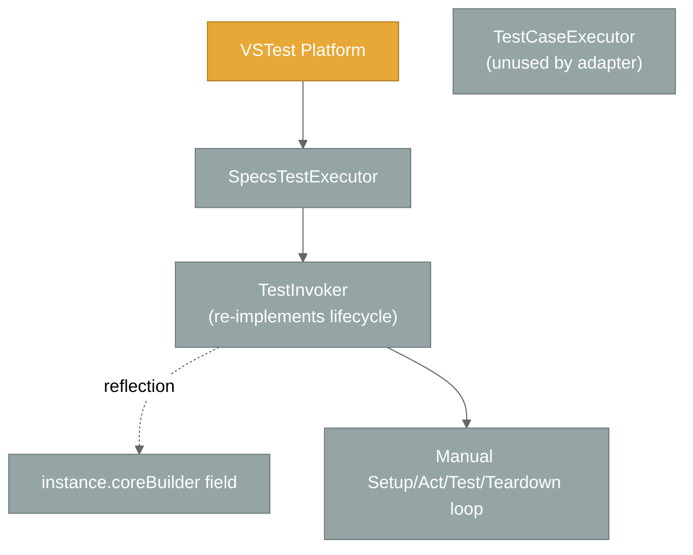

# Active Context: Specs

## Current Focus

**Correct Test Explorer semantics + self-hosting (October 2026)** — two threads of work are in flight:

1. **Suite-tree execution** — `SuiteTreeBuilder` + `SelectionTreeWalker` replace the per-test rebuild so `BeforeAll` / `AfterAll` fire exactly once per context, even when only part of a suite is selected. `[Context]` methods are now registered as named child contexts rather than invoked directly.
2. **Self-hosting `specs.core.UnitTests`** — the core unit-test project was migrated off NUnit fixtures onto `Specifications` + `[Context]` and is discovered/run by `specs.BDD.VSTestAdapter`. Specs now tests its own core with itself.

Alongside these: Test Explorer now renders a real tree (RFC-0033 `TestCase.Hierarchy`) and "Go to Source" navigates to the `It[...]` line rather than the top of the `[Context]` method.

## Project Status Snapshot

| Area | State |
|------|-------|
| `specs.core` | Stable; `ITestCase.OwnSetupOnce` / `OwnTeardownOnce` added for the selection walker |
| `specs.BDD` | Stable; `CoreBuilder` exposed as `internal protected` |
| `specs.BDD.VSTestAdapter` | Discovery + execution complete; 113 adapter unit tests + 25 integration tests passing |
| `specs.core.UnitTests` | 📌 Migrated to Specs (self-hosted); 315 tests passing with no NUnit test adapter |
| Legacy `Spec` API | Maintained for backward compatibility |
| TestHarness | Internal-only; now a retirement candidate (core no longer needs it to self-test) |
| Documentation | Core files refreshed October 2026; memory bank consolidated to 6 core files + 4 supplementary references (`architecture.md`, `core-components.md`, `test-patterns.md`, `glossary.md`) |

## Recent Architectural Changes

### 📌 NEW — `SuiteTreeBuilder` + `SelectionTreeWalker`

Suite construction and once-per-node lifecycle moved behind two new adapter components. Full BEFORE/AFTER diagrams and the failure contract live in `systemPatterns.md` section "Once-Per-Node Lifecycle (selection-tree walk)".

Key points:

- `SuiteTreeBuilder.BuildSuite(type)` instantiates the suite **once** and registers every `[Context]` method as a named child context (`instance.Context[name] = () => method.Invoke(instance, null)`), then returns `CoreBuilder.Build()`. Discovery and execution both go through it.
- `SelectionTreeWalker` walks the immutable tree depth-first, entering only **live** nodes (those with a selected test at or beneath them) and firing `OwnSetupOnce` / `OwnTeardownOnce` exactly once per node.
- Per-test loops still delegate to `TestCaseExecutor`, which receives no-op once-actions so it never double-fires `BeforeAll` / `AfterAll`.

### 📌 NEW — `ITestCase.OwnSetupOnce` / `OwnTeardownOnce`

The existing `SetupOnce` / `TeardownOnce` cascade ancestor actions into the node. The walker needs a node's *own* actions in isolation, so `specs.core` now exposes both forms.

### 📌 NEW — Test Explorer tree + precise navigation

- `TestCaseConverter` sets the VSTest RFC-0033 `TestCase.Hierarchy` property (`[null, Namespace, Class, ContextPath]`) so Test Explorer nests `[Context]` and `Describe[...]` levels.
- `SpecTest.ItAction` captures the `It[...]` lambda at discovery; `SourceLocationReader` resolves its PDB sequence point, falling back to the `[Context]` method.

### 📌 UPDATED — Cancellation is a `CancellationToken`, not a setting

`TestCaseExecutorSettings.IsCancelled` was **removed**. `TestCaseExecutor.ProcessTestCase(CancellationToken)` now takes the token directly and checks it before each test instance. `SpecsTestExecutor` owns a `CancellationTokenSource` that `ITestExecutor.Cancel()` trips.

### 📌 NEW — Self-hosting migration (`specs.core.UnitTests`)

| Before | After |
|--------|-------|
| `[TestFixture]` / `[Test]` NUnit classes | Classes derive from `Specifications` with `[Context]` methods |
| `NUnit3TestAdapter` + `NUnit.Analyzers` package references | Removed; `ProjectReference` to `specs.BDD.VSTestAdapter` instead |
| `TestContextAdapter_Tests.cs` (NUnit) | `TestContextAdapter.cs` (Specs-style suite) |
| 2 test projects discovered by NUnit's adapter | `specs.core.UnitTests` is discovered by the Specs adapter |

315 core tests pass under the Specs adapter. `Autofac.Extras.Moq` + `NFluent` are unchanged; only the *host* changed.

### 📌 UPDATED — Execution consolidated in `TestCaseExecutor`

#### BEFORE (duplicated lifecycle)

Problems:

- Lifecycle was implemented twice (once in `TestCaseExecutor`, once in `TestInvoker`).
- `TestInvoker` reached the builder via reflection on a private field.
- Cancellation handling was ad-hoc in the adapter.

#### AFTER (single execution authority)

Benefits:

- One canonical lifecycle implementation (`TestCaseExecutor`) shared by all hosts.
- No reflection — `Specifications.CoreBuilder` exposed via `InternalsVisibleTo("specs.BDD.VSTestAdapter")`.
- Cancellation flows as a `CancellationToken` parameter on `ProcessTestCase`.
- Adapter contributes two small `I*Adapter` implementations (`VSTestLoggingAdapter`, `VSTestTestProvider`) — no execution logic.

### 📌 CLARIFIED — Suite → Feature Set → Scenario → Specification

`[Context]` (attribute on a method) and `Context[...]` (indexer inside a method body) are **levels of the same hierarchy**, not separate paradigms. The earlier documentation that described them as alternatives has been corrected throughout the memory bank.

### 📌 CLARIFIED — TestHarness is not a deliverable

TestHarness is an internal nspec bridge used only to test Specs while it could not yet test itself. It is not packed and not shipped. Now that `specs.core.UnitTests` runs on Specs, TestHarness survives only as a transitive dependency of the remaining NUnit projects and is a retirement candidate.

### 📌 UPDATED — Memory bank consolidated

The memory bank was trimmed from 17 files to 10: the 6 core files plus `architecture.md`, `core-components.md`, `test-patterns.md`, and `glossary.md`.

Removed as redundant or superseded:

| Removed | Reason |
|---------|--------|
| `project-overview.md` | Duplicated `projectbrief.md` and contradicted it (claimed 5 projects, no adapter, nspec in the shipped stack) |
| `VSTestAdapter-Plan.md` | Completed implementation plan; phase history now lives in `progress.md`, and its usage examples duplicated `test-patterns.md` |
| `VSTestAdapter-DeepDive.md` | Per-class detail duplicated the adapter responsibilities table in `systemPatterns.md`; its one unique insight was folded in as "The tree is built twice" |
| `refactoring-plan-testcaseexecutor.md` | Completed plan; outcome recorded as decision #7 in `systemPatterns.md` and Phase 5 in `progress.md` |
| `roles.md`, `devops-formatting.md` | Agent/process instructions, not project knowledge |
| `README.md` | Navigation index; the 6-core-file reading order is documented in the root `README.md` and `.clinerules/default-rules.md` |

## Next Steps

### Immediate

- Stage and commit the self-hosting migration together with the `SuiteTreeBuilder` / `SelectionTreeWalker` work (currently split across staged and unstaged changes).
- Decide whether the leftover `<Using Include="NUnit.Framework" />` and transitive NUnit dependency can be dropped from `specs.core.UnitTests`.
- Fold the remaining overlap between `architecture.md` / `core-components.md` and `systemPatterns.md`, which still describe the same material from two angles.

### Short term

- Migrate `specs.BDD.UnitTests` to self-hosting as well (only 5 tests remain there).
- Extend `IntegrationTests` to cover the once-per-node contract explicitly (partial selection, failing `BeforeAll`, cancellation mid-run).
- Document a `dotnet new` template once one exists.

### Long term

- Retire TestHarness entirely.
- Consider parallel execution support (currently sequential by design).
- Publish the adapter as a NuGet package.

## Active Decisions

### Why three deliverables instead of two

- `specs.core` and `specs.BDD` could be consumed without an IDE, but real users almost always want Test Explorer integration.
- Keeping the adapter separate preserves the rule that **`specs.core` has zero external NuGet references** — only the adapter takes a dependency on `Microsoft.TestPlatform.ObjectModel`.

### Why `Action`-based public surface

- A single uniform shape across sync/async hooks.
- Lifecycle ordering remains deterministic; no need to track outstanding `Task`s between phases.
- Trade-off: async work blocks via `GetAwaiter().GetResult()`, which is acceptable for tests but unsuitable for production code.

### Why callbacks for nested-context scope switching

- Avoids thread-local state or explicit context stacks in user code.
- The `try/finally` around the swap guarantees the parent scope is restored even if the user's block throws.

### Why `[Context]` methods are registered instead of invoked

- Invoking them directly merged their contents into the class root, erasing the feature-set level from the tree.
- Registering them as named child contexts (`instance.Context[name] = () => method.Invoke(...)`) makes each feature set a real node that can own `BeforeAll` / `AfterAll`, appears in `ContextPath`, and renders as a Test Explorer tree node.

## Patterns & Preferences

### Naming

| Concept | Modern (specs.BDD) | Legacy (Spec) |
|---------|--------------------|---------------|
| Setup once | `BeforeAll(...)` / `BeforeAll(Func<Task>)` | `BeforeAll = ...` |
| Setup each | `BeforeEach(...)` / `BeforeEach(Func<Task>)` | `BeforeEach = ...` |
| Action | `Act(...)` / `Act(Func<Task>)` | `Act = ...` / `ActAsync = ...` |
| Teardown each | `AfterEach(...)` | `AfterEach = ...` |
| Teardown once | `AfterAll(...)` | `AfterAll = ...` |
| Describe | `Describe["..."] = () => { }` | `Describe["..."] = () => { }` |
| Context (block) | `Context["..."] = () => { }` | `Context["..."] = () => { }` |
| Context (feature set) | `[Context("...")] public void M()` | n/a |
| Assertion | `It["..."] = () => { }` / `ItAsync[...] = async () => { }` | `It["..."] = () => { }` |

### Style

- NFluent (`Check.That(...).IsEqualTo(...)`) in the self-hosted core tests and in user-facing examples.
- NUnit constraint-based assertions (`Assert.That(..., Is.EqualTo(...))`) in the remaining NUnit projects (`specs.BDD.UnitTests`, `specs.BDD.VSTestAdapter.Tests`).
- `null!` suppression only on fields initialized in `BeforeEach`.
- Builder methods return `IContextualTestCaseBuilder` to enable fluent chaining.

## Recent Insights

1. **One executor to rule them all** — folding the adapter's hand-rolled lifecycle into `TestCaseExecutor` eliminated a large class of subtle differences between Test Explorer behavior and internal unit tests. New lifecycle features now need to land in one place.
2. **One tree builder, too** — discovery and execution must produce *byte-identical* context paths, or `TestFinder` silently fails to locate tests. `SuiteTreeBuilder` makes that structural rather than a convention.
3. **`BeforeAll` only means something if the tree knows about contexts** — invoking `[Context]` methods directly flattened them out of the tree, which made once-per-context semantics impossible. Registering them as named child contexts fixed the semantics *and* gave Test Explorer its tree nodes for free.
4. **Discovery must be side-effect free** — instantiating a `Specifications` class and invoking its `[Context]` methods is enough to enumerate tests, *provided* no setup actually executes. The builder API enforces this naturally because hooks accumulate `Action`s rather than running them.
5. **Internal visibility is a feature** — using `InternalsVisibleTo` between the deliverables let us delete reflection-based shims and gave the adapter a clean, typed contract.
6. **Self-hosting is the best integration test** — running 315 core tests through the adapter surfaced lifecycle and path-matching bugs that the adapter's own unit tests could not.
7. **The two API styles really are the same paradigm** — they only differ syntactically. Documentation that frames them as alternatives invites confusion.

## Health Indicators

- **Builds**: clean across all 9 projects — 0 warnings, 0 errors.
- **Tests**: 458 passing, 0 failing.
  - `specs.core.UnitTests` — 315 (run by the Specs adapter)
  - `specs.BDD.VSTestAdapter.Tests` — 113
  - `specs.BDD.VSTestAdapter.IntegrationTests` — 25
  - `specs.BDD.UnitTests` — 5
- **Open bugs**: none known.
- **Known limitations**: sequential test execution; async-blocking via `GetAwaiter().GetResult()`; no data-driven tests yet.

## Open Questions

1. Should the adapter ship as a standalone NuGet package, or remain a project reference until 1.0?
2. Should `TestCaseExecutorSettings` expose a `MaxParallelism` knob (or do we keep things sequential)?
3. Can we retire the legacy `Spec` class once enough downstream consumers migrate? (Currently: no plan to remove.)
4. Should `SelectionTreeWalker`'s best-effort `OwnTeardownOnce` (exceptions swallowed) instead surface as a run-level warning?
5. Can `specs.BDD.UnitTests` and `specs.BDD.VSTestAdapter.Tests` also move to self-hosting, or does the adapter need an independent NUnit safety net?
