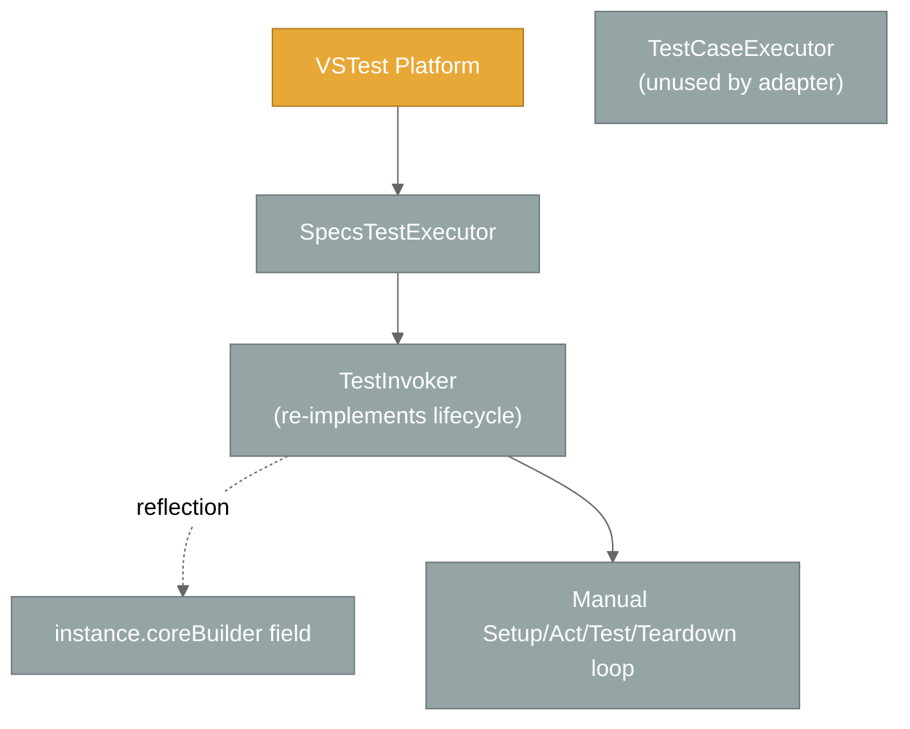
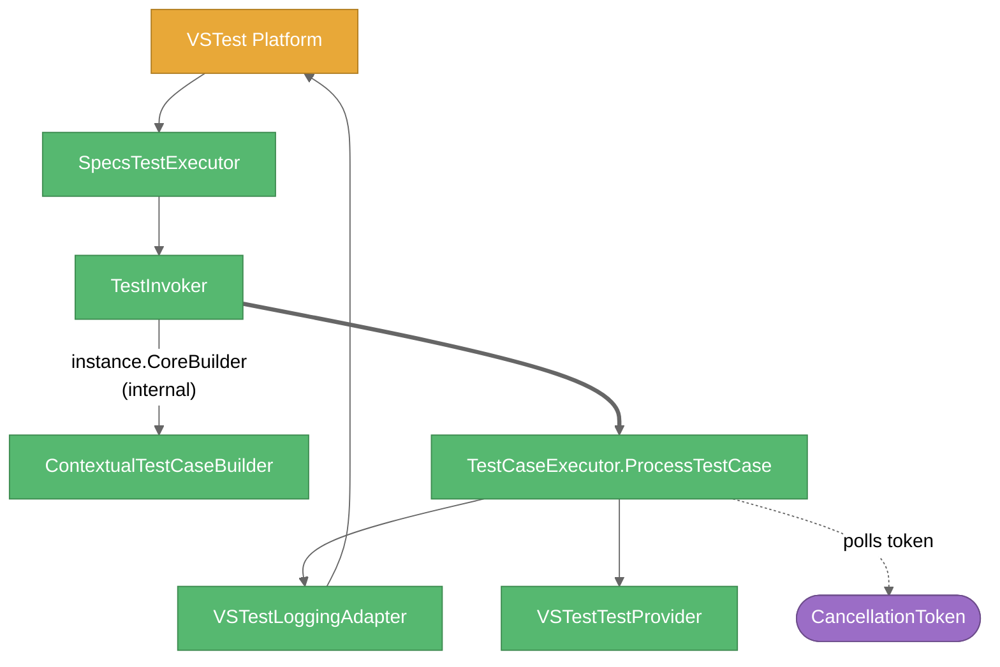

# Active Context: Specs

## Current Focus

**📌 NEW — Runner NuGet package IDs renamed (committed `2738675`, 10 files)** — the runner packages now publish as `specs.BDD.VSTest` (assembly still `specs.BDD.VSTestAdapter`, because VSTest only loads `*TestAdapter.dll`) and `specs.BDD.MTP` (assembly still `specs.BDD.TestingPlatform`) via explicit `PackageId`. `build/specs.BDD.TestingPlatform.props` became `build/specs.BDD.MTP.props`, since NuGet auto-imports only `build/<PackageId>.props`; the MTP integration project's import follows. `ci.yml` / `release.yml` now name `Specs.sln` explicitly (two root solutions made bare `restore` / `build` / `test` / `pack` ambiguous), and the MTP step passes `../../Specs.Mtp.slnx` from `tests/mtp`. The README gained an Installation section (which package per test host, the `global.json` MTP runner setting for .NET 10), and the `specs.core` / `specs.BDD` descriptions point users to a runner package. `Specs.sln` also had incidental Visual Studio rewrites (TestingPlatform project GUID, `VisualStudioVersion`). No code or test-count change. See `techContext.md` "Packaging & Release" and `systemPatterns.md` decision #45. Elsewhere in this memory bank, `build/specs.BDD.TestingPlatform.props` is now `build/specs.BDD.MTP.props`.

**📌 NEW — `[Describe]` → `[Feature]`, `TestStructure` → `ReportingLevel` (committed `ed6392f`, 64 files)** — the top-level suite attribute is now `[Feature]` (`FeatureAttribute`) so it no longer collides with the nested-context `Describe[...]` indexer. The grouping switch is `ReportingLevel` (`Test` / `Feature`, was `TestStructure.PerSpec` / `PerDescribe`), applied through `[ReportingLevel]` (assembly/class) and `[Feature(Level = ...)]` (method; was `Structure`, with `LevelSetting` replacing `StructureSetting`). The `.runsettings` element and the MTP `SpecsBDD__ReportingLevel` key are renamed too, and the old keys are no longer read. **Breaking** but a pure rename with no behaviour change. This memory bank uses the new names throughout; entries that describe earlier renames keep the names of their time. See `systemPatterns.md` decision #44 and `progress.md` Phase 17.

**📌 NEW — `[Feature]` method identity for CodeLens (staged, 7 files)** — both runners now name the `[Feature]` *method* as each spec's test method so IDEs can resolve the symbol (CodeLens, navigation). In the VSTest adapter, `TestCaseConverter` sets the FQN to `Class.DescribeMethod` (shared by every spec of the `[Feature]`, so Visual Studio shows specs as data-driven rows), moves per-spec uniqueness to a deterministic `TestCase.Id` (SHA-256 of source + the old `Class::Method::ContextPath::Description` name), and sets the RFC-0017 `TestCase.ManagedType` / `ManagedMethod` properties. In the MTP runner, `SpecTreeBuilder` stores the `[Feature]` `MethodInfo` on `SpecNode.Method`, and `TestNodeFactory` uses its name for `TestMethodIdentifierProperty.MethodName` (was the describe text). Execution is unchanged because `TestFinder` addresses specs by `TestProperties`, not the FQN. **Breaking**: `--filter FullyQualifiedName~<context or spec text>` no longer matches. Verified locally: VSTest 800 results (787 passed, 13 skipped); MTP suites pass. See `systemPatterns.md` section "`[Feature]` method identity (CodeLens / symbol navigation)" and decision #43.

**📌 Declared `It[...]` locations for "Go to Source" (staged, 19 files)** — the `It` / `ItAsync` indexers (and `IAssertProvider<T>`) now take compiler-supplied `[CallerFilePath]` / `[CallerLineNumber]` parameters and record them through the new `IContextualTestCaseBuilder.AddTestLocation`. Built nodes expose them as `ITestCase.TestLocations` (keyed by description, ordinal). When a spec's body has no PDB location in the test assembly, navigation now lands on the `It[...]` line instead of the `[Feature]` method. This covers `It["..."] = TODO` / `TODOAsync` and the parameterless `ShouldThrow<T>()`, whose bodies live in `specs.BDD`. The new shared `SourceLocationReader.TryGetTestLocation` (body PDB → declared location) is used by the MTP `SpecTreeBuilder` and by grouped-report `at <file>:line <n>` lines. The VSTest adapter carries the location on `SpecTest.DeclaredLocation` (set by `SuiteTreeFlattener`), and `TestCaseConverter` tries it between the lambda and the `[Feature]` fallback. `.vscode/settings.json` `dotnet.defaultSolution` is back to `Specs.sln`. Verified locally: VSTest 799 results (786 passed, 13 skipped); MTP 104 (99 passed, 5 skipped). See `systemPatterns.md` section "Test Explorer Hierarchy (RFC-0033)" → "Declared-location fallback" and decision #42.

**📌 Microsoft.Testing.Platform runner + shared runner core (staged, 78 files)** — a fourth deliverable, `specs.BDD.TestingPlatform`, runs Specs on Microsoft.Testing.Platform (MTP 2.5.1). It discovers each spec as a tree path (`/<assembly>/<namespace>/<class>/<describe>/<context>/…/<spec>`) used as the test node UID and matched by `--treenode-filter`. IDEs get the full tree as group nodes, and console runs get full paths plus an indented tree report. Settings come from `testconfig.json` / `SpecsBDD__*` environment variables. To share execution with the VSTest adapter, the runner-agnostic code moved from the adapter into `src/shared/specs.BDD.Runner/`, which both runners compile as linked source: the new `SuiteRunner` (root lifecycle + grouped / pending / regular split, moved out of `TestInvoker`), generic `SelectionTreeWalker<TTest>`, `GroupedSubtreeRunner` → `GroupedReport`, and the `ISpecRunListener<TTest>` events that `VSTestRunListener` and `MtpRunListener` map to their hosts. `VSTestLoggingAdapter` / `VSTestTestProvider` became the shared `SelectionLoggingAdapter<TTest>` / `SelectionTestProvider<TTest>`. VSTest `Hierarchy[3]` is now just the `[Feature]`. `specs.BDD.VSTestAdapter.IntegrationTests` was renamed `specs.BDD.IntegrationTests`. MTP tests live in `tests/mtp/Specs.Mtp.slnx`, whose `global.json` switches `dotnet test` to MTP mode, and CI/release run it as an extra step. Verified locally: build 0 warnings; VSTest 787 results (774 passed, 13 skipped); MTP 103 (98 passed, 5 skipped). See `systemPatterns.md` section "Shared Runner Core + Microsoft.Testing.Platform Runner" and decisions #36–41.

> 📌 RESOLVED — `src/specs.BDD.TestingPlatform/build/specs.BDD.TestingPlatform.props` (📌 now `specs.BDD.MTP.props`) used to be ignored by the `[Bb]uild/` rule in `src/.gitignore`. That file has been deleted, so the props file is no longer ignored and can be committed with the runner. The MTP integration app imports it, and the package ships it as its MSBuild hook.

**📌 NEW — Central build configuration + NuGet release pipeline** — shared MSBuild settings moved into the root `Directory.Build.props` (nullable, implicit usings, package metadata, symbols, XML docs, MinVer). `tests/Directory.Build.props` turns packing off for the test projects. `Directory.Packages.props` enables central package management, and `global.json` pins SDK `10.0.400`. All three deliverables are now C# 10, which implicit usings require. Versions come from `v*` git tags via MinVer. `.github/workflows/ci.yml` builds, tests, and packs every push to `main` and every PR. `.github/workflows/release.yml` publishes to nuget.org through Trusted Publishing (OIDC) and creates a GitHub Release. Doc-comment fixes keep the build at 0 warnings, and test counts are unchanged (786). See `systemPatterns.md` section "Build Configuration & Release Pipeline" and decisions #34–35.

**📌 `src/` + `tests/` split, `TestHarness` retired, `specs.BDD.UnitTests` self-hosted** — `Specs.sln` moved from `src/` to the repo root; the four test projects moved to `tests/` (`src/specs.specification.UnitTests/` became `tests/specs.BDD.UnitTests/`, matching its assembly name), leaving only the three deliverables in `src/`. `specs.BDD.UnitTests` was rewritten from nspec syntax on `nSpecTestHarness` (5 NUnit `[Test]` wrappers) to `Specifications` + `[Feature]` run by the Specs adapter (147 results). With no remaining consumer, the `TestHarness` project (`nSpecTestHarness`, `nspec 3.1.0`) was deleted, and NUnit now appears only in `specs.BDD.VSTestAdapter.Tests`. `CalculatorSpecs` switched from class-level `Feature` to `Test` (integration 28 → 34 results). See `systemPatterns.md` section "Test Hosting" and decision #33.

**📌 `SpecReporting` → `TestStructure` rename** — the grouping switch is renamed to say what it actually controls: how specs map to VSTest test cases. **Breaking**: `SpecReporting` (`Individual` / `GroupedByRootContext`) → `TestStructure` (`PerSpec` / `PerDescribe`), `[SpecReporting]` → `[TestStructure]`, `DescribeAttribute.Reporting` / `ReportingSetting` → `Structure` / `StructureSetting`, `.runsettings` `<SpecsBDD><SpecReporting>` → `<SpecsBDD><TestStructure>`. In the adapter, `TestStructureExtractor.ExtractTests` → `SuiteTreeFlattener.Flatten`, and the `ContextPath` delimiter moved from `TestStructureExtractor.PathSeparator` to the new `Conversion.ContextPathFormat.Separator`, so execution no longer reaches into `Discovery` for path formatting. No behaviour change. See `systemPatterns.md` decision #32.

**📌 NEW — .NET 10 test-project upgrade (commits `ba0a0f9`, `b496376`, `a4ad8cc`, `4affb1b`)** — the four `net8.0` test projects (`specs.core.UnitTests`, `specs.BDD.UnitTests`, `specs.BDD.VSTestAdapter.Tests`, `specs.BDD.VSTestAdapter.IntegrationTests`) now target `net10.0`, upgraded top-down one project at a time and validated with a full solution build/test. The `netstandard2.1` deliverables (`specs.core`, `specs.BDD`, `specs.BDD.VSTestAdapter`, and the since-deleted `TestHarness`) are unchanged, so no multi-targeting was needed. The explicit `System.Text.Encodings.Web 9.0.11` reference was removed from `specs.core.UnitTests` and `specs.BDD.UnitTests`. Upgrade assessment, plan, and per-task logs live under `.github/upgrades/scenarios/dotnet-version-upgrade/`. See `techContext.md` section "Target Frameworks".

**📌 NEW — Legacy `Spec` API removed** — the property-based `Spec` class, its `Domain/` runtime layer (`AbstractSpecDefinition`, `ActionRunner`, `TaskRunner`, `IRunContext`, `IRunContainer`, `ISpecDefinition`, `IndexedRunnerDelegate`, `Runner`, `Action/TaskSpecDefinition`, `Exceptions/*`), `Global.cs`, the `Specs.csproj` stub, and the `Examples/ConsoleExample` sample are deleted (22 files, 1,395 lines). `Specifications` is now the only authoring API. See `systemPatterns.md` decision #31.

**📌 NEW — `[Context]` → `[Feature]` attribute rename** — `ContextAttribute` is now `FeatureAttribute` across `specs.BDD`, the VSTest adapter, tests, integration fixtures, and `README.md`. The members (`Description`, `Reporting`, `ReportingSetting` — 📌 since renamed `Level` / `LevelSetting`) and the `Context[...]` indexers are unchanged; a suite still needs at least one `[Feature]` method to be discovered. This memory bank uses the new name throughout (older entries describing past commits were rewritten to match). See `systemPatterns.md` decision #30.

**📌 NEW — Public execution surface in `specs.core`** — `TestCaseExecutor`, `ITestContextAdapter`, `ITestProviderAdapter`, `TestContextAdapter`, and `TestInstance` are now `public`, so custom runners can drive the canonical lifecycle without `InternalsVisibleTo`. `specs.core` no longer grants the adapter internals access; `TestContextAdapter` gained `FromTestCase(ITestCase)` and lost its unused `test` parameter; the dead `Settings/TestSettings` class was deleted.

**📌 `ShouldThrow<T>` + `Act` exception capture (committed `61c96ea`)** — `It["..."] = ShouldThrow<T>()` / `ShouldThrow<T>(ex => ...)` verifies the exception thrown by `Act`. `Act` + `It` now run through `specs.core`'s public `ActExceptionContext.Run` in every execution path, so an unexpected `Act` exception fails only its own spec (with teardown still running) instead of aborting the context.

**📌 Pending specs (committed `5c5d942`)** — specs can be marked pending with `TODO` / `TODOAsync` placeholders or `xIt` / `xItAsync` / `xContext` / `xDescribe`. They are discovered, reported as **Skipped**, never run any lifecycle, render as `○ ... - PENDING` in grouped reports, and are filterable via `--filter IsPending=true|false`.

**📌 `dotnet test --filter` support (committed `b94d3a6`)** — `SpecsTestExecutor.RunTests(sources)` applies the VSTest filter expression to re-discovered test cases instead of running the whole assembly.

**📌 `SpecReporting` API + root lifecycle (October 2026, committed `124ba8c`)** — the grouped-execution feature was reshaped and hardened:

- The `bool` grouping switches became a `SpecReporting` enum (`Individual` / `GroupedByRootContext`) configurable at **method, class, assembly, or `.runsettings`** level.
- Constructor-registered `BeforeAll` / `AfterAll` now actually run (once per class) — previously they were silently skipped.
- Grouped reports gained host-aware pass/fail markers and optional per-`It` source locations.
- `ItAsync[...]` source navigation now lands on the async body.

This builds on **grouped root-context execution** (Phase 9): a root `[Feature]` can run as a **single test result** with an NSpec-style tree report in its output, while the default stays one result per `It[...]`.

It builds directly on the two threads completed just before it:

1. **Suite-tree execution** — `SuiteTreeBuilder` + `SelectionTreeWalker` replace the per-test rebuild so `BeforeAll` / `AfterAll` fire exactly once per context, even when only part of a suite is selected. `[Feature]` methods are registered as named child contexts rather than invoked directly.
2. **Self-hosting `specs.core.UnitTests`** — the core unit-test project was migrated off NUnit fixtures onto `Specifications` + `[Feature]` and is discovered/run by `specs.BDD.VSTestAdapter`. Specs now tests its own core with itself.

Alongside these: Test Explorer renders a real tree (RFC-0033 `TestCase.Hierarchy`), "Go to Source" navigates to the `It[...]` line, and display names now embed the context path so VS Code (which ignores `Hierarchy`) still shows context.

## Project Status Snapshot

| Area | State |
|------|-------|
| `specs.core` | Stable; `ITestCase.OwnSetupOnce` / `OwnTeardownOnce` added for the selection walker; 📌 `AsyncTestExtensions.RunSync` binds async test wrappers to the user delegate; 📌 `AddPendingTest`, `ChildTestCase(..., isPending)`, `ITestCase.PendingTests`; 📌 `ActExceptionContext`, `ActExceptionAssertions`, `ExpectedExceptionNotThrownException`; 📌 public `TestCaseExecutor` + adapter types, `TestContextAdapter.FromTestCase`, no `InternalsVisibleTo` for the adapter; 📌 NEW `AddTestLocation` + `ITestCase.TestLocations` |
| `specs.BDD` | Stable; `CoreBuilder` exposed as `internal protected`; 📌 UPDATED `ReportingLevel` enum (`Test` / `Feature`), `FeatureAttribute.Level`, `ReportingLevelAttribute` (assembly/class); 📌 `TODO` / `TODOAsync`, `xIt` / `xItAsync` / `xContext` / `xDescribe`; 📌 `ShouldThrow<T>`; 📌 NEW `It` / `ItAsync` indexers capture `[CallerFilePath]` / `[CallerLineNumber]` |
| `specs.BDD.VSTestAdapter` | Discovery + execution complete; grouped mode via `GroupingSettings` + 📌 `GroupedContextRunner` (now a `GroupedReport` → `TestResult` mapper); 📌 execution delegated to the shared `SuiteRunner` through `VSTestRunListener`; 📌 `Hierarchy[3]` = `[Feature]`; `SuiteTreeFlattener`; `--filter` honoured in `RunTests(sources)`; pending specs + `IsPending` property; `Act` capture; 📌 NEW `SpecTest.DeclaredLocation` navigation fallback; 📌 NEW FQN `Class.DescribeMethod` + hashed `Id` + RFC-0017 managed names; 📌 277 adapter unit-test results + 34 integration results passing (13 Skipped = pending) |
| 📌 NEW — shared runner core | `src/shared/specs.BDD.Runner/` (linked source, `internal`): `SuiteRunner`, `SelectionTreeWalker<TTest>`, `GroupedSubtreeRunner`, `ISpecRunListener<TTest>`, plus the scanners, `SuiteTreeBuilder`, `GroupingSettings`, `PendingSpecs`, `SourceLocationReader`, `TestFinder`, `ContextPathFormat` moved from the adapter |
| 📌 NEW — `specs.BDD.TestingPlatform` | MTP 2.5.1 runner: tree-path UIDs, `--treenode-filter`, IDE tree / console tree output, `testconfig.json` settings; 📌 declared-location fallback for leaves; 📌 NEW method identifier names the `[Feature]` method (`SpecNode.Method`); 70 NUnit-on-MTP tests + 34-result MTP integration app |
| `specs.core.UnitTests` | Self-hosted; 📌 340 results passing (`TestContextAdapter_Tests` suite runs grouped, collapsing 27 `It`s into 1 result); 📌 NUnit-free, moved to `tests/` |
| `specs.BDD.UnitTests` | 📌 Self-hosted (was NUnit + nspec via `TestHarness`); 📌 149 results; moved to `tests/` |
| Legacy `Spec` API | 📌 REMOVED — `Specifications` is the only API; `Examples/ConsoleExample` removed too |
| TestHarness | 📌 REMOVED — no remaining consumer once `specs.BDD.UnitTests` self-hosted |
| Build & release 📌 NEW | Central `Directory.Build.props` / `Directory.Packages.props` / `global.json`; MinVer tag versioning; CI + release workflows in place. **No `v*` tag or nuget.org release yet** |
| Documentation | Core files refreshed October 2026; memory bank consolidated to 6 core files + 4 supplementary references (`architecture.md`, `core-components.md`, `test-patterns.md`, `glossary.md`) |

## Recent Architectural Changes

### 📌 NEW — `[Feature]` method identity (7 files, +96 / −37)

BEFORE/AFTER diagrams and the property table live in `systemPatterns.md` section "`[Feature]` method identity (CodeLens / symbol navigation)"; decision #43 records the rationale.

| Layer | File(s) | What changed |
|-------|---------|--------------|
| VSTest adapter | `Conversion/TestCaseConverter.cs` | `BuildFullyQualifiedName` → `Class.DescribeMethod` (unique name when `ContextMethod` is `null`); old builder renamed `BuildUniqueName`; new `BuildId` (SHA-256 → first 16 bytes → `Guid`) assigned to `TestCase.Id`; hidden `TestCase.ManagedType` / `TestCase.ManagedMethod` properties registered and set |
| MTP runner | `Discovery/SpecNode.cs`, `Discovery/SpecTreeBuilder.cs` | New `MethodInfo? Method` on nodes; set for `Describe` and `GroupedDescribe` nodes |
| MTP runner | `Execution/TestNodeFactory.cs` | `MethodIdentifier` uses `describe.Method?.Name ?? describe.Text` |
| Tests | `TestCaseConverter_Tests` | FQN "contains" / `::` tests replaced by `FullyQualifiedName_IsClassAndDescribeMethod`, `_IsSharedBySpecsOfTheSameDescribe`, `Id_IsUniquePerSpec`, `Id_IsDeterministic`, `ManagedType_IsSpecClassFullName`, `ManagedMethod_IsDescribeMethodName`; grouped FQN test now expects `Class.describe_something` — adapter 276 → 277 |
| Tests | `SpecsTestExecutor_Tests` | Filter prefixes `Class::` → `Class.` |
| Tests | MTP `TestNodeFactory_Tests` | Identifier tests renamed `..._IsNamespaceClassAndDescribeMethod` / `..._MethodIdentifierIsTheDescribeMethod`; expect `describe_cart` / `describe_grouped` |

### 📌 Declared `It[...]` locations (19 files, +239 / −24)

BEFORE/AFTER diagrams live in `systemPatterns.md` section "Test Explorer Hierarchy (RFC-0033)" → "Declared-location fallback"; decision #42 records the rationale.

| Layer | File(s) | What changed |
|-------|---------|--------------|
| `specs.core` | `IContextualTestCaseBuilder.cs`, `ContextualTestCaseBuilder.cs` | `AddTestLocation(description, filePath, lineNumber)` — blank description / path throw `ArgumentException`; a second call for the same description replaces the first; locations are per builder (a child's locations stay on the child) |
| `specs.core` | `ITestCase.cs`, `ContextualTestCase.cs` | `IReadOnlyDictionary<string, (string filePath, int lineNumber)> TestLocations` (ordinal copy, empty by default); optional `testLocations` arg on `CreateTestCase` / `CreateTestCaseContext`, carried through `Build` / `BuildAsContext` |
| `specs.BDD` | `IAssertProvider.cs`, `AssertBuilder.cs`, `AssertBuilderAsync.cs` | Indexer becomes `this[string description, [CallerFilePath] string filePath = "", [CallerLineNumber] int lineNumber = 0]`; after `AddTest` / `AddPendingTest`, calls `AddTestLocation` when `filePath` is non-empty. Source-compatible for `It["..."] = ...` callers |
| Shared runner | `SourceLocationReader.cs` | New `TryGetTestLocation(assemblyPath, node, description, test)`: body PDB location, else `node.TestLocations[description]` |
| Shared runner | `GroupedSubtreeRunner.cs` | `AppendLocation` / `AppendPending` take the node + description and use `TryGetTestLocation`, so grouped reports show the `It` line for `TODO` specs |
| MTP runner | `Discovery/SpecTreeBuilder.cs` | Leaf `Location` uses `TryGetTestLocation`, then the `[Feature]` fallback |
| VSTest adapter | `Conversion/SpecTest.cs`, `Discovery/SuiteTreeFlattener.cs`, `Conversion/TestCaseConverter.cs` | `SpecTest.DeclaredLocation` (nullable tuple) filled from `TestLocations` for every flattened spec; converter order is `ItAction` PDB → `DeclaredLocation` → `ContextMethod` |
| Tooling | `.vscode/settings.json` | `dotnet.defaultSolution` → `Specs.sln` (was the stale `tests/mtp/Specs.Mtp.slnx`) |
| Tests | `ContextualTestCaseBuilder_Tests/TestLocations.cs` 📌 NEW | 7 core specs (no location by default, lookup, replace, child-only, blank args) — core 333 → 340 |
| Tests | `Specifications_Tests.cs` | `TODO` / `TODOAsync` record their declaring file and line (`CurrentFile()` / `CurrentLine()` helpers) — BDD 147 → 149 |
| Tests | `TestCaseConverter_Tests`, `SuiteTreeFlattener_Tests` | Declared-location fallback, lambda wins over declared location, flattened `TODO` spec carries its `It` line — adapter 273 → 276 |
| Tests | MTP `SpecTreeBuilder_Tests` | `Build_TodoSpecLeaf_PointsAtItsItDeclaration` — MTP unit tests 69 → 70 |

### 📌 MTP runner + shared runner core (78 files, +3,201 / −704)

BEFORE/AFTER diagrams, component tables, and the VSTest-vs-MTP contract live in `systemPatterns.md` section "Shared Runner Core + Microsoft.Testing.Platform Runner"; packages, settings, layout, and commands in `techContext.md` ("MTP Runner Configuration", "Package References by Project", "Solution Layout").

| Area | File(s) | What changed |
|------|---------|--------------|
| Shared core 📌 NEW | `src/shared/specs.BDD.Runner/SuiteRunner.cs`, `GroupedSubtreeRunner.cs`, `GroupedReport.cs`, `ISpecRunListener.cs`, `SpecRunItem.cs`, `SpecRunOptions.cs`, `ReportMarkers.cs`, `SpecExceptions.cs`, `SelectionLoggingAdapter.cs` | Runner-neutral execution: `SuiteRunner.Run` / `FailAll` (from `TestInvoker`); grouped runs return `GroupedReport` (from `GroupedContextRunner`); `ILoggingAdapter` → listener bridge (replaces deleted `VSTestLoggingAdapter`); marker glyphs; `Unwrap` (from `ResultReporter`) |
| Shared core (moved) | `ContextMethodScanner`, `ContextPathFormat` (now `internal`), `GroupingSettings` (+ `ParseReportingLevel`), `InvalidSpecificationException`, `MarkerStyle`, `PendingSpecs`, `SelectionTestProvider` (was `VSTestTestProvider`), `SelectionTreeWalker` (now generic), `SourceLocationReader`, `SpecificationClassScanner`, `SuiteTreeBuilder`, `TestFinder` | Moved from `specs.BDD.VSTestAdapter/{Discovery,Conversion,Execution}` to namespace `specs.BDD.Runner` |
| VSTest adapter | `TestInvoker.cs`, `GroupedContextRunner.cs`, `VSTestRunListener.cs` 📌 NEW, `ResultReporter.cs`, `TestCaseConverter.cs`, `.csproj`, `using` updates | `InvokeSuite` → `SuiteRunner.Run(..., VSTestRunListener)`; `GroupedContextRunner` keeps `Execute` + `ToTestResult`; `Hierarchy[3]` = first `ContextPath` segment; display name joins segments with `ContextPathFormat.Separator`; `.csproj` compiles `..\shared\specs.BDD.Runner\**\*.cs` |
| MTP runner 📌 NEW | `src/specs.BDD.TestingPlatform/` — `SpecsTestFramework`, `TestApplicationBuilderExtensions` (`AddSpecsBDD`, `TestingPlatformBuilderHook`, `SpecsExtension`), `SpecsSettings` (+ `ClientMode`), `Discovery/SpecTreeBuilder`, `SpecNode`, `SpecPath`, `Execution/SpecSelection`, `TestNodeFactory`, `MtpRunListener`, `Output/ConsoleTreeReport`, `.csproj` | netstandard2.1, C# 12, `NoWarn TPEXP`, `IsTestingPlatformApplication=false`, MTP packages `PrivateAssets=none`, packs `build/specs.BDD.MTP.props` |
| `specs.BDD` | `specs.BDD.csproj` | `InternalsVisibleTo("specs.BDD.TestingPlatform")` added |
| Packages | `Directory.Packages.props` | `Microsoft.Testing.Platform` + `.MSBuild` 2.5.1 |
| Solution file 📌 UPDATED (staged) | `Specs.Mtp.slnx` (moved from `tests/mtp/`), `.vscode/settings.json` | Solution now at repo root with `src/...` / `tests/mtp/...` project paths and the MTP runner listed first; 📌 `dotnet.defaultSolution` now `Specs.sln`. CI path not yet updated |
| Solution / CI | `Specs.sln`, `.github/workflows/ci.yml`, `release.yml` | `specs.BDD.TestingPlatform` added (8 projects); integration project renamed; extra `dotnet test --solution Specs.Mtp.slnx -c Release` step in `tests/mtp` |
| MTP tests 📌 NEW | `tests/mtp/global.json`, `Specs.Mtp.slnx`, `specs.BDD.TestingPlatform.Tests/*` (`SpecTreeBuilder_Tests`, `SpecSelection_Tests`, `TestNodeFactory_Tests`, `MtpRunListener_Tests`, `ConsoleTreeReport_Tests`, `SpecsSettings_Tests`, `IntegrationApp_Tests`, `TestFixtures/TreeSpecs`), `specs.BDD.TestingPlatform.IntegrationTests.csproj` | NUnit on MTP (`NUnit3TestAdapter` 6.3.1 override); integration app links `tests/specs.BDD.IntegrationTests/*.cs` and imports the runner's build props |
| Integration | `tests/specs.BDD.VSTestAdapter.IntegrationTests/` → `tests/specs.BDD.IntegrationTests/` | Folder, `.csproj`, and namespace renamed |
| Adapter tests | `TestCaseConverter_Tests` + `using` updates in 10 files | Hierarchy / display-name tests rewritten; new `Hierarchy_Grouped_TestGroupElementIsTheDescribe` (adapter 272 → 273) |
| Ignore rules | `src/.gitignore` 📌 DELETED | Its `[Bb]uild/` rule hid the runner's `build/` props; the root `.gitignore` still covers build output |
| Docs | `README.md`, `.clinerules/default-rules.md` | "Running on Microsoft.Testing.Platform" section, 4 deliverables, 4 + 2 test projects; renamed integration folder |

Open items noticed during the update:

- ✅ RESOLVED — `build/specs.BDD.MTP.props` was gitignored by `src/.gitignore` (now deleted).
- `src/specs.BDD.VSTestAdapter/Execution/TestInvoker.cs` section-divider comments contain mis-encoded box-drawing characters (`──…`) after the edit.
- `README.md` still lists the removed legacy `Specs` project and "net8.0 (tests)".

### 📌 NEW — Central build configuration + release pipeline (17 files)

BEFORE/AFTER diagrams are in `systemPatterns.md` section "Build Configuration & Release Pipeline". File-level settings, the version table, workflows, and the deployment diagram are in `techContext.md` sections "Build Configuration" and "Packaging & Release". The only source changes are XML doc comments.

| Area | File(s) | What changed |
|------|---------|--------------|
| SDK | `global.json` 📌 NEW | SDK `10.0.400`, `rollForward: latestFeature`, no prereleases |
| Shared props | `Directory.Build.props` 📌 NEW | `Nullable` + `ImplicitUsings` on; NuGet metadata (author, MIT, repo/project URL); `MinVerTagPrefix=v`; `.snupkg` symbols; `GenerateDocumentationFile`; `ContinuousIntegrationBuild` on GitHub Actions; `MinVer` `PackageReference` (`PrivateAssets=all`) |
| Test props | `tests/Directory.Build.props` 📌 NEW | Imports the root props; `IsPackable=false`, `GenerateDocumentationFile=false` |
| Package versions | `Directory.Packages.props` 📌 NEW | `ManagePackageVersionsCentrally`; 10 `PackageVersion`s (adds `MinVer 8.0.0`) |
| Deliverables | `specs.core.csproj`, `specs.BDD.csproj`, `specs.BDD.VSTestAdapter.csproj` | `<LangVersion>10</LangVersion>` (adapter was `8.0`); adapter `PackageReference`s lose `Version=` |
| Test projects | All four `.csproj` | `PackageReference`s lose `Version=`; adapter tests move from NFluent 3.0.0 to 3.1.0 |
| CI | `.github/workflows/ci.yml` 📌 NEW | Push to `main` / PR → restore, build, test, pack (`-c Release`), upload `packages` artifact |
| Release | `.github/workflows/release.yml` 📌 NEW | `v*` tag → build, test, pack → `NuGet/login@v1` (OIDC) → `dotnet nuget push` → `gh release create` (prerelease when the tag contains `-`) |
| XML docs | `SourceLocationReader.cs`, `Specifications.cs`, `ContextBuilder.cs`, `VSTestLoggingAdapter.cs` | Missing docs added (`SourceLocation` ctor, `CoreBuilder`); stale `cref` / `paramref` targets fixed |

Verified: Release build 0 warnings / 0 errors; 786 results (773 passed, 13 pending skipped). A local `dotnet pack` produced `0.0.0-alpha.0.33` packages because no `v*` tag exists yet.

### 📌 Repo restructure + BDD self-hosting (54 files)

BEFORE/AFTER diagrams and naming conventions live in `systemPatterns.md` section "Test Hosting"; decision #33 records the rationale. No production code changed.

| Area | File(s) | What changed |
|------|---------|--------------|
| Solution | `src/Specs.sln` → `Specs.sln` | Moved to the repo root; project paths now `src\...` / `tests\...`; `TestHarness` entry and its configurations removed (8 → 7 projects) |
| Removed | `src/TestHarness/TestHarness.csproj`, `nSpecTestHarness.cs` 📌 DELETED | nspec bridge (`nspec 3.1.0`, `NUnit 3.14.0`, `System.Text.Encodings.Web 9.0.11`) |
| Test projects | `src/specs.*Tests/` → `tests/specs.*Tests/` | All four moved; `ProjectReference`s rewritten to `..\..\src\...`; `src/specs.specification.UnitTests/` folder renamed `tests/specs.BDD.UnitTests/` |
| `specs.BDD.UnitTests` | `.csproj` | Dropped `NUnit3TestAdapter`, `NUnit.Analyzers`, the `TestHarness` reference, and the global `Using NUnit.Framework`; added a `ProjectReference` to `specs.BDD.VSTestAdapter` |
| `specs.BDD.UnitTests` | `AssertBuilder_Tests`, `AssertBuilderAsync_Tests`, `ContextBuilder_Tests`, `Specifications_Tests`, `BaseAssertBuilderSpecs`, `Attributes/FeatureAttribute_Tests` | Renamed with a `_Tests` suffix; base class `nSpecTestHarness` → `Specifications`; `[Test] Specs() => RunMySpecs()` + private `*_Specs()` → one public `[Feature]` method named after the type under test; `describe`/`context`/`it`/`act =`/`beforeEach =` → `Describe`/`Context`/`It`/`Act(...)`/`BeforeEach(...)`. `ContextBuilder_Tests` hoists the shared `BeforeEach` callback above `Act` |
| `specs.core.UnitTests` | `.csproj`, `TestContextAdapter.cs` → `TestContextAdapter_Tests.cs`, `RunAll*_Tests.cs`, `TestCaseExecutor_Tests.cs` | `TestHarness` reference and global `Using NUnit.Framework` removed; stray `using NUnit.Framework` deleted; NUnit `AssertionException` → `InvalidOperationException` in the executor-failure specs; `TestContextAdapter` suite class renamed `TestContextAdapter_Tests` with `[Feature]` method `TestContextAdapter()` |
| Adapter tests / integration | `.csproj` files | Paths only |
| Integration | `CalculatorSpecs.cs` | Class-level `[ReportingLevel(Feature)]` → `[ReportingLevel(Test)]`; `Subtraction (grouped)` keeps its method-level `Feature` (results 28 → 34) |
| Tooling | `.vscode/tasks.json`, `launch.json`, `settings.json`, `.clinerules/default-rules.md` | Paths point at `Specs.sln` / `tests\specs.core.UnitTests`; `watch` task and TestHarness launch config removed; project-structure reference redrawn |
| Docs | `README.md` | TestHarness and the nspec dependency dropped from the project list / tech stack |

### 📌 `SpecReporting` → `TestStructure` rename, 21 files)

Pure rename/relocation — discovery output, FQNs (`Class::Method::[grouped]`), precedence, and runtime behaviour are unchanged. Decision #32 in `systemPatterns.md` records the rationale.

| Layer | File(s) | What changed |
|-------|---------|--------------|
| `specs.BDD` | `Attributes/TestStructure.cs` 📌 NEW (replaces deleted `SpecReporting.cs`) | Enum `TestStructure { PerSpec, PerDescribe }` (was `SpecReporting { Individual, GroupedByRootContext }`) |
| `specs.BDD` | `Attributes/TestStructureAttribute.cs` (renamed from `SpecReportingAttribute.cs`) | `TestStructureAttribute(TestStructure structure)` with `Structure` property; still `Assembly \| Class`, `Inherited = false` |
| `specs.BDD` | `Attributes/FeatureAttribute.cs` | `Reporting` / `ReportingSetting` → `Level` / `LevelSetting` (nullable `ReportingLevel?` backing, default `Test`) |
| Adapter / Conversion | `ContextPathFormat.cs` 📌 NEW | Public static `Separator` (`" → "`, settable) — the single `ContextPath` delimiter for discovery and execution |
| Adapter / Discovery | `SuiteTreeFlattener.cs` (renamed from `TestStructureExtractor.cs`) | `ExtractTests(type, SpecReporting?)` → `Flatten(type, TestStructure?)`; `PathSeparator` removed in favour of `ContextPathFormat.Separator` |
| Adapter / Discovery | `GroupingSettings.cs`, `SpecsTestDiscoverer.cs`, `SuiteTreeBuilder.cs` | `ReportingLevel?` signatures; `ReadRunSettings` reads `SpecsBDD/ReportingLevel`; `Resolve` reads `LevelSetting` / `[ReportingLevel]` and returns `true` for `Feature` |
| Adapter / Execution | `SelectionTreeWalker.cs`, `GroupedContextRunner.cs`, `TestFinder.cs` | Split / join `ContextPath` with `ContextPathFormat.Separator`; `SelectionTreeWalker` and `TestFinder` drop their `Discovery` namespace import |
| Tests | `SuiteTreeFlattener_Tests.cs` (renamed from `TestStructureExtractor_Tests.cs`), `GroupingSettings_Tests`, `TestFinder_Tests`, `TestInvoker_Tests`, `GroupedContextRunner_Tests`, `SampleSpecifications.cs` | Renamed APIs, constants (`PerSpec` / `PerDescribe`) and test names; counts unchanged |
| Integration / self-hosted | `CalculatorSpecs.cs`, `PendingSpecs.cs`, `specs.core.UnitTests/.../TestContextAdapter.cs` | `[ReportingLevel(ReportingLevel.Feature)]` / `[Feature(..., Level = ReportingLevel.Feature)]` |

### 📌 NEW — Public execution surface in `specs.core`

BEFORE/AFTER diagrams live in `systemPatterns.md` section "Adapter Pattern — Framework independence"; decision #29 records the rationale.

| Layer | File(s) | What changed |
|-------|---------|--------------|
| `specs.core` | `Processors/TestExecutors/TestCaseExecutor.cs` | `internal` → `public`; ctor parameter `tests` renamed `testProvider` and now null-guarded (`ArgumentNullException`); XML docs added |
| `specs.core` | `Adapters/ITestContextAdapter.cs`, `ITestProviderAdapter.cs`, `TestInstance.cs` | `internal` → `public` with XML docs (`ILoggingAdapter` was already public) |
| `specs.core` | `Adapters/TestContextAdapter.cs` | `internal` → `public`. **Signature change**: ctor is now `(setupOnce, setupEach, act, teardownEach, teardownOnce)` — the unused, unvalidated `test` parameter was dropped and parameters lost their `Action` suffix (`ParamName` values changed accordingly). New `static FromTestCase(ITestCase)` adopts a built node's **cascaded** `SetupOnce` / `SetupEach` / `Act` / `TeardownEach` / `TeardownOnce` |
| `specs.core` | `Settings/TestSettings.cs` 📌 DELETED | Unused public class duplicating `TestCaseExecutorSettings.StopOnAssertFailure` |
| `specs.core` | `Processors/TestExecutors/TestCaseExecutorSettings.cs` | Stale `IsCancelled` reference removed from the ctor XML doc |
| `specs.core` | `specs.core.csproj` | `<InternalsVisibleTo Include="specs.BDD.VSTestAdapter" />` removed — the adapter now compiles against the public surface only |
| Adapter / Execution | `SelectionTreeWalker.cs` | Uses the new 5-argument `TestContextAdapter` ctor |
| Tests | `specs.core.UnitTests/Framework/Adapters/TestContextAdapter.cs` | Suite rewritten: local `Create()` helper, `Check.ThatCode(...).Throws<ArgumentNullException>().WithProperty("ParamName", ...)` instead of `try/catch`, new `FromTestCase` specs (null arg; mocked `ITestCase` via Moq runs all five phases in order); still 27 `It`s in one grouped result |
| Tests | `TestCaseExecutor_Tests.cs` | New "Constructor validation..." spec — null `testProvider` throws (core 332 → 333) |

### 📌 `ShouldThrow<T>` + `Act` exception capture (committed `61c96ea`, 19 files)

BEFORE/AFTER diagrams and the outcome contract live in `systemPatterns.md` section "Act Exception Capture (`ShouldThrow<T>`)"; decisions #25–28 record the rationale.

| Layer | File(s) | What changed |
|-------|---------|--------------|
| `specs.core` | `Processors/TestExecutors/ActExceptionContext.cs` 📌 NEW | Public static class: `Run(act, test)` catches the `Act` exception, publishes it in an `AsyncLocal` outcome while `test` runs, and rethrows it (`ExceptionDispatchInfo`) unless the test called `MarkHandled()`; an unhandled `Act` exception replaces any `test` exception; nested runs restore the enclosing outcome |
| `specs.core` | `Assertions/ActExceptionAssertions.cs`, `Assertions/ExpectedExceptionNotThrownException.cs` 📌 NEW | `VerifyActException<T>(this Action<T> verify)` — marks handled, throws `ExpectedExceptionNotThrownException` when nothing / an unrelated type was thrown (actual kept as `InnerException`), else calls `verify` |
| `specs.core` | `TestCaseExecutor.cs` | `Act()` moved inside the per-test `try` via `ActExceptionContext.Run(testContext.Act, test.Test)` |
| `specs.BDD` | `Specifications.cs` | `public static Action ShouldThrow<T>()` and `ShouldThrow<T>(Action<T> verify)` returning the bound `verifier.VerifyActException` |
| Adapter / Execution | `TestInvoker.cs`, `GroupedContextRunner.cs` | `RunLifecycle` / `RunTest` call `ActExceptionContext.Run(node.Act, test)` |
| Adapter / Discovery | `SourceLocationReader.cs` | `GetTestMethod` loops through nested `Delegate.Target`s (async wrapper and `ShouldThrow` verifier) |
| Tests | `ActExceptionContext_Tests.cs`, `ActExceptionAssertions_Tests.cs` 📌 NEW, `TestCaseExecutor_Tests.cs` | Self-hosted core specs for `Run` / `MarkHandled` / nesting / null args and verifier outcomes; executor `Act`-throws context rewritten (logs `LogAssertFailure`, does not throw, still tears down; rethrows with `StopOnAssertFailure`; handled exception logs success) |
| Tests | `specs.specification.UnitTests/Specifications.cs` (📌 now `tests/specs.BDD.UnitTests/Specifications_Tests.cs`) | Harness specs for `ShouldThrow` (null verifier, bound target, assignable pass, verifier receives exception, no-throw fails) |
| Tests | Adapter `TestInvoker_Tests`, `GroupedContextRunner_Tests`, `SourceLocationReader_Tests`, `SampleSpecifications.cs` | Fixtures `ShouldThrowSpec`, `GroupedShouldThrowSpec` (`TriggerFailure`-gated); tests for pass / no-throw / wrong-type / verifier failure, plain spec failing with the `Act` exception while teardown runs, suite-level isolation, grouped tallies, verifier source navigation |
| Integration | `CalculatorSpecs.cs`, `AsyncAndExceptionSpecs.cs` | Manual `try/catch` + captured locals replaced by `ShouldThrow<T>`; division `Act` hoisted to the `[Feature]` level; new `names the offending parameter` spec |
| Docs | `README.md` | "Expected exceptions" section |

### 📌 Pending specs (committed `5c5d942`)

BEFORE/AFTER routing diagrams and the runtime contract live in `systemPatterns.md` section "Pending Specs"; decisions #22–24 record the rationale.

| Layer | File(s) | What changed |
|-------|---------|--------------|
| `specs.core` | `ITestCase.cs`, `ContextualTestCase.cs` | New `IReadOnlyCollection<string> PendingTests` (ordinal `HashSet`) passed through `CreateTestCase` / `CreateTestCaseContext` (optional `pendingTests` arg) |
| `specs.core` | `IContextualTestCaseBuilder.cs`, `ContextualTestCaseBuilder.cs` | `AddPendingTest(string, Action)` / `AddPendingTest(string, Func<Task>)` (body kept in `Tests`, description recorded as pending); `ChildTestCase(description, configure, bool isPending)` — a pending builder propagates `isPending` to every descendant, so `AddTest` inside it records pending too |
| `specs.BDD` | `Specifications.cs` | `public static readonly Action TODO` / `Func<Task> TODOAsync`; `xIt`, `xItAsync`, `xContext`, `xDescribe` properties |
| `specs.BDD` | `AssertBuilder.cs`, `AssertBuilderAsync.cs`, `ContextBuilder.cs` | Internal `isPending` ctor arg; assert builders route to `AddPendingTest` when pending or when the value is `ReferenceEquals` to `TODO` / `TODOAsync` |
| Adapter / Discovery | `PendingSpecs.cs` 📌 NEW, `ReportingLevelExtractor.cs` | Helpers `IsPending` / `HasRunnableTests` / `HasAnyTests`; `SpecTest.IsPending` set per spec, and for grouped records only when the subtree is non-empty and fully pending |
| Adapter / Conversion | `SpecTest.cs`, `TestProperties.cs`, `TestCaseConverter.cs` | `IsPending` POCO field + `SpecsBDD.IsPending` `TestProperty` written onto each `TestCase` |
| Adapter / Execution | `TestInvoker.cs` | Three-way split (grouped / pending / regular); pending recorded `Skipped` up front; root once-lifecycle runs only when something runnable is selected; `Invoke` returns `Skipped` for a pending case |
| Adapter / Execution | `GroupedContextRunner.cs` | `PendingMark` (`○` / yellow ANSI / `⏸️`), `Pending` tally in summary, `RenderPendingSubtree` skips once-actions for nodes without runnable specs, all-pending result → `Skipped` ("All specs are pending."), root-setup failure leaves pending specs pending |
| Adapter / Execution | `ResultReporter.cs`, `SpecsTestExecutor.cs` | `ResultReporter.Skipped(...)` + `PendingMessage = "Pending"`; `IsPending` added to `FilterProperties` |
| Tests | `ContextualTestCaseBuilder_Tests/Pending.cs` 📌 NEW, `ContextualTestCase_Tests.cs` | +14 self-hosted core specs (pending builder API, propagation, argument validation, `PendingTests` default/dedup) |
| Tests | `specs.specification.UnitTests/Specifications.cs` (📌 now `Specifications_Tests.cs`) | Harness specs for `TODO`, `TODOAsync`, `xIt`, `xItAsync`, `xContext`, `xDescribe` |
| Tests | Adapter `*_Tests.cs`, `SampleSpecifications.cs` | Fixtures `SpecWithPending`, `AllPendingSpec`, `PendingWithFailingRootBeforeAll`, `GroupedSpecWithPending`; tests for discovery flags, converter property, grouped pending output/outcomes, `ResultReporter.Skipped`, `IsPending` filter, `TestInvoker` pending routing and root lifecycle suppression |
| Integration | `PendingSpecs.cs` 📌 NEW, `StringSpecs.cs` | Individual + grouped pending suites whose pending bodies / `BeforeAll` throw; `StringSpecs` gains a `TODO` spec |
| Docs | `README.md` | "Pending specs" section + Key Features bullet |

### 📌 `--filter` support in `RunTests(sources)` (committed `b94d3a6`)

Flow diagram, BEFORE/AFTER behaviour, and supported property table live in `systemPatterns.md` section "Test Case Filtering (`dotnet test --filter`)".

| File | What changed |
|------|--------------|
| `Execution/SpecsTestExecutor.cs` | New static `FilterProperties` map (case-insensitive: `FullyQualifiedName`, `DisplayName`, `ContextMethod`, `ContextPath`, `TestDescription`). `RunTests(sources)` calls `runContext.GetTestCaseFilter(...)` after re-discovery, filters with `MatchTestCase`, and on `TestPlatformFormatException` sends an `Error` message and returns without running anything. A `null` filter (or `null` run context) runs everything as before |
| `Tests/Execution/SpecsTestExecutor_Tests.cs` 📌 NEW | 4 NUnit + Moq tests: filter limits results to `MultiContextSpec`; property-value provider returns the same values as the `TestCase` (case-insensitive, unknown → `null`); supported names are passed to `GetTestCaseFilter`; invalid filter reports the error and runs nothing |

Verified end-to-end: `--filter "FullyQualifiedName~Calculator"` on the integration project runs 4 results instead of 20.

### 📌 `SpecReporting` API, root lifecycle, report polish (committed `124ba8c`, 25 files)

BEFORE/AFTER diagrams live in `systemPatterns.md` sections "Root (class-level) Lifecycle" and "Grouped Root-Context Execution → Configuration API"; `.runsettings` keys in `techContext.md` section "Adapter Configuration". *(📌 The `SpecReporting` names below were later renamed to `TestStructure` — see above.)*

| Layer | What changed |
|-------|--------------|
| `specs.BDD` | 📌 **Breaking**: `DescribeAttribute.Grouped` / `GroupedSetting` → `Reporting` / `ReportingSetting` (`SpecReporting?` backing). `GroupSpecsByRootContextAttribute` deleted; new `SpecReporting` enum + `SpecReportingAttribute` (`AttributeTargets.Assembly \| Class`, `Inherited = false`) |
| `specs.core` | `AddTest(string, Func<Task>)` wraps via `AsyncTestExtensions.RunSync` (extension-method-bound) so `Action.Target` is the user's `Func<Task>` |
| Adapter / Discovery | `GroupingSettings.Resolve` takes 4 layers (method → class → assembly → runsettings); `ReadRunSettings` reads `SpecsBDD/SpecReporting` (names only); new `ReadShowSourceLocations`, `ReadColorOutput`, `ResolveMarkerStyle`. `SourceLocationReader.GetTestMethod` + state-machine `MoveNext` lookup + cross-assembly guard. `SpecsTestDiscoverer` / `TestStructureExtractor` signatures switched to `SpecReporting?` |
| Adapter / Conversion | `TestCaseConverter` resolves `It` locations through `GetTestMethod` |
| Adapter / Execution | `TestInvoker.InvokeSuite` runs root `OwnSetupOnce` / `OwnTeardownOnce` and passes `rootSetupFailure`; `GroupedContextRunner` takes `rootSetupFailure`, `showSourceLocations`, `MarkerStyle`; new internal `MarkerStyle` enum; `SpecsTestExecutor` resolves settings + `VSAPPIDNAME` once per run |
| Tests | +64 adapter tests (runsettings parsing, marker styles, source locations incl. async, root lifecycle order/failure, class-level + non-inherited precedence); fixtures `GroupedAsyncSpec`, `ClassGroupedSpec`, `DerivedFromClassGroupedSpec`, `SpecWithRootLifecycle`, `SpecWithFailingRootBeforeAll`; Moq 4.20.72 added to adapter tests |
| Integration | `GroupedCalculatorSpecs` deleted; `CalculatorSpecs` is class-level grouped, shares a constructor `BeforeAll` / `BeforeEach`, names its contexts, and adds a `Subtraction (grouped)` context using `Calculator.Subtract` |
| Self-hosted core | `TestContextAdapter` suite migrated to `[Describe(Reporting = SpecReporting.GroupedByRootContext)]` |

### 📌 Grouped root-context execution (Phase 9)

A root `[Describe]` can collapse into one VSTest `TestCase` / `TestResult`. Full precedence diagram, runtime contract table, and dynamic view live in `systemPatterns.md` section "Grouped Root-Context Execution". *(Attribute names below were superseded by the `SpecReporting` API above.)*

| Layer | What was added |
|-------|----------------|
| `specs.BDD` | `FeatureAttribute.Grouped` (tri-state `bool?` backing, exposed as `GroupedSetting`); `[assembly: GroupSpecsByRootContext(bool enabled = true)]` |
| Adapter / Discovery | `GroupingSettings` (`ReadRunSettings`, `Resolve`); `SpecsTestDiscoverer` reads `IDiscoveryContext.RunSettings`; `ReportingLevelExtractor.ExtractTests(type, bool? runSettingsGrouping)` yields one `IsGrouped` record per grouped root |
| Adapter / Conversion | `SpecTest.IsGrouped`, `TestProperties.IsGrouped`; FQN `Class::Method::[grouped]`; display name = root context description |
| Adapter / Execution | `GroupedContextRunner` (once-per-node walk + NSpec-style output); `TestInvoker` splits the selection by `IsGrouped`; `SpecsTestExecutor` forwards `IRunContext` into re-discovery; `ResultReporter.Unwrap` made `internal` |
| Tests | `GroupingSettings_Tests` (precedence + XML parsing), `GroupedContextRunner_Tests` (pass/fail/BeforeAll-fail/empty/cancel), new `TestStructureExtractor_Tests` / `TestCaseConverter_Tests` cases, `GroupedSpecWithFailure` fixture, `GroupedCalculatorSpecs` integration suite (currently `Grouped = false`, exercising the per-context override; its 3 `It`s run individually) |

Side effects of the change:

- `specs.core.UnitTests.Framework.Adapters.TestContextAdapter` runs grouped, so the self-hosted count reads **289 results** (27 `It`s became 1).
- `CalculatorSpecs` in the integration project switched from hand-rolled `throw` checks to NFluent (`NFluent 3.1.0` package added).
- `.vscode/settings.json` pins `dotnet.defaultSolution` to `src/Specs.sln` (📌 now `Specs.sln` at the root).

### 📌 UPDATED — Display names embed the context path

VS Code's test UI ignores the RFC-0033 `Hierarchy` property, so `TestCaseConverter.BuildDisplayName` now returns `ContextPath → TestDescription` (or just `TestDescription` when there is no path). Visual Studio continues to nest via `Hierarchy`; the FQN format is unchanged.

### NEW — `SuiteTreeBuilder` + `SelectionTreeWalker`

Suite construction and once-per-node lifecycle moved behind two new adapter components. Full BEFORE/AFTER diagrams and the failure contract live in `systemPatterns.md` section "Once-Per-Node Lifecycle (selection-tree walk)".

Key points:

- `SuiteTreeBuilder.BuildSuite(type)` instantiates the suite **once** and registers every `[Feature]` method as a named child context (`instance.Context[name] = () => method.Invoke(instance, null)`), then returns `CoreBuilder.Build()`. Discovery and execution both go through it.
- `SelectionTreeWalker` walks the immutable tree depth-first, entering only **live** nodes (those with a selected test at or beneath them) and firing `OwnSetupOnce` / `OwnTeardownOnce` exactly once per node.
- Per-test loops still delegate to `TestCaseExecutor`, which receives no-op once-actions so it never double-fires `BeforeAll` / `AfterAll`.

### 📌 NEW — `ITestCase.OwnSetupOnce` / `OwnTeardownOnce`

The existing `SetupOnce` / `TeardownOnce` cascade ancestor actions into the node. The walker needs a node's *own* actions in isolation, so `specs.core` now exposes both forms.

### 📌 NEW — Test Explorer tree + precise navigation

- `TestCaseConverter` sets the VSTest RFC-0033 `TestCase.Hierarchy` property (`[null, Namespace, Class, ContextPath]`) so Test Explorer nests `[Feature]` and `Describe[...]` levels.
- `SpecTest.ItAction` captures the `It[...]` lambda at discovery; `SourceLocationReader` resolves its PDB sequence point, falling back to the `[Feature]` method.

### 📌 UPDATED — Cancellation is a `CancellationToken`, not a setting

`TestCaseExecutorSettings.IsCancelled` was **removed**. `TestCaseExecutor.ProcessTestCase(CancellationToken)` now takes the token directly and checks it before each test instance. `SpecsTestExecutor` owns a `CancellationTokenSource` that `ITestExecutor.Cancel()` trips.

### 📌 NEW — Self-hosting migration (`specs.core.UnitTests`)

| Before | After |
|--------|-------|
| `[TestFixture]` / `[Test]` NUnit classes | Classes derive from `Specifications` with `[Feature]` methods |
| `NUnit3TestAdapter` + `NUnit.Analyzers` package references | Removed; `ProjectReference` to `specs.BDD.VSTestAdapter` instead |
| `TestContextAdapter_Tests.cs` (NUnit) | `TestContextAdapter.cs` (Specs-style suite; 📌 since renamed back to `TestContextAdapter_Tests.cs`) |
| 2 test projects discovered by NUnit's adapter | `specs.core.UnitTests` is discovered by the Specs adapter |

315 core tests pass under the Specs adapter. `Autofac.Extras.Moq` + `NFluent` are unchanged; only the *host* changed.

### 📌 UPDATED — Execution consolidated in `TestCaseExecutor`

#### BEFORE (duplicated lifecycle)

Problems:

- Lifecycle was implemented twice (once in `TestCaseExecutor`, once in `TestInvoker`).
- `TestInvoker` reached the builder via reflection on a private field.
- Cancellation handling was ad-hoc in the adapter.

#### AFTER (single execution authority)

Benefits:

- One canonical lifecycle implementation (`TestCaseExecutor`) shared by all hosts.
- No reflection — `Specifications.CoreBuilder` exposed via `InternalsVisibleTo("specs.BDD.VSTestAdapter")`.
- Cancellation flows as a `CancellationToken` parameter on `ProcessTestCase`.
- Adapter contributes two small `I*Adapter` implementations (`VSTestLoggingAdapter`, `VSTestTestProvider`) — no execution logic.

### 📌 CLARIFIED — Suite → Feature Set → Scenario → Specification

`[Feature]` (attribute on a method) and `Context[...]` (indexer inside a method body) are **levels of the same hierarchy**, not separate paradigms. The earlier documentation that described them as alternatives has been corrected throughout the memory bank.

### 📌 UPDATED — TestHarness retired

TestHarness was an internal nspec bridge used only to test Specs while it could not yet test itself; it was never packed or shipped. Once `specs.core.UnitTests` and then `specs.BDD.UnitTests` ran on Specs, nothing depended on it, so the project was deleted (decision #33).

### 📌 UPDATED — Memory bank consolidated

The memory bank was trimmed from 17 files to 10: the 6 core files plus `architecture.md`, `core-components.md`, `test-patterns.md`, and `glossary.md`.

Removed as redundant or superseded:

| Removed | Reason |
|---------|--------|
| `project-overview.md` | Duplicated `projectbrief.md` and contradicted it (claimed 5 projects, no adapter, nspec in the shipped stack) |
| `VSTestAdapter-Plan.md` | Completed implementation plan; phase history now lives in `progress.md`, and its usage examples duplicated `test-patterns.md` |
| `VSTestAdapter-DeepDive.md` | Per-class detail duplicated the adapter responsibilities table in `systemPatterns.md`; its one unique insight was folded in as "The tree is built twice" |
| `refactoring-plan-testcaseexecutor.md` | Completed plan; outcome recorded as decision #7 in `systemPatterns.md` and Phase 5 in `progress.md` |
| `roles.md`, `devops-formatting.md` | Agent/process instructions, not project knowledge |
| `README.md` | Navigation index; the 6-core-file reading order is documented in the root `README.md` and `.clinerules/default-rules.md` |

## Next Steps

### Immediate

- 📌 NEW — Before the first release: add the `NUGET_USER` repository secret and a nuget.org Trusted Publishing policy for `release.yml`. Optionally add reviewers to the `nuget` environment. Then push the first `v*` tag.
- 📌 UPDATED — `PackageId` is now set for the two runner packages. Still to add: `Description` / `PackageTags` (and ideally a `PackageReadmeFile`) on each deliverable `.csproj`.
- 📌 NEW — Remove the redundant per-project `Nullable` / `ImplicitUsings` / `IsPackable` now that the `Directory.Build.props` files set them.
- 📌 NEW — Document the release process (tag → publish) in the root `README.md`.
- Consider an integration-level `--filter` check (e.g. `ContextPath` / `TestDescription` / `IsPending` filters through the real VSTest pipeline).
- Fold the remaining overlap between `architecture.md` / `core-components.md` and `systemPatterns.md`, which still describe the same material from two angles.
- Refresh `glossary.md` / `test-patterns.md` with the 📌 test-structure vocabulary (`ReportingLevel`, `Level =`, `[ReportingLevel]`, `ShowSourceLocations`, `ColorOutput`, `[grouped]` FQN suffix), the pending vocabulary (`TODO`, `xIt`, `xContext`, `IsPending`), 📌 `ShouldThrow<T>` / `ActExceptionContext`, and a class-level `BeforeAll` example.
- Update the root `README.md` / user docs for the breaking attribute renames (`[Feature]`, 📌 `ReportingLevel`); 📌 it still lists the removed `Specs` legacy project and `net8.0` tests.
- 📌 Rename the stale `SpecReporting` / `TestStructureExtractor` / `PathSeparator` references in the supplementary references (`architecture.md`, `core-components.md`), and retire the remaining nspec-syntax entries in `glossary.md` ("NSpec Integration", `should_be`, Tags).

### Short term

- Extend `IntegrationTests` to cover the once-per-node contract explicitly (partial selection, failing `BeforeAll`, cancellation mid-run). 📌 `CalculatorSpecs` is now individually reported; class-level `[ReportingLevel(Feature)]` no longer has integration coverage and should get a dedicated suite.
- Decide whether grouped results should expose a per-`It` count to VSTest (currently one grouped context = one test in the totals).
- Document a `dotnet new` template once one exists.

### Long term

- Consider parallel execution support (currently sequential by design).
- ~~Publish the adapter as a NuGet package.~~ 📌 The pipeline is ready (`release.yml` publishes all three packages on a `v*` tag). Only the first tag and the nuget.org trust setup remain (see Immediate).

## Active Decisions

### Why three deliverables instead of two

- `specs.core` and `specs.BDD` could be consumed without an IDE, but real users almost always want Test Explorer integration.
- Keeping the adapter separate preserves the rule that **`specs.core` has zero external NuGet references** — only the adapter takes a dependency on `Microsoft.TestPlatform.ObjectModel`.

### Why `Action`-based public surface

- A single uniform shape across sync/async hooks.
- Lifecycle ordering remains deterministic; no need to track outstanding `Task`s between phases.
- Trade-off: async work blocks via `GetAwaiter().GetResult()`, which is acceptable for tests but unsuitable for production code.

### Why callbacks for nested-context scope switching

- Avoids thread-local state or explicit context stacks in user code.
- The `try/finally` around the swap guarantees the parent scope is restored even if the user's block throws.

### Why `[Feature]` methods are registered instead of invoked

- Invoking them directly merged their contents into the class root, erasing the feature-set level from the tree.
- Registering them as named child contexts (`instance.Context[name] = () => method.Invoke(...)`) makes each feature set a real node that can own `BeforeAll` / `AfterAll`, appears in `ContextPath`, and renders as a Test Explorer tree node.

### 📌 Why grouped mode is a separate runner, resolved at discovery

- Grouped mode changes *granularity* (how many `TestCase`s exist), which VSTest fixes at discovery time — so the decision must be made in the adapter before serialization, not in the core.
- Its failure policy differs from per-`It` mode (keep running after a failed test; aggregate into one result) and its output channel differs (tree in `StandardOutCategory`), so a dedicated `GroupedContextRunner` is clearer than threading a mode flag through `SelectionTreeWalker` and `TestCaseExecutor`.
- `specs.core` stays unaware of VSTest granularity; `specs.BDD` only carries pure metadata attributes.

### 📌 UPDATED — Why `FeatureAttribute.Level` has a nullable backing

- A class, assembly, or `.runsettings` opt-in needs a per-context escape hatch; a non-nullable default of `Test` cannot distinguish "author said Test" from "author said nothing".
- `LevelSetting` (`ReportingLevel?`) feeds `GroupingSettings.Resolve`; the public `Level` property keeps attribute syntax simple.

### 📌 NEW — Why `TestStructure` instead of `SpecReporting`

- The switch changes **test-case granularity** (how many VSTest `TestCase`s discovery emits), not just how results are reported; `Test` / `Feature` name the unit that becomes a test case.
- `ContextPathFormat` lives in `Conversion` because the delimiter is part of the `SpecTest.ContextPath` contract shared by discovery and execution; owning it in a discovery class forced execution to depend on `Discovery`.
- `SuiteTreeFlattener` describes what the class does (flatten the `SuiteTreeBuilder` tree) and avoids clashing with the new `ReportingLevel` enum.

### 📌 Why the root once-lifecycle lives in `TestInvoker`

- Both runners (`SelectionTreeWalker`, `GroupedContextRunner`) start *below* the suite root, so neither could own it without double-firing when a class mixes grouped and per-`It` contexts.
- `TestInvoker.InvokeSuite` already owns the per-class tree instance, making it the one place that sees the whole selection.

### 📌 Why pending is recorded in the core but skipped in the adapter

- Only the builder knows that a spec sits under an `xContext` (pending propagates through child builders), so the fact must be captured at build time as tree metadata (`PendingTests`).
- Reporting a pending spec is host policy (VSTest `Skipped`, grouped `○` marker), so `TestCaseExecutor` is untouched and the adapter decides via `PendingSpecs`.
- Execution re-reads pending state from the rebuilt tree rather than the serialized `IsPending` property, keeping the tree the single source of truth.

### 📌 Why `ShouldThrow` reads an ambient `Act` exception instead of wrapping `Act`

- `Act` is shared by every `It` in its context; only the individual spec knows whether it *expects* an exception, so the decision must be made when the `It` runs.
- Exposing the captured exception through `ActExceptionContext` (an `AsyncLocal`) keeps `It` an `Action` and needs no new builder API — `ShouldThrow<T>` is just a pre-built `It` body.
- The capture lives in `specs.core` (public) so `TestCaseExecutor`, both adapter runners, and third-party runners share one implementation.

### 📌 NEW — Why the executor surface is public instead of `InternalsVisibleTo`

- `specs.core` is an extensibility library: a custom runner needs `TestCaseExecutor` plus the adapter interfaces to get the canonical lifecycle, and `InternalsVisibleTo` only ever helped the in-repo adapter.
- Making the adapter compile against the public surface proves that surface is sufficient — the same contract third parties get.
- Going public forced an API tidy-up first: the dead `test` ctor parameter and the duplicate `TestSettings` class would otherwise have become permanent public baggage.

## Patterns & Preferences

### Naming

| Concept | specs.BDD |
|---------|-----------|
| Setup once | `BeforeAll(...)` / `BeforeAll(Func<Task>)` |
| Setup each | `BeforeEach(...)` / `BeforeEach(Func<Task>)` |
| Action | `Act(...)` / `Act(Func<Task>)` |
| Teardown each | `AfterEach(...)` |
| Teardown once | `AfterAll(...)` |
| Describe | `Describe["..."] = () => { }` |
| Context (block) | `Context["..."] = () => { }` |
| Context (feature set) | `[Feature("...")] public void M()` |
| Grouped feature set 📌 UPDATED | `[Feature("...", Level = ReportingLevel.Feature)] public void M()` |
| Grouped suite / assembly 📌 UPDATED | `[ReportingLevel(ReportingLevel.Feature)]` on class or `[assembly: ...]` |
| Assertion | `It["..."] = () => { }` / `ItAsync[...] = async () => { }` |
| Pending spec 📌 | `It["..."] = TODO` / `ItAsync["..."] = TODOAsync` / `xIt[...]` / `xItAsync[...]` |
| Pending scope 📌 | `xContext["..."] = () => { }` / `xDescribe["..."] = () => { }` |
| Expected exception 📌 | `It["..."] = ShouldThrow<T>()` / `ShouldThrow<T>(ex => ...)` |

### Style

- NFluent (`Check.That(...).IsEqualTo(...)`) in the self-hosted tests (📌 core, BDD, integration) and in user-facing examples.
- NUnit constraint-based assertions (`Assert.That(..., Is.EqualTo(...))`) only in `specs.BDD.VSTestAdapter.Tests`.
- 📌 Test classes/files are `<TypeUnderTest>_Tests`; the root `[Feature]` method is named after the type under test.
- `null!` suppression only on fields initialized in `BeforeEach`.
- Builder methods return `IContextualTestCaseBuilder` to enable fluent chaining.

## Recent Insights

1. **One executor to rule them all** — folding the adapter's hand-rolled lifecycle into `TestCaseExecutor` eliminated a large class of subtle differences between Test Explorer behavior and internal unit tests. New lifecycle features now need to land in one place.
2. **One tree builder, too** — discovery and execution must produce *byte-identical* context paths, or `TestFinder` silently fails to locate tests. `SuiteTreeBuilder` makes that structural rather than a convention.
3. **`BeforeAll` only means something if the tree knows about contexts** — invoking `[Feature]` methods directly flattened them out of the tree, which made once-per-context semantics impossible. Registering them as named child contexts fixed the semantics *and* gave Test Explorer its tree nodes for free.
4. **Discovery must be side-effect free** — instantiating a `Specifications` class and invoking its `[Feature]` methods is enough to enumerate tests, *provided* no setup actually executes. The builder API enforces this naturally because hooks accumulate `Action`s rather than running them.
5. 📌 UPDATED **Internal visibility is a stepping stone** — `InternalsVisibleTo` let us delete reflection-based shims and gave the adapter a typed contract; once that contract stabilised in `specs.core` it was promoted to `public` and the grant removed. Only `specs.BDD` still grants the adapter internals (`Specifications.CoreBuilder`).
6. **Self-hosting is the best integration test** — running 315 core tests through the adapter surfaced lifecycle and path-matching bugs that the adapter's own unit tests could not.
7. 📌 UPDATED **The two API styles really were the same paradigm** — they only differed syntactically, which is why the legacy `Spec` API could be removed without losing any capability.
8. 📌 **Granularity is a discovery-time contract** — VSTest counts whatever discovery emitted. Grouping a context silently changes headline test totals (315 → 289 in the core suite), so grouped mode must stay opt-in and visible in the display name.
9. 📌 **VS Code and Visual Studio disagree on `Hierarchy`** — only VS honours RFC-0033; anything that must be visible in both IDEs has to live in `DisplayName`.
10. 📌 **"Never ran" is worse than "failed"** — constructor-level `BeforeAll` / `AfterAll` were silently skipped because the walker excluded the root node and nothing else picked it up. A fixture that logs lifecycle order (`SpecWithRootLifecycle`) caught it.
11. 📌 **Closures hide the user's lambda** — wrapping a `Func<Task>` in a lambda makes `Action.Method` a compiler-generated closure; binding an extension method keeps the original delegate reachable through `Action.Target`.
12. 📌 **Visual Studio's Test Explorer does not render ANSI** — output formatting must detect the host (`VSAPPIDNAME`) rather than assume a terminal.
13. 📌 **Source-based runs arrive unfiltered** — VSTest only hands the `--filter` expression to the adapter through `IRunContext.GetTestCaseFilter`; an adapter that re-discovers without applying it silently runs the whole assembly.
14. 📌 **"Pending" must reach the once-actions too** — skipping a pending spec's body is not enough; if its context's `BeforeAll` still runs, a parked `xContext` can fail the run. Liveness has to be computed from *runnable* specs, for both the root and every node.
15. 📌 **An `Act` exception is a spec outcome, not a run fault** — calling `Act()` outside the per-test `try` let one throwing `Act` skip its siblings and every teardown. Moving it inside the failure boundary is what made `ShouldThrow` possible *and* fixed the teardown leak.
16. 📌 **Report the root cause** — when `Act` throws and the `It` then trips over the missing result, the `It` exception is a symptom; the unverified `Act` exception must win.
17. 📌 **Publishing an API is when dead parameters get noticed** — `TestContextAdapter`'s unvalidated `test` argument and `TestCaseExecutor`'s unchecked provider survived while internal; reviewing them as public API surfaced both.
18. 📌 NEW **Scaffolding outlives its purpose quietly** — `TestHarness` stayed in the build long after the core self-hosted because one small project still inherited from it, and it dragged `NUnit.Framework` into an otherwise NUnit-free project as a global `Using`. Migrating that last consumer let both go.
19. 📌 NEW **Granularity also shows in a test project's headline count** — the same BDD specs went from 5 results (one NUnit wrapper per class) to 147 once Specs hosted them; per-spec results are what make Test Explorer navigation and `--filter` useful.
20. 📌 NEW **Separate the lifecycle from the reporting before adding a second host** — the root lifecycle and pending/grouped routing had grown inside VSTest-typed classes; pulling them behind `ISpecRunListener<TTest>` let the MTP runner reuse them unchanged, and running the same integration specs under both runners (34 / 29 / 5) proves they agree.
21. 📌 NEW **Visual Studio nests four levels whatever the protocol** — even with MTP group nodes, VS shows `Namespace › Class › method › test`, so the `[Feature]` is presented as the method and the context path stays in the display name.
22. 📌 NEW **`dotnet test` mode is per folder** — on the .NET 10 SDK, `global.json` `test.runner` decides VSTest vs MTP for every project run from that folder, so MTP tests need their own folder and solution.
23. 📌 NEW **A shared delegate has no useful source location** — `TODO` and the parameterless `ShouldThrow<T>()` verifier are the same object for every spec, so their PDB points into `specs.BDD` (or nowhere). Only the call site knows which `It[...]` line declared them, and caller-info attributes on the indexer capture that for free.

## Health Indicators

- **Builds**: clean across all 📌 8 projects (+ 2 MTP projects) — 0 errors, 0 build warnings (one expected discovery warning from the `SpecWithNoContextMethods` fixture at test time).
- **Tests (VSTest, `Specs.sln`)**: 📌 799 results — 786 passed, 13 skipped (all pending specs), 0 failed.
  - `specs.core.UnitTests` — 📌 340 results (run by the Specs adapter; one grouped suite)
  - `specs.BDD.UnitTests` — 📌 149 results (run by the Specs adapter; was 5 NUnit tests)
  - `specs.BDD.VSTestAdapter.Tests` — 📌 276 results (268 passed, 8 pending fixture specs skipped)
  - `specs.BDD.IntegrationTests` (📌 renamed) — 34 results (29 passed, 5 pending skipped; `CalculatorSpecs` reports one result per spec, except the grouped `Subtraction` describe)
- 📌 **Tests (MTP, `Specs.Mtp.slnx`, run from `tests/mtp`)**: 📌 104 results — 99 passed, 5 skipped.
  - `specs.BDD.TestingPlatform.Tests` — 📌 70 NUnit-on-MTP tests
  - `specs.BDD.TestingPlatform.IntegrationTests` — 34 results (29 passed, 5 pending skipped)
- **Open bugs**: none known.
- **Known limitations**: sequential test execution; async-blocking via `GetAwaiter().GetResult()`; no data-driven tests yet.

## Open Questions

1. Should the adapter ship as a standalone NuGet package, or remain a project reference until 1.0?
2. Should `TestCaseExecutorSettings` expose a `MaxParallelism` knob (or do we keep things sequential)?
3. ~~Can we retire the legacy `Spec` class?~~ 📌 RESOLVED — removed.
4. Should `SelectionTreeWalker`'s best-effort `OwnTeardownOnce` (exceptions swallowed) instead surface as a run-level warning?
5. ~~Can `specs.BDD.UnitTests` and `specs.BDD.VSTestAdapter.Tests` also move to self-hosting?~~ 📌 PARTLY RESOLVED — `specs.BDD.UnitTests` now self-hosts; `specs.BDD.VSTestAdapter.Tests` stays on NUnit as the adapter's independent safety net.
6. 📌 Should a grouped `[Feature]` be allowed below the root (nested `Describe`/`Context` blocks), or stay root-only as today?
7. 📌 Should grouped results report the inner pass/fail tally to VSTest somehow (e.g. via `TestResult.Messages` only, as now, or via additional synthetic results)?
8. 📌 Should `MarkerStyle` detection cover other non-ANSI hosts (e.g. Rider) beyond `VSAPPIDNAME=devenv.exe`?
9. 📌 Should `TestCaseExecutor` honour `ITestCase.PendingTests` so non-VSTest hosts skip pending specs too?
10. ~~Should the legacy `Spec` API gain `TODO` / `xIt` equivalents?~~ 📌 MOOT — API removed.
11. ~~Should the parameterless `ShouldThrow<T>()` navigate to the `It[...]` line (e.g. by capturing a caller location), rather than falling back to the `[Feature]` method?~~ 📌 RESOLVED — the `It` indexer captures its caller location (decision #42).
12. ~~Should the legacy `Spec.ShouldThrow` helpers converge on `ActExceptionContext`?~~ 📌 MOOT — API removed.
13. 📌 Should the rest of the builder/runner surface (`ContextualTestCase`, `RunAllBuilder`, `RunAllRunner`) stay `internal`, now that the executor and adapter types are public?
