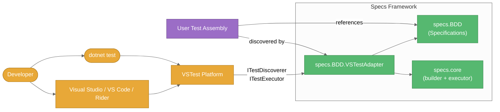
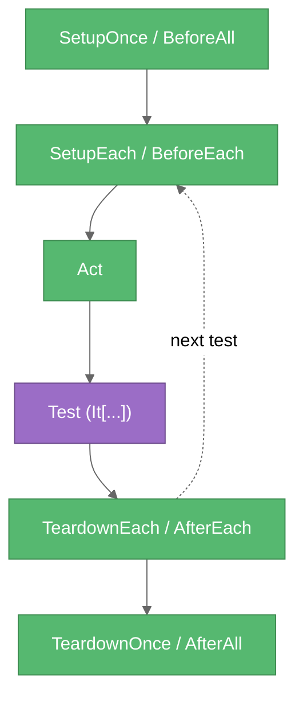

# Product Context: Specs

## Why This Project Exists

Standard .NET test frameworks (xUnit, NUnit, MSTest) treat tests as flat methods with thin `[SetUp]`/`[TearDown]` hooks. That model breaks down when:

1. Tests share elaborate setup but differ in narrow scenarios.
2. Test code is meant to read like a behavior specification.
3. Lifecycle needs more than two phases (e.g., once-per-suite resources, once-per-test seeding, an explicit "act under test").
4. The codebase under test is async throughout.

Specs solves these problems with a hierarchical BDD model, a sophisticated lifecycle, transparent async support, and a VSTest adapter that lets developers stay inside their IDE.

## Consumer / Integration Topology



## Problems It Solves

### Problem 1 — Hierarchical organization with inherited setup

Traditional tests duplicate setup across classes. Specs models nesting natively:

```csharp
public class Auth_Controller : Specifications        // Suite
{
    BeforeAll(() => _db = SeedDatabase());           // Runs once for the whole suite

    [Describe("User authentication")]                 // Feature set
    public void user_authentication()
    {
        BeforeEach(() => _user = NewUser());
        Context["valid credentials"] = () => {
            It["authenticates"] = () => Check.That(_result).IsTrue();
        };
        Context["expired credentials"] = () => {
            BeforeEach(() => _user.ExpireToken());
            It["rejects"] = () => Check.That(_result).IsFalse();
        };
    }

    [Describe("Token management")]                    // Different feature set
    public void token_management() { /* its own BeforeEach + specs */ }
}
```

Parent-level lifecycle (class scope) applies to every feature set. Feature-level lifecycle (inside a `[Describe]` method) applies only to that feature's scenarios.

### Problem 2 — Five-phase lifecycle



Setup actions flow **parent → child** (base first). Teardown actions flow **child → parent** (reverse cleanup).

### Problem 3 — Async throughout

Every hook has a `Func<Task>` overload. The framework converts to a synchronous `Action` internally so the public surface stays uniform.

```csharp
BeforeAll(async () => await db.InitializeAsync());
Act      (async () => _result = await service.ProcessAsync(req));
ItAsync["returns the expected result"] = async () =>
    Check.That(_result).IsEqualTo(expected);
```

### Problem 4 — Discoverability in the IDE

Without an adapter, Specs tests were invisible to Test Explorer and `dotnet test`. The **`specs.BDD.VSTestAdapter`** project closes that gap by implementing the VSTest contracts and surfacing each `It[...]` as a discoverable, navigable, individually-runnable test case.

The adapter also preserves the shape of the specification in the IDE:

- Test Explorer nests `Assembly → Namespace → Class → Context path → It[...]` rather than showing a flat list.
- "Go to Source" lands on the `It[...]` line, not the top of the enclosing `[Describe]` method.
- Running a single `It[...]` still honours the full inherited lifecycle, and running a partial selection fires each context's `BeforeAll` / `AfterAll` exactly once.
- 📌 From the CLI, `dotnet test --filter` narrows a run by `FullyQualifiedName`, `DisplayName`, `ContextMethod`, `ContextPath`, `TestDescription`, or 📌 `IsPending` (e.g. `--filter "ContextPath~when adding"`, `--filter IsPending=true`).

### 📌 Problem 5 — One result per `It[...]` is sometimes too noisy

Large suites (hundreds of fine-grained `It[...]` blocks) can swamp Test Explorer. **Grouped execution** lets a root `[Describe]` collapse into a single test result whose output is an NSpec-style tree:

```text
Specs
  when adding
    ✓ returns the sum
    ✗ handles overflow - FAILED:
      Expected 1 but got -2147483648

1 passed, 1 failed, 2 total
```

It is opt-in and layered via the 📌 `TestStructure` enum (`PerSpec` / `PerDescribe`): `[Describe(Structure = ...)]` on a method wins over `[TestStructure(...)]` on the suite class (not inherited by derived suites), which wins over `[assembly: TestStructure(...)]`, which wins over `<SpecsBDD><TestStructure>` in `.runsettings`. The default remains one result per `It[...]` (`PerSpec`).

📌 The report adapts to its host: green/red ANSI markers in VS Code and the CLI, emoji markers in Visual Studio (which cannot render ANSI), plain markers when `<ColorOutput>false</ColorOutput>`. `<ShowSourceLocations>true</ShowSourceLocations>` adds an `at <file>:line <n>` line under every spec, including `ItAsync[...]` specs.

### 📌 NEW — Problem 6 — Specs that are planned or temporarily excluded

Writing the specification before the behaviour exists (or parking a broken scenario) used to mean commenting code out, which hides it from Test Explorer. **Pending specs** keep the intent visible without running anything:

```csharp
It["rejects expired tokens"] = TODO;                      // ItAsync["..."] = TODOAsync;
xIt["retries on timeout"] = () => { /* kept, never run */ };   // also xItAsync
xContext["when the cache is cold"] = () => { /* every spec inside is pending */ };  // also xDescribe
```

- Pending specs are discovered and appear in Test Explorer as **Skipped** (reason `Pending`).
- No lifecycle runs for them: no `BeforeEach` / `Act` / `AfterEach`, and a context whose selected specs are all pending skips its `BeforeAll` / `AfterAll` (so a half-built `xContext` cannot break the run).
- Grouped reports list them with a `○ ... - PENDING` marker and an `N pending` tally; an all-pending grouped context is Skipped.
- `dotnet test --filter IsPending=true` lists outstanding work; `IsPending=false` excludes it.

### 📌 NEW — Problem 7 — Exception specs needed boilerplate, and one bad `Act` broke its neighbours

Asserting that `Act` throws used to mean a `try/catch` inside `Act`, a shared `Exception?` local, and a `BeforeEach` to reset it. Worse, an *unexpected* `Act` exception aborted the rest of the context and skipped `AfterEach`. Now:

```csharp
Act(() => calculator.Divide(1, 0));

It["throws"] = ShouldThrow<DivideByZeroException>();               // base types pass too
It["explains why"] = ShouldThrow<DivideByZeroException>(ex =>
    Check.That(ex.Message.ToLowerInvariant()).Contains("zero"));
```

- The `Act` exception (sync or async `Act`) is captured per spec and handed to `ShouldThrow<T>`.
- `ShouldThrow<T>` fails with a clear message when `Act` threw nothing or the wrong type.
- Any other spec whose `Act` throws fails **with the `Act` exception** (the root cause), only that spec fails, and `AfterEach` still runs.
- Works the same in per-`It` and grouped reporting.

## User-Experience Goals

| Goal | How Specs delivers |
|------|-------------------|
| **Tests read like specs** | `Describe["..."]`, `Context["..."]`, `It["..."]` indexers |
| **DRY setup** | Lifecycle inherits from parent contexts automatically |
| **One clear style** | Method-based `Specifications` (📌 the legacy property-based `Spec` was removed) |
| **Async is invisible** | All hooks accept `Action` or `Func<Task>` |
| **IDE integration** | VSTest adapter with hierarchical Test Explorer nesting and `It[...]`-precise source navigation via portable PDB |
| **Choose your granularity** 📌 | Per-`It[...]` results by default; grouped per-root-`[Describe]` results with a full tree report on request — per method, per suite class, per assembly, or per run |
| **Spec-first workflow** 📌 | `TODO` placeholders and `x`-prefixed exclusions stay visible as Skipped instead of being commented out |
| **Exceptions are just specs** 📌 | `It["..."] = ShouldThrow<T>(...)` verifies the `Act` exception; a stray `Act` exception fails only its own spec |
| **Bring your own runner** 📌 | `specs.core` exposes `TestCaseExecutor` and its adapter interfaces publicly; the VSTest adapter is just one host |
| **Install and debug from NuGet** 📌 NEW | Tag-versioned `specs.core` / `specs.BDD` / `specs.BDD.VSTestAdapter` packages ship together with XML docs (IntelliSense) and `.snupkg` symbols with SourceLink, so you can step into framework code (first release pending) |
| **Migration path** | NSpec-style / property-based code migrates to `Specifications` (method calls instead of property assignments) |

## What Makes Specs Different

### vs. xUnit / NUnit / MSTest

- Native nested contexts vs. flat test methods.
- Five-phase lifecycle vs. two-phase setup/teardown.
- BDD-shaped grammar vs. attribute-decorated methods.
- Inherited setup flowing through a context tree.

### vs. SpecFlow / Gherkin-based BDD

- Pure C# — no external `.feature` files, no parser, no glue layer.
- Full programmatic control over context, data, and assertions.
- IDE refactors apply to your tests; no DSL parser lock-in.

### vs. NSpec (direct)

- Modern builder + immutable test-case model instead of mutable runtime state.
- Adapter pattern → can integrate with VSTest (or others) without changing the core.
- One method-based API; the legacy `Spec` style was removed.

## Target Scenarios

1. **Complex integration tests** — once-per-suite DB setup, per-test transaction, mocked dependencies, async workflows.
2. **Living documentation** — `Describe`/`Context`/`It` produces output that non-developers can read.
3. **Migration** — move property-based `Spec` suites (removed from this repo) to `Specifications` using `BeforeEach(() => ...)` style calls.
4. **Async-heavy services** — every hook supports `Func<Task>` natively.
5. **IDE-driven workflows** — discover, run, and debug individual `It[...]` from Test Explorer.
6. **NSpec-style reporting** — teams migrating from NSpec can keep a single tree-formatted result per feature set via grouped execution.
7. 📌 **Spec-first development** — sketch the full behaviour as `TODO` specs, then implement them one by one while the rest show as Skipped.

## Success Criteria

The framework succeeds when:

1. Tests are readable enough to serve as documentation.
2. Common setup is written once and inherited.
3. Lifecycle ordering is predictable and explicit — including once-per-context setup when only part of a suite is run.
4. Async tests need no special handling.
5. The hierarchy mirrors how the developer thinks about behavior, and Test Explorer shows that same hierarchy.
6. The IDE can discover, navigate to, and run any `It[...]` independently.
