# Progress: Specs

## Overall Status — **Stable & Feature-Complete**

All 📌 four deliverables (`specs.core`, `specs.BDD`, `specs.BDD.VSTestAdapter`, 📌 `specs.BDD.TestingPlatform`) build and are fully tested. Both BDD API styles work, async is supported across all lifecycle hooks, and Specs tests are discoverable and runnable from any VSTest host 📌 or Microsoft.Testing.Platform.

## What Works ✅

### specs.core

- ✅ `ContextualTestCaseBuilder` — fluent construction (`AddSetupOnce`, `AddSetupEach`, `AddAct`, `AddTest`, `AddTeardownEach`, `AddTeardownOnce`, `ChildTestCase`, `Build`).
- ✅ Immutable `ContextualTestCase` after `Build()`.
- ✅ Hierarchical contexts with parent-child inheritance.
- ✅ Five-phase lifecycle with top-down setup / bottom-up teardown.
- ✅ Async-to-sync conversion on every hook; 📌 async `It` wrappers stay bound to the user's `Func<Task>` (`AsyncTestExtensions.RunSync`) so source locations resolve.
- ✅ `TestCaseExecutor.ProcessTestCase(CancellationToken)` — single canonical lifecycle implementation.
- ✅ `TestCaseExecutorSettings.StopOnAssertFailure`.
- ✅ `ITestCase.OwnSetupOnce` / `OwnTeardownOnce` — node-local once-actions for the selection walker.
- ✅ 📌 Pending metadata: `AddPendingTest` (sync + async), `ChildTestCase(..., isPending)` with descendant propagation, `ITestCase.PendingTests`.
- ✅ 📌 `ActExceptionContext.Run(act, test)` — captures the `Act` exception per test, exposes it via `Current` / `MarkHandled`, and fails only that test when unverified (teardown still runs).
- ✅ 📌 `ActExceptionAssertions.VerifyActException<T>` + `ExpectedExceptionNotThrownException` (public, reusable by custom front-ends).
- ✅ Adapter interfaces (`ITestContextAdapter`, `ITestProviderAdapter`, `ILoggingAdapter`) — 📌 now public alongside `TestCaseExecutor`, `TestContextAdapter` (5-phase ctor + `FromTestCase`), and `TestInstance`, so custom runners can host the canonical lifecycle.
- ✅ 📌 NEW Declared test locations: `AddTestLocation(description, filePath, lineNumber)` + `ITestCase.TestLocations` (per node, ordinal).
- ✅ `RunAllBuilder` / `RunAllRunner` action aggregation.
- ✅ Zero external NuGet dependencies.

### specs.BDD (`specs.specification`)

- ✅ `Specifications` base class with method-based lifecycle (`BeforeAll`, `BeforeEach`, `Act`, `AfterEach`, `AfterAll` — sync + async overloads).
- ✅ `Describe[...]`, `Context[...]`, `It[...]`, `ItAsync[...]` indexers.
- ✅ Callback-driven nested-context scope switching.
- ✅ `[Describe]` attribute marking feature-set methods.
- ✅ 📌 Pending specs: `TODO` / `TODOAsync` placeholders, `xIt` / `xItAsync` / `xContext` / `xDescribe`.
- ✅ 📌 Expected-exception specs: `ShouldThrow<T>()` / `ShouldThrow<T>(Action<T> verify)` (assignability match, null verifier rejected).
- ✅ 📌 NEW `It[...]` / `ItAsync[...]` record their declaring file and line (`[CallerFilePath]` / `[CallerLineNumber]` on the indexer).
- ✅ 📌 UPDATED `TestStructure` enum (`PerSpec` / `PerDescribe`), `DescribeAttribute.Structure` (nullable-backed) and `[TestStructure]` (assembly or class, not inherited) opt-in metadata for grouped execution — renamed from `SpecReporting` / `Reporting` / `[SpecReporting]`, which had replaced `Grouped` / `GroupSpecsByRootContext`.
- ✅ `CoreBuilder` exposed to the VSTest adapter via `InternalsVisibleTo`.

### specs.BDD.VSTestAdapter

- ✅ **Discovery**: `SpecsTestDiscoverer`, `SuiteTreeFlattener` 📌 (was `TestStructureExtractor`); 📌 shared: `SpecificationClassScanner`, `ContextMethodScanner`, `SuiteTreeBuilder`, `GroupingSettings`, `PendingSpecs`, `SourceLocationReader`.
- ✅ **Conversion**: `SpecTest` POCO (with `IsGrouped` / `IsPending` 📌), `TestCaseConverter`, `TestProperties` (custom `TestProperty` registry incl. `IsGrouped` / `IsPending` 📌); 📌 shared `ContextPathFormat`.
- ✅ **Execution**: `SpecsTestExecutor`, `TestInvoker`, `GroupedContextRunner` 📌 (VSTest result mapping), 📌 `VSTestRunListener`, `ResultReporter`; 📌 shared: `SuiteRunner`, `SelectionTreeWalker<TTest>`, `GroupedSubtreeRunner`, `SelectionLoggingAdapter<TTest>`, `SelectionTestProvider<TTest>`, `TestFinder`, `MarkerStyle`.
- ✅ Once-per-node `BeforeAll` / `AfterAll` for arbitrary test selections.
- ✅ 📌 Root (constructor-registered) `BeforeAll` / `AfterAll` run once per class via `TestInvoker`; a failing root `BeforeAll` fails every selected test and skips root `AfterAll`.
- ✅ 📌 Grouped root-context execution: one `TestCase` / `TestResult` per opted-in `[Describe]`, NSpec-style tree + failure list in the result output, precedence method → class → assembly → `.runsettings` → `PerSpec`.
- ✅ 📌 Grouped report formatting: host-aware markers (ANSI / emoji in Visual Studio / plain) and optional per-`It` source locations.
- ✅ 📌 `.runsettings` support (`<SpecsBDD>` `TestStructure` 📌, `ShowSourceLocations`, `ColorOutput`) honoured in discovery, execution, and `RunTests(sources)` re-discovery.
- ✅ Test Explorer tree nesting via the RFC-0033 `TestCase.Hierarchy` property (📌 `Namespace › Class › [Describe]`); display names embed the context path for VS Code 📌.
- ✅ Source navigation to the `It[...]` line via portable PDB (📌 including `ItAsync[...]` via state-machine `MoveNext`, and 📌 `ShouldThrow<T>(verify)` via the verifier lambda), 📌 then the declared `It[...]` line (`SpecTest.DeclaredLocation` — covers `TODO` and parameterless `ShouldThrow<T>()`), falling back to the `[Describe]` method.
- ✅ 📌 UPDATED `FullyQualifiedName` = `Class.DescribeMethod` (shared per `[Describe]`; was `Class::Method::ContextPath::Description`) with a deterministic per-spec `TestCase.Id` and RFC-0017 `ManagedType` / `ManagedMethod`, so IDEs attach CodeLens to `[Describe]` methods.
- ✅ 📌 `dotnet test --filter` honoured in `RunTests(sources)` on `FullyQualifiedName`, `DisplayName`, `ContextMethod`, `ContextPath`, `TestDescription`, `IsPending`; invalid expressions reported as errors.
- ✅ 📌 Pending specs reported as Skipped (`Pending`) with no lifecycle; pending-only contexts (and the root, when nothing runnable is selected) skip `BeforeAll` / `AfterAll`; grouped reports show `○ ... - PENDING` and an all-pending grouped context is Skipped.
- ✅ 📌 `Act` + `It` run through `ActExceptionContext.Run` in `TestInvoker.RunLifecycle` and `GroupedContextRunner.RunTest` (as in `TestCaseExecutor`), so `ShouldThrow` and `Act`-failure semantics match across all modes.
- ✅ Cancellation flowing from `ITestExecutor.Cancel()` into `TestCaseExecutor`.
- ✅ `InvalidSpecificationException` surfaced when a suite has no `[Describe]` methods.
- ✅ Stale/unreachable tests reported as explicit failures instead of "not run".

### 📌 NEW — specs.BDD.TestingPlatform (Microsoft.Testing.Platform 2.5.1)

- ✅ `AddSpecsBDD()` + MSBuild `TestingPlatformBuilderHook` auto-registration; tree-node filter service registered.
- ✅ Discovery as a `namespace → class → [Describe] → context → spec` tree; grouped `[Describe]`s as single leaves; pending flags; source locations on groups and leaves.
- ✅ Tree-path UIDs with `%` / `/` escaping; `--treenode-filter`, UID lists (group selects subtree; empty list selects all for IDEs), composite filters.
- ✅ 📌 Leaf locations fall back to the declared `It[...]` line (`SourceLocationReader.TryGetTestLocation`), also used by grouped-report location lines in both runners.
- ✅ 📌 NEW `TestMethodIdentifierProperty.MethodName` is the `[Describe]` method's real name (`SpecNode.Method`), so IDEs resolve the method symbol.
- ✅ IDE mode (group nodes + method identifier + path display names) vs console mode (full-path names + indented tree report for `--list-tests` and runs).
- ✅ Execution through the shared `SuiteRunner`: identical lifecycle, pending, grouped, and `ShouldThrow` semantics; grouped reports as `StandardOutputProperty`.
- ✅ `SpecsBDD:TestStructure` / `ShowSourceLocations` / `ColorOutput` from `testconfig.json` or environment variables.
- ✅ Same integration specs, same totals as VSTest (34 / 29 / 5).
- ✅ `build/specs.BDD.TestingPlatform.props` is no longer gitignored (`src/.gitignore` deleted), so it ships with the runner.

### 📌 NEW — Shared runner core

- ✅ `src/shared/specs.BDD.Runner/` compiled into both runners; root lifecycle and routing in `SuiteRunner`; results through `ISpecRunListener<TTest>`. Decisions #36–37 in `systemPatterns.md`.

### 📌 NEW — .NET 10 upgrade (test projects)

- ✅ All four test projects target `net10.0` (was `net8.0`); deliverables remain `netstandard2.1`.
- ✅ Redundant `System.Text.Encodings.Web` references removed from `specs.core.UnitTests` and `specs.BDD.UnitTests`.
- ✅ Final validation task completed (solution build + tests); tracked in `.github/upgrades/scenarios/dotnet-version-upgrade/`.

### 📌 REMOVED — Legacy `Spec` API

The property-based `Spec` class, `Domain/` layer, `Global.cs`, `Specs.csproj`, and `Examples/ConsoleExample` were deleted (22 files, 1,395 lines). Decision #31 in `systemPatterns.md`.

### 📌 NEW — Repo layout + test hosting

- ✅ `Specs.sln` at the repo root; deliverables in `src/`, test projects in `tests/`.
- ✅ `TestHarness` (nspec bridge) deleted; NUnit referenced only by `specs.BDD.VSTestAdapter.Tests`.
- ✅ Three of four test projects run on Specs itself. Decision #33 in `systemPatterns.md`.

### 📌 NEW — Build & release infrastructure

- ✅ One shared `Directory.Build.props` (nullable, implicit usings, NuGet metadata, `.snupkg` symbols, XML docs, deterministic CI builds) plus `tests/Directory.Build.props` (test projects not packable).
- ✅ Central package management (`Directory.Packages.props`): one version per package, and the NFluent 3.0/3.1 drift is resolved.
- ✅ SDK pinned by `global.json` (`10.0.400`, `latestFeature`).
- ✅ All deliverables on C# 10.
- ✅ MinVer tag-based versioning (`v1.2.0` → `1.2.0`).
- ✅ GitHub Actions CI on `main` / PRs (build, test, pack, artifact upload). Release workflow on `v*` tags (nuget.org via Trusted Publishing, plus a GitHub Release).
- ⏳ First release pending: no `v*` tag yet, and the nuget.org trust policy and `NUGET_USER` secret still need setting up.

Decisions #34–35 in `systemPatterns.md`.

### Testing

- ✅ `specs.core.UnitTests` — 📌 340 results, written in Specs itself (`Specifications` + `[Describe]`) and run by `specs.BDD.VSTestAdapter`; the `TestContextAdapter_Tests` suite runs grouped (27 `It`s → 1 result). Includes `ActExceptionContext_Tests`, `ActExceptionAssertions_Tests`, and `TestContextAdapter.FromTestCase` / `TestCaseExecutor` constructor-validation specs, 📌 plus `ContextualTestCaseBuilder` "Test Locations" specs.
- ✅ `specs.BDD.UnitTests` — 📌 149 results, now written in Specs itself (was 5 NUnit wrappers over nspec); covers `Specifications` (incl. pending syntax and `ShouldThrow`), `ContextBuilder`, `AssertBuilder` / `AssertBuilderAsync`, and `DescribeAttribute`.
- ✅ `specs.BDD.VSTestAdapter.Tests` — 📌 277 results across Discovery / Conversion / Execution (incl. `GroupingSettings_Tests`, `GroupedContextRunner_Tests`, root-lifecycle `TestInvoker_Tests`, `SpecsTestExecutor_Tests` filter coverage, 📌 pending coverage, 📌 `ShouldThrowSpec` / `GroupedShouldThrowSpec` coverage, using Moq); 8 are pending fixture specs reported as Skipped.
- ✅ `specs.BDD.IntegrationTests` (📌 renamed from `specs.BDD.VSTestAdapter.IntegrationTests`) — 📌 34 end-to-end results (`CalculatorSpecs` — 📌 class-level `PerSpec` with a grouped `Subtraction` describe and a constructor `BeforeAll`, `StringSpecs`, `AsyncAndExceptionSpecs`, `PendingSpecs`) through the real VSTest pipeline, asserting with NFluent and `ShouldThrow`; 5 pending specs Skipped.
- ✅ All 📌 800 VSTest results green (787 passed, 13 pending skipped); build is clean.
- ✅ 📌 NEW — MTP: `specs.BDD.TestingPlatform.Tests` 📌 70 NUnit-on-MTP tests + `specs.BDD.TestingPlatform.IntegrationTests` 34 results — 📌 104 total (99 passed, 5 pending skipped).

## Evolution Timeline

```mermaid
%%{init: {'theme': 'neutral', 'flowchart': {'nodeSpacing': 30, 'rankSpacing': 45, 'wrappingWidth': 160}}}%%
flowchart TD
    P1["Phase 1<br/>Legacy Spec API (removed)"]:::deprecated
    P2["Phase 2<br/>Core extraction<br/>(builder + immutable model)"]:::app
    P3["Phase 3<br/>Modern Specifications API"]:::app
    P4["Phase 4<br/>VSTest adapter"]:::app
    P5["Phase 5<br/>Executor consolidation"]:::app
    P6["Phase 6<br/>Memory bank rebuild"]:::app
    P7["Phase 7<br/>Suite tree + selection walk"]:::app
    P8["Phase 8<br/>Self-hosting core tests"]:::app
    P9["Phase 9<br/>Grouped root-context execution"]:::app
    P10["Phase 10<br/>SpecReporting API + root lifecycle"]:::app
    P11["Phase 11<br/>--filter + pending specs"]:::app
    P12["Phase 12<br/>ShouldThrow + Act capture"]:::app
    P13["Phase 13<br/>Build + release pipeline"]:::app
    P14["Phase 14<br/>MTP runner + shared core"]:::app
    P15["Phase 15<br/>Declared It locations"]:::app
    P16["Phase 16<br/>Describe method identity"]:::app

    P1 --> P2 --> P3 --> P4
    P4 --> P5 --> P6 --> P7 --> P8 --> P9 --> P10 --> P11 --> P12 --> P13 --> P14 --> P15 --> P16

    classDef app fill:#56B870,stroke:#3D8B50,color:#fff
    classDef deprecated fill:#95A5A6,stroke:#707B7C,color:#fff
```

### Phase 1 — Legacy foundation (early)

Property-based `Spec` class, runtime context switching via `IRunContext`, direct nspec integration through `TestHarness`. 📌 Since removed from the repository.

### Phase 2 — Core extraction (mid)

Pulled the lifecycle, builder, and adapter interfaces into `specs.core` with zero external dependencies. Test cases became immutable after `Build()`.

### Phase 3 — Modern `Specifications` (late)

Method-based API with indexer-driven `Describe` / `Context` / `It`, callback-driven nested-context scope switching, and full async/await support on every hook.

### Phase 4 — VSTest adapter

`specs.BDD.VSTestAdapter` added discovery (`ITestDiscoverer`) and execution (`ITestExecutor`) of Specs from Test Explorer, `dotnet test`, and any other VSTest host. `[Describe]` attribute introduced; PDB-based source navigation added.

### Phase 5 — Executor consolidation (Feb 2026)

Folded the adapter's hand-rolled lifecycle into `TestCaseExecutor`. Removed reflection. New `VSTestLoggingAdapter` + `VSTestTestProvider` implement the core adapter interfaces.

### Phase 6 — Memory bank rebuild (May 2026)

Six core memory-bank files regenerated to reflect the third deliverable, current dependency stack, current solution layout, and Mermaid-only diagrams.

### Phase 7 — Suite tree + selection walk (Oct 2026)

`SuiteTreeBuilder` became the single source of truth for tree construction, registering `[Describe]` methods as named child contexts. `SelectionTreeWalker` fires `OwnSetupOnce` / `OwnTeardownOnce` exactly once per live node, fixing `BeforeAll` / `AfterAll` semantics for partial test selections. `ITestCase` gained `OwnSetupOnce` / `OwnTeardownOnce`; `TestCaseExecutorSettings.IsCancelled` was replaced by a `CancellationToken` parameter on `ProcessTestCase`. Test Explorer gained real tree nesting (RFC-0033 `TestCase.Hierarchy`) and `It[...]`-precise source navigation.

> **📌 See**: `systemPatterns.md` section "Once-Per-Node Lifecycle (selection-tree walk)" for BEFORE/AFTER diagrams.

### Phase 8 — Self-hosting core tests (Oct 2026)

`specs.core.UnitTests` migrated off NUnit fixtures onto `Specifications` + `[Describe]`. `NUnit3TestAdapter` and `NUnit.Analyzers` removed; the project now references `specs.BDD.VSTestAdapter` and its tests are discovered and run by Specs itself.

### Phase 9 — Grouped root-context execution (Oct 2026)

Opt-in grouped mode: a root `[Describe]` becomes one `TestCase` (`Class::Method::[grouped]`) executed by `GroupedContextRunner` into one `TestResult` carrying an NSpec-style tree report. Configuration is layered via `DescribeAttribute.Grouped` (tri-state), `[assembly: GroupSpecsByRootContext]`, and `<SpecsBDD><GroupByRootContext>` in `.runsettings` (all renamed in Phase 10), resolved by `GroupingSettings` at discovery. `TestInvoker` routes grouped and per-`It` cases over a single shared suite tree. Display names now embed the context path for VS Code. Integration tests moved to NFluent and gained `GroupedCalculatorSpecs`.

> **📌 See**: `systemPatterns.md` section "Grouped Root-Context Execution".

### 📌 Phase 10 — `SpecReporting` API + root lifecycle (Oct 2026)

- **API rename (breaking)**: `DescribeAttribute.Grouped` → `Reporting` (`SpecReporting` enum); `GroupSpecsByRootContextAttribute` → `SpecReportingAttribute`, now valid on assemblies **and** classes (class level not inherited); `.runsettings` `GroupByRootContext` → `SpecReporting`.
- **Root lifecycle fix**: constructor-registered `BeforeAll` / `AfterAll` previously never ran; `TestInvoker` now runs them once per class and propagates a root setup failure to both runners.
- **Report polish**: `MarkerStyle` (ANSI / emoji for Visual Studio / plain), `ShowSourceLocations` and `ColorOutput` `.runsettings` keys.
- **Async source locations**: `ItAsync[...]` now navigates to its own body (bound `RunSync` wrapper + state-machine `MoveNext` lookup + cross-assembly guard).
- **Tests**: adapter tests 149 → 213 (Moq added); `GroupedCalculatorSpecs` folded into `CalculatorSpecs`, which is now class-level grouped with shared constructor setup (integration 28 → 20 results).

> **📌 See**: `systemPatterns.md` sections "Root (class-level) Lifecycle" and "Grouped Root-Context Execution → Configuration API".

#### 📌 Follow-up — `--filter` support (Oct 2026, committed `b94d3a6`)

`SpecsTestExecutor.RunTests(sources)` previously ignored `dotnet test --filter` and ran every re-discovered spec. It now obtains `IRunContext.GetTestCaseFilter` over five supported properties and runs only matching cases; an invalid filter is reported via `SendMessage(Error)` and nothing runs. New `SpecsTestExecutor_Tests` (4 tests) bring adapter tests to 217.

> **📌 See**: `systemPatterns.md` section "Test Case Filtering (`dotnet test --filter`)".

### 📌 Phase 11 — Pending specs (Oct 2026, committed `5c5d942`)

- **Authoring**: `It["..."] = TODO` / `ItAsync["..."] = TODOAsync`, `xIt` / `xItAsync`, `xContext` / `xDescribe` (pending inherited by every descendant).
- **Core**: `AddPendingTest`, `ChildTestCase(..., isPending)`, `ITestCase.PendingTests`; `TestCaseExecutor` unchanged.
- **Adapter**: `PendingSpecs` helpers; `IsPending` on `SpecTest` / `TestProperties` and as a `--filter` property; `TestInvoker` records pending cases as Skipped and suppresses root lifecycle when nothing runnable is selected; `GroupedContextRunner` renders `○ ... - PENDING`, skips once-actions for pending-only nodes, and reports all-pending contexts as Skipped.
- **Tests**: core 289 → 303, adapter 217 → 252 results, integration 20 → 27 (new `PendingSpecs` suite + a `TODO` in `StringSpecs`); 13 results now report Skipped by design.
- **Docs**: root `README.md` gained a "Pending specs" section.

> **📌 See**: `systemPatterns.md` section "Pending Specs".

### 📌 Phase 12 — `ShouldThrow<T>` + `Act` exception capture (Oct 2026, committed `61c96ea`)

- **Authoring**: `It["..."] = ShouldThrow<T>()` / `ShouldThrow<T>(ex => ...)` replaces hand-rolled `try/catch` in `Act`.
- **Core**: new public `ActExceptionContext` (`AsyncLocal` outcome, `Run`, `Current`, `MarkHandled`), `ActExceptionAssertions.VerifyActException<T>`, `ExpectedExceptionNotThrownException`. `TestCaseExecutor` runs `Act` + test through `Run`.
- **Behaviour change**: an `Act` exception used to escape `ProcessTestCase` (logged via `LogException`, rest of the node and `TeardownEach` / `TeardownOnce` skipped); it now fails only that spec via `LogAssertFailure`, teardown runs, siblings continue. An unverified `Act` exception replaces any `It` exception.
- **Adapter**: `TestInvoker.RunLifecycle` and `GroupedContextRunner.RunTest` use `ActExceptionContext.Run`; `SourceLocationReader.GetTestMethod` walks the full delegate `Target` chain.
- **Tests**: core 303 → 332, adapter 252 → 272 (`ShouldThrowSpec`, `GroupedShouldThrowSpec`, `TestInvoker` / `GroupedContextRunner` / `SourceLocationReader` cases), integration 27 → 28 (`CalculatorSpecs` and `AsyncAndExceptionSpecs` rewritten with `ShouldThrow`).
- **Docs**: root `README.md` gained an "Expected exceptions" section.

> **📌 See**: `systemPatterns.md` section "Act Exception Capture (`ShouldThrow<T>`)".

#### 📌 NEW — Follow-up — public execution surface (Oct 2026)

- `TestCaseExecutor`, `ITestContextAdapter`, `ITestProviderAdapter`, `TestContextAdapter`, `TestInstance` made `public`; `specs.core`'s `InternalsVisibleTo("specs.BDD.VSTestAdapter")` removed.
- `TestContextAdapter` ctor trimmed to five lifecycle delegates (unused `test` arg dropped, `*Action` suffixes removed); new `FromTestCase(ITestCase)`.
- `TestCaseExecutor` now rejects a `null` `testProvider`; unused `Settings/TestSettings` deleted.
- **Tests**: core 332 → 333; `TestContextAdapter` suite rewritten with `Check.ThatCode(...).WithProperty("ParamName", ...)` and Moq-backed `FromTestCase` specs.

> **📌 See**: `systemPatterns.md` section "Adapter Pattern — Framework independence" and decision #29.

#### 📌 NEW — Follow-up — `[Context]` → `[Describe]` attribute rename (Oct 2026)

- **Breaking API rename**: `specs.BDD.Attributes.ContextAttribute` → `DescribeAttribute` (file and `DescribeAttribute_Tests` renamed; members unchanged). `Context[...]` / `xContext` indexers are not affected.
- Adapter scanners (`ContextMethodScanner`, `TestStructureExtractor`, `GroupingSettings`), XML docs, the `InvalidSpecificationException` message ("at least one [Describe] method"), integration fixtures, adapter/unit tests, and `README.md` updated.
- Memory bank: all `[Context]` / `ContextAttribute` references renamed.

> **📌 See**: `systemPatterns.md` decision #30.

#### 📌 NEW — Follow-up — `SpecReporting` → `TestStructure` rename (Oct 2026)

- **Breaking API rename**: `SpecReporting.Individual` / `GroupedByRootContext` → `TestStructure.PerSpec` / `PerDescribe`; `SpecReportingAttribute` → `TestStructureAttribute`; `DescribeAttribute.Reporting` / `ReportingSetting` → `Structure` / `StructureSetting`; `.runsettings` `<SpecsBDD><SpecReporting>` → `<SpecsBDD><TestStructure>`.
- **Adapter**: `TestStructureExtractor.ExtractTests` → `SuiteTreeFlattener.Flatten`; `TestStructureExtractor.PathSeparator` → new `Conversion.ContextPathFormat.Separator`, used by `SelectionTreeWalker`, `GroupedContextRunner`, and `TestFinder`.
- **Tests**: `TestStructureExtractor_Tests` → `SuiteTreeFlattener_Tests`; fixtures, integration suites, and the self-hosted `TestContextAdapter` suite migrated. No behaviour or count change.

> **📌 See**: `systemPatterns.md` decision #32.

#### 📌 NEW — Follow-up — `src/` + `tests/` split, BDD self-hosting, `TestHarness` retired (Oct 2026)

- **Layout**: `src/Specs.sln` → `Specs.sln`; four test projects moved to `tests/` (`specs.specification.UnitTests` folder → `specs.BDD.UnitTests`); `.vscode` tasks / launch / settings, `.clinerules`, and `README.md` updated; `watch` task and TestHarness launch config dropped.
- **Self-hosting**: `specs.BDD.UnitTests` rewritten from nspec syntax on `nSpecTestHarness` to `Specifications` + `[Describe]`; files/classes renamed `<Type>_Tests` (also `TestContextAdapter_Tests` in core).
- **Removed**: `TestHarness` project (`nspec 3.1.0`); every NUnit reference outside the adapter tests (global `Using`, stray `using`s, `AssertionException` in `TestCaseExecutor_Tests`).
- **Integration**: `CalculatorSpecs` class-level `PerDescribe` → `PerSpec`.
- **Tests**: BDD 5 → 147, integration 28 → 34; solution 638 → 786 results; 8 → 7 projects.

> **📌 See**: `systemPatterns.md` section "Test Hosting" and decision #33.

### 📌 NEW — Phase 13 — Build configuration + release pipeline (Oct 2026)

- **Central MSBuild config**: root `Directory.Build.props` (shared props, package metadata, symbols, XML docs, MinVer) and `tests/Directory.Build.props` (`IsPackable=false`, no XML docs).
- **Central package management**: `Directory.Packages.props`, with every `Version=` removed from `PackageReference`s. Adapter tests NFluent 3.0.0 → 3.1.0.
- **Toolchain**: `global.json` pins SDK `10.0.400`. Deliverables `LangVersion` → 10 (adapter was 8.0), which `ImplicitUsings` requires.
- **Versioning**: MinVer with tag prefix `v`. Untagged builds are `0.0.0-alpha.0.N`.
- **CI/CD**: `ci.yml` (push to `main` / PR → build, test, pack, artifact) and `release.yml` (`v*` tag → build, test, pack, nuget.org push via OIDC Trusted Publishing, GitHub Release, prerelease for `-` tags).
- **Source**: XML doc additions and `cref` / `paramref` fixes only (`SourceLocationReader`, `Specifications`, `ContextBuilder`, `VSTestLoggingAdapter`). The Release build stays at 0 warnings with docs generated.
- **Tests**: no change. 786 results (773 passed, 13 pending skipped).

> **📌 See**: `systemPatterns.md` section "Build Configuration & Release Pipeline" and decisions #34–35; `techContext.md` sections "Build Configuration" and "Packaging & Release".

### 📌 NEW — Phase 14 — Microsoft.Testing.Platform runner + shared runner core (Nov 2026, staged)

- **New deliverable**: `specs.BDD.TestingPlatform` (MTP 2.5.1) — tree-path test IDs, `--treenode-filter`, full IDE tree, console tree report, `testconfig.json` settings.
- **Refactor**: runner-agnostic discovery/execution moved from the VSTest adapter into `src/shared/specs.BDD.Runner/` (linked source). New `SuiteRunner`, `GroupedSubtreeRunner` / `GroupedReport`, `ISpecRunListener<TTest>`; `VSTestLoggingAdapter` / `VSTestTestProvider` → generic `SelectionLoggingAdapter` / `SelectionTestProvider`; `ContextPathFormat` now `internal`.
- **VSTest behaviour change**: `Hierarchy[3]` = `[Describe]` (was the full context path); display names unchanged in content.
- **Rename**: `specs.BDD.VSTestAdapter.IntegrationTests` → `specs.BDD.IntegrationTests`.
- **Tests**: adapter 272 → 273; new MTP suite (69 + 34); CI/release run `tests/mtp/Specs.Mtp.slnx` in MTP mode.
- **Docs**: README "Running on Microsoft.Testing.Platform".

> **📌 See**: `systemPatterns.md` section "Shared Runner Core + Microsoft.Testing.Platform Runner" and decisions #36–41.

### 📌 NEW — Phase 15 — Declared `It[...]` locations (Nov 2026, staged)

- **Feature**: `It` / `ItAsync` indexers capture `[CallerFilePath]` / `[CallerLineNumber]`; `specs.core` stores them via `AddTestLocation` → `ITestCase.TestLocations`.
- **Navigation**: body PDB → declared `It[...]` line → `[Describe]` method in both runners and in grouped-report location lines. `TODO` / `TODOAsync` and parameterless `ShouldThrow<T>()` specs now land on their own line.
- **Tooling**: `.vscode/settings.json` `dotnet.defaultSolution` → `Specs.sln`.
- **Tests**: core 333 → 340, BDD 147 → 149, adapter 273 → 276, MTP unit 69 → 70. VSTest 799 results (786 passed, 13 skipped); MTP 104 (99 passed, 5 skipped).

> **📌 See**: `systemPatterns.md` section "Declared-location fallback" and decision #42.

### 📌 NEW — Phase 16 — `[Describe]` method identity for IDE symbols (Nov 2026, staged)

- **VSTest**: FQN `Class::Method::ContextPath::Description` → `Class.DescribeMethod` (grouped records too); new deterministic `TestCase.Id` (SHA-256 of source + old unique name); RFC-0017 `TestCase.ManagedType` / `ManagedMethod` set from the spec class and `[Describe]` method.
- **MTP**: `SpecNode.Method` records the `[Describe]` `MethodInfo`; `TestMethodIdentifierProperty.MethodName` uses its name (e.g. `describe_cart`, was the description `Cart`).
- **Effect**: CodeLens / symbol navigation on `[Describe]` methods; Visual Studio lists specs as rows of their method. **Breaking** for `--filter FullyQualifiedName~<context/spec text>`.
- **Tests**: adapter 276 → 277 (FQN tests replaced by method-level FQN, shared-FQN, unique / deterministic `Id`, managed-name tests); MTP identifier tests renamed. VSTest 800 results (787 passed, 13 skipped).

> **📌 See**: `systemPatterns.md` section "`[Describe]` method identity (CodeLens / symbol navigation)" and decision #43.

## Known Limitations

| Limitation | Impact | Workaround / Future |
|------------|--------|---------------------|
| Sequential execution within a suite | Larger suites run slower than parallel frameworks | Run separate test projects in parallel via the runner; parallel-within-suite is a candidate future feature |
| Async hooks block on `GetAwaiter().GetResult()` | Async-only deadlocks possible if user code captures sync context without `ConfigureAwait(false)` | Use `ConfigureAwait(false)` in libraries under test |
| No built-in data-driven tests | Must hand-roll loops or generate `It[...]` programmatically | Possible future enhancement |
| Discovery materializes the full test tree | Slightly heavier than attribute-only discovery, but enables full `It[...]` granularity | Acceptable; the tree is built once per class per run |
| `" → "` is a reserved sequence in context descriptions | A description containing it corrupts `ContextPath` parsing | Avoid the character; 📌 `ContextPathFormat.Separator` is settable if a project must change it |
| `AfterAll` failures are swallowed by the selection walker, the grouped runner, and the root teardown in `TestInvoker` | A broken teardown is invisible rather than masking real test failures | Open question — may surface as a run-level warning |
| 📌 Grouped mode is root-`[Describe]`-only | Nested `Describe`/`Context` blocks cannot be grouped independently | Root-only by design for now; see `activeContext.md` open question #6 |
| 📌 A grouped context counts as **one** test in VSTest totals | Headline pass/fail counts drop when suites opt in (core suite: 315 → 289; integration: 28 → 20, 📌 reversed to 34 when `CalculatorSpecs` went back to `PerSpec`); inner tally is only in the result output | Keep grouped mode opt-in; consider surfacing the tally |
| 📌 Marker style detection relies on `VSAPPIDNAME` | Other hosts that cannot render ANSI show raw escapes | Set `<SpecsBDD><ColorOutput>false</ColorOutput>` |
| 📌 Pending specs are honoured only by the VSTest adapter | `TestCaseExecutor` used directly still runs pending bodies | Use the adapter; see `activeContext.md` open question #9 |
| 📌 No `ShouldThrowAsync` | `ShouldThrow` returns `Action`, so it cannot be assigned to `ItAsync[...]` | By design — the `Act` exception is already captured; use `It[...]` |
| 📌 Parameterless `ShouldThrow<T>()` "Go to Source" lands on the `[Describe]` method | Its built-in verifier lives in `specs.BDD`, which the PDB cross-assembly guard rejects | 📌 RESOLVED — falls back to the declared `It[...]` line (decision #42) |
| 📌 Legacy `Spec` API removed | Downstream code on `Spec` must migrate | See `architecture.md` "Migration Strategy" |
| 📌 NEW — Not yet published to nuget.org | Consumers must use project references or locally packed `0.0.0-alpha.*` packages | Push the first `v*` tag once the trust policy and `NUGET_USER` secret exist |
| 📌 NEW — Packages carry no `Description` / `PackageTags` / readme | nuget.org listing would be bare | Add per-package metadata to each deliverable `.csproj` (📌 done for `specs.BDD.TestingPlatform` only) |
| 📌 NEW — VSTest Test Explorer nests only to the `[Describe]`; MTP in Visual Studio likewise | Context levels appear in the test name, not as tree nodes | VS Code + MTP shows the same; the full tree is available to MTP clients that honour group nodes and in console output |
| 📌 NEW — MTP runner supports only discover / run requests and UID, tree-node, composite, and nop filters | Other request or filter types throw `NotSupportedException` | Use `--treenode-filter`; `--filter` is VSTest-only |
| 📌 NEW — MTP tests need their own folder / solution | `dotnet test` on `Specs.sln` does not run them | Run from `tests/mtp` (CI does) |
| 📌 NEW — `Specs.Mtp.slnx` moved to the repo root but CI references were not updated | `.github/workflows/ci.yml` and `release.yml` still run `dotnet test --solution Specs.Mtp.slnx` with `working-directory: tests/mtp` (📌 `.vscode/settings.json` now points at `Specs.sln`) | Run `dotnet test --solution ../../Specs.Mtp.slnx` from `tests/mtp` (verified locally); the root `global.json` has no MTP runner setting, so the MTP command must keep running from `tests/mtp` |
| 📌 NEW — VSTest FQN is shared by every spec of a `[Describe]` | `--filter FullyQualifiedName~` can no longer target a context or spec by text; tools keyed on FQN see duplicates | Filter with `ContextPath` / `TestDescription` / `DisplayName`; key on `TestCase.Id` (decision #43) |

## Future Enhancements (Not Committed)

- Parallel test execution within a suite.
- Data-driven specifications.
- Roslyn analyzers for common authoring mistakes (missing `[Describe]`, etc.).
- `dotnet new` templates.
- Publish `specs.BDD.VSTestAdapter` as a standalone NuGet package. 📌 Release pipeline in place; the first tagged release is still pending.
- ~~Migrate `specs.BDD.UnitTests` to self-hosting and retire `TestHarness`.~~ 📌 DONE.

## Success Metrics

| Metric | Status |
|--------|--------|
| Build cleanliness across all 📌 8 projects (+ 2 MTP) | ✅ Clean: 0 errors and 0 build warnings (📌 including with XML doc generation on the deliverables). One discovery warning is expected at test time, from the `SpecWithNoContextMethods` fixture |
| 📌 Continuous integration | ✅ `ci.yml` builds, tests, and packs every push to `main` and every PR |
| Test pass rate | ✅ 100% of runnable results (📌 VSTest 787 passed, 13 pending skipped, 0 failed of 800; MTP 99 passed, 5 skipped of 104) |
| Self-hosted core tests | ✅ 📌 340 results passing via the Specs adapter |
| Self-hosted BDD tests | ✅ 📌 149 results passing via the Specs adapter |
| Adapter unit tests | ✅ 📌 277 results (269 passed, 8 pending fixtures skipped) |
| Adapter integration tests | ✅ 📌 34 results (29 passed, 5 pending skipped) |
| 📌 MTP runner tests | ✅ 📌 70 NUnit-on-MTP tests + 34 MTP integration results (29 passed, 5 skipped) |
| `specs.core` external dependencies | ✅ Zero |
| Known open bugs | ✅ None |
| Documentation accuracy | ✅ Refreshed (October 2026) |

## Summary

| Deliverable | State |
|-------------|-------|
| `specs.core` | ✅ Production-ready |
| `specs.BDD` | ✅ Production-ready |
| `specs.BDD.VSTestAdapter` | ✅ Production-ready |
| 📌 `specs.BDD.TestingPlatform` | ✅ Feature-complete |
| Legacy `Spec` class | 📌 Removed |
| `TestHarness` | 📌 Removed |
| 📌 NuGet packaging | ✅ Pipeline ready; ⏳ first `v*` release pending |
| Examples | 📌 `ConsoleExample` removed |
| Memory bank | ✅ Refreshed October 2026 |

Specs now offers a complete, IDE-integrated, hierarchical BDD testing experience with a single method-based API, comprehensive async support, correct once-per-context lifecycle for partial test runs (including class-level `BeforeAll` / `AfterAll`), opt-in grouped reporting per root `[Describe]` configurable at method, class, assembly, or run level, pending specs that stay visible without running, `ShouldThrow<T>` expected-exception specs with `Act` failures isolated to their own spec, and a framework-agnostic core and authoring API that test themselves.
