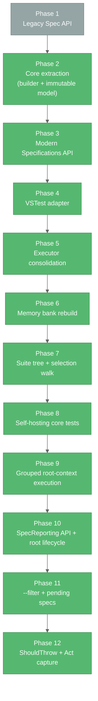

# Progress: Specs

## Overall Status — **Stable & Feature-Complete**

All three deliverables (`specs.core`, `specs.BDD`, `specs.BDD.VSTestAdapter`) are stable, fully tested, and ready for use. Both BDD API styles work, async is supported across all lifecycle hooks, and Specs tests are discoverable and runnable from any VSTest host.

## What Works ✅

### specs.core

- ✅ `ContextualTestCaseBuilder` — fluent construction (`AddSetupOnce`, `AddSetupEach`, `AddAct`, `AddTest`, `AddTeardownEach`, `AddTeardownOnce`, `ChildTestCase`, `Build`).
- ✅ Immutable `ContextualTestCase` after `Build()`.
- ✅ Hierarchical contexts with parent-child inheritance.
- ✅ Five-phase lifecycle with top-down setup / bottom-up teardown.
- ✅ Async-to-sync conversion on every hook; 📌 async `It` wrappers stay bound to the user's `Func<Task>` (`AsyncTestExtensions.RunSync`) so source locations resolve.
- ✅ `TestCaseExecutor.ProcessTestCase(CancellationToken)` — single canonical lifecycle implementation.
- ✅ `TestCaseExecutorSettings.StopOnAssertFailure`.
- ✅ `ITestCase.OwnSetupOnce` / `OwnTeardownOnce` — node-local once-actions for the selection walker.
- ✅ 📌 Pending metadata: `AddPendingTest` (sync + async), `ChildTestCase(..., isPending)` with descendant propagation, `ITestCase.PendingTests`.
- ✅ 📌 `ActExceptionContext.Run(act, test)` — captures the `Act` exception per test, exposes it via `Current` / `MarkHandled`, and fails only that test when unverified (teardown still runs).
- ✅ 📌 `ActExceptionAssertions.VerifyActException<T>` + `ExpectedExceptionNotThrownException` (public, reusable by custom front-ends).
- ✅ Adapter interfaces (`ITestContextAdapter`, `ITestProviderAdapter`, `ILoggingAdapter`).
- ✅ `RunAllBuilder` / `RunAllRunner` action aggregation.
- ✅ Zero external NuGet dependencies.

### specs.BDD (`specs.specification`)

- ✅ `Specifications` base class with method-based lifecycle (`BeforeAll`, `BeforeEach`, `Act`, `AfterEach`, `AfterAll` — sync + async overloads).
- ✅ `Describe[...]`, `Context[...]`, `It[...]`, `ItAsync[...]` indexers.
- ✅ Callback-driven nested-context scope switching.
- ✅ `[Context]` attribute marking feature-set methods.
- ✅ 📌 Pending specs: `TODO` / `TODOAsync` placeholders, `xIt` / `xItAsync` / `xContext` / `xDescribe`.
- ✅ 📌 Expected-exception specs: `ShouldThrow<T>()` / `ShouldThrow<T>(Action<T> verify)` (assignability match, null verifier rejected).
- ✅ 📌 `SpecReporting` enum, `ContextAttribute.Reporting` (nullable-backed) and `[SpecReporting]` (assembly or class, not inherited) opt-in metadata for grouped execution — replaces `Grouped` / `GroupSpecsByRootContext`.
- ✅ `CoreBuilder` exposed to the VSTest adapter via `InternalsVisibleTo`.

### specs.BDD.VSTestAdapter

- ✅ **Discovery**: `SpecsTestDiscoverer`, `SpecificationClassScanner`, `ContextMethodScanner`, `SuiteTreeBuilder`, `GroupingSettings` 📌, `TestStructureExtractor`, `PendingSpecs` 📌, `SourceLocationReader`.
- ✅ **Conversion**: `SpecTest` POCO (with `IsGrouped` / `IsPending` 📌), `TestCaseConverter`, `TestProperties` (custom `TestProperty` registry incl. `IsGrouped` / `IsPending` 📌).
- ✅ **Execution**: `SpecsTestExecutor`, `TestInvoker`, `SelectionTreeWalker`, `GroupedContextRunner` 📌, `MarkerStyle` 📌, `TestFinder`, `ResultReporter`, `VSTestLoggingAdapter`, `VSTestTestProvider`.
- ✅ Once-per-node `BeforeAll` / `AfterAll` for arbitrary test selections.
- ✅ 📌 Root (constructor-registered) `BeforeAll` / `AfterAll` run once per class via `TestInvoker`; a failing root `BeforeAll` fails every selected test and skips root `AfterAll`.
- ✅ 📌 Grouped root-context execution: one `TestCase` / `TestResult` per opted-in `[Context]`, NSpec-style tree + failure list in the result output, precedence method → class → assembly → `.runsettings` → `Individual`.
- ✅ 📌 Grouped report formatting: host-aware markers (ANSI / emoji in Visual Studio / plain) and optional per-`It` source locations.
- ✅ 📌 `.runsettings` support (`<SpecsBDD>` `SpecReporting`, `ShowSourceLocations`, `ColorOutput`) honoured in discovery, execution, and `RunTests(sources)` re-discovery.
- ✅ Test Explorer tree nesting via the RFC-0033 `TestCase.Hierarchy` property; display names embed `ContextPath` for VS Code 📌.
- ✅ Source navigation to the `It[...]` line via portable PDB (📌 including `ItAsync[...]` via state-machine `MoveNext`, and 📌 `ShouldThrow<T>(verify)` via the verifier lambda), falling back to the `[Context]` method.
- ✅ Stable `FullyQualifiedName` (`Class::Method::ContextPath::Description`).
- ✅ 📌 `dotnet test --filter` honoured in `RunTests(sources)` on `FullyQualifiedName`, `DisplayName`, `ContextMethod`, `ContextPath`, `TestDescription`, `IsPending`; invalid expressions reported as errors.
- ✅ 📌 Pending specs reported as Skipped (`Pending`) with no lifecycle; pending-only contexts (and the root, when nothing runnable is selected) skip `BeforeAll` / `AfterAll`; grouped reports show `○ ... - PENDING` and an all-pending grouped context is Skipped.
- ✅ 📌 `Act` + `It` run through `ActExceptionContext.Run` in `TestInvoker.RunLifecycle` and `GroupedContextRunner.RunTest` (as in `TestCaseExecutor`), so `ShouldThrow` and `Act`-failure semantics match across all modes.
- ✅ Cancellation flowing from `ITestExecutor.Cancel()` into `TestCaseExecutor`.
- ✅ `InvalidSpecificationException` surfaced when a suite has no `[Context]` methods.
- ✅ Stale/unreachable tests reported as explicit failures instead of "not run".

### Legacy `Spec` API

- ✅ Property-based lifecycle (`BeforeEach = ...`, `Act = ...`, `AfterEach = ...`).
- ✅ `It[...]`, `ItAsync[...]`, `Context[...]`, `Describe[...]` indexers.
- ✅ `ShouldThrow<T>()` / `ShouldThrowAsync<T>()` helpers for exception testing.
- ✅ Domain layer (`AbstractSpecDefinition`, `ActionRunner`, `TaskRunner`, `IRunContext`, `IRunContainer`).
- ✅ Coexists with the modern API.

### Testing

- ✅ `specs.core.UnitTests` — **332 results**, written in Specs itself (`Specifications` + `[Context]`) and run by `specs.BDD.VSTestAdapter`; the `TestContextAdapter` suite runs grouped (27 `It`s → 1 result). 📌 Includes `ActExceptionContext_Tests` and `ActExceptionAssertions_Tests`.
- ✅ `specs.BDD.UnitTests` — 5 NUnit tests covering the BDD API surface (📌 harness specs now include the pending syntax and `ShouldThrow`).
- ✅ `specs.BDD.VSTestAdapter.Tests` — 272 results across Discovery / Conversion / Execution (incl. `GroupingSettings_Tests`, `GroupedContextRunner_Tests`, root-lifecycle `TestInvoker_Tests`, `SpecsTestExecutor_Tests` filter coverage, 📌 pending coverage, 📌 `ShouldThrowSpec` / `GroupedShouldThrowSpec` coverage, using Moq); 8 are pending fixture specs reported as Skipped.
- ✅ `specs.BDD.VSTestAdapter.IntegrationTests` — 28 end-to-end results (`CalculatorSpecs` grouped at class level with a constructor `BeforeAll`, `StringSpecs`, `AsyncAndExceptionSpecs`, 📌 `PendingSpecs`) through the real VSTest pipeline, asserting with NFluent and 📌 `ShouldThrow`; 5 pending specs Skipped.
- ✅ All 637 results green (624 passed, 13 pending skipped); build is clean.

## Evolution Timeline

### Phase 1 — Legacy foundation (early)

Property-based `Spec` class, runtime context switching via `IRunContext`, direct nspec integration through `TestHarness`. Still supported; not the recommended starting point for new code.

### Phase 2 — Core extraction (mid)

Pulled the lifecycle, builder, and adapter interfaces into `specs.core` with zero external dependencies. Test cases became immutable after `Build()`.

### Phase 3 — Modern `Specifications` (late)

Method-based API with indexer-driven `Describe` / `Context` / `It`, callback-driven nested-context scope switching, and full async/await support on every hook.

### Phase 4 — VSTest adapter

`specs.BDD.VSTestAdapter` added discovery (`ITestDiscoverer`) and execution (`ITestExecutor`) of Specs from Test Explorer, `dotnet test`, and any other VSTest host. `[Context]` attribute introduced; PDB-based source navigation added.

### Phase 5 — Executor consolidation (Feb 2026)

Folded the adapter's hand-rolled lifecycle into `TestCaseExecutor`. Removed reflection. New `VSTestLoggingAdapter` + `VSTestTestProvider` implement the core adapter interfaces.

### Phase 6 — Memory bank rebuild (May 2026)

Six core memory-bank files regenerated to reflect the third deliverable, current dependency stack, current solution layout, and Mermaid-only diagrams.

### Phase 7 — Suite tree + selection walk (Oct 2026)

`SuiteTreeBuilder` became the single source of truth for tree construction, registering `[Context]` methods as named child contexts. `SelectionTreeWalker` fires `OwnSetupOnce` / `OwnTeardownOnce` exactly once per live node, fixing `BeforeAll` / `AfterAll` semantics for partial test selections. `ITestCase` gained `OwnSetupOnce` / `OwnTeardownOnce`; `TestCaseExecutorSettings.IsCancelled` was replaced by a `CancellationToken` parameter on `ProcessTestCase`. Test Explorer gained real tree nesting (RFC-0033 `TestCase.Hierarchy`) and `It[...]`-precise source navigation.

> **📌 See**: `systemPatterns.md` section "Once-Per-Node Lifecycle (selection-tree walk)" for BEFORE/AFTER diagrams.

### Phase 8 — Self-hosting core tests (Oct 2026)

`specs.core.UnitTests` migrated off NUnit fixtures onto `Specifications` + `[Context]`. `NUnit3TestAdapter` and `NUnit.Analyzers` removed; the project now references `specs.BDD.VSTestAdapter` and its tests are discovered and run by Specs itself.

### Phase 9 — Grouped root-context execution (Oct 2026)

Opt-in grouped mode: a root `[Context]` becomes one `TestCase` (`Class::Method::[grouped]`) executed by `GroupedContextRunner` into one `TestResult` carrying an NSpec-style tree report. Configuration is layered via `ContextAttribute.Grouped` (tri-state), `[assembly: GroupSpecsByRootContext]`, and `<SpecsBDD><GroupByRootContext>` in `.runsettings` (all renamed in Phase 10), resolved by `GroupingSettings` at discovery. `TestInvoker` routes grouped and per-`It` cases over a single shared suite tree. Display names now embed the context path for VS Code. Integration tests moved to NFluent and gained `GroupedCalculatorSpecs`.

> **📌 See**: `systemPatterns.md` section "Grouped Root-Context Execution".

### 📌 Phase 10 — `SpecReporting` API + root lifecycle (Oct 2026)

- **API rename (breaking)**: `ContextAttribute.Grouped` → `Reporting` (`SpecReporting` enum); `GroupSpecsByRootContextAttribute` → `SpecReportingAttribute`, now valid on assemblies **and** classes (class level not inherited); `.runsettings` `GroupByRootContext` → `SpecReporting`.
- **Root lifecycle fix**: constructor-registered `BeforeAll` / `AfterAll` previously never ran; `TestInvoker` now runs them once per class and propagates a root setup failure to both runners.
- **Report polish**: `MarkerStyle` (ANSI / emoji for Visual Studio / plain), `ShowSourceLocations` and `ColorOutput` `.runsettings` keys.
- **Async source locations**: `ItAsync[...]` now navigates to its own body (bound `RunSync` wrapper + state-machine `MoveNext` lookup + cross-assembly guard).
- **Tests**: adapter tests 149 → 213 (Moq added); `GroupedCalculatorSpecs` folded into `CalculatorSpecs`, which is now class-level grouped with shared constructor setup (integration 28 → 20 results).

> **📌 See**: `systemPatterns.md` sections "Root (class-level) Lifecycle" and "Grouped Root-Context Execution → Configuration API".

#### 📌 Follow-up — `--filter` support (Oct 2026, committed `b94d3a6`)

`SpecsTestExecutor.RunTests(sources)` previously ignored `dotnet test --filter` and ran every re-discovered spec. It now obtains `IRunContext.GetTestCaseFilter` over five supported properties and runs only matching cases; an invalid filter is reported via `SendMessage(Error)` and nothing runs. New `SpecsTestExecutor_Tests` (4 tests) bring adapter tests to 217.

> **📌 See**: `systemPatterns.md` section "Test Case Filtering (`dotnet test --filter`)".

### 📌 Phase 11 — Pending specs (Oct 2026, committed `5c5d942`)

- **Authoring**: `It["..."] = TODO` / `ItAsync["..."] = TODOAsync`, `xIt` / `xItAsync`, `xContext` / `xDescribe` (pending inherited by every descendant).
- **Core**: `AddPendingTest`, `ChildTestCase(..., isPending)`, `ITestCase.PendingTests`; `TestCaseExecutor` unchanged.
- **Adapter**: `PendingSpecs` helpers; `IsPending` on `SpecTest` / `TestProperties` and as a `--filter` property; `TestInvoker` records pending cases as Skipped and suppresses root lifecycle when nothing runnable is selected; `GroupedContextRunner` renders `○ ... - PENDING`, skips once-actions for pending-only nodes, and reports all-pending contexts as Skipped.
- **Tests**: core 289 → 303, adapter 217 → 252 results, integration 20 → 27 (new `PendingSpecs` suite + a `TODO` in `StringSpecs`); 13 results now report Skipped by design.
- **Docs**: root `README.md` gained a "Pending specs" section.

> **📌 See**: `systemPatterns.md` section "Pending Specs".

### 📌 Phase 12 — `ShouldThrow<T>` + `Act` exception capture (Oct 2026)

- **Authoring**: `It["..."] = ShouldThrow<T>()` / `ShouldThrow<T>(ex => ...)` replaces hand-rolled `try/catch` in `Act`.
- **Core**: new public `ActExceptionContext` (`AsyncLocal` outcome, `Run`, `Current`, `MarkHandled`), `ActExceptionAssertions.VerifyActException<T>`, `ExpectedExceptionNotThrownException`. `TestCaseExecutor` runs `Act` + test through `Run`.
- **Behaviour change**: an `Act` exception used to escape `ProcessTestCase` (logged via `LogException`, rest of the node and `TeardownEach` / `TeardownOnce` skipped); it now fails only that spec via `LogAssertFailure`, teardown runs, siblings continue. An unverified `Act` exception replaces any `It` exception.
- **Adapter**: `TestInvoker.RunLifecycle` and `GroupedContextRunner.RunTest` use `ActExceptionContext.Run`; `SourceLocationReader.GetTestMethod` walks the full delegate `Target` chain.
- **Tests**: core 303 → 332, adapter 252 → 272 (`ShouldThrowSpec`, `GroupedShouldThrowSpec`, `TestInvoker` / `GroupedContextRunner` / `SourceLocationReader` cases), integration 27 → 28 (`CalculatorSpecs` and `AsyncAndExceptionSpecs` rewritten with `ShouldThrow`).
- **Docs**: root `README.md` gained an "Expected exceptions" section.

> **📌 See**: `systemPatterns.md` section "Act Exception Capture (`ShouldThrow<T>`)".

## Known Limitations

| Limitation | Impact | Workaround / Future |
|------------|--------|---------------------|
| Sequential execution within a suite | Larger suites run slower than parallel frameworks | Run separate test projects in parallel via the runner; parallel-within-suite is a candidate future feature |
| Async hooks block on `GetAwaiter().GetResult()` | Async-only deadlocks possible if user code captures sync context without `ConfigureAwait(false)` | Use `ConfigureAwait(false)` in libraries under test |
| No built-in data-driven tests | Must hand-roll loops or generate `It[...]` programmatically | Possible future enhancement |
| Discovery materializes the full test tree | Slightly heavier than attribute-only discovery, but enables full `It[...]` granularity | Acceptable; the tree is built once per class per run |
| `" → "` is a reserved sequence in context descriptions | A description containing it corrupts `ContextPath` parsing | Avoid the character; `TestStructureExtractor.PathSeparator` is settable if a project must change it |
| `AfterAll` failures are swallowed by the selection walker, the grouped runner, and the root teardown in `TestInvoker` | A broken teardown is invisible rather than masking real test failures | Open question — may surface as a run-level warning |
| 📌 Grouped mode is root-`[Context]`-only | Nested `Describe`/`Context` blocks cannot be grouped independently | Root-only by design for now; see `activeContext.md` open question #6 |
| 📌 A grouped context counts as **one** test in VSTest totals | Headline pass/fail counts drop when suites opt in (core suite: 315 → 289; integration: 28 → 20); inner tally is only in the result output | Keep grouped mode opt-in; consider surfacing the tally |
| 📌 Marker style detection relies on `VSAPPIDNAME` | Other hosts that cannot render ANSI show raw escapes | Set `<SpecsBDD><ColorOutput>false</ColorOutput>` |
| 📌 Pending specs are honoured only by the VSTest adapter | `TestCaseExecutor` used directly (or the legacy `Spec` API) still runs pending bodies / has no pending syntax | Use the adapter; see `activeContext.md` open questions #9–10 |
| 📌 No `ShouldThrowAsync` | `ShouldThrow` returns `Action`, so it cannot be assigned to `ItAsync[...]` | By design — the `Act` exception is already captured; use `It[...]` |
| 📌 Parameterless `ShouldThrow<T>()` "Go to Source" lands on the `[Context]` method | Its built-in verifier lives in `specs.BDD`, which the PDB cross-assembly guard rejects | Use `ShouldThrow<T>(verify)` when precise navigation matters |
| Legacy `Spec` API retained | Two API styles to document and maintain | Both supported indefinitely; modern API recommended for new suites |

## Future Enhancements (Not Committed)

- Parallel test execution within a suite.
- Data-driven specifications.
- Roslyn analyzers for common authoring mistakes (missing `[Context]`, etc.).
- `dotnet new` templates.
- Publish `specs.BDD.VSTestAdapter` as a standalone NuGet package.
- Migrate `specs.BDD.UnitTests` to self-hosting and retire `TestHarness`.

## Success Metrics

| Metric | Status |
|--------|--------|
| Build cleanliness across all 9 projects | ✅ Clean — 0 errors (one expected discovery warning from the `SpecWithNoContextMethods` fixture) |
| Test pass rate | ✅ 100% of runnable results (624 passed, 13 pending skipped, 0 failed of 637) |
| Self-hosted core tests | ✅ 332 results passing via the Specs adapter |
| Adapter unit tests | ✅ 272 results (264 passed, 8 pending fixtures skipped) |
| Adapter integration tests | ✅ 28 results (23 passed, 5 pending skipped) |
| `specs.core` external dependencies | ✅ Zero |
| Known open bugs | ✅ None |
| Documentation accuracy | ✅ Refreshed (October 2026) |

## Summary

| Deliverable | State |
|-------------|-------|
| `specs.core` | ✅ Production-ready |
| `specs.BDD` | ✅ Production-ready |
| `specs.BDD.VSTestAdapter` | ✅ Production-ready |
| Legacy `Spec` class | ✅ Maintained for backward compatibility |
| `TestHarness` | 🔧 Internal-only; retirement candidate now that the core self-hosts |
| Examples | ✅ `ConsoleExample` demonstrates the legacy API |
| Memory bank | ✅ Refreshed October 2026 |

Specs now offers a complete, IDE-integrated, hierarchical BDD testing experience with two coexisting API styles, comprehensive async support, correct once-per-context lifecycle for partial test runs (including class-level `BeforeAll` / `AfterAll`), opt-in grouped reporting per root `[Context]` configurable at method, class, assembly, or run level, pending specs that stay visible without running, `ShouldThrow<T>` expected-exception specs with `Act` failures isolated to their own spec, and a framework-agnostic core that tests itself.
