# System Patterns: Specs

## Architectural Overview

Specs is a **two-layer framework** (`specs.core` + `specs.BDD`) with 📌 **two runners** on top: the VSTest adapter and the 📌 NEW Microsoft.Testing.Platform (MTP) runner. Both runners compile the same runner-agnostic code from `src/shared/specs.BDD.Runner/` (see section "Shared Runner Core + Microsoft.Testing.Platform Runner"). Each layer is independently testable and depends only on the one beneath it.

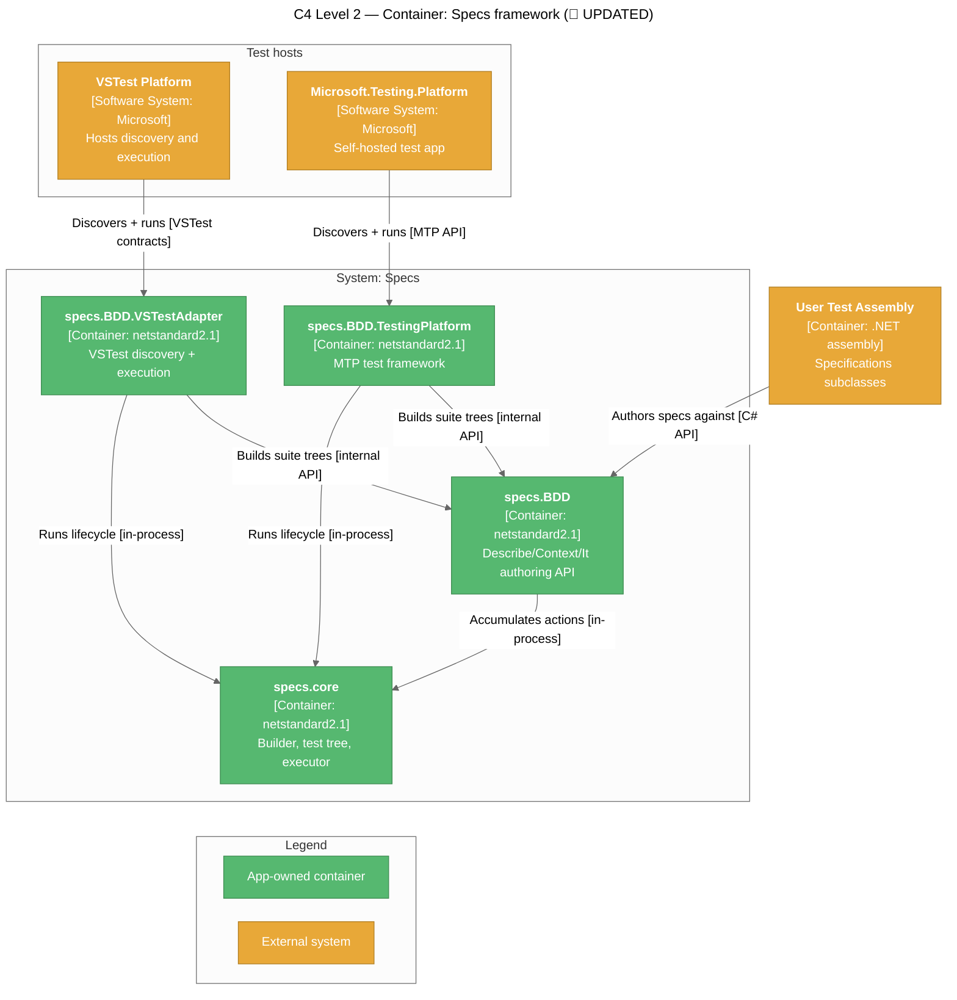

### Inside the containers

| Container | Key components |
|-----------|---------------|
| `specs.core` | `IContextualTestCaseBuilder` / `ContextualTestCaseBuilder` (📌 `AddPendingTest`, `ChildTestCase(..., isPending)`), immutable `ContextualTestCase` (📌 `PendingTests`), `TestCaseExecutor` (📌 public), 📌 `ActExceptionContext`, 📌 `ActExceptionAssertions` / `ExpectedExceptionNotThrownException`, `TestContextAdapter` (📌 public, `FromTestCase`), adapter interfaces (`ITestContextAdapter`, `ITestProviderAdapter`, `ILoggingAdapter` — 📌 all public) |
| `specs.BDD` | `Specifications` base class (📌 `TODO` / `TODOAsync`, `xIt` / `xItAsync` / `xContext` / `xDescribe`, 📌 `ShouldThrow<T>()` / `ShouldThrow<T>(Action<T>)`), `ContextBuilder`, `AssertBuilder` / `AssertBuilderAsync`, `[Feature]` attribute (with 📌 `Level`), 📌 `ReportingLevel` enum, 📌 `[ReportingLevel]` assembly/class attribute |
| `specs.BDD.VSTestAdapter` | `SpecsTestDiscoverer`, 📌 `SuiteTreeFlattener`, `TestCaseConverter`, `TestProperties`, `SpecTest`, `SpecsTestExecutor`, `TestInvoker`, `GroupedContextRunner` (📌 now a VSTest result mapper), 📌 `VSTestRunListener`, `ResultReporter` — plus the shared runner core below |
| 📌 NEW — shared runner core (`src/shared/specs.BDD.Runner/`, compiled into both runners) | `SuiteRunner`, `SelectionTreeWalker<TTest>`, `GroupedSubtreeRunner`, `ISpecRunListener<TTest>`, `SelectionTestProvider<TTest>`, `SelectionLoggingAdapter<TTest>`, `SpecRunItem<TTest>`, `SpecRunOptions`, `GroupedReport`, `ReportMarkers`, `SpecExceptions`, and (moved from the adapter) `SpecificationClassScanner`, `ContextMethodScanner`, `SuiteTreeBuilder`, `GroupingSettings`, `PendingSpecs`, `SourceLocationReader`, `TestFinder`, `ContextPathFormat`, `MarkerStyle`, `InvalidSpecificationException` |
| 📌 NEW — `specs.BDD.TestingPlatform` | `TestApplicationBuilderExtensions.AddSpecsBDD`, `TestingPlatformBuilderHook`, `SpecsTestFramework`, `SpecsSettings`, `ClientMode`, `SpecTreeBuilder` / `SpecNode` / `SpecForest` / `SpecPath`, `SpecSelection`, `TestNodeFactory`, `MtpRunListener`, `ConsoleTreeReport` |

## Core Design Patterns

### 1. Builder Pattern — Test-case construction

`IContextualTestCaseBuilder` accumulates lifecycle actions, child contexts, and tests fluently, then produces an immutable `ContextualTestCase` via `Build()`.

```csharp
IContextualTestCaseBuilder builder = new ContextualTestCaseBuilder("MySpec");

builder
    .AddSetupOnce(() => InitDb())
    .AddSetupEach(() => SeedRow())
    .AddAct      (() => _result = Subject.Run())
    .AddTest     ("returns expected", () => Check.That(_result).IsTrue())
    .AddTeardownEach(() => RollbackTx())
    .AddTeardownOnce(() => DropDb());

IContextualTestCase testCase = builder.Build();   // immutable from here on
```

**Benefits**: clear separation between definition and execution; cacheable, thread-safe results; validation can run at build time.

### 2. Composite Pattern — Hierarchical contexts

Each `ContextualTestCase` may have child `ContextualTestCase`s. Children inherit their parents' setup/act actions automatically.

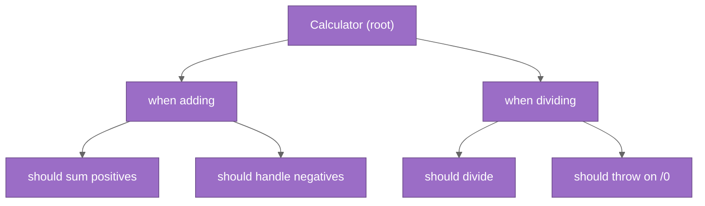

### 3. Adapter Pattern — Framework independence

`specs.core` exposes three adapter interfaces; concrete bindings live elsewhere.

| Interface | Responsibility | Runner implementation (📌 UPDATED — shared by VSTest and MTP) |
|-----------|---------------|-----------------------|
| `ITestProviderAdapter` | Supplies the list of `TestInstance` to run | 📌 `SelectionTestProvider<TTest>` (was `VSTestTestProvider`) |
| `ITestContextAdapter` | Tracks lifecycle state, manages action inheritance | `TestContextAdapter` (default, in core) |
| `ILoggingAdapter` | Reports pass/fail/exception | 📌 `SelectionLoggingAdapter<TTest>` → `ISpecRunListener<TTest>` → `VSTestRunListener` (`IFrameworkHandle`) or `MtpRunListener` (MTP message bus). Was `VSTestLoggingAdapter` → `IFrameworkHandle` |

The core has **zero** reference to `Microsoft.TestPlatform.*`.

📌 `TestContextAdapter` takes five lifecycle delegates `(setupOnce, setupEach, act, teardownEach, teardownOnce)`; `TestContextAdapter.FromTestCase(ITestCase)` builds one from a node's **cascaded** actions (whole-tree hosts). Hosts that own once-actions themselves (`SelectionTreeWalker`) use the constructor with no-op `setupOnce` / `teardownOnce`.

#### 📌 BEFORE (internal surface + `InternalsVisibleTo`)

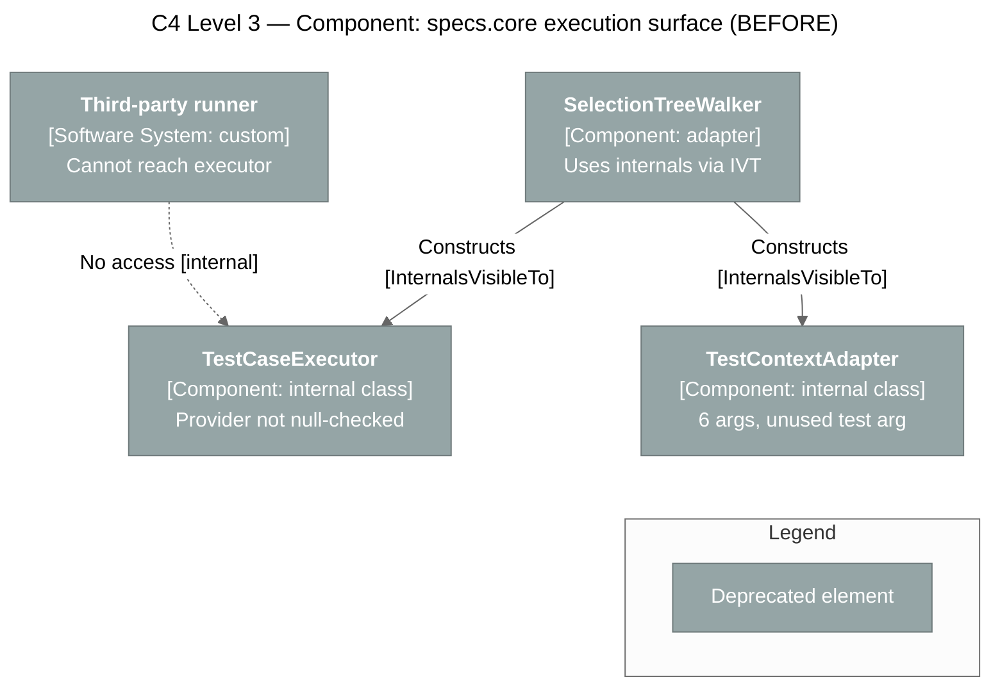

Problems:

- Only the in-repo adapter could run the canonical lifecycle; custom front-ends had to re-implement it.
- Dead API baggage: an unvalidated `test` ctor argument and an unused public `Settings/TestSettings` class duplicating `TestCaseExecutorSettings`.
- `TestCaseExecutor` accepted a `null` provider and failed later with a `NullReferenceException`.

#### 📌 AFTER (public surface, no adapter IVT)

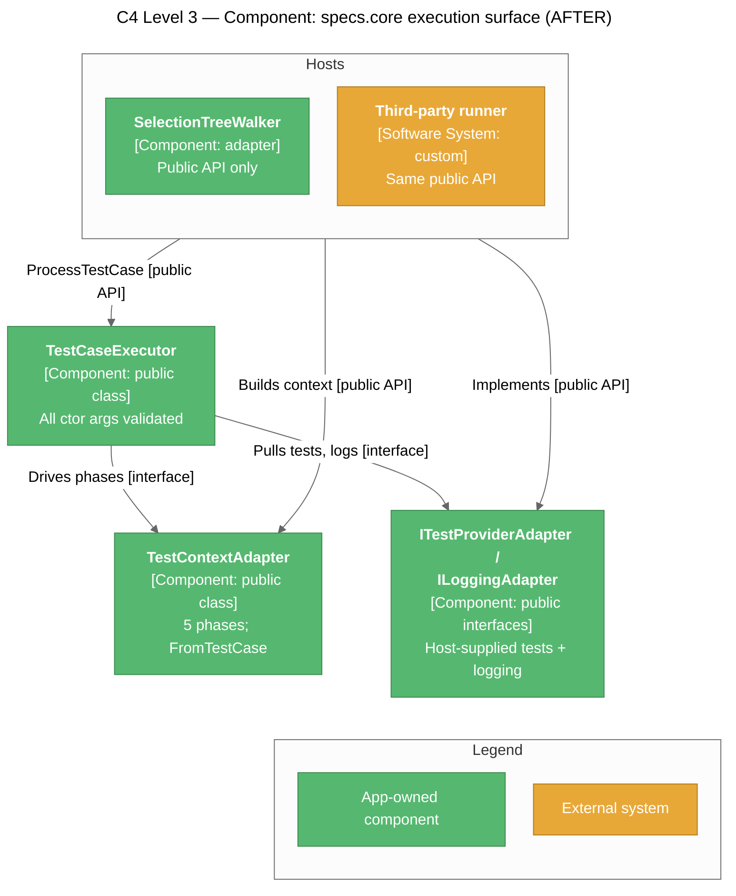

Benefits:

- Any runner gets identical lifecycle semantics (including `ActExceptionContext` capture) by supplying only tests, context, and logging.
- The adapter consumes exactly the surface third parties see, so the public contract is exercised on every run.
- `specs.core` keeps `InternalsVisibleTo` only for its own test assemblies (`specs.core.UnitTests`, `specs.BDD.UnitTests`, `DynamicProxyGenAssembly2`).

### 4. Strategy Pattern — Executor configuration

`TestCaseExecutorSettings` carries `StopOnAssertFailure` (fail-fast vs. continue). Cancellation is **not** a setting — `ProcessTestCase(CancellationToken)` takes the token directly and checks it before each test instance.

### 5. Template Method — Fixed lifecycle order

`TestCaseExecutor.ProcessTestCase(CancellationToken)` always runs:

1. `SetupOnce` (parent → child).
2. For each test: `SetupEach` → `Act` → test → `TeardownEach`. 📌 `Act` + test run together through `ActExceptionContext.Run`, so an `Act` exception fails only that test and `TeardownEach` still runs (see "Act Exception Capture").
3. `TeardownOnce` (child → parent).

## Critical Implementation Patterns

### Top-down setup / bottom-up teardown

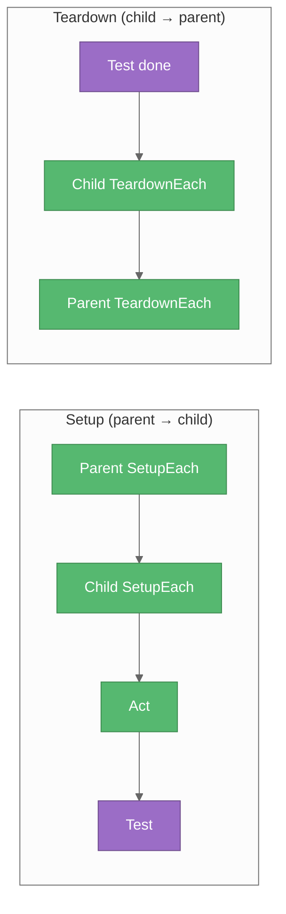

### Context-switching callback (specs.BDD)

`Specifications` keeps a pointer to the currently-active builder. When a nested `Describe[..]` or `Context[..]` block opens, the pointer is swapped to a child builder for the duration of the user action and restored afterward.

```csharp
private void contextCallBack(IContextualTestCaseBuilder childBuilder, Action action)
{
    var previous = this.coreBuilder;
    this.coreBuilder = childBuilder;
    try   { action.Invoke(); }
    finally { this.coreBuilder = previous; }
}
```

This is how lifecycle methods called *inside* a nested block correctly attach to the child scope without explicit threading.

### Async → sync conversion

```csharp
public IContextualTestCaseBuilder AddSetupOnce(Func<Task> asyncAction)
    => AddSetupOnce(() => asyncAction().GetAwaiter().GetResult());
```

The public surface stays `Action`-based. `GetAwaiter().GetResult()` blocks — acceptable in test scenarios; trades pure-async purity for a uniform API.

### Immutability after Build

`IContextualTestCase` exposes only read-only collections and getters. The builder is the only mutator; once `Build()` is called, the resulting case is safe to share, cache, or execute repeatedly.

## VSTest Adapter Pipeline

The adapter is a discovery → conversion → execution pipeline. Both ends are anchored on **`SuiteTreeBuilder`**, the single source of truth for suite-tree construction.

### 📌 Discovery + Conversion

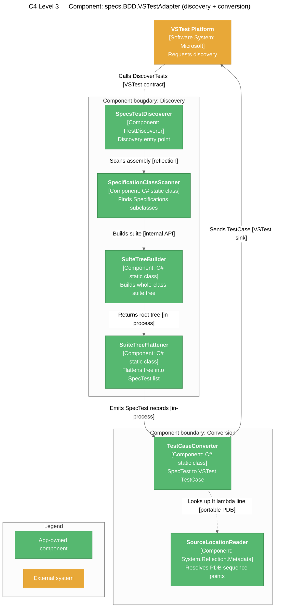

### 📌 Execution

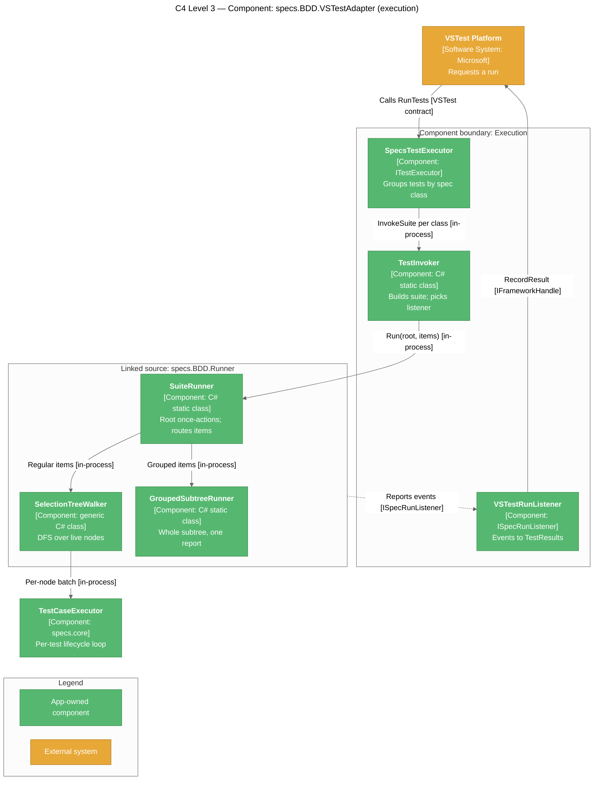

### Adapter responsibilities

> 📌 UPDATED — rows marked **(shared)** now live in `src/shared/specs.BDD.Runner/` (namespace `specs.BDD.Runner`) and are compiled into both runners; see section "Shared Runner Core + Microsoft.Testing.Platform Runner".

| Layer | Class | Responsibility |
|-------|-------|---------------|
| Discovery | `SpecsTestDiscoverer` | Entry point declared by `[FileExtension(".dll" / ".exe")]` and `[DefaultExecutorUri("executor://SpecsTestExecutor/v1")]`; reads the `.runsettings` `ReportingLevel` value from `IDiscoveryContext.RunSettings` 📌 |
| Discovery | `SpecificationClassScanner` **(shared)** | Reflects assemblies to find non-abstract `Specifications` subclasses |
| Discovery | `ContextMethodScanner` **(shared)** | Finds `[Feature]`-decorated methods; throws `InvalidSpecificationException` if none |
| Discovery | **`SuiteTreeBuilder`** **(shared)** | Instantiates the suite once and registers every `[Feature]` method as a **named child context** via `instance.Context[name] = () => method.Invoke(...)`, then returns `CoreBuilder.Build()`. Shared by discovery *and* execution |
| Discovery | **`GroupingSettings`** **(shared)** 📌 UPDATED | 📌 `ParseReportingLevel(string?)` extracted so the MTP runner parses `SpecsBDD:ReportingLevel` with the same rules. Resolves the effective `ReportingLevel` per root `[Feature]`: `FeatureAttribute.LevelSetting` → class `[ReportingLevel]` (not inherited) → assembly `[ReportingLevel]` → `.runsettings` `<SpecsBDD><ReportingLevel>` → `Test`; grouped when the result is `Feature`. Also reads `ShowSourceLocations` / `ColorOutput` and picks the grouped-report `MarkerStyle` |
| Discovery | `SuiteTreeFlattener` 📌 RENAMED | `Flatten(type, ReportingLevel?)` (was `TestStructureExtractor.ExtractTests`) flattens the suite tree into `SpecTest` records, joining context names with `ContextPathFormat.Separator`; emits a single `IsGrouped` record for grouped root contexts 📌; 📌 sets `IsPending` per spec (grouped record: pending only when the subtree has specs and all are pending) |
| Discovery | `PendingSpecs` **(shared)** | Internal static helpers over a built tree: `IsPending(node, description)`, `HasRunnableTests(node)` (any non-pending spec at or below), `HasAnyTests(node)`. Shared by discovery, `TestInvoker`, and `GroupedContextRunner` |
| Discovery | `SourceLocationReader` **(shared)** | Reads portable PDB sequence points for any `MethodBase` (lambda or `[Feature]` method). 📌 `GetTestMethod(Action)` walks the whole `Delegate.Target` chain, unwrapping async `It` wrappers to the user's `Func<Task>` and 📌 `ShouldThrow` delegates to the user's verifier; async bodies resolve via the state machine's `MoveNext`; methods from a different assembly than the PDB return `null` |
| Conversion | `SpecTest` | POCO: `SpecificationClass`, `ContextMethod`, `ItAction`, `ContextPath`, `TestDescription`, `IsGrouped` 📌, `IsPending` 📌 NEW |
| Conversion | `ContextPathFormat` **(shared)** 📌 UPDATED | Static `Separator` (`" → "`) — the one `ContextPath` delimiter used by `SuiteTreeFlattener`, `SelectionTreeWalker`, `GroupedSubtreeRunner`, `TestFinder`, and the MTP `SpecTreeBuilder` / `TestNodeFactory`. 📌 Moved from `VSTestAdapter.Conversion` to `specs.BDD.Runner` and is now `internal` (was `public`) |
| Conversion | `TestCaseConverter` | Produces 📌 UPDATED a method-level `FullyQualifiedName` (`Class.DescribeMethod`, shared by all specs of a `[Feature]`), a deterministic per-spec `Id` (SHA-256 of source + unique name), RFC-0017 `ManagedType` / `ManagedMethod`, a `DisplayName` of every context segment plus the spec joined by `ContextPathFormat.Separator` (VS Code ignores `Hierarchy`), the RFC-0033 `TestCase.Hierarchy` property (📌 `[3]` is now the `[Feature]` only), and source location |
| Conversion | `TestProperties` | Custom `TestProperty` registry (`ClassName`, `ContextMethod`, `ContextPath`, `TestDescription`, `IsGrouped` 📌, `IsPending` 📌 NEW — `SpecsBDD.IsPending`, `bool`) preserving metadata across VSTest serialization |
| Execution | `SpecsTestExecutor` | `[ExtensionUri("executor://SpecsTestExecutor/v1")]`; groups selected tests by `(Source, ClassName)` so lifecycle fires once per class; owns the `CancellationTokenSource`; forwards `IRunContext` into re-discovery so `.runsettings` grouping applies to `RunTests(sources)`; 📌 resolves `ShowSourceLocations` and `MarkerStyle` once per run; 📌 NEW applies the `dotnet test --filter` expression to re-discovered cases in `RunTests(sources)` (see "Test Case Filtering") |
| Execution | `TestInvoker` 📌 UPDATED | Resolves the spec `Type`, builds the suite via `SuiteTreeBuilder`, maps each `TestCase` to a `SpecRunItem<TestCase>`, and calls `SuiteRunner.Run` with a `VSTestRunListener` (or `SuiteRunner.FailAll` when the suite cannot be built). `Invoke` (single case) still runs the cascaded lifecycle itself. 📌 The root lifecycle and three-way split moved to `SuiteRunner` |
| Execution | **`SuiteRunner`** **(shared)** 📌 NEW | Per-class entry for both runners: splits the selection three ways (grouped / pending / regular), records pending items as pending up front, runs the **root** (class-constructor) `OwnSetupOnce` / `OwnTeardownOnce` once per class (skipped entirely when nothing selected is runnable), hands grouped items to `GroupedSubtreeRunner` and the rest to `SelectionTreeWalker` (one shared tree instance). A root `BeforeAll` failure fails every selected runnable test and skips the root `AfterAll` |
| Execution | **`SelectionTreeWalker<TTest>`** **(shared)** | Depth-first walk of the suite tree firing `OwnSetupOnce` / `OwnTeardownOnce` **exactly once per live non-root node** (the root is owned by `SuiteRunner`); delegates per-test loops to `TestCaseExecutor`. 📌 Generic over the runner's test handle; reports through `ISpecRunListener<TTest>` |
| Execution | **`GroupedSubtreeRunner`** **(shared)** 📌 NEW | Runs an entire root `[Feature]` subtree and returns a runner-neutral `GroupedReport` (`GroupedOutcome` `Passed` / `Failed` / `Skipped`, tree output, error message, combined stack traces) — or `null` when the context no longer exists (`MissingContext`). Mirrors the walker's once-per-node lifecycle but keeps running after per-test failures; NSpec-style tree + failure list using the run's `MarkerStyle`, optional per-`It` `at file:line N` locations, fully failed tree when the root `BeforeAll` failed, `○ ... - PENDING` for pending specs, once-actions skipped for nodes with no runnable specs, all-pending → `Skipped`. (Body of the former `GroupedContextRunner`) |
| Execution | **`GroupedContextRunner`** 📌 UPDATED | VSTest mapping only: `Execute` runs `GroupedSubtreeRunner` for one `TestCase`; `ToTestResult` turns a `GroupedReport` into one `TestResult` with the tree in `StandardOutCategory` |
| Execution | `VSTestRunListener` 📌 NEW | `ISpecRunListener<TestCase>` over `IFrameworkHandle`: `RecordStart`, `RecordResult` via `ResultReporter` / `GroupedContextRunner.ToTestResult`, `SendMessage` for logs |
| Execution | `MarkerStyle` **(shared)** | Internal enum (`Plain` / `Ansi` / `Emoji`); glyphs come from 📌 `ReportMarkers.For(style)` |
| Execution | `TestFinder` **(shared)** | Splits `ContextPath` on `ContextPathFormat.Separator` and walks the immutable test tree |
| Execution | `ResultReporter` | Builds `TestResult` objects for pass/fail/skip outcomes (`Skipped(..., message = PendingMessage)` with `PendingMessage = "Pending"`). 📌 `Unwrap` moved to the shared `SpecExceptions.Unwrap` |
| Execution | `SelectionLoggingAdapter<TTest>` **(shared)** 📌 RENAMED | `ILoggingAdapter` that forwards to `ISpecRunListener<TTest>`; tracks `ReportedDescriptions` so unreached tests can be failed explicitly (was `VSTestLoggingAdapter` over `IFrameworkHandle` — deleted) |
| Execution | `SelectionTestProvider<TTest>` **(shared)** 📌 RENAMED | `ITestProviderAdapter` wrapping `(test handle, description, Action)` triples as `TestInstance[]` (was `VSTestTestProvider`) |

## Once-Per-Node Lifecycle (selection-tree walk)

Running a *subset* of a suite from Test Explorer must still honour `BeforeAll` / `AfterAll` semantics: each context's once-actions fire exactly once no matter how many of its tests were selected.

### 📌 BEFORE (per-test cascaded lifecycle)

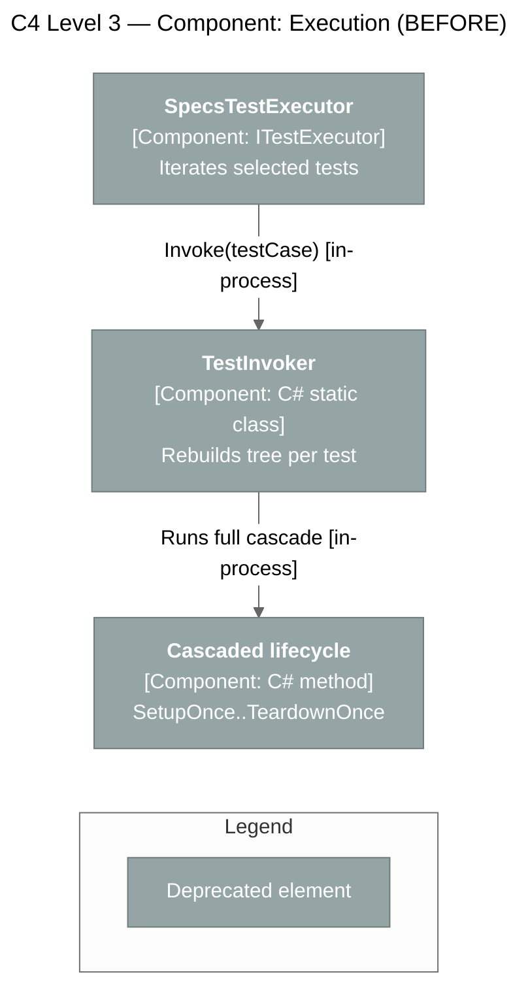

Problems:

- The suite tree was rebuilt once **per selected test**, so a fresh `Specifications` instance was created each time.
- `SetupOnce` / `TeardownOnce` ran once **per test**, not once per context — `BeforeAll` semantics were wrong for multi-test runs.
- `[Feature]` methods were invoked directly, so they did not appear as nodes in the tree and could not own once-actions.

### 📌 AFTER (suite tree + selection walk)

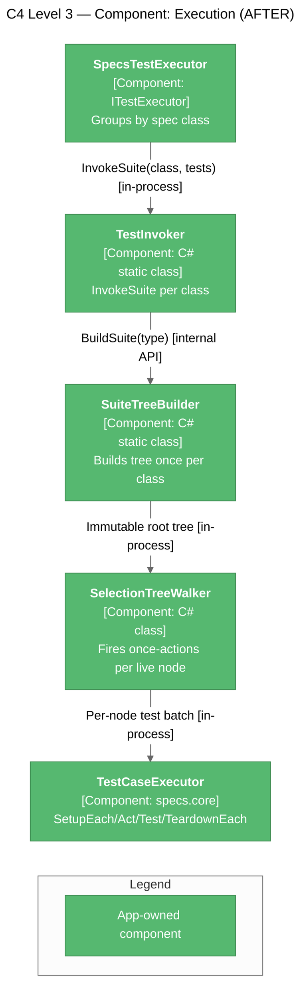

Benefits:

- `[Feature]` methods become **named child contexts** of the class root, so they are first-class tree nodes that can own `BeforeAll` / `AfterAll`.
- `ITestCase.OwnSetupOnce` / `OwnTeardownOnce` expose a node's *own* once-actions (no ancestor cascade), which is exactly what the walker needs.
- Only **live** nodes (those with at least one selected test at or beneath them) run lifecycle; idle branches are skipped.
- The walker passes no-op once-actions into `TestContextAdapter` so `TestCaseExecutor` still handles `SetupEach` → `Act` → test → `TeardownEach` without double-firing once-actions.
- Clear failure contract: a failing `OwnSetupOnce` at node *N* fails every selected test at or under *N*, skips *N*'s `OwnTeardownOnce`, and lets sibling branches continue.
- `SelectionLoggingAdapter.ReportedDescriptions` (📌 was `VSTestLoggingAdapter`) lets the walker fail any test that was never reached due to a lifecycle fault, so Test Explorer never shows a stuck "not run" entry.

## 📌 NEW — Root (class-level) Lifecycle

Hooks registered in a `Specifications` constructor (`BeforeAll`, `BeforeEach`, `Act`, `AfterEach`, `AfterAll`) attach to the **suite root** node. `BeforeEach` / `Act` / `AfterEach` already cascaded into every test, but the root's *once*-actions were never fired.

### 📌 BEFORE (root once-actions skipped)


Problems:

- A class-level `BeforeAll` / `AfterAll` registered in the constructor **silently never ran** in either mode.
- No defined behaviour for a failing suite-wide setup.

### 📌 AFTER (TestInvoker owns the root)

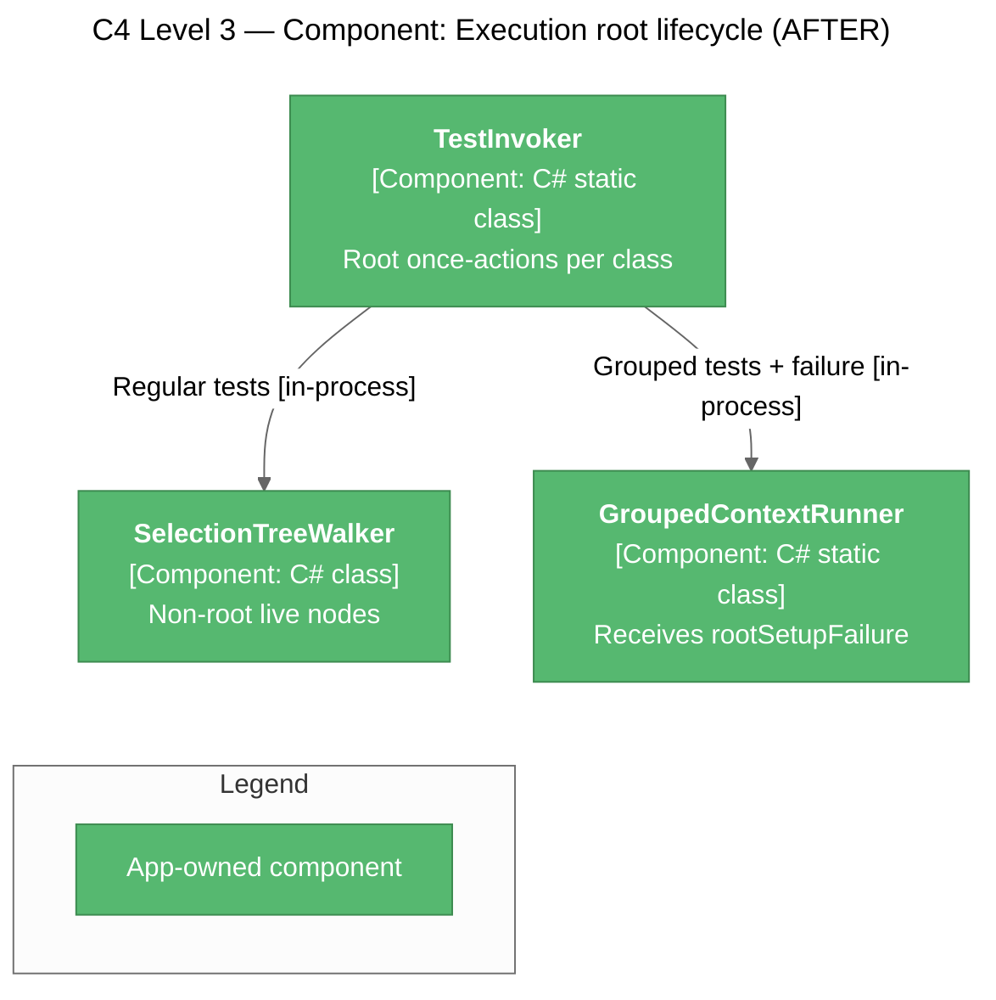

> 📌 UPDATED — root ownership moved from `TestInvoker` to the shared `SuiteRunner`, so the VSTest and MTP runners apply the same contract.

Benefits / contract:

- Root `OwnSetupOnce` runs **once per class** before any grouped or per-`It` work; root `OwnTeardownOnce` runs once in a `finally` (best-effort, exceptions swallowed).
- If root `BeforeAll` throws: grouped results render a fully failed tree (`FailSubtree`) with the unwrapped root exception, regular tests are reported failed via `ReportAllAsFailed`, and root `AfterAll` is **skipped**.
- `SelectionTreeWalker` keeps skipping the root, now by design rather than by omission.

## 📌 Grouped Root-Context Execution

By default every `It[...]` is its own VSTest `TestCase`. A root `[Feature]` can instead opt into **grouped mode** (📌 `ReportingLevel.Feature`), where the whole subtree is discovered as one `TestCase` and executed by `GroupedContextRunner` into one `TestResult`.

### 📌 MODERNIZED — Configuration API

#### BEFORE (`bool` flags, three layers)


```csharp
[assembly: GroupSpecsByRootContext]                  // removed
[Feature("subtraction", Grouped = true)]              // removed
```

Problems: no class-level switch; `bool` naming did not describe *what* was being chosen; assembly attribute name was mode-specific.

#### AFTER (📌 UPDATED — `ReportingLevel` enum, four layers)

> 📌 Introduced as `SpecReporting` (`Individual` / `GroupedByRootContext`, `Reporting =`) in `124ba8c`; renamed to `TestStructure` (`PerSpec` / `PerDescribe`, `Structure =`) by decision #32. Layers and precedence are unchanged.

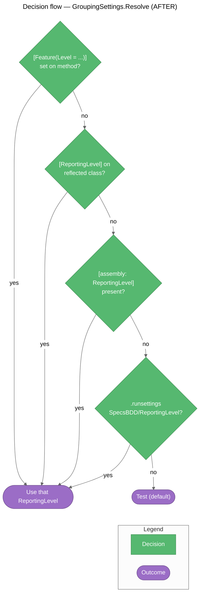

```csharp
[assembly: ReportingLevel(ReportingLevel.Feature)]

[ReportingLevel(ReportingLevel.Feature)]                   // class-level, NOT inherited
public class CalculatorSpecs : Specifications
{
    [Feature("Addition", Level = ReportingLevel.Test)]   // per-method override
    public void describe_addition() { /* ... */ }
}
```

Benefits:

- One vocabulary (`ReportingLevel.Test` / `Feature`) across method, class, assembly, and `.runsettings`; extensible to future modes.
- Class-level opt-in (`AttributeTargets.Assembly | Class`, `Inherited = false`) — read from the method's `ReflectedType`, so a derived suite does **not** inherit its base's setting.
- `FeatureAttribute` keeps a nullable backing (`ReportingLevel?`, exposed as `LevelSetting`) so an explicit `Level = Test` overrides any lower layer.
- `.runsettings` parsing accepts enum **names** only (case-insensitive, trimmed); numeric strings and undefined values yield `null`.

### Runtime contract

| Aspect | Per-`It[...]` mode (`SelectionTreeWalker`) | Grouped mode (`GroupedContextRunner`) |
|--------|--------------------------------------------|---------------------------------------|
| Discovery output | One `SpecTest` per `It[...]` | One `SpecTest` with `IsGrouped = true`, `ContextPath` = root context name |
| `FullyQualifiedName` | 📌 UPDATED `Class.DescribeMethod` (was `Class::Method::ContextPath::Description`) | 📌 UPDATED `Class.DescribeMethod` (was `Class::Method::[grouped]`) |
| 📌 NEW `Id` | SHA-256 of source + `Class::Method::ContextPath::Description` | SHA-256 of source + `Class::Method::[grouped]` |
| `DisplayName` | `ContextPath → Description` | Root context description |
| Once-actions | `OwnSetupOnce` / `OwnTeardownOnce` once per live node | Same, over the entire subtree |
| Per-test failure | That test fails; siblings continue | Counted, run continues; result fails if any failed |
| 📌 `Act` exception | Captured by `ActExceptionContext.Run`; fails that test only (unless verified by `ShouldThrow`), `TeardownEach` still runs | Same — counted as that spec's failure, run continues |
| `BeforeAll` failure | Fails every selected test under the node | Fails every test under the node (`FailSubtree`), run continues elsewhere |
| 📌 Root (class) `BeforeAll` failure | Every selected test reported failed; root `AfterAll` skipped | Whole tree rendered as failed with the root exception; root `AfterAll` skipped |
| `AfterAll` failure | Swallowed (best-effort) | Swallowed (best-effort) |
| Empty subtree | n/a | `TestOutcome.Skipped` with "No specs found" |
| 📌 Pending spec | Recorded Skipped (`Pending`) by `TestInvoker` before any lifecycle; never reaches the walker | Rendered `○ ... - PENDING`, counted in `N pending`; never executed |
| 📌 All specs pending | Node not live → its once-actions never run | Node once-actions skipped; result `Skipped` with "All specs are pending." |
| Output | Per-result messages | NSpec-style tree + `N passed, M failed, [P pending, ]T total` + numbered failure list in `StandardOutCategory`; `ErrorMessage` summarises failed paths |

### 📌 NEW — Report formatting

| Setting | Source | Effect |
|---------|--------|--------|
| Pass/fail markers | `GroupingSettings.ResolveMarkerStyle(colorOutput, VSAPPIDNAME)` | `ColorOutput=false` → `Plain` (`✓` / `✗` / 📌 `○`); host is Visual Studio (`VSAPPIDNAME=devenv.exe`, which cannot render ANSI) → `Emoji` (`✅` / `❌` / 📌 `⏸️`); otherwise → `Ansi` (green `✓` / red `✗` / 📌 yellow `○`) |
| Source locations | `.runsettings` `SpecsBDD/ShowSourceLocations` (default `false`) | Adds an indented `at <file>:line <n>` under each passing, failing, root-setup-failed, or 📌 pending `It` |

Both values are resolved once per run in `SpecsTestExecutor` and threaded through `TestInvoker.InvokeSuite` → `GroupedContextRunner.Run` → `Execute`.

Both runners share the single suite tree built by `SuiteTreeBuilder` for the class, so grouped and per-`It` contexts in the same class never trigger a second instantiation.

### Dynamic view

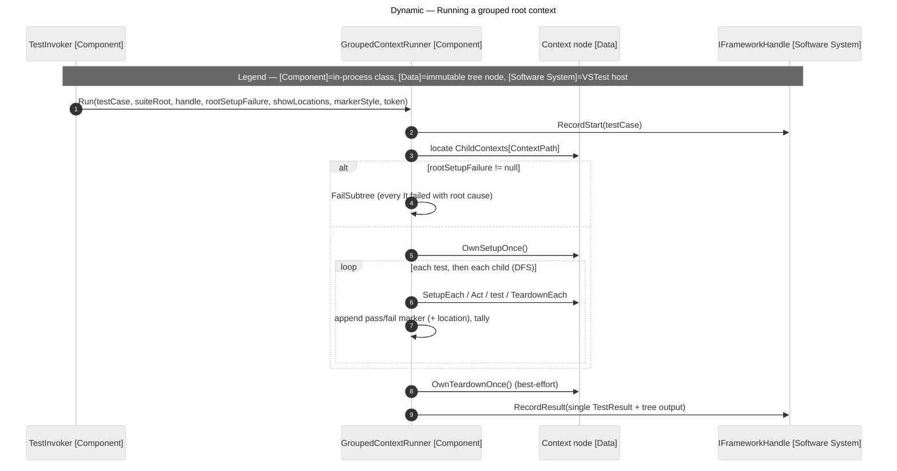

## Test Explorer Hierarchy (RFC-0033)

`TestCaseConverter` sets the VSTest `TestCase.Hierarchy` property — a `string[4]` of `[Container, Namespace, Class, TestGroup]`:

| Index | Value | Notes |
|-------|-------|-------|
| 0 | `null` | VS fills it from the project/assembly name |
| 1 | `SpecificationClass.Namespace` | — |
| 2 | `SpecificationClass.Name` | Simple (unqualified) name |
| 3 | 📌 UPDATED — first segment of `SpecTest.ContextPath` (the `[Feature]`) | Was the full `[Feature]` + `Describe`/`Context` chain. Visual Studio nests only four levels, so the deeper path now lives in the display name. Grouped records use their `[Feature]` too |

Source navigation prefers the `It[...]` lambda's PDB sequence point (`SourceLocationReader.GetTestMethod(SpecTest.ItAction)`) so "Go to Source" lands on the assertion line, 📌 then the `It[...]` line recorded at declaration (see "Declared-location fallback" below), and finally the `[Feature]` method.

📌 **Async `ItAsync[...]` navigation**: `ContextualTestCaseBuilder.AddTest(string, Func<Task>)` wraps the test as `test.RunSync` (an extension-method-bound delegate) instead of a closure, so the wrapper `Action.Target` *is* the user's `Func<Task>`. `GetTestMethod` unwraps it, and `TryGetLocation` follows `[AsyncStateMachine]` to `MoveNext`, where the async body's sequence points actually live. 📌 `ShouldThrow<T>(verify)` uses the same trick — it returns `verify.VerifyActException` (extension-method-bound), so the user's verifier lambda is the innermost `Target`. The parameterless `ShouldThrow<T>()` binds a verifier defined in `specs.BDD`, which the cross-assembly guard rejects, so navigation 📌 now falls back to the declared `It[...]` line (was the `[Feature]` method).

📌 **VS Code caveat**: the VS Code test UI ignores `Hierarchy`, so `TestCaseConverter.BuildDisplayName` embeds the context path (`describe → context → … → spec`, joined with `ContextPathFormat.Separator`) to keep contexts visible there. Visual Studio nests `Namespace › Class › [Feature]` via `Hierarchy` and shows the same path-qualified name beneath it. 📌 The MTP runner uses the same display-name rule for IDE clients (see `TestNodeFactory`).

### 📌 NEW — Declared-location fallback

Some spec bodies have no source in the test assembly: `It["..."] = TODO` / `TODOAsync` and the parameterless `ShouldThrow<T>()` share one delegate defined in `specs.BDD`. The `It[...]` call site is the only place that knows which line declared them.

#### 📌 BEFORE (body PDB or `[Feature]` method)

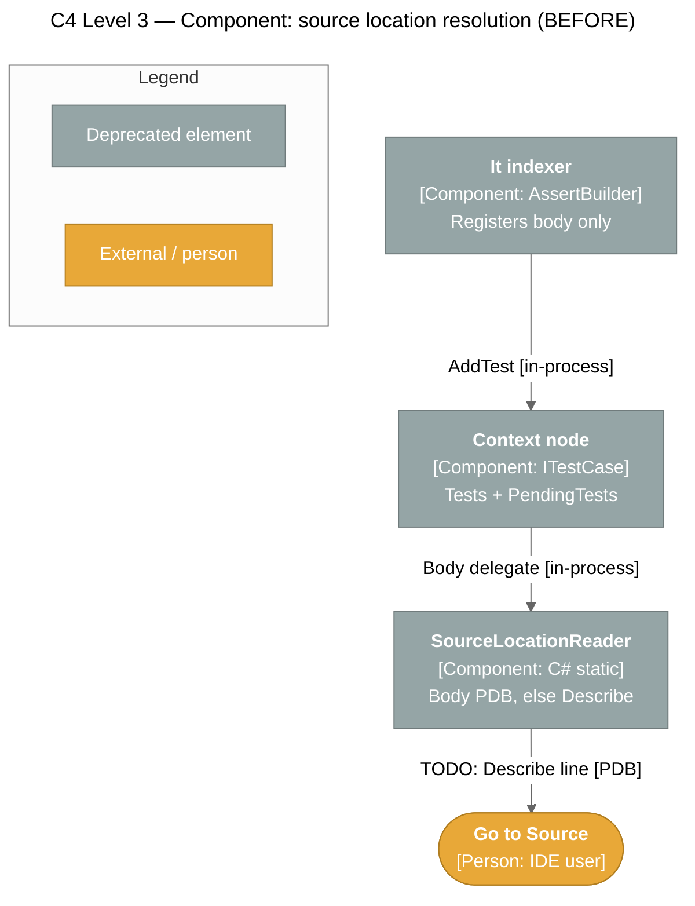

- `TODO` specs and `ShouldThrow<T>()` specs navigated to the `[Feature]` method, so every one landed on the same line.

#### 📌 AFTER (caller info recorded on the node)

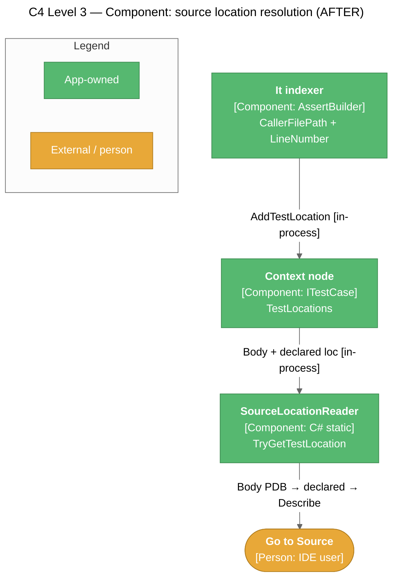

| Consumer | Resolution order |
|----------|------------------|
| MTP `SpecTreeBuilder` (leaf `Location`) | `TryGetTestLocation` (body PDB → `TestLocations`) → `[Feature]` method |
| Grouped report (`GroupedSubtreeRunner`, `ShowSourceLocations`) | `TryGetTestLocation`; line omitted when both are unknown |
| VSTest `TestCaseConverter` | `ItAction` PDB → `SpecTest.DeclaredLocation` (from `SuiteTreeFlattener`) → `ContextMethod` |

- The body PDB still wins, so ordinary specs keep landing on the lambda's first statement rather than the `It[...]` line.
- `TestLocations` is discovery-only metadata. Execution and `TestCaseExecutor` ignore it.

### 📌 NEW — `[Feature]` method identity (CodeLens / symbol navigation)

IDEs attach CodeLens and symbol navigation by resolving a test to a real method. Both runners now name the `[Feature]` **method** (not its description text) as the test's method, and the VSTest adapter moves per-spec uniqueness from the fully-qualified name to the `TestCase.Id`. Decision #43 records the rationale.

#### 📌 BEFORE (unique FQN, no method symbol)

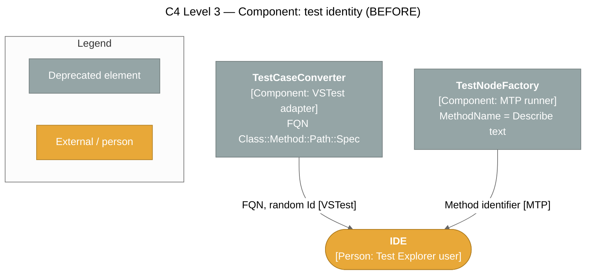

- The VSTest FQN and the MTP `MethodName` (e.g. `Cart`) did not name a C# method, so no CodeLens appeared on `[Feature]` methods and symbol lookups failed.

#### 📌 AFTER (method-level FQN + managed names, hashed Id)

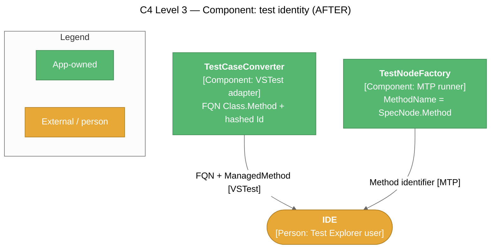

| Runner | Property | Value |
|--------|----------|-------|
| VSTest | `FullyQualifiedName` | `{Class.FullName}.{DescribeMethod}` — shared by every spec (and the grouped record) of a `[Feature]`, so Visual Studio shows specs as data-driven rows of the method. Falls back to the unique name when `ContextMethod` is `null` |
| VSTest | `Id` | Deterministic GUID: first 16 bytes of SHA-256 over `source + "\|" + uniqueName`, where `uniqueName` is the old `Class::Method::ContextPath::Description` (grouped: `Class::Method::[grouped]`) |
| VSTest | `TestCase.ManagedType` / `TestCase.ManagedMethod` (RFC-0017, hidden) | Spec class full name / `[Feature]` method name; set only when `ContextMethod` is known |
| MTP | `TestMethodIdentifierProperty.MethodName` | `SpecNode.Method.Name` (new `MethodInfo? Method` on `Describe` / `GroupedDescribe` nodes, set by `SpecTreeBuilder`), falling back to the describe text |

- Execution is unaffected: `TestFinder` re-locates specs from the `TestProperties` address (`ClassName`, `ContextMethod`, `ContextPath`, `TestDescription`), never from the FQN.
- `--filter FullyQualifiedName~<context or spec text>` no longer matches; use `ContextPath` / `TestDescription` instead. Class / method substrings still match.

### Discovery safety

The adapter executes user-defined `[Feature]` methods during discovery (it must, to enumerate `It[...]` blocks). To stay safe:

- Suites are instantiated through the parameterless constructor only.
- Setup actions are collected, **not executed**, at discovery time.
- Failures during discovery surface as `InvalidSpecificationException` or specific VSTest error logs — they never abort the run.
- `SourceLocationReader` degrades gracefully: a missing or unreadable PDB yields `null`, never an exception.
- `SpecificationClassScanner` catches `ReflectionTypeLoadException` and returns the types that *did* load, so one broken dependency cannot hide an entire assembly's tests.

### The tree is built twice

Discovery and execution each build the suite tree independently — VSTest serializes `TestCase` objects across the discovery/execution boundary, so no live object graph survives between the two phases.

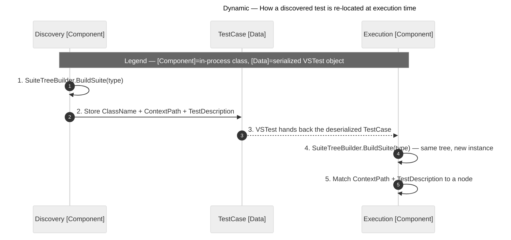

The four `TestProperties` values (`ClassName`, `ContextMethod`, `ContextPath`, `TestDescription`) are the **address** that lets execution find the node discovery found. This is why `SuiteTreeBuilder` must be the only construction path: if the two phases disagreed on a single context description, the address would no longer resolve. A fifth property, `IsGrouped`, tells `TestInvoker` which runner the address belongs to. 📌 A sixth, `IsPending`, exists for `--filter` only — execution re-derives pending state from the rebuilt tree (`PendingSpecs.IsPending`) rather than trusting the serialized flag.

## Key Technical Decisions

| # | Decision | Rationale | Impact |
|---|----------|-----------|--------|
| 1 | Immutable `ContextualTestCase` after `Build()` | Predictable, thread-safe, cacheable | Builder is the only mutation surface |
| 2 | `Action`-based public surface (async → sync internally) | Uniform API; simpler mental model | `GetAwaiter().GetResult()` blocks but acceptable for tests |
| 3 | Top-down setup, bottom-up teardown | Matches construction/disposal semantics | Builder must track and reverse action order |
| 4 | Adapter-driven framework integration | Core has zero test-framework deps | Adapter layer required per host (VSTest provided) |
| 5 | ~~Two coexisting API styles~~ 📌 SUPERSEDED by #31 | Backward compatibility + modern design | The legacy property-based `Spec` API was removed; only `Specifications` remains |
| 6 | Hierarchical (composite) context model | Matches BDD `describe → context → it` thinking | More complex builder + executor |
| 7 | **Consolidate execution in `TestCaseExecutor`** (Feb 2026 refactor) | Eliminates duplicate execution logic in the adapter; single source of truth for lifecycle semantics | `TestInvoker` delegates to `TestCaseExecutor` rather than re-implementing the lifecycle |
| 8 | Discovery reads `Specifications.CoreBuilder` directly (no reflection) | Cleaner contract; testable; faster | `CoreBuilder` exposed via `InternalsVisibleTo("specs.BDD.VSTestAdapter")` on `specs.BDD` only (📌 `specs.core` no longer grants it — see #29) |
| 9 | 📌 **`SuiteTreeBuilder` is the single source of truth for tree construction** | Discovery and execution must agree on paths, descriptions, and ordering, or `TestFinder` silently misses tests | `[Feature]` methods are registered as named child contexts rather than invoked directly |
| 10 | 📌 **Cancellation is a `CancellationToken` parameter, not an executor setting** | Matches BCL conventions; the token flows straight from `ITestExecutor.Cancel()` through `SpecsTestExecutor`'s `CancellationTokenSource` | `TestCaseExecutorSettings.IsCancelled` was removed; `ProcessTestCase(CancellationToken)` checks the token before each test |
| 11 | 📌 **Once-actions exposed separately as `OwnSetupOnce` / `OwnTeardownOnce`** | The walker needs a node's *own* once-actions without the ancestor cascade that `SetupOnce` / `TeardownOnce` provide | Two extra members on `ITestCase`; `TestCaseExecutor` behaviour unchanged |
| 12 | **Navigate to the `It[...]` lambda, not the `[Feature]` method** | "Go to Source" should land on the assertion the developer clicked | `SpecTest.ItAction` captured at discovery; `SourceLocationReader` accepts any `MethodBase` |
| 13 | 📌 **Grouped mode is a discovery-time decision, resolved in the adapter** | The core stays unaware of VSTest granularity; the flag must be fixed before `TestCase`s are serialized so discovery and execution agree | `GroupingSettings` lives in the adapter; `FeatureAttribute.Level` / `ReportingLevelAttribute` / `ReportingLevel` 📌 live in `specs.BDD` as pure metadata |
| 14 | 📌 **Grouped runner is separate from `SelectionTreeWalker`, not a mode flag on it** | Grouped mode has a different failure policy (continue after per-test failure, aggregate into one result) and a different output channel | `GroupedContextRunner` duplicates the small once-per-node walk rather than threading a mode through the walker and `TestCaseExecutor` |
| 15 | 📌 UPDATED **Explicit `Level = Test` must beat class/assembly/runsettings opt-in** | Authors need a per-context escape hatch when a class or assembly is grouped by default | `FeatureAttribute` uses a nullable `ReportingLevel?` backing field exposed as `LevelSetting` |
| 16 | 📌 **Reporting is an enum, not a `bool`** (📌 renamed by #32) | Names the choice (`Individual` / `GroupedByRootContext`) and leaves room for future modes | Breaking rename: `Grouped` → `Reporting`, `GroupSpecsByRootContextAttribute` → `SpecReportingAttribute`, `GroupByRootContext` → `SpecReporting` in `.runsettings` |
| 17 | 📌 **Class-level `[ReportingLevel]` is not inherited** | A base suite's test-structure choice should not silently change a derived suite's test granularity | `Inherited = false`; resolved from `MethodInfo.ReflectedType` |
| 18 | 📌 NEW **`TestInvoker` owns the root once-lifecycle** | Constructor-registered `BeforeAll` / `AfterAll` must run exactly once per class regardless of how the selection splits between runners | Walker still skips the root; `GroupedContextRunner` receives `rootSetupFailure` |
| 19 | 📌 NEW **Async test wrapper is bound to the original `Func<Task>`** | Source location needs the user's lambda, not a compiler closure | `AsyncTestExtensions.RunSync` in `specs.core`; `SourceLocationReader.GetTestMethod` unwraps `Action.Target` |
| 20 | 📌 NEW **Marker style depends on the host** | Visual Studio's Test Explorer shows raw ANSI escapes; VS Code / CLI render them | `VSAPPIDNAME=devenv.exe` → emoji; `ColorOutput=false` → plain |
| 21 | 📌 NEW **The adapter applies `--filter` itself in `RunTests(sources)`** | VSTest hands source-based runs to the adapter unfiltered; an adapter that ignores `IRunContext.GetTestCaseFilter` runs every test | `SpecsTestExecutor.FilterProperties` maps case-insensitive names to `TestProperty`s; an invalid expression is reported as an error and nothing runs |
| 22 | 📌 NEW **Pending is tree metadata in the core; skipping is adapter policy** | The core builder is where `xContext` inheritance is known, but *how* a pending spec is reported is host-specific | `ITestCase.PendingTests` (ordinal set of descriptions) in `specs.core`; `TestCaseExecutor` is unchanged and does not consult it |
| 23 | 📌 NEW **Pending specs keep their body in `Tests`** | Pending specs must still be discovered, addressed by `TestFinder`, and navigable via "Go to Source" | `AddPendingTest` calls `AddTest` then records the description; `TODO` / `TODOAsync` are recognised by reference identity |
| 24 | 📌 **No lifecycle for pending-only selections** | A half-written `xContext` (e.g. a throwing `BeforeAll`) must not fail the run | Pending cases bypass the walker; root and node once-actions run only when `PendingSpecs.HasRunnableTests` is true |
| 25 | 📌 NEW **The `Act` exception is exposed to the spec through an ambient `AsyncLocal` context** | Keeps `It` an `Action`; `ShouldThrow<T>` is just an `It` body, needing no new builder API or lifecycle phase | `ActExceptionContext` is **public** in `specs.core` (extensibility library); every execution path (`TestCaseExecutor`, `TestInvoker.RunLifecycle`, `GroupedContextRunner.RunTest`) must call `Run(act, test)` |
| 26 | 📌 NEW **An unverified `Act` exception fails only its spec and wins over the `It` exception** | The `Act` failure is the root cause; an `It` that then trips over missing state would report a misleading symptom | Behaviour change: `Act` exceptions no longer abort the node via `LogException` or skip `TeardownEach` / `TeardownOnce`; rethrown with `ExceptionDispatchInfo` to keep the stack |
| 27 | 📌 NEW **`ShouldThrow<T>` matches by assignability and returns a bound delegate** | Base-type expectations (`ArithmeticException`) are idiomatic; a bound delegate keeps "Go to Source" on the verifier lambda | `GetTestMethod` walks the full `Target` chain; wrong type / no exception → `ExpectedExceptionNotThrownException` (wrong type kept as `InnerException`) |
| 28 | 📌 NEW **No `ShouldThrowAsync`** | The `Act` exception (sync or async `Act`) is already captured before `It` runs; an async verifier adds nothing | `ShouldThrow` returns `Action` and is used with `It[...]`, not `ItAsync[...]` |
| 29 | 📌 NEW **`specs.core`'s execution surface is public; the adapter gets no `InternalsVisibleTo`** | `specs.core` is an extensibility library; custom runners need the canonical executor, and the in-repo adapter should prove the public surface is sufficient | `TestCaseExecutor`, `ITestContextAdapter`, `ITestProviderAdapter`, `TestContextAdapter`, `TestInstance` public; `TestContextAdapter` ctor trimmed to 5 args + `FromTestCase`; `TestSettings` deleted. Decision #8 still applies to `specs.BDD` (`CoreBuilder`) |
| 30 | 📌 NEW **Context-builder attribute renamed `[Context]` → `[Feature]`** | Matches the `Describe[...]` vocabulary and the BDD idiom; the attribute marks the root describe block of a suite | **Breaking**: `ContextAttribute` → `FeatureAttribute` (same members: `Description`, `Reporting`, `ReportingSetting` — 📌 since renamed by #32); scanners, extractor, grouping resolver, error message, README and all fixtures updated. `Context[...]` / `xContext` indexers are unchanged |
| 31 | 📌 NEW **Legacy `Spec` API, `Domain/` layer, `Specs.csproj` and `Examples/ConsoleExample` removed** | Two API styles doubled the documentation and maintenance burden; the modern `Specifications` API + `specs.core` fully replace it, and the core now self-hosts | **Breaking**: `Spec`, `Global.cs`, `Domain/*` (`AbstractSpecDefinition`, `ActionRunner`, `TaskRunner`, `IRunContext`/`IRunContainer`, spec definitions, `Exceptions/*`) and the `ConsoleExample` sample are deleted (1,395 lines). Migrate by deriving from `Specifications` and using `[Feature]` methods; `ShouldThrow<T>()` now lives on `Specifications` (see #25–28) |
| 32 | 📌 NEW **`SpecReporting` renamed `TestStructure` (`PerSpec` / `PerDescribe`); `ContextPath` delimiter moved to `Conversion.ContextPathFormat`** | The switch decides how specs map to VSTest test cases (granularity), not merely how results are reported; the delimiter is part of the `SpecTest.ContextPath` contract shared by discovery and execution, so execution should not depend on a discovery class for it | **Breaking**: `SpecReporting` → `TestStructure`, `SpecReportingAttribute` → `TestStructureAttribute`, `Reporting` / `ReportingSetting` → `Structure` / `StructureSetting`, `.runsettings` `SpecReporting` → `TestStructure`. Adapter: `TestStructureExtractor.ExtractTests` → `SuiteTreeFlattener.Flatten`, `PathSeparator` → `ContextPathFormat.Separator`. Behaviour, FQNs, and precedence unchanged |
| 33 | 📌 NEW **Repo split into `src/` (deliverables) + `tests/` (test projects); `Specs.sln` at the root; `TestHarness` retired; `specs.BDD.UnitTests` self-hosted** | Deliverables and test code are separated at folder level, and the nspec bridge was only kept alive by `specs.BDD.UnitTests` — once that project ran on Specs, nothing needed it | `TestHarness` project, `nspec 3.1.0`, and every NUnit dependency outside `specs.BDD.VSTestAdapter.Tests` are gone; solution goes from 8 to 7 projects. Test files take a `_Tests` suffix so the class name no longer collides with the type under test, and the `[Feature]` method is named after that type. See section "Test Hosting" |
| 34 | 📌 NEW **Shared build settings live in `Directory.Build.props` / `Directory.Packages.props` / `global.json`, not in each `.csproj`** | Per-project settings had drifted (NFluent 3.0.0 vs 3.1.0, `LangVersion` 8.0 on one deliverable only), and packaging needs identical metadata on all three packages | Central package management is on, so a `Version=` on a `PackageReference` breaks restore. `ImplicitUsings` everywhere forces `LangVersion` 10 on the netstandard2.1 deliverables. `GenerateDocumentationFile` makes undocumented public API a CS1591 warning. Test projects opt out of packing via `tests/Directory.Build.props`. See section "Build Configuration & Release Pipeline" |
| 35 | 📌 NEW **Versions come from git tags (MinVer); releases are cut by pushing a `v*` tag and published with nuget.org Trusted Publishing** | One source of truth for the version, so no version bump commits. All packages ship together at the same version. No long-lived NuGet API key is stored in the repo | `MinVer` is a build-time-only reference (`PrivateAssets=all`), so `specs.core` keeps zero runtime dependencies. CI needs full history (`fetch-depth: 0`). Untagged builds are `0.0.0-alpha.0.N`. `release.yml` needs the `NUGET_USER` secret plus a nuget.org trust policy, and publishes all three packages together with symbols (`.snupkg`, SourceLink) |
| 36 | 📌 NEW **Runner-agnostic discovery/execution is shared as linked source (`src/shared/specs.BDD.Runner/`), not a separate assembly** | A second runner needed the same tree building, root lifecycle, pending/grouped routing, and grouped report; a shared assembly would have meant a fourth package and a public (or IVT-exposed) API for what are implementation details | Both runner `.csproj`s include `..\shared\specs.BDD.Runner\**\*.cs` (`LinkBase="Runner"`); the types are `internal` and compiled once per runner in namespace `specs.BDD.Runner`. `specs.BDD` grants `InternalsVisibleTo` to both runners (for `CoreBuilder`). `ContextPathFormat` became `internal` (was `public`). No `.csproj` exists under `src/shared/` |
| 37 | 📌 NEW **Runners report through `ISpecRunListener<TTest>`; the root lifecycle lives in the shared `SuiteRunner`** | The lifecycle contract (decisions #18, #24, #26) must be identical in every runner, and only result reporting is runner-specific | `TestInvoker`'s split and root once-actions moved to `SuiteRunner`; `SelectionTreeWalker`, `SelectionLoggingAdapter`, `SelectionTestProvider` became generic over the runner's test handle; `GroupedContextRunner`'s body became `GroupedSubtreeRunner` returning `GroupedReport`. VSTest behaviour and results are unchanged |
| 38 | 📌 NEW **The MTP runner identifies every node by its tree path** (`/<assembly>/<namespace>/<class>/<describe>/<context>/…/<spec>`) | The path is stable across discovery and execution, readable, and is exactly what `--treenode-filter` matches | Leaf UID = path; group UID = path + `/` so a group and a spec with the same name never collide. Segments escape only `%` → `%25` and `/` → `%2F`. Nested classes are `Outer+Inner`; classes outside a namespace use `global`. Filter operators in names (`(`, `)`, `*`, `|`, `&`, `[`, `]`) must be `\`-escaped by the user |
| 39 | 📌 NEW **MTP output depends on the client: tree for IDEs, flat paths + console tree for CLI** | IDEs (`--server` / `--server jsonrpc`) can show hierarchy; `dotnet test` (`--server dotnettestcli`) and console runs list tests flat | IDE: state-less group nodes with parent UIDs, leaf display `describe → context → spec`, `TestMethodIdentifierProperty` = `Namespace › Class › [Feature]` (Visual Studio nests only four levels), and an empty UID list selects everything (C# Dev Kit re-discovery). CLI: leaf display = full path, plus a `ConsoleTreeReport` after discovery and runs |
| 40 | 📌 NEW **MTP tests live in a separate `tests/mtp/Specs.Mtp.slnx` with its own `global.json` (`test.runner = Microsoft.Testing.Platform`)** | On the .NET 10 SDK, `global.json` switches `dotnet test` between VSTest and MTP modes for the whole folder; the main `Specs.sln` must stay on VSTest | CI/release run a second `dotnet test --solution Specs.Mtp.slnx` from `tests/mtp`. MTP tests use NUnit on MTP (`EnableNUnitRunner`, `NUnit3TestAdapter` `VersionOverride="6.3.1"`; the VSTest adapter tests stay on 4.5). The MTP integration app compiles `tests/specs.BDD.IntegrationTests/*.cs` as linked source and must match its totals (34 / 29 passed / 5 skipped) |
| 41 | 📌 NEW **VSTest `Hierarchy[3]` is the `[Feature]` only** | Visual Studio nests just `Namespace › Class › TestGroup`; putting the whole context path there produced one group per context path instead of one per `[Feature]` | Display names now always join every context segment and the spec with `ContextPathFormat.Separator`, matching the MTP IDE display name. FQNs unchanged |
| 42 | 📌 NEW **`It[...]` records its declaring file and line via caller-info attributes; navigation falls back to it when the body has no PDB location** | `TODO`, `TODOAsync`, and the parameterless `ShouldThrow<T>()` are shared delegates from `specs.BDD`, so their PDB cannot identify the spec; only the call site can | `IAssertProvider<T>` / `AssertBuilder` / `AssertBuilderAsync` indexers gain optional `[CallerFilePath]` / `[CallerLineNumber]` parameters (source-compatible). New `IContextualTestCaseBuilder.AddTestLocation` and `ITestCase.TestLocations` in `specs.core` (adds a member to a public interface). Resolution order is body PDB → declared location → `[Feature]` in both runners. Resolves the parameterless `ShouldThrow<T>()` navigation gap |
| 43 | 📌 NEW **Tests identify the `[Feature]` *method*: VSTest FQN = `Class.DescribeMethod` + RFC-0017 `ManagedType` / `ManagedMethod`, uniqueness moves to a hashed `TestCase.Id`; MTP `MethodName` = the `[Feature]` method name** | IDEs (CodeLens, "Go to test", Visual Studio data-driven grouping) resolve tests to real C# symbols; the old FQN and the MTP describe-text method name matched no symbol | **Breaking for FQN consumers**: FQNs are no longer unique per spec, and `--filter FullyQualifiedName~` no longer sees context/spec text. `Id` is deterministic across discovery/execution (VSTest default Ids are derived from the FQN, which would now collide). Execution still addresses specs via `TestProperties`. Supersedes "FQNs unchanged" in #32 / #41 |
| 44 | 📌 NEW **`[Describe]` renamed `[Feature]`; `TestStructure` renamed `ReportingLevel` (`Test` / `Feature`)** | `[Describe]` shared its name with the `Describe[...]` indexer that creates nested contexts, so spec authors could not tell the top-level marker from a nested context; `TestStructure` / `PerSpec` / `PerDescribe` described VSTest mechanics rather than what one result represents | **Breaking**: `DescribeAttribute` → `FeatureAttribute`, `TestStructure` → `ReportingLevel` (own file), `[TestStructure]` → `[ReportingLevel]`, `Structure` / `StructureSetting` → `Level` / `LevelSetting`, `.runsettings` / `SpecsBDD__` key → `ReportingLevel`. Behaviour, FQNs, and precedence unchanged |
| 45 | 📌 NEW **Runner packages are named for their test host (`specs.BDD.VSTest`, `specs.BDD.MTP`), not their assemblies; the MTP props file is named for the `PackageId`** | Assembly names did not tell users which host each package targets. The VSTest assembly must stay `*TestAdapter.dll` for VSTest to load it, so only `PackageId` changes | NuGet auto-imports only `build/<PackageId>.props`, so `specs.BDD.TestingPlatform.props` became `specs.BDD.MTP.props` (otherwise `AddSpecsBDD()` would never be wired in for consumers). With two root solutions, workflows name `Specs.sln` explicitly. Package ID ≠ assembly name for both runners |
| 46 | 📌 NEW **`dotnet new` templates ship as a content-only `specs.BDD.Templates` package, versioned with the rest and stamped at pack time; CI smoke-tests them** | New users need a correct project for their chosen host without reading setup docs, and the template must reference runner packages that exist at its own version | `PackageType=Template`, no assembly or dependencies. `StampTemplateVersion` depends on the `MinVer` target and rewrites `@@SPECS_VERSION@@` in each `template.json`. The templates pin NFluent and the Test SDK as literal versions, because central package management does not reach generated projects. CI / release install the packed template from `artifacts/` and run `specs-vstest` (`dotnet test`) and `specs-mtp` (`dotnet run`), so a broken template fails the build and blocks the release |

## Critical Execution Paths

### Path 1 — Test construction

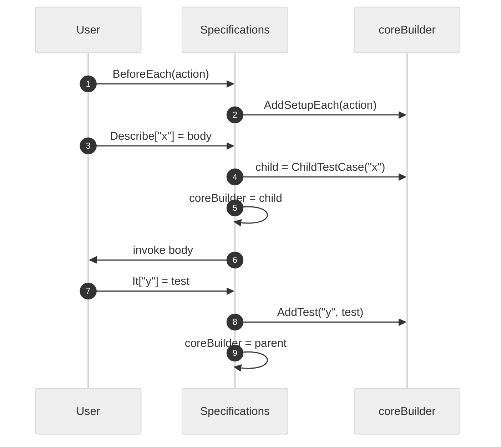

### Path 2 — Test execution (suite tree + selection walk)

```mermaid
---
title: "Dynamic — Running a selection of tests from Test Explorer"
---
%%{init: {'theme': 'neutral'}}%%
sequenceDiagram
    autonumber
    participant VST as VSTest Platform [Software System]
    participant EXR as SpecsTestExecutor [Component]
    participant INV as TestInvoker [Component]
    participant SB as SuiteTreeBuilder [Component]
    participant SR as SuiteRunner [Component]
    participant SW as SelectionTreeWalker [Component]
    participant EXE as TestCaseExecutor [Component]
    Note over VST,EXE: Legend — [Software System]=external host, [Component]=in-process class
    VST->>EXR: RunTests(testCases, frameworkHandle)
    EXR->>EXR: Group by (Source, ClassName)
    loop per spec class
        EXR->>INV: InvokeSuite(source, className, tests, showLocations, markerStyle, token)
        INV->>SB: BuildSuite(specType)
        SB-->>INV: immutable root IContextualTestCase
        INV->>SR: Run(root, items, VSTestRunListener, options, token)
        SR->>SR: root.OwnSetupOnce()
        SR->>SW: Walk()
        loop per live non-root node (DFS)
            SW->>SW: node.OwnSetupOnce()
            SW->>EXE: ProcessTestCase(token)
            EXE-->>VST: RecordResult via SelectionLoggingAdapter → VSTestRunListener
            SW->>SW: node.OwnTeardownOnce()
        end
        SR->>SR: root.OwnTeardownOnce() (finally, best-effort)
    end
```

### 📌 NEW — Test Case Filtering (`dotnet test --filter`)

When VSTest calls `RunTests(sources, …)` (CLI runs, `dotnet test --filter …`), the adapter re-discovers every `TestCase` and must apply the filter itself. Selection-based runs (`RunTests(testCases, …)`, e.g. Test Explorer) are already filtered by the host and are unaffected.

**BEFORE**: re-discovered cases were passed straight to `RunTests(testCases, …)`, so `--filter` was silently ignored and every spec in the assembly ran.

**AFTER**:

```mermaid
---
title: "Dynamic — RunTests(sources) with a --filter expression"
---
%%{init: {'theme': 'neutral', 'flowchart': {'nodeSpacing': 30, 'rankSpacing': 45, 'wrappingWidth': 160}}}%%
flowchart TD
    VST(["<b>VSTest Platform</b><br/>[Software System: Microsoft]<br/>dotnet test --filter"]):::external
    EXR["<b>SpecsTestExecutor</b><br/>[Component: ITestExecutor]<br/>RunTests(sources)"]:::app
    DISC["<b>SpecsTestDiscoverer</b><br/>[Component: ITestDiscoverer]<br/>Re-discovers TestCases"]:::app
    PARSE{"GetTestCaseFilter<br/>throws?"}
    ERR(["Error message<br/>nothing runs"]):::highlight
    HAS{"Filter<br/>present?"}
    MATCH("MatchTestCase per case<br/>via FilterProperties")
    RUN["<b>RunTests(testCases)</b><br/>[Component: C# method]<br/>Grouped by spec class"]:::app

    VST -->|"1. RunTests [VSTest contract]"| EXR
    EXR -->|"2. Discover [in-process]"| DISC
    DISC -->|"3. TestCase list [in-process]"| PARSE
    PARSE -->|"TestPlatformFormatException"| ERR
    PARSE -->|"no"| HAS
    HAS -->|"yes"| MATCH
    HAS -->|"no (null)"| RUN
    MATCH -->|"4. Matching cases [in-process]"| RUN

    subgraph LEGEND["Legend"]
        direction TB
        L1["App-owned component"]:::app
        L2["External system"]:::external
        L3["Error path"]:::highlight
    end

    RUN ~~~ LEGEND

    classDef app fill:#56B870,stroke:#3D8B50,color:#fff
    classDef external fill:#E8A838,stroke:#B07D20,color:#fff
    classDef highlight fill:#E74C3C,stroke:#C0392B,color:#fff
```

Supported filter properties (names matched case-insensitively by `SpecsTestExecutor.FilterProperties`):

| Filter name | Backing `TestProperty` |
|-------------|------------------------|
| `FullyQualifiedName` | `TestCaseProperties.FullyQualifiedName` |
| `DisplayName` | `TestCaseProperties.DisplayName` |
| `ContextMethod` | `TestProperties.ContextMethod` |
| `ContextPath` | `TestProperties.ContextPath` |
| `TestDescription` | `TestProperties.TestDescription` |
| 📌 `IsPending` | `TestProperties.IsPending` (`IsPending=true` / `IsPending=false`) |

Unknown names resolve to `null` in the property-value provider, so they never match. Grouped records are filtered like any other case. 📌 UPDATED — the FQN is now `Class.DescribeMethod` for every spec of a `[Feature]`, so `FullyQualifiedName` filters select whole `[Feature]` methods; use `ContextPath` / `TestDescription` to narrow further.

## 📌 NEW — Pending Specs

A **pending** spec is discovered and reported but never executed. Authors mark specs pending three ways in `specs.BDD`:

| Syntax | Mechanism |
|--------|-----------|
| `It["..."] = TODO;` / `ItAsync["..."] = TODOAsync;` | `AssertBuilder` / `AssertBuilderAsync` detect the static `Specifications.TODO` / `TODOAsync` delegate by `ReferenceEquals` |
| `xIt["..."] = ...;` / `xItAsync["..."] = ...;` | Builder constructed with `isPending: true`; body kept for source navigation |
| `xContext["..."] = ...;` / `xDescribe["..."] = ...;` | `ContextBuilder(isPending: true)` → `ChildTestCase(..., isPending: true)`; the child builder inherits `isPending` from its parent, so every descendant spec is pending |

### 📌 BEFORE (no pending concept)

```mermaid
---
title: "C4 Level 3 — Component: Execution routing (BEFORE pending specs)"
---
%%{init: {'theme': 'neutral'}}%%
flowchart TD
    INV["<b>TestInvoker</b><br/>[Component: C# static class]<br/>Two-way split; root always runs"]:::deprecated
    SW["<b>SelectionTreeWalker</b><br/>[Component: C# class]<br/>Runs every selected spec"]:::deprecated
    GR["<b>GroupedContextRunner</b><br/>[Component: C# static class]<br/>Runs every spec in subtree"]:::deprecated

    INV -->|"Regular tests [in-process]"| SW
    INV -->|"Grouped tests [in-process]"| GR

    subgraph LEGEND["Legend"]
        direction LR
        L1["Deprecated element"]:::deprecated
    end

    SW ~~~ LEGEND

    classDef deprecated fill:#95A5A6,stroke:#707B7C,color:#fff
```

Problems:

- Unwritten specs had to be commented out, disappearing from Test Explorer.
- No way to park a broken scenario without it failing (or its `BeforeAll` breaking siblings).

### 📌 AFTER (pending metadata + three-way routing)

```mermaid
---
title: "C4 Level 3 — Component: Pending specs (AFTER)"
---
%%{init: {'theme': 'neutral', 'flowchart': {'nodeSpacing': 30, 'rankSpacing': 45, 'wrappingWidth': 160}}}%%
flowchart TD
    AB["<b>AssertBuilder / ContextBuilder</b><br/>[Component: specs.BDD]<br/>TODO, xIt, xContext"]:::app
    CB["<b>ContextualTestCaseBuilder</b><br/>[Component: specs.core]<br/>AddPendingTest, isPending child"]:::app
    TREE[("<b>ContextualTestCase</b><br/>[Data: immutable tree]<br/>PendingTests per node")]:::data
    PS["<b>PendingSpecs</b><br/>[Component: adapter static class]<br/>IsPending / HasRunnableTests"]:::app
    INV["<b>TestInvoker</b><br/>[Component: C# static class]<br/>Grouped / pending / regular"]:::app
    SKIP(["Skipped result<br/>reason: Pending"]):::data
    SW["<b>SelectionTreeWalker</b><br/>[Component: C# class]<br/>Runnable specs only"]:::app
    GR["<b>GroupedContextRunner</b><br/>[Component: C# static class]<br/>Renders PENDING, skips idle nodes"]:::app

    AB -->|"Registers specs [in-process]"| CB
    CB ==>|"Build() [in-process]"| TREE
    PS -->|"Queries [in-process]"| TREE
    INV -->|"Classifies each case [in-process]"| PS
    INV -->|"Pending [RecordResult]"| SKIP
    INV -->|"Regular [in-process]"| SW
    INV -->|"Grouped [in-process]"| GR

    subgraph LEGEND["Legend"]
        direction TB
        L1["App-owned component"]:::app
        L2[("Data / outcome")]:::data
    end

    GR ~~~ LEGEND

    classDef app fill:#56B870,stroke:#3D8B50,color:#fff
    classDef data fill:#9B6DC6,stroke:#6E4D8C,color:#fff
```

Benefits / contract:

- **Discovery**: pending specs are emitted like any other `SpecTest` with `IsPending = true`; a grouped record is pending only when its subtree has specs and none are runnable.
- **Per-`It` execution**: `TestInvoker.InvokeSuite` records pending cases as `Skipped` (`ResultReporter.PendingMessage`) before any lifecycle; `TestInvoker.Invoke` (single case) returns `Skipped` without running anything.
- **Once-actions**: pending cases never reach `SelectionTreeWalker`, so a pending-only node is never live. Root `OwnSetupOnce` / `OwnTeardownOnce` run only if a regular case or a grouped context with runnable specs is selected.
- **Grouped execution**: `RunNode` short-circuits nodes with no runnable specs into `RenderPendingSubtree` (no `BeforeAll` / `AfterAll`); a root-`BeforeAll` failure leaves pending specs rendered as pending, not failed.
- **Filtering**: `IsPending` is a supported `--filter` property.
- **Scope**: only the `Specifications` API and the VSTest adapter honour pending; `TestCaseExecutor` does not.

## 📌 NEW — Act Exception Capture (`ShouldThrow<T>`)

Expected-exception specs are written by pointing `It[...]` at the exception thrown by `Act`:

```csharp
Act(() => calculator.Divide(1, 0));

It["throws"] = ShouldThrow<DivideByZeroException>();
It["explains why"] = ShouldThrow<DivideByZeroException>(ex =>
    Check.That(ex.Message.ToLowerInvariant()).Contains("zero"));
```

### 📌 BEFORE (Act outside the test's failure boundary)

```mermaid
---
title: "C4 Level 3 — Component: Act/It execution (BEFORE)"
---
%%{init: {'theme': 'neutral'}}%%
flowchart TD
    EXE["<b>TestCaseExecutor</b><br/>[Component: specs.core]<br/>Calls Act before test try"]:::deprecated
    ACT["<b>User Act</b><br/>[Component: delegate]<br/>Manual try/catch to a local"]:::deprecated
    IT["<b>User It</b><br/>[Component: delegate]<br/>Inspects captured local"]:::deprecated
    LOG["<b>LogException + rethrow</b><br/>[Component: ILoggingAdapter]<br/>Aborts the whole node"]:::deprecated

    EXE -->|"1. Invokes [in-process]"| ACT
    ACT -.->|"Uncaught throw [exception]"| LOG
    EXE -->|"2. Invokes if Act survived [in-process]"| IT

    subgraph LEGEND["Legend"]
        direction LR
        L1["Deprecated element"]:::deprecated
    end

    IT ~~~ LEGEND

    classDef deprecated fill:#95A5A6,stroke:#707B7C,color:#fff
```

Problems:

- Exception specs needed a hand-rolled `try/catch` in `Act`, a shared `Exception?` local, and a `BeforeEach` to reset it.
- An uncaught `Act` exception escaped `ProcessTestCase` (and `TestInvoker.RunLifecycle`): remaining tests in the node never ran, and `TeardownEach` / `TeardownOnce` were skipped.

### 📌 AFTER (`ActExceptionContext.Run`)

```mermaid
---
title: "C4 Level 3 — Component: Act/It execution (AFTER)"
---
%%{init: {'theme': 'neutral', 'flowchart': {'nodeSpacing': 30, 'rankSpacing': 45, 'wrappingWidth': 160}}}%%
flowchart TD
    subgraph HOSTS["Execution paths"]
        direction TB
        EXE["<b>TestCaseExecutor</b><br/>[Component: specs.core]<br/>Per-node test loop"]:::app
        INV["<b>TestInvoker.RunLifecycle</b><br/>[Component: adapter]<br/>Single-case invoke"]:::app
        GR["<b>GroupedContextRunner</b><br/>[Component: adapter]<br/>RunTest per spec"]:::app
    end

    AEC["<b>ActExceptionContext</b><br/>[Component: specs.core static class]<br/>Run(act, test)"]:::app
    SLOT[("<b>Outcome</b><br/>[Data: AsyncLocal]<br/>Exception + Handled")]:::data
    ST["<b>ShouldThrow&lt;T&gt;</b><br/>[Component: specs.BDD]<br/>Bound verifier delegate"]:::app
    AEA["<b>ActExceptionAssertions</b><br/>[Component: specs.core]<br/>VerifyActException&lt;T&gt;"]:::app

    HOSTS -->|"1. Run(Act, It) [in-process]"| AEC
    AEC ==>|"2. Captures Act throw [AsyncLocal]"| SLOT
    AEC -->|"3. Invokes It [in-process]"| ST
    ST -->|"4. Delegates [extension method]"| AEA
    AEA -->|"5. Reads + MarkHandled [AsyncLocal]"| SLOT

    subgraph LEGEND["Legend"]
        direction TB
        L1["App-owned component"]:::app
        L2[("Ambient data")]:::data
    end

    AEA ~~~ LEGEND

    classDef app fill:#56B870,stroke:#3D8B50,color:#fff
    classDef data fill:#9B6DC6,stroke:#6E4D8C,color:#fff
```

Contract:

| Situation | Result |
|-----------|--------|
| `Act` does not throw | `It` runs normally; `ActExceptionContext.Current` is `null` |
| `Act` throws, `It` calls `MarkHandled` (any `ShouldThrow`) | Spec outcome is the `It` outcome (verifier failure propagates) |
| `Act` throws, `It` does not handle it | `Act` exception rethrown (`ExceptionDispatchInfo`), **replacing** any exception thrown by `It` |
| `ShouldThrow<T>` and `Act` threw nothing / an unrelated type | `ExpectedExceptionNotThrownException` (unrelated type kept as `InnerException`); verifier not called |
| `ShouldThrow<T>` and `Act` threw a derived type | Passes (assignability) |
| Nested `Run` inside a test | Isolated outcome; enclosing `Current` restored afterwards |

Benefits:

- Exception specs read like any other spec — no shared mutable local, no reset hook.
- One throwing `Act` no longer takes down sibling specs or skips teardown; `StopOnAssertFailure` still rethrows.
- All three execution paths share the same capture code, so per-`It`, single-invoke, and grouped runs agree.

> **📌 See**: decisions #25–28 above.

## 📌 NEW — Test Hosting (self-hosting + `src/` / `tests/` split)

Which runner discovers each test project, and where it lives on disk. Decision #33 records the rationale.

### 📌 BEFORE (nspec bridge for the BDD tests)

```mermaid
---
title: "C4 Level 2 — Container: Test hosting (BEFORE)"
---
%%{init: {'theme': 'neutral', 'flowchart': {'nodeSpacing': 30, 'rankSpacing': 45, 'wrappingWidth': 160}}}%%
flowchart TD
    VST["<b>VSTest Platform</b><br/>[Software System: Microsoft]<br/>Runs all test projects"]:::external

    subgraph SRC["Folder: src/ (Specs.sln here)"]
        direction TB
        NUA["<b>NUnit3TestAdapter</b><br/>[Library: NuGet]<br/>Hosts NUnit fixtures"]:::external
        BUT["<b>specs.BDD.UnitTests</b><br/>[Container: NUnit tests]<br/>5 [Test] wrappers"]:::deprecated
        TH["<b>TestHarness</b><br/>[Container: netstandard2.1]<br/>nSpecTestHarness.RunMySpecs"]:::deprecated
        NSPEC["<b>nspec 3.1</b><br/>[Library: NuGet]<br/>Legacy BDD runner"]:::deprecated
        CUT["<b>specs.core.UnitTests</b><br/>[Container: Specs-hosted]<br/>Still referenced TestHarness"]:::deprecated
    end

    VST -->|"Loads adapter [VSTest]"| NUA
    NUA -->|"Runs [NUnit]"| BUT
    BUT -->|"Inherits base [project ref]"| TH
    TH -->|"Executes specs [nspec API]"| NSPEC
    CUT -.->|"Unused ref [project ref]"| TH

    subgraph LEGEND["Legend"]
        direction LR
        L1["Deprecated"]:::deprecated
        L2["External"]:::external
    end

    NSPEC ~~~ LEGEND

    classDef external fill:#E8A838,stroke:#B07D20,color:#fff
    classDef deprecated fill:#95A5A6,stroke:#707B7C,color:#fff
```

Problems:

- `specs.BDD.UnitTests` wrote nspec syntax (`describe[...]`, `it[...]`, `act = ...`) wrapped in one NUnit `[Test]` per class — 5 results for the whole spec tree, with failures surfaced only through NUnit's aggregate assertion.
- `TestHarness` (and with it `nspec` + `NUnit`) leaked into `specs.core.UnitTests` via a global `Using Include="NUnit.Framework"`.
- Deliverables and test projects were mixed in `src/`, with the solution file nested inside it.

### 📌 AFTER (Specs hosts its own unit tests)

```mermaid
---
title: "C4 Level 2 — Container: Test hosting (AFTER)"
---
%%{init: {'theme': 'neutral', 'flowchart': {'nodeSpacing': 30, 'rankSpacing': 45, 'wrappingWidth': 160}}}%%
flowchart TD
    VST["<b>VSTest Platform</b><br/>[Software System: Microsoft]<br/>Runs all test projects"]:::external

    subgraph SRC["Folder: src/"]
        direction TB
        ADP["<b>specs.BDD.VSTestAdapter</b><br/>[Container: netstandard2.1]<br/>Specs discovery + execution"]:::app
    end

    subgraph TESTS["Folder: tests/"]
        direction TB
        SELF["<b>Self-hosted suites</b><br/>[Container: Specs-hosted]<br/>core + BDD + integration"]:::app
        AUT["<b>specs.BDD.VSTestAdapter.Tests</b><br/>[Container: NUnit tests]<br/>Independent safety net"]:::app
        NUA["<b>NUnit3TestAdapter</b><br/>[Library: NuGet]<br/>Adapter tests only"]:::external
    end

    VST -->|"Loads adapter [VSTest]"| ADP
    ADP -->|"Discovers [Feature] [reflection]"| SELF
    VST -->|"Loads adapter [VSTest]"| NUA
    NUA -->|"Runs fixtures [NUnit]"| AUT
    AUT -->|"Tests [project ref]"| ADP

    subgraph LEGEND["Legend"]
        direction LR
        L1["App-owned"]:::app
        L2["External"]:::external
    end

    AUT ~~~ LEGEND

    classDef app fill:#56B870,stroke:#3D8B50,color:#fff
    classDef external fill:#E8A838,stroke:#B07D20,color:#fff
```

Benefits:

- `specs.BDD.UnitTests` derives from `Specifications` with `[Feature]` methods and is run by the Specs adapter: 5 opaque NUnit results → 📌 147 individual spec results with Test Explorer nesting and source navigation.
- Three of four test projects now run on Specs; only the adapter's own tests stay on NUnit, so a broken adapter cannot hide its own failures.
- No `nspec`, no `TestHarness`, and no `NUnit` reference outside `specs.BDD.VSTestAdapter.Tests` (`TestCaseExecutor_Tests` swapped NUnit's `AssertionException` for `InvalidOperationException`).
- `Specs.sln` at the repo root; `src/` holds only the three deliverables and `tests/` holds the four test projects (`ProjectReference`s now `..\..\src\...`).

Conventions introduced by the migration:

| Element | Convention | Example |
|---------|-----------|---------|
| Test file / class | `<TypeUnderTest>_Tests` | `ContextBuilder_Tests`, `TestContextAdapter_Tests` |
| Root `[Feature]` method | Named after the type under test | `[Feature] public void ContextBuilder()` |
| Shared spec bodies | Abstract base deriving `Specifications`, concrete `[Feature]` per subclass | `BaseAssertBuilderSpecs<TSubject, TDelegate>` → `AssertBuilder_Tests` / `AssertBuilderAsync_Tests` |
| nspec → Specs syntax | `describe`/`context`/`it` → `Describe`/`Context`/`It`; `act = ...` / `beforeEach = ...` → `Act(...)` / `BeforeEach(...)` | — |

## 📌 NEW — Build Configuration & Release Pipeline

How every project gets its settings, package versions, and package version number. Decisions #34–35 record the rationale; file-level settings, versions, workflows, and the deployment view are in `techContext.md` sections "Build Configuration" and "Packaging & Release".

### 📌 BEFORE (per-project settings, manual packing)

```mermaid
---
title: "C4 Level 2 — Container: Build configuration (BEFORE)"
---
%%{init: {'theme': 'neutral'}}%%
flowchart TD
    DEV(["<b>Maintainer</b><br/>[Person]"]):::external
    CSP["<b>7 × .csproj</b><br/>[Container: MSBuild project]<br/>Own versions, LangVersion"]:::deprecated
    PACK["<b>dotnet pack (local)</b><br/>[Container: .NET SDK, unpinned]<br/>Default version 1.0.0"]:::deprecated

    DEV -->|"Edits each project [manual]"| CSP
    DEV -->|"Packs by hand [dotnet CLI]"| PACK
    PACK -->|"Reads settings [MSBuild]"| CSP

    subgraph LEGEND["Legend"]
        direction LR
        L1["Deprecated"]:::deprecated
        L2["Person"]:::external
    end

    PACK ~~~ LEGEND

    classDef external fill:#E8A838,stroke:#B07D20,color:#fff
    classDef deprecated fill:#95A5A6,stroke:#707B7C,color:#fff
```

Problems:

- Package versions were repeated in every `.csproj` and drifted (adapter tests on NFluent 3.0.0, the rest on 3.1.0).
- Language version was inconsistent: `LangVersion 8.0` on the adapter, SDK default on core and BDD.
- No package metadata (authors, license, repository), no symbols, no XML docs, and every package was `1.0.0`.
- No CI. Build and tests ran only on developer machines, against whatever SDK was installed.

### 📌 AFTER (central MSBuild config + tag-driven versions)

```mermaid
---
title: "C4 Level 2 — Container: Build configuration (AFTER)"
---
%%{init: {'theme': 'neutral', 'flowchart': {'nodeSpacing': 30, 'rankSpacing': 45, 'wrappingWidth': 160}}}%%
flowchart TD
    GHA["<b>GitHub Actions</b><br/>[Software System: CI/CD]<br/>ci.yml + release.yml"]:::external

    subgraph ROOT["Repo root config"]
        direction TB
        GJ["<b>global.json</b><br/>[Component: SDK config]<br/>SDK 10.0.400 pin"]:::app
        DBP["<b>Directory.Build.props</b><br/>[Component: MSBuild props]<br/>Shared props + metadata"]:::app
        DPP["<b>Directory.Packages.props</b><br/>[Component: CPM]<br/>One version per package"]:::app
    end

    subgraph PROJ["Projects"]
        direction TB
        DEL["<b>3 deliverables</b><br/>[Container: netstandard2.1]<br/>Packable, C# 10, XML docs"]:::app
        TDBP["<b>tests/Directory.Build.props</b><br/>[Component: MSBuild props]<br/>Imports root, no packing"]:::app
        TST["<b>4 test projects</b><br/>[Container: net10.0]<br/>IsPackable=false"]:::app
    end

    MINV["<b>MinVer 8.0</b><br/>[Library: build-time NuGet]<br/>Computes Version"]:::external
    GIT[("<b>Git tags</b><br/>[Data: v* tags]<br/>v1.2.0 → 1.2.0")]:::data

    GHA -->|"Reads SDK pin [setup-dotnet]"| ROOT
    GHA -->|"Builds, tests, packs [dotnet CLI]"| PROJ
    ROOT -->|"Auto-imported [MSBuild]"| PROJ
    TDBP -->|"Applies to [MSBuild]"| TST
    PROJ -->|"Version at build [MinVer target]"| MINV
    MINV -->|"Reads tag + height [git]"| GIT

    subgraph LEGEND["Legend"]
        direction TB
        L1["App-owned"]:::app
        L2["External"]:::external
        L3[("Data")]:::data
    end

    GIT ~~~ LEGEND

    classDef app fill:#56B870,stroke:#3D8B50,color:#fff
    classDef external fill:#E8A838,stroke:#B07D20,color:#fff
    classDef data fill:#9B6DC6,stroke:#6E4D8C,color:#fff
```

Benefits:

- Each package has exactly one version, kept in `Directory.Packages.props`. The NFluent drift is gone.
- All three deliverables share C# 10, nullable, implicit usings, MIT license metadata, XML docs, and `.snupkg` symbols with SourceLink. CI builds are deterministic (`ContinuousIntegrationBuild`).
- The version number lives only in the git tag. Pushing `v1.2.0` builds, tests, packs, and publishes all three packages at `1.2.0`, then creates a GitHub Release.
- Every push to `main` and every PR is built, tested, and packed on CI against the pinned SDK. The packages are kept as a downloadable run artifact.

Turning on XML doc generation also meant fixing a few doc comments to keep the build warning-free. These were documentation-only changes; the file list is in `activeContext.md`.

## 📌 NEW — Project Templates (`dotnet new`)

`src/specs.BDD.Templates/` packs a content-only template package so a new user can scaffold a runnable Specs project in one command. Decision #46 records the rationale; template parameters and versions are in `techContext.md` "Project Templates".

### 📌 BEFORE (hand-built test project)

```mermaid
---
title: "Dynamic — Starting a Specs project (BEFORE)"
---
%%{init: {'theme': 'neutral'}}%%
flowchart TD
    DEV(["<b>Developer</b><br/>[Person]"]):::external
    PRJ["<b>New test project</b><br/>[Container: .NET project]<br/>Hand-written csproj"]:::deprecated
    RD["<b>README</b><br/>[Software System: docs]<br/>Package + host choice"]:::deprecated

    DEV -->|"1. Reads setup steps [web]"| RD
    DEV -->|"2. Creates + edits [dotnet new classlib]"| PRJ

    subgraph LEGEND["Legend"]
        direction LR
        L1["Person"]:::external
        L2["Deprecated"]:::deprecated
    end

    PRJ ~~~ LEGEND

    classDef external fill:#E8A838,stroke:#B07D20,color:#fff
    classDef deprecated fill:#95A5A6,stroke:#707B7C,color:#fff
```

Problems:

- Users had to pick the right runner package and add the host-specific settings themselves (`Microsoft.NET.Test.Sdk` + `IsTestProject` for VSTest, `OutputType=Exe` for MTP).
- Nothing in CI proved that the packed packages worked in a project outside the repo. Every in-repo test used project references.

### 📌 AFTER (versioned template package, smoke-tested on CI)

```mermaid
---
title: "Dynamic — Template pack and scaffold (AFTER)"
---
%%{init: {'theme': 'neutral', 'flowchart': {'nodeSpacing': 30, 'rankSpacing': 45, 'wrappingWidth': 160}}}%%
flowchart TD
    MINV["<b>MinVer</b><br/>[Library: build-time NuGet]<br/>Package version"]:::external
    TPL["<b>specs.BDD.Templates</b><br/>[Container: template csproj]<br/>Content-only package"]:::app
    STAMP("<b>StampTemplateVersion</b><br/>[Component: MSBuild target]<br/>@@SPECS_VERSION@@ → version"):::app
    NUPKG[("<b>specs.BDD.Templates.nupkg</b><br/>[Container: NuGet package]<br/>content/templates/*")]:::data
    DEV(["<b>Developer / CI smoke test</b><br/>[Person]"]):::external
    NEW["<b>dotnet new</b><br/>[Software System: .NET SDK]<br/>specs-vstest / specs-mtp"]:::external
    PRJ["<b>Scaffolded project</b><br/>[Container: net10.0]<br/>CalculatorSpecs, C# or VB"]:::app
    RUN["<b>specs.BDD.VSTest / .MTP</b><br/>[Container: NuGet package]<br/>Same version as template"]:::app

    TPL -->|"1. Version [MinVer target]"| MINV
    TPL -->|"2. Stamps template.json [MSBuild]"| STAMP
    STAMP ==>|"3. Packs [dotnet pack]"| NUPKG
    DEV -->|"4. Installs + runs [dotnet new]"| NEW
    NEW -->|"5. Reads template [nupkg]"| NUPKG
    NEW ==>|"6. Generates [file system]"| PRJ
    PRJ -->|"7. Restores [NuGet]"| RUN

    subgraph LEGEND["Legend"]
        direction TB
        L1["App-owned"]:::app
        L2["External / person"]:::external
        L3[("Package")]:::data
    end

    RUN ~~~ LEGEND

    classDef app fill:#56B870,stroke:#3D8B50,color:#fff
    classDef external fill:#E8A838,stroke:#B07D20,color:#fff
    classDef data fill:#9B6DC6,stroke:#6E4D8C,color:#fff
```

Benefits:

- `dotnet new specs-vstest` or `dotnet new specs-mtp` (add `-lang VB` for Visual Basic) gives a project that builds and passes straight away.
- The template's default `specsVersion` is the version it was packed with, so a template and the runner packages from the same tag always match. `--specsVersion` overrides it.
- CI and release scaffold both C# templates against the freshly packed `artifacts/` and run them, which is the first end-to-end check of the packages as consumers see them. In `release.yml` this runs before the nuget.org push.

Design notes:

| Concern | Approach |
|---------|----------|
| One command per host, two languages | C# and VB templates share `shortName` and `groupIdentity` (`Specs.BDD.Template.VSTest` / `.MTP`); `tags.language` selects one |
| Project naming | `sourceName` = `Specs.Template`, so `-n Demo` renames the project file and the C# namespace (VB uses `RootNamespace`) |
| Version stamping | The `template.json` originals are excluded from packing. The target writes stamped copies under `obj/…/stamped/` and packs them to the same `content/templates/<name>/` path |
| No assembly in the package | `IncludeBuildOutput=false`, `IncludeSymbols=false`, `SuppressDependenciesWhenPacking=true`; NU5128 / NU5110 / NU5111 suppressed. The `netstandard2.1` TFM exists only so the SDK can pack |
| MTP template runs without `global.json` | The MTP project is an `Exe` (via `specs.BDD.MTP.props`), so `dotnet run` works anywhere. MTP-mode `dotnet test` additionally needs the .NET 10 `global.json` runner setting (see `techContext.md` "MTP Runner Configuration") |

## 📌 NEW — Shared Runner Core + Microsoft.Testing.Platform Runner

Specs ships two runners over one execution core: `specs.BDD.VSTestAdapter` and 📌 `specs.BDD.TestingPlatform` for Microsoft.Testing.Platform (MTP). The runner-agnostic code moved out of the adapter into `src/shared/specs.BDD.Runner/`, which both runners compile as linked source. Decisions #36–41 record the rationale; packages, settings, and commands are in `techContext.md`.

### 📌 BEFORE (execution owned by the VSTest adapter)

```mermaid
---
title: "C4 Level 3 — Component: Suite execution (BEFORE)"
---
%%{init: {'theme': 'neutral', 'flowchart': {'nodeSpacing': 30, 'rankSpacing': 45, 'wrappingWidth': 160}}}%%
flowchart TD
    VST["<b>VSTest Platform</b><br/>[Software System: Microsoft]<br/>Only supported host"]:::external
    MTP["<b>Microsoft.Testing.Platform</b><br/>[Software System: Microsoft]<br/>No Specs support"]:::highlight

    subgraph ADP["Container: specs.BDD.VSTestAdapter"]
        direction TB
        INV["<b>TestInvoker</b><br/>[Component: C# static class]<br/>Root lifecycle + routing"]:::deprecated
        SW["<b>SelectionTreeWalker</b><br/>[Component: C# class]<br/>Typed to VSTest TestCase"]:::deprecated
        GR["<b>GroupedContextRunner</b><br/>[Component: C# static class]<br/>Runs + builds TestResult"]:::deprecated
        LOG["<b>VSTestLoggingAdapter</b><br/>[Component: ILoggingAdapter]<br/>Writes IFrameworkHandle"]:::deprecated
    end

    VST -->|"RunTests [VSTest contract]"| INV
    INV -->|"Regular tests [in-process]"| SW
    INV -->|"Grouped tests [in-process]"| GR
    SW -->|"Results [ILoggingAdapter]"| LOG
    LOG -->|"RecordResult [IFrameworkHandle]"| VST
    GR -->|"RecordResult [IFrameworkHandle]"| VST

    subgraph LEGEND["Legend"]
        direction TB
        L1["Deprecated element"]:::deprecated
        L2["External system"]:::external
        L3["Gap"]:::highlight
    end

    LOG ~~~ LEGEND

    classDef external fill:#E8A838,stroke:#B07D20,color:#fff
    classDef deprecated fill:#95A5A6,stroke:#707B7C,color:#fff
    classDef highlight fill:#E74C3C,stroke:#C0392B,color:#fff
```

Problems:

- Root once-actions, the grouped / pending / regular split, and grouped-report rendering were tied to VSTest types (`TestCase`, `IFrameworkHandle`, `TestResult`), so a second runner would have had to copy them.
- No Microsoft.Testing.Platform support, which `dotnet test` on the .NET 10 SDK and C# Dev Kit can use instead of VSTest.
- VSTest gives Test Explorer only four levels, so the context tree below the `[Feature]` could never be shown as nodes.

### 📌 AFTER (shared runner core, two thin hosts)

```mermaid
---
title: "C4 Level 3 — Component: Suite execution (AFTER)"
---
%%{init: {'theme': 'neutral', 'flowchart': {'nodeSpacing': 30, 'rankSpacing': 45, 'wrappingWidth': 160}}}%%
flowchart TD
    VST["<b>VSTest Platform</b><br/>[Software System: Microsoft]<br/>Test Explorer, dotnet test"]:::external
    MTP["<b>Microsoft.Testing.Platform</b><br/>[Software System: Microsoft]<br/>Test app, IDEs, dotnet test"]:::external

    subgraph ADP["Container: specs.BDD.VSTestAdapter"]
        direction TB
        INV["<b>TestInvoker</b><br/>[Component: C# static class]<br/>Builds suite per class"]:::app
        VRL["<b>VSTestRunListener</b><br/>[Component: ISpecRunListener]<br/>Events to TestResults"]:::app
    end

    subgraph TP["Container: specs.BDD.TestingPlatform"]
        direction TB
        STF["<b>SpecsTestFramework</b><br/>[Component: ITestFramework]<br/>Discover / run requests"]:::app
        MRL["<b>MtpRunListener</b><br/>[Component: ISpecRunListener]<br/>Events to TestNode updates"]:::app
    end

    subgraph SHARED["Linked source: specs.BDD.Runner"]
        direction TB
        SR["<b>SuiteRunner</b><br/>[Component: C# static class]<br/>Root lifecycle + routing"]:::app
        SW["<b>SelectionTreeWalker&lt;T&gt;</b><br/>[Component: generic class]<br/>Once per live node"]:::app
        GSR["<b>GroupedSubtreeRunner</b><br/>[Component: C# static class]<br/>Returns GroupedReport"]:::app
    end

    VST -->|"RunTests [VSTest contract]"| INV
    MTP -->|"ExecuteRequestAsync [MTP API]"| STF
    INV -->|"Run(root, items) [in-process]"| SR
    STF -->|"Run(root, items) [in-process]"| SR
    SR -->|"Regular items [in-process]"| SW
    SR -->|"Grouped items [in-process]"| GSR
    SHARED -.->|"Events [ISpecRunListener]"| VRL
    SHARED -.->|"Events [ISpecRunListener]"| MRL

    subgraph LEGEND["Legend"]
        direction TB
        L1["App-owned component"]:::app
        L2["External system"]:::external
    end

    GSR ~~~ LEGEND

    classDef app fill:#56B870,stroke:#3D8B50,color:#fff
    classDef external fill:#E8A838,stroke:#B07D20,color:#fff
```

Benefits:

- One implementation of the root lifecycle, pending routing, `ActExceptionContext` capture, and grouped reports; both runners get identical semantics.
- A runner only supplies tree discovery for its host, a `SpecRunItem<TTest>` per selected test, and an `ISpecRunListener<TTest>`.
- The VSTest adapter's behaviour, FQNs, and result counts are unchanged (except `Hierarchy[3]`, decision #41).

Shared runner core (all `internal`, namespace `specs.BDD.Runner`):

| Component | Responsibility |
|-----------|---------------|
| `SuiteRunner` | `Run(root, items, listener, options, token)` — three-way split, pending reported up front, root once-actions only when something runnable is selected, grouped items → `GroupedSubtreeRunner`, regular → `SelectionTreeWalker`; `FailAll` when a suite cannot be built |
| `ISpecRunListener<TTest>` | `Started`, `Passed`, `Failed`, `Pending`, `GroupedCompleted(report)`, `LogInformation`, `LogError` |
| `SpecRunItem<TTest>` / `SpecRunOptions` | Selected test (`Test` handle, `ContextPath`, `TestDescription`, `IsGrouped`); grouped-report options (`SourceForLocations`, `MarkerStyle`) |
| `GroupedSubtreeRunner` / `GroupedReport` | Runs one grouped `[Feature]` into an outcome (`Passed` / `Failed` / `Skipped`) + tree output + error message + combined stack traces |
| `SelectionTreeWalker<TTest>`, `SelectionLoggingAdapter<TTest>`, `SelectionTestProvider<TTest>` | Once-per-live-node walk and its `TestCaseExecutor` adapters |
| `ReportMarkers` / `SpecExceptions` | Pass / fail / pending glyphs per `MarkerStyle` and two-space indentation; `Unwrap` of `TargetInvocationException` |
| Moved from the adapter | `SpecificationClassScanner`, `ContextMethodScanner`, `SuiteTreeBuilder`, `GroupingSettings` (+ `ParseReportingLevel`), `PendingSpecs`, `SourceLocationReader`, `TestFinder`, `ContextPathFormat`, `MarkerStyle`, `InvalidSpecificationException` |

### 📌 MTP runner components

```mermaid
---
title: "C4 Level 3 — Component: specs.BDD.TestingPlatform"
---
%%{init: {'theme': 'neutral', 'flowchart': {'nodeSpacing': 30, 'rankSpacing': 45, 'wrappingWidth': 160}}}%%
flowchart TD
    APP(["<b>Test application</b><br/>[Container: MTP exe]<br/>Generated entry point"]):::external
    HOOK["<b>TestingPlatformBuilderHook</b><br/>[Component: AddSpecsBDD]<br/>Registers framework + filter"]:::app
    STF["<b>SpecsTestFramework</b><br/>[Component: ITestFramework]<br/>Discover / run requests"]:::app

    subgraph DISC["Discovery + selection"]
        direction TB
        STB["<b>SpecTreeBuilder</b><br/>[Component: C# static class]<br/>SpecForest of SpecNodes"]:::app
        SEL["<b>SpecSelection</b><br/>[Component: C# static class]<br/>Applies MTP filters"]:::app
    end

    subgraph OUT["Reporting"]
        direction TB
        TNF["<b>TestNodeFactory</b><br/>[Component: C# class]<br/>Group + leaf TestNodes"]:::app
        MRL["<b>MtpRunListener</b><br/>[Component: ISpecRunListener]<br/>Publishes state updates"]:::app
        CTR["<b>ConsoleTreeReport</b><br/>[Component: C# static class]<br/>Indented CLI tree"]:::app
    end

    SR["<b>SuiteRunner</b><br/>[Component: shared runner]<br/>Runs selected specs"]:::app

    APP -->|"1. AddExtensions [MSBuild hook]"| HOOK
    HOOK -->|"2. Creates [MTP API]"| STF
    STF -->|"3. Builds forest [reflection]"| STB
    STF -->|"4. Selects leaves [in-process]"| SEL
    STF -->|"5. Runs per class [in-process]"| SR
    SR -.->|"6. Events [ISpecRunListener]"| MRL
    MRL -->|"7. Leaf messages [in-process]"| TNF
    STF -->|"8. CLI only [output device]"| CTR

    subgraph LEGEND["Legend"]
        direction TB
        L1["App-owned component"]:::app
        L2(["Host / generated app"]):::external
    end

    CTR ~~~ LEGEND

    classDef app fill:#56B870,stroke:#3D8B50,color:#fff
    classDef external fill:#E8A838,stroke:#B07D20,color:#fff
```

| Component | Responsibility |
|-----------|---------------|
| `TestApplicationBuilderExtensions.AddSpecsBDD` | Public. Registers `SpecsTestFramework` (empty `TestFrameworkCapabilities`) and the tree-node filter service (`--treenode-filter`) |
| `TestingPlatformBuilderHook` | Public. `AddExtensions(builder, args)`, called by the MSBuild-generated entry point via the `TestingPlatformBuilderHook` item in `build/specs.BDD.MTP.props` |
| `SpecsExtension` | Extension identity: UID `SpecsBDD`, display name `Specs BDD`, version from `AssemblyInformationalVersion` |
| `SpecsTestFramework` | `ITestFramework` + `IDataProducer` (`TestNodeUpdateMessage`). Handles `DiscoverTestExecutionRequest` and `RunTestExecutionRequest` (others → `NotSupportedException`). Builds the forest from the entry assembly, reports discovery warnings, publishes group nodes then leaves, runs each class via `SuiteRunner` on a worker thread, and logs the filter and selection count. Warns IDE clients when a run request matches none of the discovered specs |
| `SpecsSettings` | Reads `SpecsBDD:ReportingLevel`, `SpecsBDD:ShowSourceLocations` (default `false`), `SpecsBDD:ColorOutput` (default `true`) from MTP configuration |
| `ClientMode.IsIde` | `true` for `--server` with no argument or `jsonrpc`; `false` for `dotnettestcli` and console runs |
| `SpecTreeBuilder` | Per specification class: validates `[Feature]` methods (otherwise a warning, class skipped), builds the suite with the shared `SuiteTreeBuilder`, and creates `Namespace → Class → Describe → Context → Spec` nodes. A `[Feature]` resolved as `Feature` by `GroupingSettings.Resolve` becomes one `GroupedDescribe` leaf (pending when all of its specs are pending). Leaves carry `ContextPath`, `TestDescription`, `IsPending`, and a source location (the `It` lambda, falling back to the `[Feature]` method) |
| `SpecNode` / `SpecClass` / `SpecForest` / `SpecPath` | Tree model (`SpecNodeKind`: `Namespace`, `Class`, `Describe`, `Context`, `Spec`, `GroupedDescribe`); UIDs and escaping per decision #38 |
| `SpecSelection` | `null` / `NopFilter` → all; `TestNodeUidListFilter` → the listed leaves plus every leaf under a listed group (empty list → all for IDE clients); `TreeNodeFilter` → `MatchesFilter` plus a depth check (a leaf must be at least as deep as the filter); `CompositeTestExecutionFilter` → all parts must match; anything else → `NotSupportedException`. `Describe(filter)` summarises a filter for logs |
| `TestNodeFactory` | Builds `TestNodeUpdateMessage`s per decision #39: state-less group nodes (IDE only), leaves with `TestMethodIdentifierProperty` (📌 `MethodName` = the `[Feature]` method's name via `SpecNode.Method`, decision #43) and `TestFileLocationProperty` |
| `MtpRunListener` | Publishes `InProgress` / `Passed` / `Failed` / `Skipped("Pending")` leaf states with `TimingProperty`; grouped results add `StandardOutputProperty` with the tree report, and failures carry a `GroupedSpecsFailedException` with the combined stack traces. Records outcomes for `ConsoleTreeReport` |
| `ConsoleTreeReport` | Indented tree of the selected part of the forest: `- spec` (with `- PENDING`) after discovery, pass / fail / pending markers or `- NOT RUN` after a run |

MTP runtime contract (differences from VSTest):

| Aspect | VSTest adapter | MTP runner |
|--------|----------------|-----------|
| Test ID | 📌 UPDATED Hashed `TestCase.Id` (FQN = `Class.DescribeMethod`, decision #43) | Tree path (decision #38) |
| Discovery → execution | `TestCase` serialized; tree rebuilt and re-located by `TestFinder` | Same process; the forest is rebuilt per request and filtered by UID / tree path |
| Filtering | `--filter` on `TestProperties` | `--treenode-filter` / UID lists |
| IDE tree | `Namespace › Class › [Feature]` via `Hierarchy` | Full tree as group nodes; Visual Studio still shows only `Namespace › Class › [Feature]` via the method identifier |
| Settings | `.runsettings` `<SpecsBDD>` | `[appname].testconfig.json` `SpecsBDD` section or `SpecsBDD__*` environment variables |
| Lifecycle, pending, grouped, `ShouldThrow` | Shared `SuiteRunner` | Shared `SuiteRunner` (identical) |

## Pattern Summary

| Pattern | Used by | Benefit |
|---------|---------|---------|
| Builder | `ContextualTestCaseBuilder`, `SuiteTreeBuilder` | Fluent construction, immutability, one construction path |
| Composite | `ContextualTestCase` tree | Inherited lifecycle, hierarchy |
| Adapter | `I*Adapter` interfaces (📌 public) | Framework independence; third-party runners |
| Strategy | `TestCaseExecutorSettings` | Configurable execution behavior |
| Template Method | `TestCaseExecutor` | Fixed, predictable lifecycle order |
| Pipeline | VSTest adapter (Discovery → Conversion → Execution) | Cleanly separated responsibilities |
| Visitor / tree walk | `SelectionTreeWalker`, 📌 `GroupedSubtreeRunner` | Once-per-node lifecycle over an arbitrary test selection / an entire root context |
| Chain of responsibility (config) | `GroupingSettings.Resolve` | Layered opt-in: method → class → assembly → `.runsettings` → `Test` |
| Callback (scope switch) | `Specifications.contextCallBack` | Nested context definition without thread-local state |
| 📌 Ambient context | `ActExceptionContext` (`AsyncLocal<Outcome>`) | Exposes the `Act` exception to `It` without changing the `Action` signature |
| 📌 Observer (listener) | `ISpecRunListener<TTest>` → `VSTestRunListener` / `MtpRunListener` | One execution core; each runner maps events to its own result model |
| 📌 Shared source (linked compile) | `src/shared/specs.BDD.Runner/` in both runner `.csproj`s | Code reuse without a public API or an extra package |
