# System Patterns: Specs

## Architectural Overview

Specs is a **three-layer framework** with a **VSTest adapter** on top. Each layer is independently testable and depends only on the one beneath it.

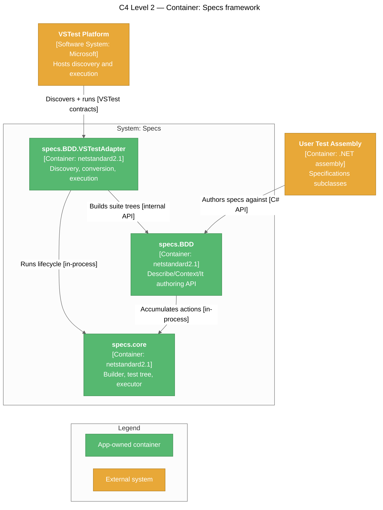

### Inside the containers

| Container | Key components |
|-----------|---------------|
| `specs.core` | `IContextualTestCaseBuilder` / `ContextualTestCaseBuilder`, immutable `ContextualTestCase`, `TestCaseExecutor`, `TestContextAdapter`, adapter interfaces (`ITestContextAdapter`, `ITestProviderAdapter`, `ILoggingAdapter`) |
| `specs.BDD` | `Specifications` base class, `ContextBuilder`, `AssertBuilder` / `AssertBuilderAsync`, `[Context]` attribute (with `Reporting`), 📌 `SpecReporting` enum, 📌 `[SpecReporting]` assembly/class attribute |
| `specs.BDD.VSTestAdapter` | `SpecsTestDiscoverer`, `SuiteTreeBuilder`, `GroupingSettings`, `TestStructureExtractor`, `SourceLocationReader`, `TestCaseConverter`, `SpecsTestExecutor`, `TestInvoker`, `SelectionTreeWalker`, `GroupedContextRunner`, 📌 `MarkerStyle`, `TestFinder`, `VSTestLoggingAdapter`, `VSTestTestProvider`, `ResultReporter` |

## Core Design Patterns

### 1. Builder Pattern — Test-case construction

`IContextualTestCaseBuilder` accumulates lifecycle actions, child contexts, and tests fluently, then produces an immutable `ContextualTestCase` via `Build()`.

```csharp
IContextualTestCaseBuilder builder = new ContextualTestCaseBuilder("MySpec");

builder
    .AddSetupOnce(() => InitDb())
    .AddSetupEach(() => SeedRow())
    .AddAct      (() => _result = Subject.Run())
    .AddTest     ("returns expected", () => Check.That(_result).IsTrue())
    .AddTeardownEach(() => RollbackTx())
    .AddTeardownOnce(() => DropDb());

IContextualTestCase testCase = builder.Build();   // immutable from here on
```

**Benefits**: clear separation between definition and execution; cacheable, thread-safe results; validation can run at build time.

### 2. Composite Pattern — Hierarchical contexts

Each `ContextualTestCase` may have child `ContextualTestCase`s. Children inherit their parents' setup/act actions automatically.

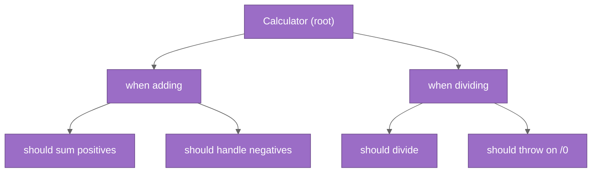

### 3. Adapter Pattern — Framework independence

`specs.core` exposes three adapter interfaces; concrete bindings live elsewhere.

| Interface | Responsibility | VSTest implementation |
|-----------|---------------|-----------------------|
| `ITestProviderAdapter` | Supplies the list of `TestInstance` to run | `VSTestTestProvider` |
| `ITestContextAdapter` | Tracks lifecycle state, manages action inheritance | `TestContextAdapter` (default, in core) |
| `ILoggingAdapter` | Reports pass/fail/exception | `VSTestLoggingAdapter` → `IFrameworkHandle` |

The core has **zero** reference to `Microsoft.TestPlatform.*`.

### 4. Strategy Pattern — Executor configuration

`TestCaseExecutorSettings` carries `StopOnAssertFailure` (fail-fast vs. continue). Cancellation is **not** a setting — `ProcessTestCase(CancellationToken)` takes the token directly and checks it before each test instance.

### 5. Template Method — Fixed lifecycle order

`TestCaseExecutor.ProcessTestCase(CancellationToken)` always runs:

1. `SetupOnce` (parent → child).
2. For each test: `SetupEach` → `Act` → test → `TeardownEach`.
3. `TeardownOnce` (child → parent).

## Critical Implementation Patterns

### Top-down setup / bottom-up teardown

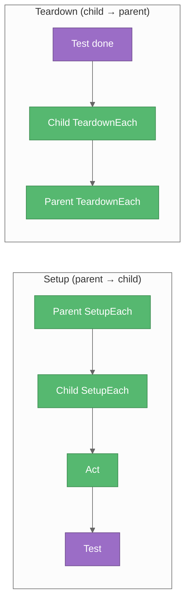

### Context-switching callback (specs.BDD)

`Specifications` keeps a pointer to the currently-active builder. When a nested `Describe[..]` or `Context[..]` block opens, the pointer is swapped to a child builder for the duration of the user action and restored afterward.

```csharp
private void contextCallBack(IContextualTestCaseBuilder childBuilder, Action action)
{
    var previous = this.coreBuilder;
    this.coreBuilder = childBuilder;
    try   { action.Invoke(); }
    finally { this.coreBuilder = previous; }
}
```

This is how lifecycle methods called *inside* a nested block correctly attach to the child scope without explicit threading.

### Async → sync conversion

```csharp
public IContextualTestCaseBuilder AddSetupOnce(Func<Task> asyncAction)
    => AddSetupOnce(() => asyncAction().GetAwaiter().GetResult());
```

The public surface stays `Action`-based. `GetAwaiter().GetResult()` blocks — acceptable in test scenarios; trades pure-async purity for a uniform API.

### Immutability after Build

`IContextualTestCase` exposes only read-only collections and getters. The builder is the only mutator; once `Build()` is called, the resulting case is safe to share, cache, or execute repeatedly.

## VSTest Adapter Pipeline

The adapter is a discovery → conversion → execution pipeline. Both ends are anchored on **`SuiteTreeBuilder`**, the single source of truth for suite-tree construction.

### 📌 Discovery + Conversion

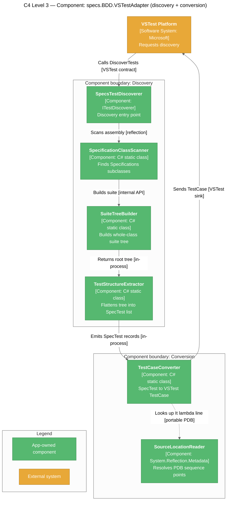

### 📌 Execution

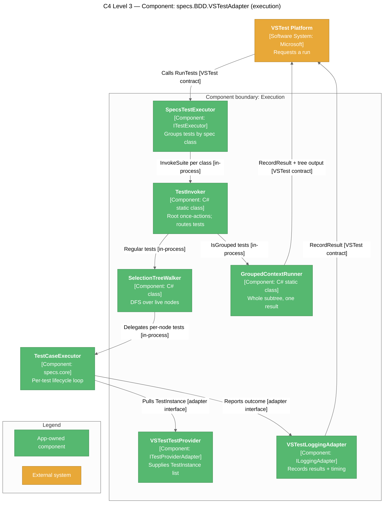

### Adapter responsibilities

| Layer | Class | Responsibility |
|-------|-------|---------------|
| Discovery | `SpecsTestDiscoverer` | Entry point declared by `[FileExtension(".dll" / ".exe")]` and `[DefaultExecutorUri("executor://SpecsTestExecutor/v1")]`; reads the `.runsettings` `SpecReporting` value from `IDiscoveryContext.RunSettings` 📌 |
| Discovery | `SpecificationClassScanner` | Reflects assemblies to find non-abstract `Specifications` subclasses |
| Discovery | `ContextMethodScanner` | Finds `[Context]`-decorated methods; throws `InvalidSpecificationException` if none |
| Discovery | **`SuiteTreeBuilder`** | Instantiates the suite once and registers every `[Context]` method as a **named child context** via `instance.Context[name] = () => method.Invoke(...)`, then returns `CoreBuilder.Build()`. Shared by discovery *and* execution |
| Discovery | **`GroupingSettings`** 📌 UPDATED | Resolves the effective `SpecReporting` per root `[Context]`: `ContextAttribute.ReportingSetting` → class `[SpecReporting]` (not inherited) → assembly `[SpecReporting]` → `.runsettings` `<SpecsBDD><SpecReporting>` → `Individual`. Also reads `ShowSourceLocations` / `ColorOutput` and picks the grouped-report `MarkerStyle` |
| Discovery | `TestStructureExtractor` | Flattens the suite tree into `SpecTest` records; owns `PathSeparator` (`" → "`); emits a single `IsGrouped` record for grouped root contexts 📌 |
| Discovery | `SourceLocationReader` | Reads portable PDB sequence points for any `MethodBase` (lambda or `[Context]` method). 📌 `GetTestMethod(Action)` unwraps async `It` wrappers to the user's `Func<Task>`; async bodies resolve via the state machine's `MoveNext`; methods from a different assembly than the PDB return `null` |
| Conversion | `SpecTest` | POCO: `SpecificationClass`, `ContextMethod`, `ItAction`, `ContextPath`, `TestDescription`, `IsGrouped` 📌 |
| Conversion | `TestCaseConverter` | Produces stable `FullyQualifiedName` (`Class::Method::[grouped]` for grouped records), a `DisplayName` that embeds `ContextPath` (VS Code ignores `Hierarchy`) 📌, the RFC-0033 `TestCase.Hierarchy` property, and source location |
| Conversion | `TestProperties` | Custom `TestProperty` registry (`ClassName`, `ContextMethod`, `ContextPath`, `TestDescription`, `IsGrouped` 📌) preserving metadata across VSTest serialization |
| Execution | `SpecsTestExecutor` | `[ExtensionUri("executor://SpecsTestExecutor/v1")]`; groups selected tests by `(Source, ClassName)` so lifecycle fires once per class; owns the `CancellationTokenSource`; forwards `IRunContext` into re-discovery so `.runsettings` grouping applies to `RunTests(sources)`; 📌 resolves `ShowSourceLocations` and `MarkerStyle` once per run |
| Execution | `TestInvoker` | Resolves the spec `Type`, builds the suite via `SuiteTreeBuilder`, 📌 runs the **root** (class-constructor) `OwnSetupOnce` / `OwnTeardownOnce` once per class, splits the selection on `IsGrouped`, and hands grouped cases to `GroupedContextRunner` and the rest to `SelectionTreeWalker` (both share one tree instance). A root `BeforeAll` failure fails every selected test and skips the root `AfterAll` |
| Execution | **`SelectionTreeWalker`** | Depth-first walk of the suite tree firing `OwnSetupOnce` / `OwnTeardownOnce` **exactly once per live non-root node** (the root is owned by `TestInvoker`); delegates per-test loops to `TestCaseExecutor` |
| Execution | **`GroupedContextRunner`** 📌 | Runs an entire root `[Context]` subtree as **one** `TestResult`; mirrors the walker's once-per-node lifecycle but keeps running after per-test failures so the report is complete; emits an NSpec-style tree + failure list to `StandardOutCategory` using the run's `MarkerStyle`, optional per-`It` `at file:line N` locations, and a fully failed tree when the root `BeforeAll` failed |
| Execution | `MarkerStyle` 📌 NEW | Internal enum (`Plain` / `Ansi` / `Emoji`) selecting grouped-report pass/fail glyphs |
| Execution | `TestFinder` | Splits `ContextPath` on `" → "` and walks the immutable test tree |
| Execution | `ResultReporter` | Builds `TestResult` objects for pass/fail/skip outcomes; `Unwrap` (now `internal`) strips `TargetInvocationException` layers for both runners |
| Execution | `VSTestLoggingAdapter` | `ILoggingAdapter` over `IFrameworkHandle`; tracks `ReportedDescriptions` so unreached tests can be failed explicitly |
| Execution | `VSTestTestProvider` | `ITestProviderAdapter` wrapping `(TestCase, description, Action)` triples as `TestInstance[]` |

## Once-Per-Node Lifecycle (selection-tree walk)

Running a *subset* of a suite from Test Explorer must still honour `BeforeAll` / `AfterAll` semantics: each context's once-actions fire exactly once no matter how many of its tests were selected.

### 📌 BEFORE (per-test cascaded lifecycle)

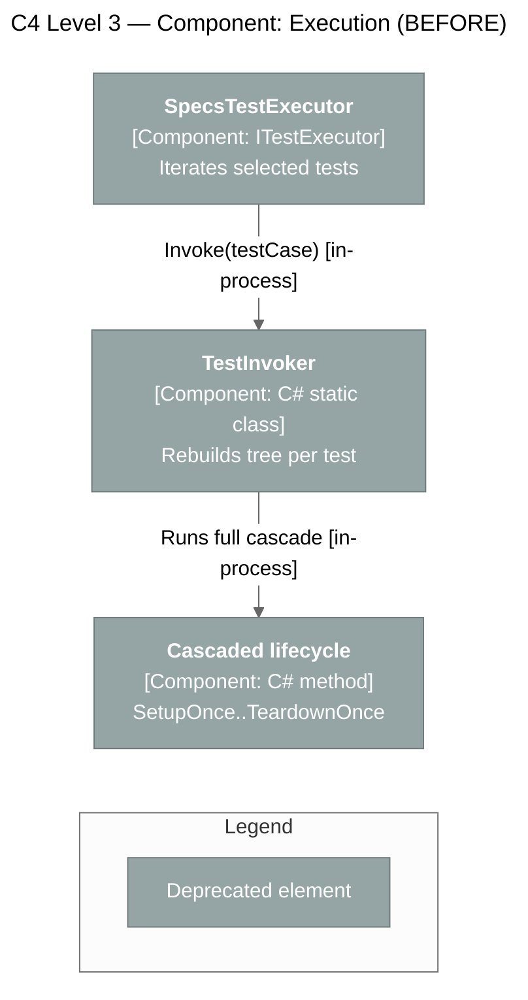

Problems:

- The suite tree was rebuilt once **per selected test**, so a fresh `Specifications` instance was created each time.
- `SetupOnce` / `TeardownOnce` ran once **per test**, not once per context — `BeforeAll` semantics were wrong for multi-test runs.
- `[Context]` methods were invoked directly, so they did not appear as nodes in the tree and could not own once-actions.

### 📌 AFTER (suite tree + selection walk)

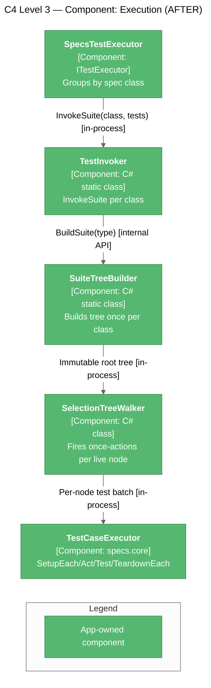

Benefits:

- `[Context]` methods become **named child contexts** of the class root, so they are first-class tree nodes that can own `BeforeAll` / `AfterAll`.
- `ITestCase.OwnSetupOnce` / `OwnTeardownOnce` expose a node's *own* once-actions (no ancestor cascade), which is exactly what the walker needs.
- Only **live** nodes (those with at least one selected test at or beneath them) run lifecycle; idle branches are skipped.
- The walker passes no-op once-actions into `TestContextAdapter` so `TestCaseExecutor` still handles `SetupEach` → `Act` → test → `TeardownEach` without double-firing once-actions.
- Clear failure contract: a failing `OwnSetupOnce` at node *N* fails every selected test at or under *N*, skips *N*'s `OwnTeardownOnce`, and lets sibling branches continue.
- `VSTestLoggingAdapter.ReportedDescriptions` lets the walker fail any test that was never reached due to a lifecycle fault, so Test Explorer never shows a stuck "not run" entry.

## 📌 NEW — Root (class-level) Lifecycle

Hooks registered in a `Specifications` constructor (`BeforeAll`, `BeforeEach`, `Act`, `AfterEach`, `AfterAll`) attach to the **suite root** node. `BeforeEach` / `Act` / `AfterEach` already cascaded into every test, but the root's *once*-actions were never fired.

### 📌 BEFORE (root once-actions skipped)

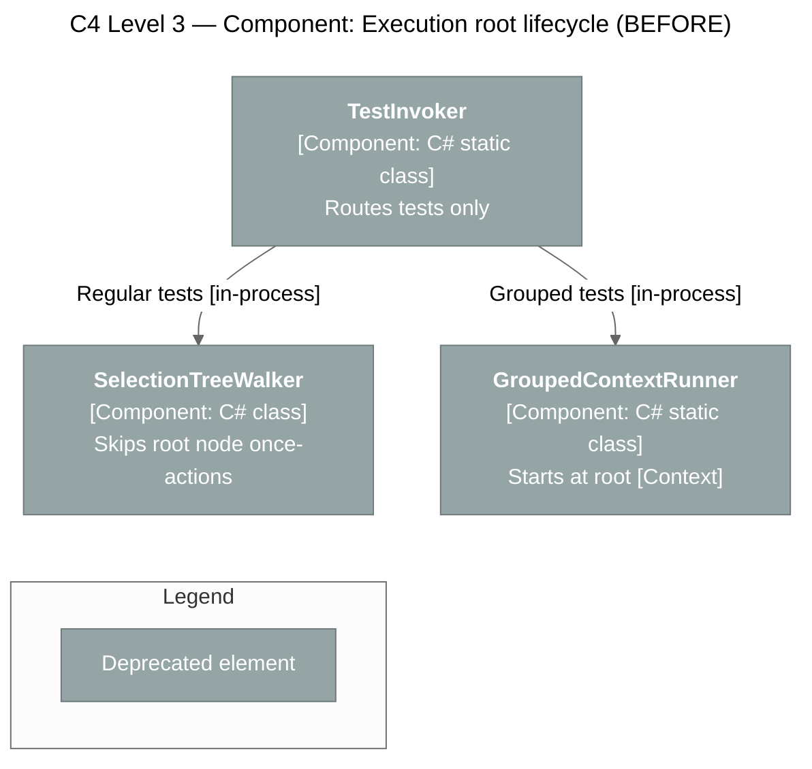

Problems:

- A class-level `BeforeAll` / `AfterAll` registered in the constructor **silently never ran** in either mode.
- No defined behaviour for a failing suite-wide setup.

### 📌 AFTER (TestInvoker owns the root)

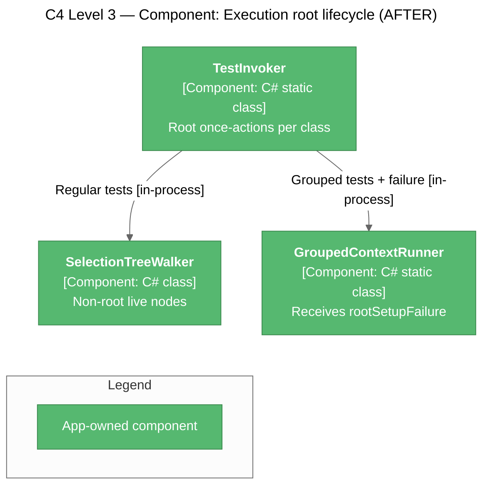

Benefits / contract:

- Root `OwnSetupOnce` runs **once per class** before any grouped or per-`It` work; root `OwnTeardownOnce` runs once in a `finally` (best-effort, exceptions swallowed).
- If root `BeforeAll` throws: grouped results render a fully failed tree (`FailSubtree`) with the unwrapped root exception, regular tests are reported failed via `ReportAllAsFailed`, and root `AfterAll` is **skipped**.
- `SelectionTreeWalker` keeps skipping the root, now by design rather than by omission.

## 📌 Grouped Root-Context Execution

By default every `It[...]` is its own VSTest `TestCase`. A root `[Context]` can instead opt into **grouped mode** (`SpecReporting.GroupedByRootContext`), where the whole subtree is discovered as one `TestCase` and executed by `GroupedContextRunner` into one `TestResult`.

### 📌 MODERNIZED — Configuration API

#### BEFORE (`bool` flags, three layers)

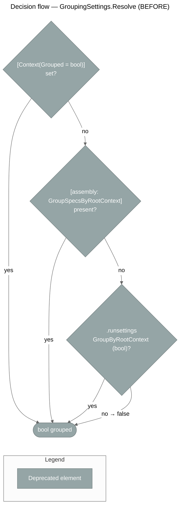

```csharp
[assembly: GroupSpecsByRootContext]                  // removed
[Context("subtraction", Grouped = true)]              // removed
```

Problems: no class-level switch; `bool` naming did not describe *what* was being chosen; assembly attribute name was mode-specific.

#### AFTER (`SpecReporting` enum, four layers)

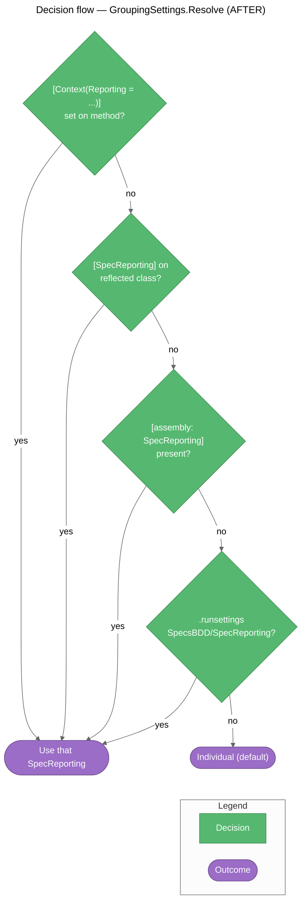

```csharp
[assembly: SpecReporting(SpecReporting.GroupedByRootContext)]

[SpecReporting(SpecReporting.GroupedByRootContext)]          // class-level, NOT inherited
public class CalculatorSpecs : Specifications
{
    [Context("Addition", Reporting = SpecReporting.Individual)] // per-method override
    public void describe_addition() { /* ... */ }
}
```

Benefits:

- One vocabulary (`SpecReporting.Individual` / `GroupedByRootContext`) across method, class, assembly, and `.runsettings`; extensible to future modes.
- Class-level opt-in (`AttributeTargets.Assembly | Class`, `Inherited = false`) — read from the method's `ReflectedType`, so a derived suite does **not** inherit its base's setting.
- `ContextAttribute` keeps a nullable backing (`SpecReporting?`, exposed as `ReportingSetting`) so an explicit `Reporting = Individual` overrides any lower layer.
- `.runsettings` parsing accepts enum **names** only (case-insensitive, trimmed); numeric strings and undefined values yield `null`.

### Runtime contract

| Aspect | Per-`It[...]` mode (`SelectionTreeWalker`) | Grouped mode (`GroupedContextRunner`) |
|--------|--------------------------------------------|---------------------------------------|
| Discovery output | One `SpecTest` per `It[...]` | One `SpecTest` with `IsGrouped = true`, `ContextPath` = root context name |
| `FullyQualifiedName` | `Class::Method::ContextPath::Description` | `Class::Method::[grouped]` |
| `DisplayName` | `ContextPath → Description` | Root context description |
| Once-actions | `OwnSetupOnce` / `OwnTeardownOnce` once per live node | Same, over the entire subtree |
| Per-test failure | That test fails; siblings continue | Counted, run continues; result fails if any failed |
| `BeforeAll` failure | Fails every selected test under the node | Fails every test under the node (`FailSubtree`), run continues elsewhere |
| 📌 Root (class) `BeforeAll` failure | Every selected test reported failed; root `AfterAll` skipped | Whole tree rendered as failed with the root exception; root `AfterAll` skipped |
| `AfterAll` failure | Swallowed (best-effort) | Swallowed (best-effort) |
| Empty subtree | n/a | `TestOutcome.Skipped` with "No specs found" |
| Output | Per-result messages | NSpec-style tree + `N passed, M failed, T total` + numbered failure list in `StandardOutCategory`; `ErrorMessage` summarises failed paths |

### 📌 NEW — Report formatting

| Setting | Source | Effect |
|---------|--------|--------|
| Pass/fail markers | `GroupingSettings.ResolveMarkerStyle(colorOutput, VSAPPIDNAME)` | `ColorOutput=false` → `Plain` (`✓` / `✗`); host is Visual Studio (`VSAPPIDNAME=devenv.exe`, which cannot render ANSI) → `Emoji` (`✅` / `❌`); otherwise → `Ansi` (green `✓` / red `✗`) |
| Source locations | `.runsettings` `SpecsBDD/ShowSourceLocations` (default `false`) | Adds an indented `at <file>:line <n>` under each passing, failing, or root-setup-failed `It` |

Both values are resolved once per run in `SpecsTestExecutor` and threaded through `TestInvoker.InvokeSuite` → `GroupedContextRunner.Run` → `Execute`.

Both runners share the single suite tree built by `SuiteTreeBuilder` for the class, so grouped and per-`It` contexts in the same class never trigger a second instantiation.

### Dynamic view

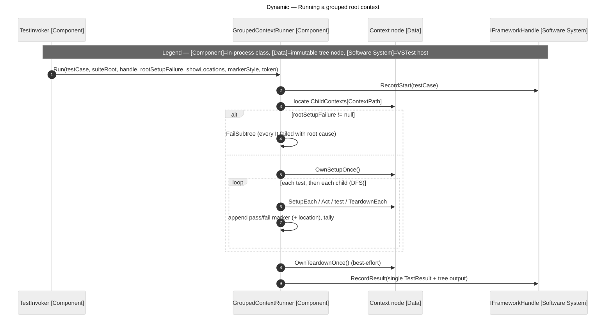

## Test Explorer Hierarchy (RFC-0033)

`TestCaseConverter` sets the VSTest `TestCase.Hierarchy` property — a `string[4]` of `[Container, Namespace, Class, TestGroup]`:

| Index | Value | Notes |
|-------|-------|-------|
| 0 | `null` | VS fills it from the project/assembly name |
| 1 | `SpecificationClass.Namespace` | — |
| 2 | `SpecificationClass.Name` | Simple (unqualified) name |
| 3 | `SpecTest.ContextPath` | Full `[Context]` + `Describe`/`Context` chain joined by `" → "` |

Source navigation prefers the `It[...]` lambda's PDB sequence point (`SourceLocationReader.GetTestMethod(SpecTest.ItAction)`) so "Go to Source" lands on the assertion line, falling back to the `[Context]` method when the lambda has no sequence points.

📌 **Async `ItAsync[...]` navigation**: `ContextualTestCaseBuilder.AddTest(string, Func<Task>)` wraps the test as `test.RunSync` (an extension-method-bound delegate) instead of a closure, so the wrapper `Action.Target` *is* the user's `Func<Task>`. `GetTestMethod` unwraps it, and `TryGetLocation` follows `[AsyncStateMachine]` to `MoveNext`, where the async body's sequence points actually live.

📌 **VS Code caveat**: the VS Code test UI ignores `Hierarchy`, so `TestCaseConverter.BuildDisplayName` embeds the context path (`ContextPath → TestDescription`) to keep contexts visible there. Visual Studio still nests via `Hierarchy`.

### Discovery safety

The adapter executes user-defined `[Context]` methods during discovery (it must, to enumerate `It[...]` blocks). To stay safe:

- Suites are instantiated through the parameterless constructor only.
- Setup actions are collected, **not executed**, at discovery time.
- Failures during discovery surface as `InvalidSpecificationException` or specific VSTest error logs — they never abort the run.
- `SourceLocationReader` degrades gracefully: a missing or unreadable PDB yields `null`, never an exception.
- `SpecificationClassScanner` catches `ReflectionTypeLoadException` and returns the types that *did* load, so one broken dependency cannot hide an entire assembly's tests.

### The tree is built twice

Discovery and execution each build the suite tree independently — VSTest serializes `TestCase` objects across the discovery/execution boundary, so no live object graph survives between the two phases.

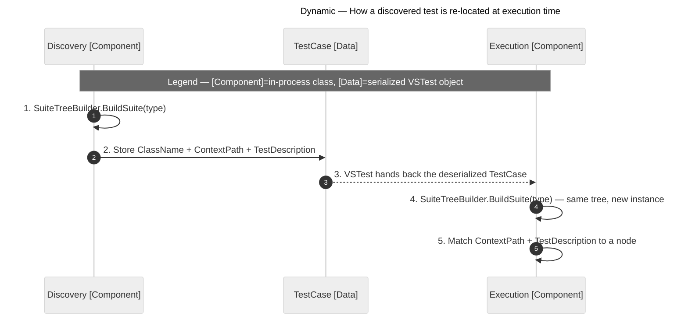

The four `TestProperties` values (`ClassName`, `ContextMethod`, `ContextPath`, `TestDescription`) are the **address** that lets execution find the node discovery found. This is why `SuiteTreeBuilder` must be the only construction path: if the two phases disagreed on a single context description, the address would no longer resolve. A fifth property, `IsGrouped`, tells `TestInvoker` which runner the address belongs to.

## Key Technical Decisions

| # | Decision | Rationale | Impact |
|---|----------|-----------|--------|
| 1 | Immutable `ContextualTestCase` after `Build()` | Predictable, thread-safe, cacheable | Builder is the only mutation surface |
| 2 | `Action`-based public surface (async → sync internally) | Uniform API; simpler mental model | `GetAwaiter().GetResult()` blocks but acceptable for tests |
| 3 | Top-down setup, bottom-up teardown | Matches construction/disposal semantics | Builder must track and reverse action order |
| 4 | Adapter-driven framework integration | Core has zero test-framework deps | Adapter layer required per host (VSTest provided) |
| 5 | Two coexisting API styles | Backward compatibility + modern design | Some code duplication; documentation must cover both |
| 6 | Hierarchical (composite) context model | Matches BDD `describe → context → it` thinking | More complex builder + executor |
| 7 | **Consolidate execution in `TestCaseExecutor`** (Feb 2026 refactor) | Eliminates duplicate execution logic in the adapter; single source of truth for lifecycle semantics | `TestInvoker` delegates to `TestCaseExecutor` rather than re-implementing the lifecycle |
| 8 | Discovery reads `Specifications.CoreBuilder` directly (no reflection) | Cleaner contract; testable; faster | `CoreBuilder` exposed via `InternalsVisibleTo("specs.BDD.VSTestAdapter")` |
| 9 | 📌 **`SuiteTreeBuilder` is the single source of truth for tree construction** | Discovery and execution must agree on paths, descriptions, and ordering, or `TestFinder` silently misses tests | `[Context]` methods are registered as named child contexts rather than invoked directly |
| 10 | 📌 **Cancellation is a `CancellationToken` parameter, not an executor setting** | Matches BCL conventions; the token flows straight from `ITestExecutor.Cancel()` through `SpecsTestExecutor`'s `CancellationTokenSource` | `TestCaseExecutorSettings.IsCancelled` was removed; `ProcessTestCase(CancellationToken)` checks the token before each test |
| 11 | 📌 **Once-actions exposed separately as `OwnSetupOnce` / `OwnTeardownOnce`** | The walker needs a node's *own* once-actions without the ancestor cascade that `SetupOnce` / `TeardownOnce` provide | Two extra members on `ITestCase`; `TestCaseExecutor` behaviour unchanged |
| 12 | **Navigate to the `It[...]` lambda, not the `[Context]` method** | "Go to Source" should land on the assertion the developer clicked | `SpecTest.ItAction` captured at discovery; `SourceLocationReader` accepts any `MethodBase` |
| 13 | 📌 **Grouped mode is a discovery-time decision, resolved in the adapter** | The core stays unaware of VSTest granularity; the flag must be fixed before `TestCase`s are serialized so discovery and execution agree | `GroupingSettings` lives in the adapter; `ContextAttribute.Reporting` / `SpecReportingAttribute` / `SpecReporting` live in `specs.BDD` as pure metadata |
| 14 | 📌 **Grouped runner is separate from `SelectionTreeWalker`, not a mode flag on it** | Grouped mode has a different failure policy (continue after per-test failure, aggregate into one result) and a different output channel | `GroupedContextRunner` duplicates the small once-per-node walk rather than threading a mode through the walker and `TestCaseExecutor` |
| 15 | 📌 UPDATED **Explicit `Reporting = Individual` must beat class/assembly/runsettings opt-in** | Authors need a per-context escape hatch when a class or assembly is grouped by default | `ContextAttribute` uses a nullable `SpecReporting?` backing field exposed as `ReportingSetting` |
| 16 | 📌 NEW **Reporting is an enum, not a `bool`** | Names the choice (`Individual` / `GroupedByRootContext`) and leaves room for future modes | Breaking rename: `Grouped` → `Reporting`, `GroupSpecsByRootContextAttribute` → `SpecReportingAttribute`, `GroupByRootContext` → `SpecReporting` in `.runsettings` |
| 17 | 📌 NEW **Class-level `[SpecReporting]` is not inherited** | A base suite's reporting choice should not silently change a derived suite's test granularity | `Inherited = false`; resolved from `MethodInfo.ReflectedType` |
| 18 | 📌 NEW **`TestInvoker` owns the root once-lifecycle** | Constructor-registered `BeforeAll` / `AfterAll` must run exactly once per class regardless of how the selection splits between runners | Walker still skips the root; `GroupedContextRunner` receives `rootSetupFailure` |
| 19 | 📌 NEW **Async test wrapper is bound to the original `Func<Task>`** | Source location needs the user's lambda, not a compiler closure | `AsyncTestExtensions.RunSync` in `specs.core`; `SourceLocationReader.GetTestMethod` unwraps `Action.Target` |
| 20 | 📌 NEW **Marker style depends on the host** | Visual Studio's Test Explorer shows raw ANSI escapes; VS Code / CLI render them | `VSAPPIDNAME=devenv.exe` → emoji; `ColorOutput=false` → plain |

## Critical Execution Paths

### Path 1 — Test construction

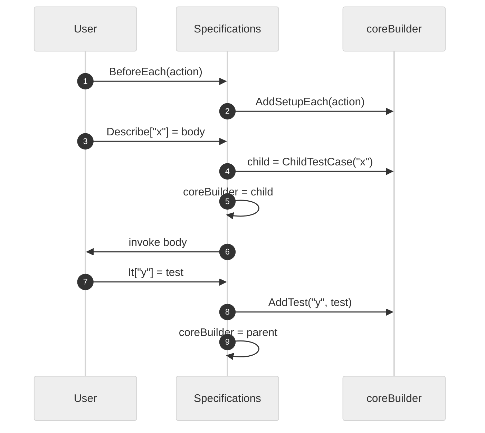

### Path 2 — Test execution (suite tree + selection walk)

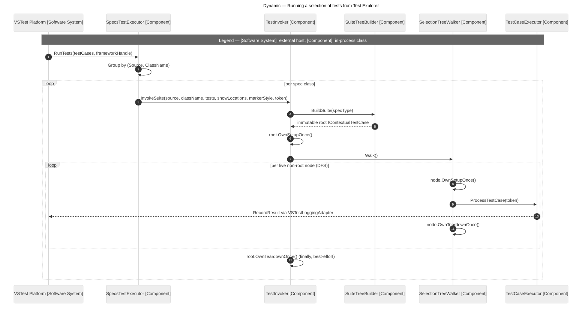

## Pattern Summary

| Pattern | Used by | Benefit |
|---------|---------|---------|
| Builder | `ContextualTestCaseBuilder`, `SuiteTreeBuilder` | Fluent construction, immutability, one construction path |
| Composite | `ContextualTestCase` tree | Inherited lifecycle, hierarchy |
| Adapter | `I*Adapter` interfaces | Framework independence |
| Strategy | `TestCaseExecutorSettings` | Configurable execution behavior |
| Template Method | `TestCaseExecutor` | Fixed, predictable lifecycle order |
| Pipeline | VSTest adapter (Discovery → Conversion → Execution) | Cleanly separated responsibilities |
| Visitor / tree walk | `SelectionTreeWalker`, `GroupedContextRunner` | Once-per-node lifecycle over an arbitrary test selection / an entire root context |
| Chain of responsibility (config) | `GroupingSettings.Resolve` | Layered opt-in: method → class → assembly → `.runsettings` → `Individual` |
| Callback (scope switch) | `Specifications.contextCallBack` | Nested context definition without thread-local state |
