# System Patterns: Specs

## Architectural Overview

Specs is a **three-layer framework** with a **VSTest adapter** on top. Each layer is independently testable and depends only on the one beneath it.

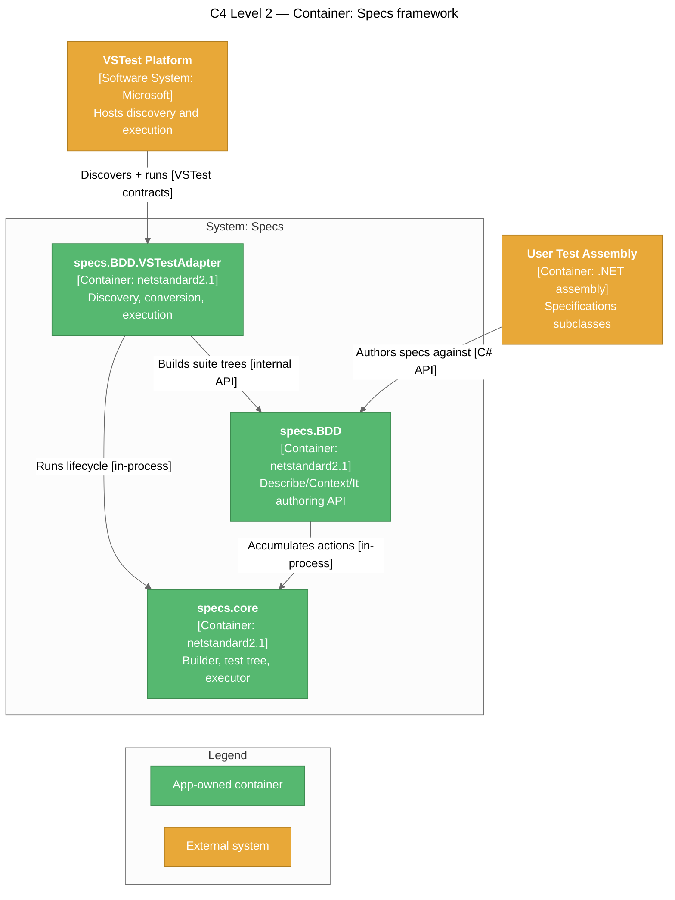

### Inside the containers

| Container | Key components |
|-----------|---------------|
| `specs.core` | `IContextualTestCaseBuilder` / `ContextualTestCaseBuilder` (📌 `AddPendingTest`, `ChildTestCase(..., isPending)`), immutable `ContextualTestCase` (📌 `PendingTests`), `TestCaseExecutor` (📌 public), 📌 `ActExceptionContext`, 📌 `ActExceptionAssertions` / `ExpectedExceptionNotThrownException`, `TestContextAdapter` (📌 public, `FromTestCase`), adapter interfaces (`ITestContextAdapter`, `ITestProviderAdapter`, `ILoggingAdapter` — 📌 all public) |
| `specs.BDD` | `Specifications` base class (📌 `TODO` / `TODOAsync`, `xIt` / `xItAsync` / `xContext` / `xDescribe`, 📌 `ShouldThrow<T>()` / `ShouldThrow<T>(Action<T>)`), `ContextBuilder`, `AssertBuilder` / `AssertBuilderAsync`, `[Describe]` attribute (with 📌 `Structure`), 📌 `TestStructure` enum, 📌 `[TestStructure]` assembly/class attribute |
| `specs.BDD.VSTestAdapter` | `SpecsTestDiscoverer`, `SuiteTreeBuilder`, `GroupingSettings`, 📌 `SuiteTreeFlattener`, 📌 `PendingSpecs`, `SourceLocationReader`, `TestCaseConverter`, 📌 `ContextPathFormat`, `SpecsTestExecutor`, `TestInvoker`, `SelectionTreeWalker`, `GroupedContextRunner`, 📌 `MarkerStyle`, `TestFinder`, `VSTestLoggingAdapter`, `VSTestTestProvider`, `ResultReporter` |

## Core Design Patterns

### 1. Builder Pattern — Test-case construction

`IContextualTestCaseBuilder` accumulates lifecycle actions, child contexts, and tests fluently, then produces an immutable `ContextualTestCase` via `Build()`.

```csharp
IContextualTestCaseBuilder builder = new ContextualTestCaseBuilder("MySpec");

builder
    .AddSetupOnce(() => InitDb())
    .AddSetupEach(() => SeedRow())
    .AddAct      (() => _result = Subject.Run())
    .AddTest     ("returns expected", () => Check.That(_result).IsTrue())
    .AddTeardownEach(() => RollbackTx())
    .AddTeardownOnce(() => DropDb());

IContextualTestCase testCase = builder.Build();   // immutable from here on
```

**Benefits**: clear separation between definition and execution; cacheable, thread-safe results; validation can run at build time.

### 2. Composite Pattern — Hierarchical contexts

Each `ContextualTestCase` may have child `ContextualTestCase`s. Children inherit their parents' setup/act actions automatically.

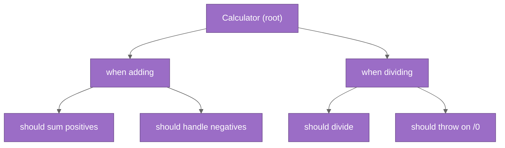

### 3. Adapter Pattern — Framework independence

`specs.core` exposes three adapter interfaces; concrete bindings live elsewhere.

| Interface | Responsibility | VSTest implementation |
|-----------|---------------|-----------------------|
| `ITestProviderAdapter` | Supplies the list of `TestInstance` to run | `VSTestTestProvider` |
| `ITestContextAdapter` | Tracks lifecycle state, manages action inheritance | `TestContextAdapter` (default, in core) |
| `ILoggingAdapter` | Reports pass/fail/exception | `VSTestLoggingAdapter` → `IFrameworkHandle` |

The core has **zero** reference to `Microsoft.TestPlatform.*`.

📌 `TestContextAdapter` takes five lifecycle delegates `(setupOnce, setupEach, act, teardownEach, teardownOnce)`; `TestContextAdapter.FromTestCase(ITestCase)` builds one from a node's **cascaded** actions (whole-tree hosts). Hosts that own once-actions themselves (`SelectionTreeWalker`) use the constructor with no-op `setupOnce` / `teardownOnce`.

#### 📌 BEFORE (internal surface + `InternalsVisibleTo`)

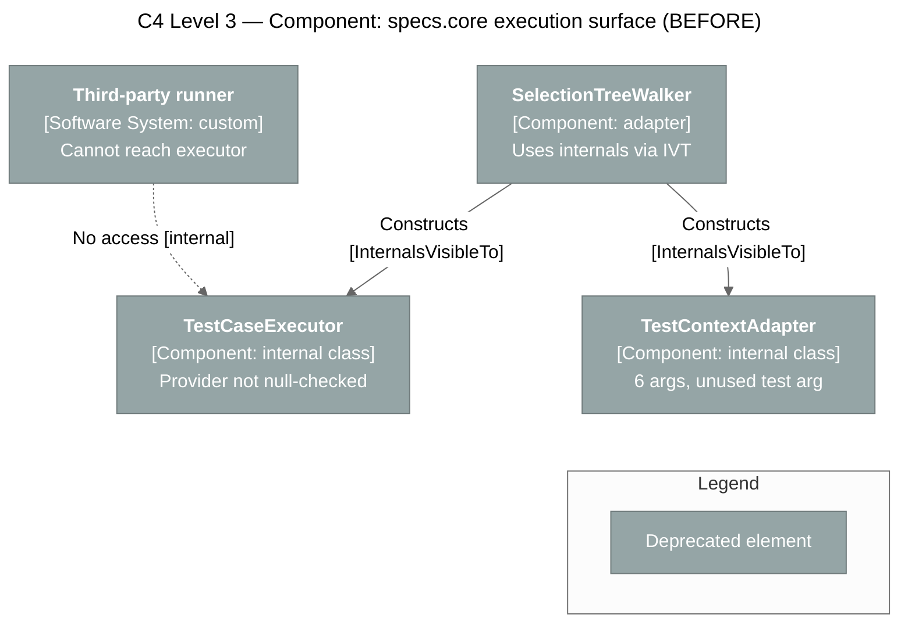

Problems:

- Only the in-repo adapter could run the canonical lifecycle; custom front-ends had to re-implement it.
- Dead API baggage: an unvalidated `test` ctor argument and an unused public `Settings/TestSettings` class duplicating `TestCaseExecutorSettings`.
- `TestCaseExecutor` accepted a `null` provider and failed later with a `NullReferenceException`.

#### 📌 AFTER (public surface, no adapter IVT)

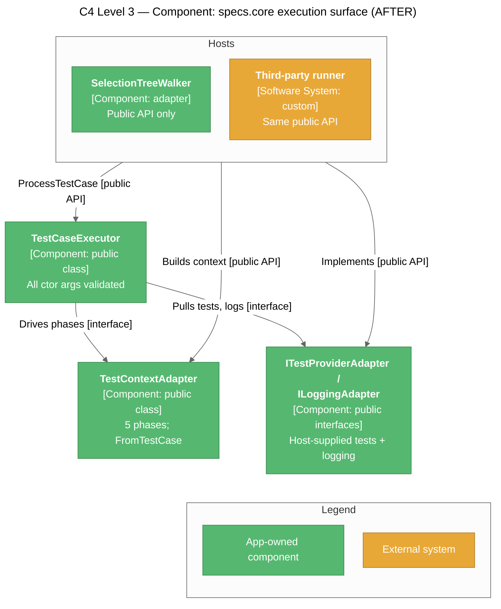

Benefits:

- Any runner gets identical lifecycle semantics (including `ActExceptionContext` capture) by supplying only tests, context, and logging.
- The adapter consumes exactly the surface third parties see, so the public contract is exercised on every run.
- `specs.core` keeps `InternalsVisibleTo` only for its own test assemblies (`specs.core.UnitTests`, `specs.BDD.UnitTests`, `DynamicProxyGenAssembly2`).

### 4. Strategy Pattern — Executor configuration

`TestCaseExecutorSettings` carries `StopOnAssertFailure` (fail-fast vs. continue). Cancellation is **not** a setting — `ProcessTestCase(CancellationToken)` takes the token directly and checks it before each test instance.

### 5. Template Method — Fixed lifecycle order

`TestCaseExecutor.ProcessTestCase(CancellationToken)` always runs:

1. `SetupOnce` (parent → child).
2. For each test: `SetupEach` → `Act` → test → `TeardownEach`. 📌 `Act` + test run together through `ActExceptionContext.Run`, so an `Act` exception fails only that test and `TeardownEach` still runs (see "Act Exception Capture").
3. `TeardownOnce` (child → parent).

## Critical Implementation Patterns

### Top-down setup / bottom-up teardown

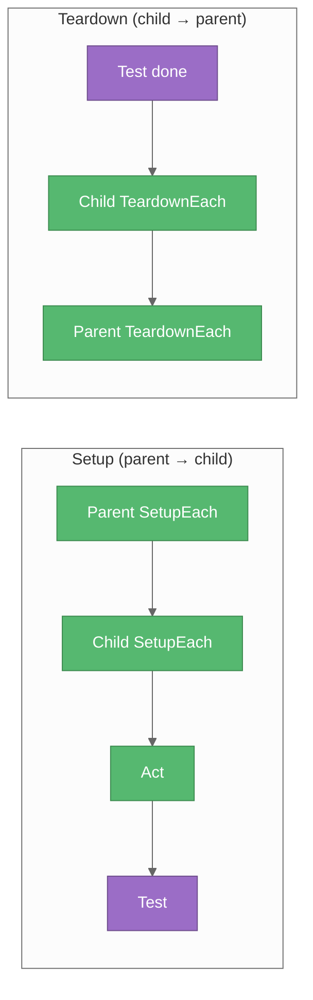

### Context-switching callback (specs.BDD)

`Specifications` keeps a pointer to the currently-active builder. When a nested `Describe[..]` or `Context[..]` block opens, the pointer is swapped to a child builder for the duration of the user action and restored afterward.

```csharp
private void contextCallBack(IContextualTestCaseBuilder childBuilder, Action action)
{
    var previous = this.coreBuilder;
    this.coreBuilder = childBuilder;
    try   { action.Invoke(); }
    finally { this.coreBuilder = previous; }
}
```

This is how lifecycle methods called *inside* a nested block correctly attach to the child scope without explicit threading.

### Async → sync conversion

```csharp
public IContextualTestCaseBuilder AddSetupOnce(Func<Task> asyncAction)
    => AddSetupOnce(() => asyncAction().GetAwaiter().GetResult());
```

The public surface stays `Action`-based. `GetAwaiter().GetResult()` blocks — acceptable in test scenarios; trades pure-async purity for a uniform API.

### Immutability after Build

`IContextualTestCase` exposes only read-only collections and getters. The builder is the only mutator; once `Build()` is called, the resulting case is safe to share, cache, or execute repeatedly.

## VSTest Adapter Pipeline

The adapter is a discovery → conversion → execution pipeline. Both ends are anchored on **`SuiteTreeBuilder`**, the single source of truth for suite-tree construction.

### 📌 Discovery + Conversion

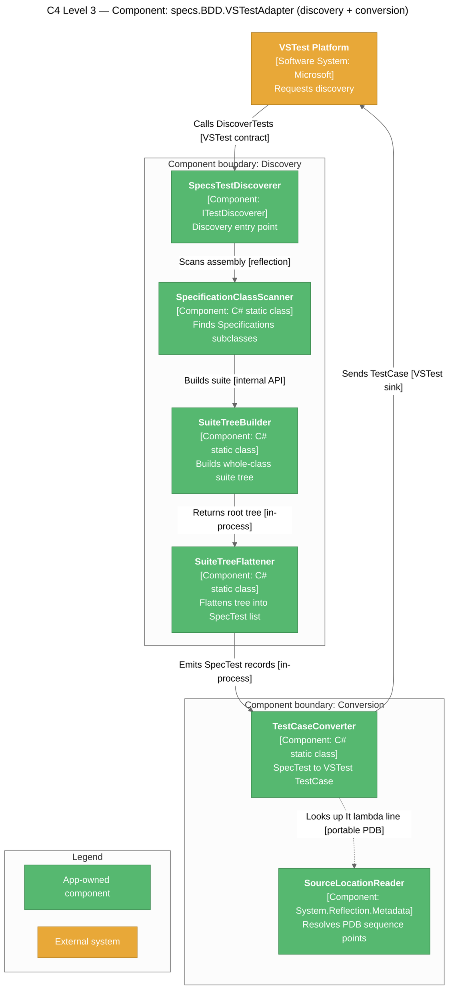

### 📌 Execution

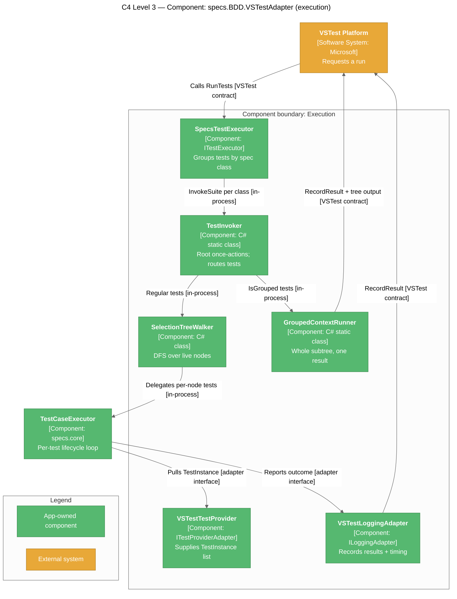

### Adapter responsibilities

| Layer | Class | Responsibility |
|-------|-------|---------------|
| Discovery | `SpecsTestDiscoverer` | Entry point declared by `[FileExtension(".dll" / ".exe")]` and `[DefaultExecutorUri("executor://SpecsTestExecutor/v1")]`; reads the `.runsettings` `TestStructure` value from `IDiscoveryContext.RunSettings` 📌 |
| Discovery | `SpecificationClassScanner` | Reflects assemblies to find non-abstract `Specifications` subclasses |
| Discovery | `ContextMethodScanner` | Finds `[Describe]`-decorated methods; throws `InvalidSpecificationException` if none |
| Discovery | **`SuiteTreeBuilder`** | Instantiates the suite once and registers every `[Describe]` method as a **named child context** via `instance.Context[name] = () => method.Invoke(...)`, then returns `CoreBuilder.Build()`. Shared by discovery *and* execution |
| Discovery | **`GroupingSettings`** 📌 UPDATED | Resolves the effective `TestStructure` per root `[Describe]`: `DescribeAttribute.StructureSetting` → class `[TestStructure]` (not inherited) → assembly `[TestStructure]` → `.runsettings` `<SpecsBDD><TestStructure>` → `PerSpec`; grouped when the result is `PerDescribe`. Also reads `ShowSourceLocations` / `ColorOutput` and picks the grouped-report `MarkerStyle` |
| Discovery | `SuiteTreeFlattener` 📌 RENAMED | `Flatten(type, TestStructure?)` (was `TestStructureExtractor.ExtractTests`) flattens the suite tree into `SpecTest` records, joining context names with `ContextPathFormat.Separator`; emits a single `IsGrouped` record for grouped root contexts 📌; 📌 sets `IsPending` per spec (grouped record: pending only when the subtree has specs and all are pending) |
| Discovery | `PendingSpecs` 📌 NEW | Internal static helpers over a built tree: `IsPending(node, description)`, `HasRunnableTests(node)` (any non-pending spec at or below), `HasAnyTests(node)`. Shared by discovery, `TestInvoker`, and `GroupedContextRunner` |
| Discovery | `SourceLocationReader` | Reads portable PDB sequence points for any `MethodBase` (lambda or `[Describe]` method). 📌 `GetTestMethod(Action)` walks the whole `Delegate.Target` chain, unwrapping async `It` wrappers to the user's `Func<Task>` and 📌 `ShouldThrow` delegates to the user's verifier; async bodies resolve via the state machine's `MoveNext`; methods from a different assembly than the PDB return `null` |
| Conversion | `SpecTest` | POCO: `SpecificationClass`, `ContextMethod`, `ItAction`, `ContextPath`, `TestDescription`, `IsGrouped` 📌, `IsPending` 📌 NEW |
| Conversion | `ContextPathFormat` 📌 NEW | Public static `Separator` (`" → "`, settable) — the one `ContextPath` delimiter used by `SuiteTreeFlattener`, `SelectionTreeWalker`, `GroupedContextRunner`, and `TestFinder` (moved from `TestStructureExtractor.PathSeparator`) |
| Conversion | `TestCaseConverter` | Produces stable `FullyQualifiedName` (`Class::Method::[grouped]` for grouped records), a `DisplayName` that embeds `ContextPath` (VS Code ignores `Hierarchy`) 📌, the RFC-0033 `TestCase.Hierarchy` property, and source location |
| Conversion | `TestProperties` | Custom `TestProperty` registry (`ClassName`, `ContextMethod`, `ContextPath`, `TestDescription`, `IsGrouped` 📌, `IsPending` 📌 NEW — `SpecsBDD.IsPending`, `bool`) preserving metadata across VSTest serialization |
| Execution | `SpecsTestExecutor` | `[ExtensionUri("executor://SpecsTestExecutor/v1")]`; groups selected tests by `(Source, ClassName)` so lifecycle fires once per class; owns the `CancellationTokenSource`; forwards `IRunContext` into re-discovery so `.runsettings` grouping applies to `RunTests(sources)`; 📌 resolves `ShowSourceLocations` and `MarkerStyle` once per run; 📌 NEW applies the `dotnet test --filter` expression to re-discovered cases in `RunTests(sources)` (see "Test Case Filtering") |
| Execution | `TestInvoker` | Resolves the spec `Type`, builds the suite via `SuiteTreeBuilder`, 📌 runs the **root** (class-constructor) `OwnSetupOnce` / `OwnTeardownOnce` once per class, splits the selection three ways (grouped / 📌 pending / regular), records pending cases as Skipped up front, and hands grouped cases to `GroupedContextRunner` and the rest to `SelectionTreeWalker` (both share one tree instance). A root `BeforeAll` failure fails every selected runnable test and skips the root `AfterAll`; 📌 the root lifecycle is skipped entirely when nothing selected is runnable |
| Execution | **`SelectionTreeWalker`** | Depth-first walk of the suite tree firing `OwnSetupOnce` / `OwnTeardownOnce` **exactly once per live non-root node** (the root is owned by `TestInvoker`); delegates per-test loops to `TestCaseExecutor` |
| Execution | **`GroupedContextRunner`** 📌 | Runs an entire root `[Describe]` subtree as **one** `TestResult`; mirrors the walker's once-per-node lifecycle but keeps running after per-test failures so the report is complete; emits an NSpec-style tree + failure list to `StandardOutCategory` using the run's `MarkerStyle`, optional per-`It` `at file:line N` locations, and a fully failed tree when the root `BeforeAll` failed. 📌 Renders pending specs as `○ ... - PENDING` without running them, skips the once-actions of any node with no runnable specs, and reports an all-pending context as Skipped |
| Execution | `MarkerStyle` 📌 NEW | Internal enum (`Plain` / `Ansi` / `Emoji`) selecting grouped-report pass/fail glyphs |
| Execution | `TestFinder` | Splits `ContextPath` on 📌 `ContextPathFormat.Separator` and walks the immutable test tree |
| Execution | `ResultReporter` | Builds `TestResult` objects for pass/fail/skip outcomes (📌 `Skipped(..., message = PendingMessage)` with `PendingMessage = "Pending"`); `Unwrap` (now `internal`) strips `TargetInvocationException` layers for both runners |
| Execution | `VSTestLoggingAdapter` | `ILoggingAdapter` over `IFrameworkHandle`; tracks `ReportedDescriptions` so unreached tests can be failed explicitly |
| Execution | `VSTestTestProvider` | `ITestProviderAdapter` wrapping `(TestCase, description, Action)` triples as `TestInstance[]` |

## Once-Per-Node Lifecycle (selection-tree walk)

Running a *subset* of a suite from Test Explorer must still honour `BeforeAll` / `AfterAll` semantics: each context's once-actions fire exactly once no matter how many of its tests were selected.

### 📌 BEFORE (per-test cascaded lifecycle)

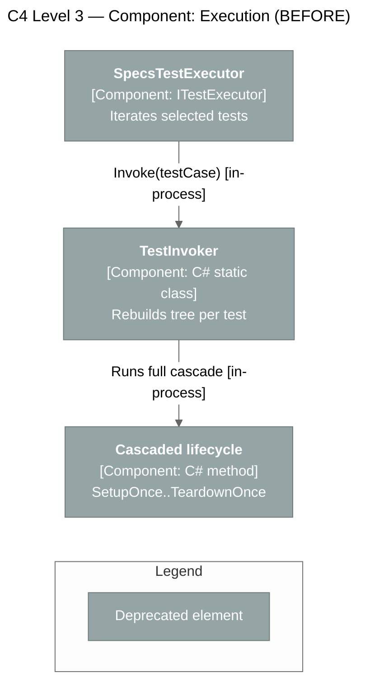

Problems:

- The suite tree was rebuilt once **per selected test**, so a fresh `Specifications` instance was created each time.
- `SetupOnce` / `TeardownOnce` ran once **per test**, not once per context — `BeforeAll` semantics were wrong for multi-test runs.
- `[Describe]` methods were invoked directly, so they did not appear as nodes in the tree and could not own once-actions.

### 📌 AFTER (suite tree + selection walk)

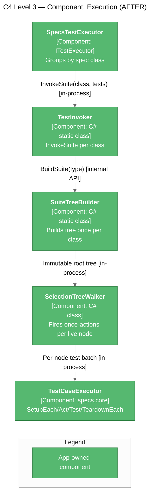

Benefits:

- `[Describe]` methods become **named child contexts** of the class root, so they are first-class tree nodes that can own `BeforeAll` / `AfterAll`.
- `ITestCase.OwnSetupOnce` / `OwnTeardownOnce` expose a node's *own* once-actions (no ancestor cascade), which is exactly what the walker needs.
- Only **live** nodes (those with at least one selected test at or beneath them) run lifecycle; idle branches are skipped.
- The walker passes no-op once-actions into `TestContextAdapter` so `TestCaseExecutor` still handles `SetupEach` → `Act` → test → `TeardownEach` without double-firing once-actions.
- Clear failure contract: a failing `OwnSetupOnce` at node *N* fails every selected test at or under *N*, skips *N*'s `OwnTeardownOnce`, and lets sibling branches continue.
- `VSTestLoggingAdapter.ReportedDescriptions` lets the walker fail any test that was never reached due to a lifecycle fault, so Test Explorer never shows a stuck "not run" entry.

## 📌 NEW — Root (class-level) Lifecycle

Hooks registered in a `Specifications` constructor (`BeforeAll`, `BeforeEach`, `Act`, `AfterEach`, `AfterAll`) attach to the **suite root** node. `BeforeEach` / `Act` / `AfterEach` already cascaded into every test, but the root's *once*-actions were never fired.

### 📌 BEFORE (root once-actions skipped)


Problems:

- A class-level `BeforeAll` / `AfterAll` registered in the constructor **silently never ran** in either mode.
- No defined behaviour for a failing suite-wide setup.

### 📌 AFTER (TestInvoker owns the root)

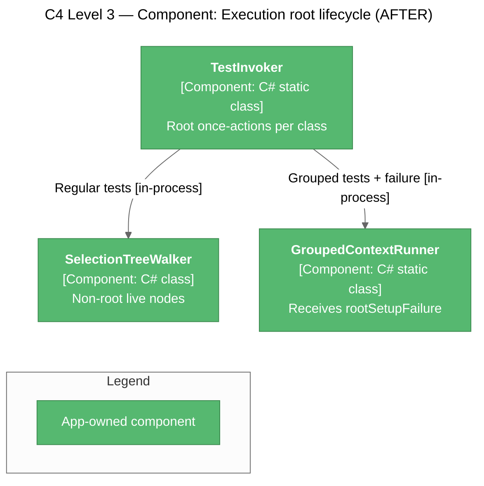

Benefits / contract:

- Root `OwnSetupOnce` runs **once per class** before any grouped or per-`It` work; root `OwnTeardownOnce` runs once in a `finally` (best-effort, exceptions swallowed).
- If root `BeforeAll` throws: grouped results render a fully failed tree (`FailSubtree`) with the unwrapped root exception, regular tests are reported failed via `ReportAllAsFailed`, and root `AfterAll` is **skipped**.
- `SelectionTreeWalker` keeps skipping the root, now by design rather than by omission.

## 📌 Grouped Root-Context Execution

By default every `It[...]` is its own VSTest `TestCase`. A root `[Describe]` can instead opt into **grouped mode** (📌 `TestStructure.PerDescribe`), where the whole subtree is discovered as one `TestCase` and executed by `GroupedContextRunner` into one `TestResult`.

### 📌 MODERNIZED — Configuration API

#### BEFORE (`bool` flags, three layers)

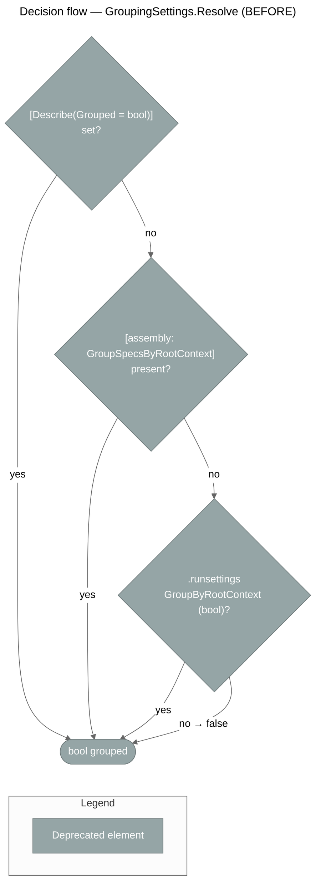

```csharp
[assembly: GroupSpecsByRootContext]                  // removed
[Describe("subtraction", Grouped = true)]              // removed
```

Problems: no class-level switch; `bool` naming did not describe *what* was being chosen; assembly attribute name was mode-specific.

#### AFTER (📌 UPDATED — `TestStructure` enum, four layers)

> 📌 Introduced as `SpecReporting` (`Individual` / `GroupedByRootContext`, `Reporting =`) in `124ba8c`; renamed to `TestStructure` (`PerSpec` / `PerDescribe`, `Structure =`) by decision #32. Layers and precedence are unchanged.

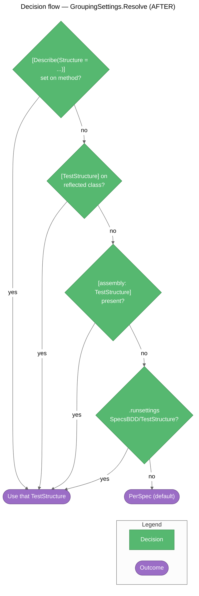

```csharp
[assembly: TestStructure(TestStructure.PerDescribe)]

[TestStructure(TestStructure.PerDescribe)]                   // class-level, NOT inherited
public class CalculatorSpecs : Specifications
{
    [Describe("Addition", Structure = TestStructure.PerSpec)]   // per-method override
    public void describe_addition() { /* ... */ }
}
```

Benefits:

- One vocabulary (`TestStructure.PerSpec` / `PerDescribe`) across method, class, assembly, and `.runsettings`; extensible to future modes.
- Class-level opt-in (`AttributeTargets.Assembly | Class`, `Inherited = false`) — read from the method's `ReflectedType`, so a derived suite does **not** inherit its base's setting.
- `DescribeAttribute` keeps a nullable backing (`TestStructure?`, exposed as `StructureSetting`) so an explicit `Structure = PerSpec` overrides any lower layer.
- `.runsettings` parsing accepts enum **names** only (case-insensitive, trimmed); numeric strings and undefined values yield `null`.

### Runtime contract

| Aspect | Per-`It[...]` mode (`SelectionTreeWalker`) | Grouped mode (`GroupedContextRunner`) |
|--------|--------------------------------------------|---------------------------------------|
| Discovery output | One `SpecTest` per `It[...]` | One `SpecTest` with `IsGrouped = true`, `ContextPath` = root context name |
| `FullyQualifiedName` | `Class::Method::ContextPath::Description` | `Class::Method::[grouped]` |
| `DisplayName` | `ContextPath → Description` | Root context description |
| Once-actions | `OwnSetupOnce` / `OwnTeardownOnce` once per live node | Same, over the entire subtree |
| Per-test failure | That test fails; siblings continue | Counted, run continues; result fails if any failed |
| 📌 `Act` exception | Captured by `ActExceptionContext.Run`; fails that test only (unless verified by `ShouldThrow`), `TeardownEach` still runs | Same — counted as that spec's failure, run continues |
| `BeforeAll` failure | Fails every selected test under the node | Fails every test under the node (`FailSubtree`), run continues elsewhere |
| 📌 Root (class) `BeforeAll` failure | Every selected test reported failed; root `AfterAll` skipped | Whole tree rendered as failed with the root exception; root `AfterAll` skipped |
| `AfterAll` failure | Swallowed (best-effort) | Swallowed (best-effort) |
| Empty subtree | n/a | `TestOutcome.Skipped` with "No specs found" |
| 📌 Pending spec | Recorded Skipped (`Pending`) by `TestInvoker` before any lifecycle; never reaches the walker | Rendered `○ ... - PENDING`, counted in `N pending`; never executed |
| 📌 All specs pending | Node not live → its once-actions never run | Node once-actions skipped; result `Skipped` with "All specs are pending." |
| Output | Per-result messages | NSpec-style tree + `N passed, M failed, [P pending, ]T total` + numbered failure list in `StandardOutCategory`; `ErrorMessage` summarises failed paths |

### 📌 NEW — Report formatting

| Setting | Source | Effect |
|---------|--------|--------|
| Pass/fail markers | `GroupingSettings.ResolveMarkerStyle(colorOutput, VSAPPIDNAME)` | `ColorOutput=false` → `Plain` (`✓` / `✗` / 📌 `○`); host is Visual Studio (`VSAPPIDNAME=devenv.exe`, which cannot render ANSI) → `Emoji` (`✅` / `❌` / 📌 `⏸️`); otherwise → `Ansi` (green `✓` / red `✗` / 📌 yellow `○`) |
| Source locations | `.runsettings` `SpecsBDD/ShowSourceLocations` (default `false`) | Adds an indented `at <file>:line <n>` under each passing, failing, root-setup-failed, or 📌 pending `It` |

Both values are resolved once per run in `SpecsTestExecutor` and threaded through `TestInvoker.InvokeSuite` → `GroupedContextRunner.Run` → `Execute`.

Both runners share the single suite tree built by `SuiteTreeBuilder` for the class, so grouped and per-`It` contexts in the same class never trigger a second instantiation.

### Dynamic view

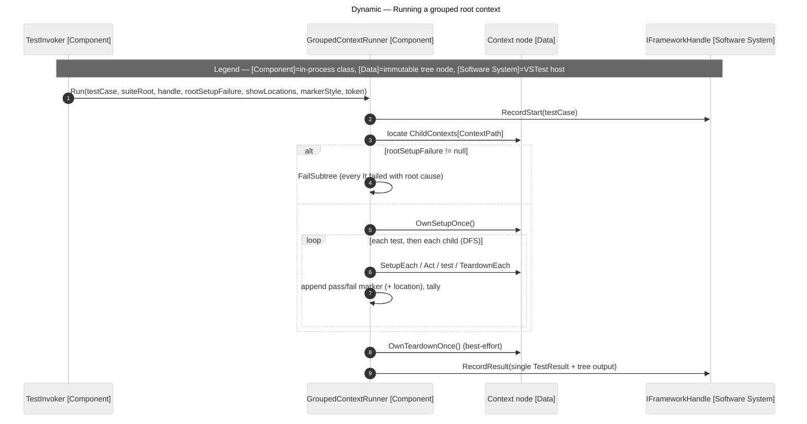

## Test Explorer Hierarchy (RFC-0033)

`TestCaseConverter` sets the VSTest `TestCase.Hierarchy` property — a `string[4]` of `[Container, Namespace, Class, TestGroup]`:

| Index | Value | Notes |
|-------|-------|-------|
| 0 | `null` | VS fills it from the project/assembly name |
| 1 | `SpecificationClass.Namespace` | — |
| 2 | `SpecificationClass.Name` | Simple (unqualified) name |
| 3 | `SpecTest.ContextPath` | Full `[Describe]` + `Describe`/`Context` chain joined by `" → "` |

Source navigation prefers the `It[...]` lambda's PDB sequence point (`SourceLocationReader.GetTestMethod(SpecTest.ItAction)`) so "Go to Source" lands on the assertion line, falling back to the `[Describe]` method when the lambda has no sequence points.

📌 **Async `ItAsync[...]` navigation**: `ContextualTestCaseBuilder.AddTest(string, Func<Task>)` wraps the test as `test.RunSync` (an extension-method-bound delegate) instead of a closure, so the wrapper `Action.Target` *is* the user's `Func<Task>`. `GetTestMethod` unwraps it, and `TryGetLocation` follows `[AsyncStateMachine]` to `MoveNext`, where the async body's sequence points actually live. 📌 `ShouldThrow<T>(verify)` uses the same trick — it returns `verify.VerifyActException` (extension-method-bound), so the user's verifier lambda is the innermost `Target`. The parameterless `ShouldThrow<T>()` binds a verifier defined in `specs.BDD`, which the cross-assembly guard rejects, so navigation falls back to the `[Describe]` method.

📌 **VS Code caveat**: the VS Code test UI ignores `Hierarchy`, so `TestCaseConverter.BuildDisplayName` embeds the context path (`ContextPath → TestDescription`) to keep contexts visible there. Visual Studio still nests via `Hierarchy`.

### Discovery safety

The adapter executes user-defined `[Describe]` methods during discovery (it must, to enumerate `It[...]` blocks). To stay safe:

- Suites are instantiated through the parameterless constructor only.
- Setup actions are collected, **not executed**, at discovery time.
- Failures during discovery surface as `InvalidSpecificationException` or specific VSTest error logs — they never abort the run.
- `SourceLocationReader` degrades gracefully: a missing or unreadable PDB yields `null`, never an exception.
- `SpecificationClassScanner` catches `ReflectionTypeLoadException` and returns the types that *did* load, so one broken dependency cannot hide an entire assembly's tests.

### The tree is built twice

Discovery and execution each build the suite tree independently — VSTest serializes `TestCase` objects across the discovery/execution boundary, so no live object graph survives between the two phases.

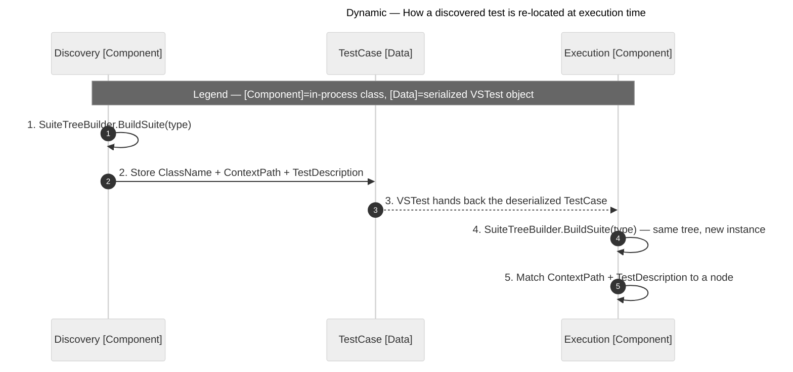

The four `TestProperties` values (`ClassName`, `ContextMethod`, `ContextPath`, `TestDescription`) are the **address** that lets execution find the node discovery found. This is why `SuiteTreeBuilder` must be the only construction path: if the two phases disagreed on a single context description, the address would no longer resolve. A fifth property, `IsGrouped`, tells `TestInvoker` which runner the address belongs to. 📌 A sixth, `IsPending`, exists for `--filter` only — execution re-derives pending state from the rebuilt tree (`PendingSpecs.IsPending`) rather than trusting the serialized flag.

## Key Technical Decisions

| # | Decision | Rationale | Impact |
|---|----------|-----------|--------|
| 1 | Immutable `ContextualTestCase` after `Build()` | Predictable, thread-safe, cacheable | Builder is the only mutation surface |
| 2 | `Action`-based public surface (async → sync internally) | Uniform API; simpler mental model | `GetAwaiter().GetResult()` blocks but acceptable for tests |
| 3 | Top-down setup, bottom-up teardown | Matches construction/disposal semantics | Builder must track and reverse action order |
| 4 | Adapter-driven framework integration | Core has zero test-framework deps | Adapter layer required per host (VSTest provided) |
| 5 | ~~Two coexisting API styles~~ 📌 SUPERSEDED by #31 | Backward compatibility + modern design | The legacy property-based `Spec` API was removed; only `Specifications` remains |
| 6 | Hierarchical (composite) context model | Matches BDD `describe → context → it` thinking | More complex builder + executor |
| 7 | **Consolidate execution in `TestCaseExecutor`** (Feb 2026 refactor) | Eliminates duplicate execution logic in the adapter; single source of truth for lifecycle semantics | `TestInvoker` delegates to `TestCaseExecutor` rather than re-implementing the lifecycle |
| 8 | Discovery reads `Specifications.CoreBuilder` directly (no reflection) | Cleaner contract; testable; faster | `CoreBuilder` exposed via `InternalsVisibleTo("specs.BDD.VSTestAdapter")` on `specs.BDD` only (📌 `specs.core` no longer grants it — see #29) |
| 9 | 📌 **`SuiteTreeBuilder` is the single source of truth for tree construction** | Discovery and execution must agree on paths, descriptions, and ordering, or `TestFinder` silently misses tests | `[Describe]` methods are registered as named child contexts rather than invoked directly |
| 10 | 📌 **Cancellation is a `CancellationToken` parameter, not an executor setting** | Matches BCL conventions; the token flows straight from `ITestExecutor.Cancel()` through `SpecsTestExecutor`'s `CancellationTokenSource` | `TestCaseExecutorSettings.IsCancelled` was removed; `ProcessTestCase(CancellationToken)` checks the token before each test |
| 11 | 📌 **Once-actions exposed separately as `OwnSetupOnce` / `OwnTeardownOnce`** | The walker needs a node's *own* once-actions without the ancestor cascade that `SetupOnce` / `TeardownOnce` provide | Two extra members on `ITestCase`; `TestCaseExecutor` behaviour unchanged |
| 12 | **Navigate to the `It[...]` lambda, not the `[Describe]` method** | "Go to Source" should land on the assertion the developer clicked | `SpecTest.ItAction` captured at discovery; `SourceLocationReader` accepts any `MethodBase` |
| 13 | 📌 **Grouped mode is a discovery-time decision, resolved in the adapter** | The core stays unaware of VSTest granularity; the flag must be fixed before `TestCase`s are serialized so discovery and execution agree | `GroupingSettings` lives in the adapter; `DescribeAttribute.Structure` / `TestStructureAttribute` / `TestStructure` 📌 live in `specs.BDD` as pure metadata |
| 14 | 📌 **Grouped runner is separate from `SelectionTreeWalker`, not a mode flag on it** | Grouped mode has a different failure policy (continue after per-test failure, aggregate into one result) and a different output channel | `GroupedContextRunner` duplicates the small once-per-node walk rather than threading a mode through the walker and `TestCaseExecutor` |
| 15 | 📌 UPDATED **Explicit `Structure = PerSpec` must beat class/assembly/runsettings opt-in** | Authors need a per-context escape hatch when a class or assembly is grouped by default | `DescribeAttribute` uses a nullable `TestStructure?` backing field exposed as `StructureSetting` |
| 16 | 📌 **Reporting is an enum, not a `bool`** (📌 renamed by #32) | Names the choice (`Individual` / `GroupedByRootContext`) and leaves room for future modes | Breaking rename: `Grouped` → `Reporting`, `GroupSpecsByRootContextAttribute` → `SpecReportingAttribute`, `GroupByRootContext` → `SpecReporting` in `.runsettings` |
| 17 | 📌 **Class-level `[TestStructure]` is not inherited** | A base suite's test-structure choice should not silently change a derived suite's test granularity | `Inherited = false`; resolved from `MethodInfo.ReflectedType` |
| 18 | 📌 NEW **`TestInvoker` owns the root once-lifecycle** | Constructor-registered `BeforeAll` / `AfterAll` must run exactly once per class regardless of how the selection splits between runners | Walker still skips the root; `GroupedContextRunner` receives `rootSetupFailure` |
| 19 | 📌 NEW **Async test wrapper is bound to the original `Func<Task>`** | Source location needs the user's lambda, not a compiler closure | `AsyncTestExtensions.RunSync` in `specs.core`; `SourceLocationReader.GetTestMethod` unwraps `Action.Target` |
| 20 | 📌 NEW **Marker style depends on the host** | Visual Studio's Test Explorer shows raw ANSI escapes; VS Code / CLI render them | `VSAPPIDNAME=devenv.exe` → emoji; `ColorOutput=false` → plain |
| 21 | 📌 NEW **The adapter applies `--filter` itself in `RunTests(sources)`** | VSTest hands source-based runs to the adapter unfiltered; an adapter that ignores `IRunContext.GetTestCaseFilter` runs every test | `SpecsTestExecutor.FilterProperties` maps case-insensitive names to `TestProperty`s; an invalid expression is reported as an error and nothing runs |
| 22 | 📌 NEW **Pending is tree metadata in the core; skipping is adapter policy** | The core builder is where `xContext` inheritance is known, but *how* a pending spec is reported is host-specific | `ITestCase.PendingTests` (ordinal set of descriptions) in `specs.core`; `TestCaseExecutor` is unchanged and does not consult it |
| 23 | 📌 NEW **Pending specs keep their body in `Tests`** | Pending specs must still be discovered, addressed by `TestFinder`, and navigable via "Go to Source" | `AddPendingTest` calls `AddTest` then records the description; `TODO` / `TODOAsync` are recognised by reference identity |
| 24 | 📌 **No lifecycle for pending-only selections** | A half-written `xContext` (e.g. a throwing `BeforeAll`) must not fail the run | Pending cases bypass the walker; root and node once-actions run only when `PendingSpecs.HasRunnableTests` is true |
| 25 | 📌 NEW **The `Act` exception is exposed to the spec through an ambient `AsyncLocal` context** | Keeps `It` an `Action`; `ShouldThrow<T>` is just an `It` body, needing no new builder API or lifecycle phase | `ActExceptionContext` is **public** in `specs.core` (extensibility library); every execution path (`TestCaseExecutor`, `TestInvoker.RunLifecycle`, `GroupedContextRunner.RunTest`) must call `Run(act, test)` |
| 26 | 📌 NEW **An unverified `Act` exception fails only its spec and wins over the `It` exception** | The `Act` failure is the root cause; an `It` that then trips over missing state would report a misleading symptom | Behaviour change: `Act` exceptions no longer abort the node via `LogException` or skip `TeardownEach` / `TeardownOnce`; rethrown with `ExceptionDispatchInfo` to keep the stack |
| 27 | 📌 NEW **`ShouldThrow<T>` matches by assignability and returns a bound delegate** | Base-type expectations (`ArithmeticException`) are idiomatic; a bound delegate keeps "Go to Source" on the verifier lambda | `GetTestMethod` walks the full `Target` chain; wrong type / no exception → `ExpectedExceptionNotThrownException` (wrong type kept as `InnerException`) |
| 28 | 📌 NEW **No `ShouldThrowAsync`** | The `Act` exception (sync or async `Act`) is already captured before `It` runs; an async verifier adds nothing | `ShouldThrow` returns `Action` and is used with `It[...]`, not `ItAsync[...]` |
| 29 | 📌 NEW **`specs.core`'s execution surface is public; the adapter gets no `InternalsVisibleTo`** | `specs.core` is an extensibility library; custom runners need the canonical executor, and the in-repo adapter should prove the public surface is sufficient | `TestCaseExecutor`, `ITestContextAdapter`, `ITestProviderAdapter`, `TestContextAdapter`, `TestInstance` public; `TestContextAdapter` ctor trimmed to 5 args + `FromTestCase`; `TestSettings` deleted. Decision #8 still applies to `specs.BDD` (`CoreBuilder`) |
| 30 | 📌 NEW **Context-builder attribute renamed `[Context]` → `[Describe]`** | Matches the `Describe[...]` vocabulary and the BDD idiom; the attribute marks the root describe block of a suite | **Breaking**: `ContextAttribute` → `DescribeAttribute` (same members: `Description`, `Reporting`, `ReportingSetting` — 📌 since renamed by #32); scanners, extractor, grouping resolver, error message, README and all fixtures updated. `Context[...]` / `xContext` indexers are unchanged |
| 31 | 📌 NEW **Legacy `Spec` API, `Domain/` layer, `Specs.csproj` and `Examples/ConsoleExample` removed** | Two API styles doubled the documentation and maintenance burden; the modern `Specifications` API + `specs.core` fully replace it, and the core now self-hosts | **Breaking**: `Spec`, `Global.cs`, `Domain/*` (`AbstractSpecDefinition`, `ActionRunner`, `TaskRunner`, `IRunContext`/`IRunContainer`, spec definitions, `Exceptions/*`) and the `ConsoleExample` sample are deleted (1,395 lines). Migrate by deriving from `Specifications` and using `[Describe]` methods; `ShouldThrow<T>()` now lives on `Specifications` (see #25–28) |
| 32 | 📌 NEW **`SpecReporting` renamed `TestStructure` (`PerSpec` / `PerDescribe`); `ContextPath` delimiter moved to `Conversion.ContextPathFormat`** | The switch decides how specs map to VSTest test cases (granularity), not merely how results are reported; the delimiter is part of the `SpecTest.ContextPath` contract shared by discovery and execution, so execution should not depend on a discovery class for it | **Breaking**: `SpecReporting` → `TestStructure`, `SpecReportingAttribute` → `TestStructureAttribute`, `Reporting` / `ReportingSetting` → `Structure` / `StructureSetting`, `.runsettings` `SpecReporting` → `TestStructure`. Adapter: `TestStructureExtractor.ExtractTests` → `SuiteTreeFlattener.Flatten`, `PathSeparator` → `ContextPathFormat.Separator`. Behaviour, FQNs, and precedence unchanged |
| 33 | 📌 NEW **Repo split into `src/` (deliverables) + `tests/` (test projects); `Specs.sln` at the root; `TestHarness` retired; `specs.BDD.UnitTests` self-hosted** | Deliverables and test code are separated at folder level, and the nspec bridge was only kept alive by `specs.BDD.UnitTests` — once that project ran on Specs, nothing needed it | `TestHarness` project, `nspec 3.1.0`, and every NUnit dependency outside `specs.BDD.VSTestAdapter.Tests` are gone; solution goes from 8 to 7 projects. Test files take a `_Tests` suffix so the class name no longer collides with the type under test, and the `[Describe]` method is named after that type. See section "Test Hosting" |

## Critical Execution Paths

### Path 1 — Test construction

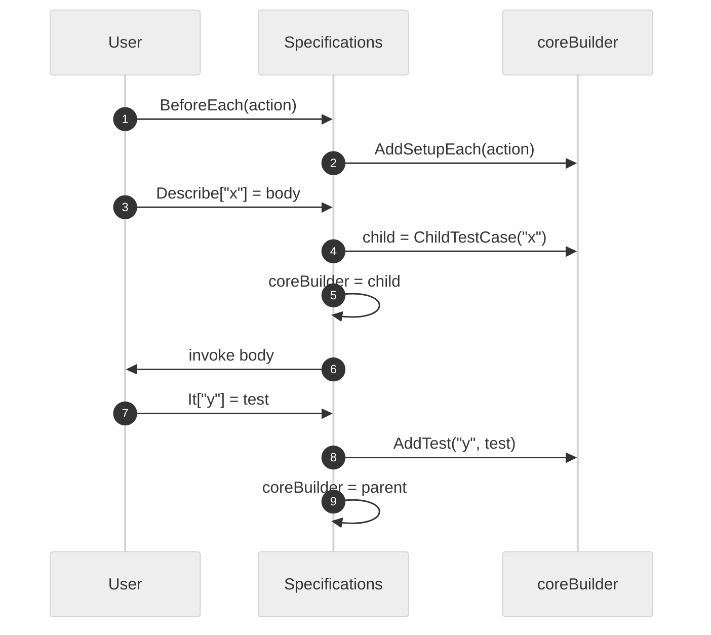

### Path 2 — Test execution (suite tree + selection walk)

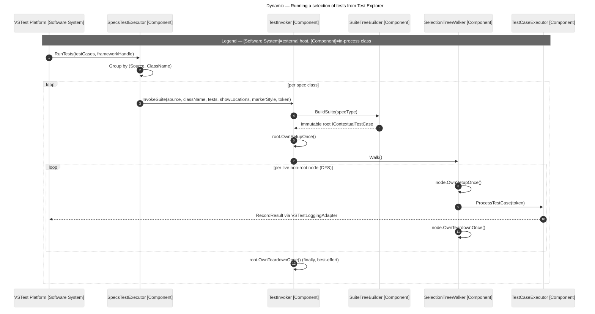

### 📌 NEW — Test Case Filtering (`dotnet test --filter`)

When VSTest calls `RunTests(sources, …)` (CLI runs, `dotnet test --filter …`), the adapter re-discovers every `TestCase` and must apply the filter itself. Selection-based runs (`RunTests(testCases, …)`, e.g. Test Explorer) are already filtered by the host and are unaffected.

**BEFORE**: re-discovered cases were passed straight to `RunTests(testCases, …)`, so `--filter` was silently ignored and every spec in the assembly ran.

**AFTER**:

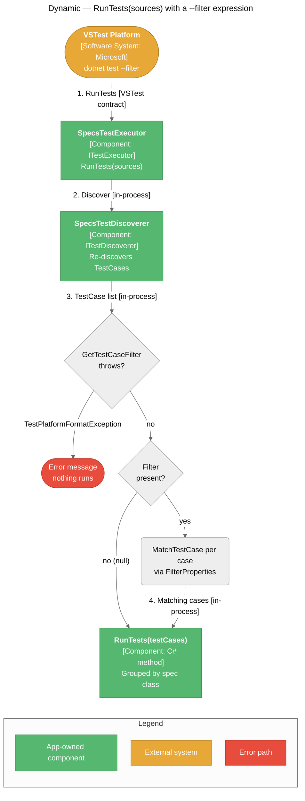

Supported filter properties (names matched case-insensitively by `SpecsTestExecutor.FilterProperties`):

| Filter name | Backing `TestProperty` |
|-------------|------------------------|
| `FullyQualifiedName` | `TestCaseProperties.FullyQualifiedName` |
| `DisplayName` | `TestCaseProperties.DisplayName` |
| `ContextMethod` | `TestProperties.ContextMethod` |
| `ContextPath` | `TestProperties.ContextPath` |
| `TestDescription` | `TestProperties.TestDescription` |
| 📌 `IsPending` | `TestProperties.IsPending` (`IsPending=true` / `IsPending=false`) |

Unknown names resolve to `null` in the property-value provider, so they never match. Grouped records are filtered like any other case (by their `Class::Method::[grouped]` FQN).

## 📌 NEW — Pending Specs

A **pending** spec is discovered and reported but never executed. Authors mark specs pending three ways in `specs.BDD`:

| Syntax | Mechanism |
|--------|-----------|
| `It["..."] = TODO;` / `ItAsync["..."] = TODOAsync;` | `AssertBuilder` / `AssertBuilderAsync` detect the static `Specifications.TODO` / `TODOAsync` delegate by `ReferenceEquals` |
| `xIt["..."] = ...;` / `xItAsync["..."] = ...;` | Builder constructed with `isPending: true`; body kept for source navigation |
| `xContext["..."] = ...;` / `xDescribe["..."] = ...;` | `ContextBuilder(isPending: true)` → `ChildTestCase(..., isPending: true)`; the child builder inherits `isPending` from its parent, so every descendant spec is pending |

### 📌 BEFORE (no pending concept)

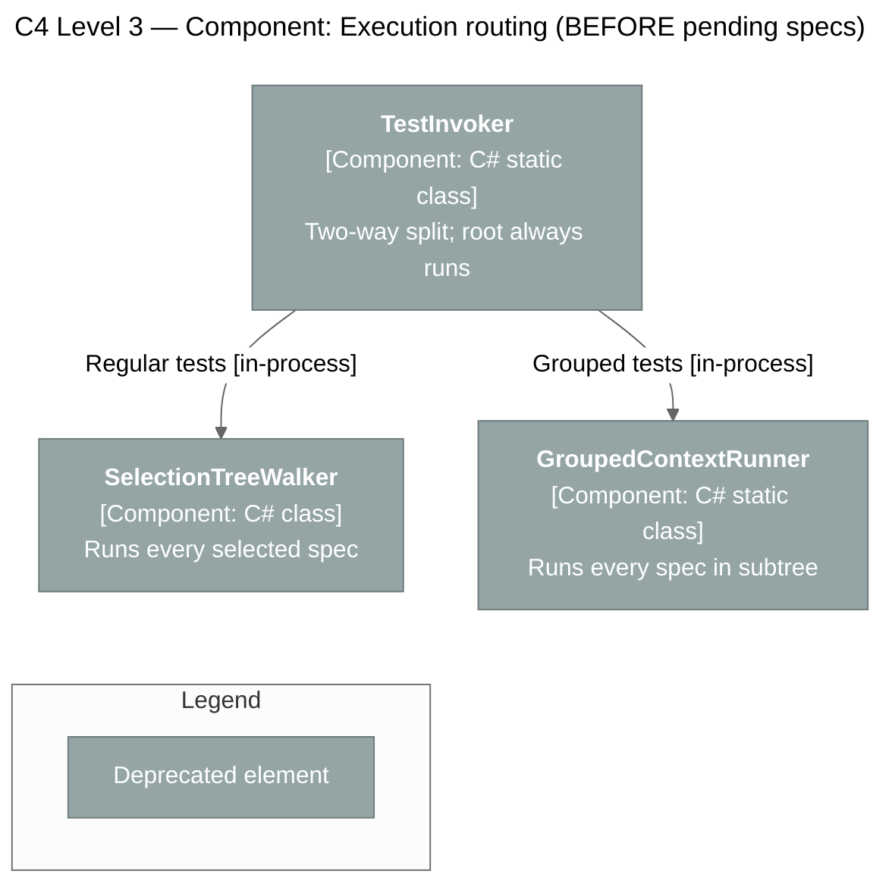

Problems:

- Unwritten specs had to be commented out, disappearing from Test Explorer.
- No way to park a broken scenario without it failing (or its `BeforeAll` breaking siblings).

### 📌 AFTER (pending metadata + three-way routing)

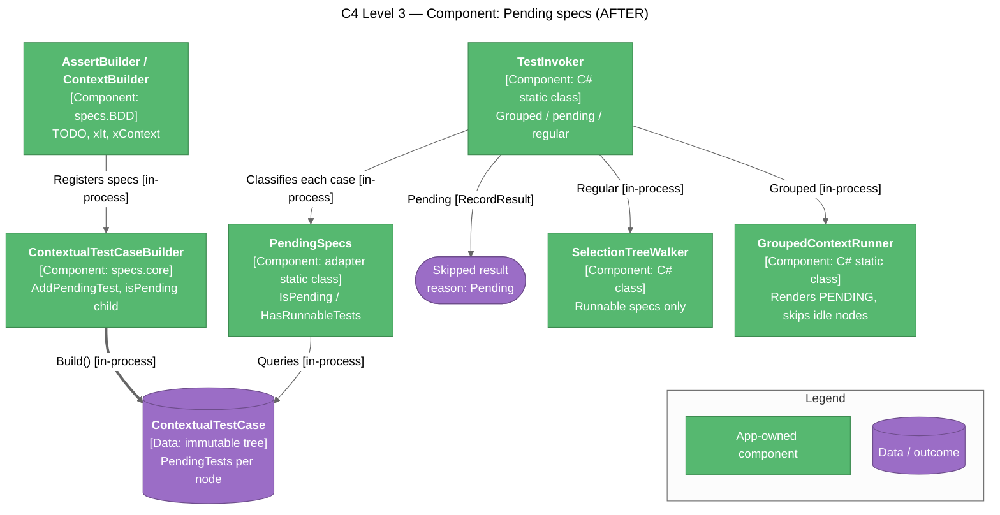

Benefits / contract:

- **Discovery**: pending specs are emitted like any other `SpecTest` with `IsPending = true`; a grouped record is pending only when its subtree has specs and none are runnable.
- **Per-`It` execution**: `TestInvoker.InvokeSuite` records pending cases as `Skipped` (`ResultReporter.PendingMessage`) before any lifecycle; `TestInvoker.Invoke` (single case) returns `Skipped` without running anything.
- **Once-actions**: pending cases never reach `SelectionTreeWalker`, so a pending-only node is never live. Root `OwnSetupOnce` / `OwnTeardownOnce` run only if a regular case or a grouped context with runnable specs is selected.
- **Grouped execution**: `RunNode` short-circuits nodes with no runnable specs into `RenderPendingSubtree` (no `BeforeAll` / `AfterAll`); a root-`BeforeAll` failure leaves pending specs rendered as pending, not failed.
- **Filtering**: `IsPending` is a supported `--filter` property.
- **Scope**: only the `Specifications` API and the VSTest adapter honour pending; `TestCaseExecutor` does not.

## 📌 NEW — Act Exception Capture (`ShouldThrow<T>`)

Expected-exception specs are written by pointing `It[...]` at the exception thrown by `Act`:

```csharp
Act(() => calculator.Divide(1, 0));

It["throws"] = ShouldThrow<DivideByZeroException>();
It["explains why"] = ShouldThrow<DivideByZeroException>(ex =>
    Check.That(ex.Message.ToLowerInvariant()).Contains("zero"));
```

### 📌 BEFORE (Act outside the test's failure boundary)

```mermaid
---
title: "C4 Level 3 — Component: Act/It execution (BEFORE)"
---
%%{init: {'theme': 'neutral'}}%%
flowchart TD
    EXE["<b>TestCaseExecutor</b><br/>[Component: specs.core]<br/>Calls Act before test try"]:::deprecated
    ACT["<b>User Act</b><br/>[Component: delegate]<br/>Manual try/catch to a local"]:::deprecated
    IT["<b>User It</b><br/>[Component: delegate]<br/>Inspects captured local"]:::deprecated
    LOG["<b>LogException + rethrow</b><br/>[Component: ILoggingAdapter]<br/>Aborts the whole node"]:::deprecated

    EXE -->|"1. Invokes [in-process]"| ACT
    ACT -.->|"Uncaught throw [exception]"| LOG
    EXE -->|"2. Invokes if Act survived [in-process]"| IT

    subgraph LEGEND["Legend"]
        direction LR
        L1["Deprecated element"]:::deprecated
    end

    IT ~~~ LEGEND

    classDef deprecated fill:#95A5A6,stroke:#707B7C,color:#fff
```

Problems:

- Exception specs needed a hand-rolled `try/catch` in `Act`, a shared `Exception?` local, and a `BeforeEach` to reset it.
- An uncaught `Act` exception escaped `ProcessTestCase` (and `TestInvoker.RunLifecycle`): remaining tests in the node never ran, and `TeardownEach` / `TeardownOnce` were skipped.

### 📌 AFTER (`ActExceptionContext.Run`)

```mermaid
---
title: "C4 Level 3 — Component: Act/It execution (AFTER)"
---
%%{init: {'theme': 'neutral', 'flowchart': {'nodeSpacing': 30, 'rankSpacing': 45, 'wrappingWidth': 160}}}%%
flowchart TD
    subgraph HOSTS["Execution paths"]
        direction TB
        EXE["<b>TestCaseExecutor</b><br/>[Component: specs.core]<br/>Per-node test loop"]:::app
        INV["<b>TestInvoker.RunLifecycle</b><br/>[Component: adapter]<br/>Single-case invoke"]:::app
        GR["<b>GroupedContextRunner</b><br/>[Component: adapter]<br/>RunTest per spec"]:::app
    end

    AEC["<b>ActExceptionContext</b><br/>[Component: specs.core static class]<br/>Run(act, test)"]:::app
    SLOT[("<b>Outcome</b><br/>[Data: AsyncLocal]<br/>Exception + Handled")]:::data
    ST["<b>ShouldThrow&lt;T&gt;</b><br/>[Component: specs.BDD]<br/>Bound verifier delegate"]:::app
    AEA["<b>ActExceptionAssertions</b><br/>[Component: specs.core]<br/>VerifyActException&lt;T&gt;"]:::app

    HOSTS -->|"1. Run(Act, It) [in-process]"| AEC
    AEC ==>|"2. Captures Act throw [AsyncLocal]"| SLOT
    AEC -->|"3. Invokes It [in-process]"| ST
    ST -->|"4. Delegates [extension method]"| AEA
    AEA -->|"5. Reads + MarkHandled [AsyncLocal]"| SLOT

    subgraph LEGEND["Legend"]
        direction TB
        L1["App-owned component"]:::app
        L2[("Ambient data")]:::data
    end

    AEA ~~~ LEGEND

    classDef app fill:#56B870,stroke:#3D8B50,color:#fff
    classDef data fill:#9B6DC6,stroke:#6E4D8C,color:#fff
```

Contract:

| Situation | Result |
|-----------|--------|
| `Act` does not throw | `It` runs normally; `ActExceptionContext.Current` is `null` |
| `Act` throws, `It` calls `MarkHandled` (any `ShouldThrow`) | Spec outcome is the `It` outcome (verifier failure propagates) |
| `Act` throws, `It` does not handle it | `Act` exception rethrown (`ExceptionDispatchInfo`), **replacing** any exception thrown by `It` |
| `ShouldThrow<T>` and `Act` threw nothing / an unrelated type | `ExpectedExceptionNotThrownException` (unrelated type kept as `InnerException`); verifier not called |
| `ShouldThrow<T>` and `Act` threw a derived type | Passes (assignability) |
| Nested `Run` inside a test | Isolated outcome; enclosing `Current` restored afterwards |

Benefits:

- Exception specs read like any other spec — no shared mutable local, no reset hook.
- One throwing `Act` no longer takes down sibling specs or skips teardown; `StopOnAssertFailure` still rethrows.
- All three execution paths share the same capture code, so per-`It`, single-invoke, and grouped runs agree.

> **📌 See**: decisions #25–28 above.

## 📌 NEW — Test Hosting (self-hosting + `src/` / `tests/` split)

Which runner discovers each test project, and where it lives on disk. Decision #33 records the rationale.

### 📌 BEFORE (nspec bridge for the BDD tests)

```mermaid
---
title: "C4 Level 2 — Container: Test hosting (BEFORE)"
---
%%{init: {'theme': 'neutral', 'flowchart': {'nodeSpacing': 30, 'rankSpacing': 45, 'wrappingWidth': 160}}}%%
flowchart TD
    VST["<b>VSTest Platform</b><br/>[Software System: Microsoft]<br/>Runs all test projects"]:::external

    subgraph SRC["Folder: src/ (Specs.sln here)"]
        direction TB
        NUA["<b>NUnit3TestAdapter</b><br/>[Library: NuGet]<br/>Hosts NUnit fixtures"]:::external
        BUT["<b>specs.BDD.UnitTests</b><br/>[Container: NUnit tests]<br/>5 [Test] wrappers"]:::deprecated
        TH["<b>TestHarness</b><br/>[Container: netstandard2.1]<br/>nSpecTestHarness.RunMySpecs"]:::deprecated
        NSPEC["<b>nspec 3.1</b><br/>[Library: NuGet]<br/>Legacy BDD runner"]:::deprecated
        CUT["<b>specs.core.UnitTests</b><br/>[Container: Specs-hosted]<br/>Still referenced TestHarness"]:::deprecated
    end

    VST -->|"Loads adapter [VSTest]"| NUA
    NUA -->|"Runs [NUnit]"| BUT
    BUT -->|"Inherits base [project ref]"| TH
    TH -->|"Executes specs [nspec API]"| NSPEC
    CUT -.->|"Unused ref [project ref]"| TH

    subgraph LEGEND["Legend"]
        direction LR
        L1["Deprecated"]:::deprecated
        L2["External"]:::external
    end

    NSPEC ~~~ LEGEND

    classDef external fill:#E8A838,stroke:#B07D20,color:#fff
    classDef deprecated fill:#95A5A6,stroke:#707B7C,color:#fff
```

Problems:

- `specs.BDD.UnitTests` wrote nspec syntax (`describe[...]`, `it[...]`, `act = ...`) wrapped in one NUnit `[Test]` per class — 5 results for the whole spec tree, with failures surfaced only through NUnit's aggregate assertion.
- `TestHarness` (and with it `nspec` + `NUnit`) leaked into `specs.core.UnitTests` via a global `Using Include="NUnit.Framework"`.
- Deliverables and test projects were mixed in `src/`, with the solution file nested inside it.

### 📌 AFTER (Specs hosts its own unit tests)

```mermaid
---
title: "C4 Level 2 — Container: Test hosting (AFTER)"
---
%%{init: {'theme': 'neutral', 'flowchart': {'nodeSpacing': 30, 'rankSpacing': 45, 'wrappingWidth': 160}}}%%
flowchart TD
    VST["<b>VSTest Platform</b><br/>[Software System: Microsoft]<br/>Runs all test projects"]:::external

    subgraph SRC["Folder: src/"]
        direction TB
        ADP["<b>specs.BDD.VSTestAdapter</b><br/>[Container: netstandard2.1]<br/>Specs discovery + execution"]:::app
    end

    subgraph TESTS["Folder: tests/"]
        direction TB
        SELF["<b>Self-hosted suites</b><br/>[Container: Specs-hosted]<br/>core + BDD + integration"]:::app
        AUT["<b>specs.BDD.VSTestAdapter.Tests</b><br/>[Container: NUnit tests]<br/>Independent safety net"]:::app
        NUA["<b>NUnit3TestAdapter</b><br/>[Library: NuGet]<br/>Adapter tests only"]:::external
    end

    VST -->|"Loads adapter [VSTest]"| ADP
    ADP -->|"Discovers [Describe] [reflection]"| SELF
    VST -->|"Loads adapter [VSTest]"| NUA
    NUA -->|"Runs fixtures [NUnit]"| AUT
    AUT -->|"Tests [project ref]"| ADP

    subgraph LEGEND["Legend"]
        direction LR
        L1["App-owned"]:::app
        L2["External"]:::external
    end

    AUT ~~~ LEGEND

    classDef app fill:#56B870,stroke:#3D8B50,color:#fff
    classDef external fill:#E8A838,stroke:#B07D20,color:#fff
```

Benefits:

- `specs.BDD.UnitTests` derives from `Specifications` with `[Describe]` methods and is run by the Specs adapter: 5 opaque NUnit results → 📌 147 individual spec results with Test Explorer nesting and source navigation.
- Three of four test projects now run on Specs; only the adapter's own tests stay on NUnit, so a broken adapter cannot hide its own failures.
- No `nspec`, no `TestHarness`, and no `NUnit` reference outside `specs.BDD.VSTestAdapter.Tests` (`TestCaseExecutor_Tests` swapped NUnit's `AssertionException` for `InvalidOperationException`).
- `Specs.sln` at the repo root; `src/` holds only the three deliverables and `tests/` holds the four test projects (`ProjectReference`s now `..\..\src\...`).

Conventions introduced by the migration:

| Element | Convention | Example |
|---------|-----------|---------|
| Test file / class | `<TypeUnderTest>_Tests` | `ContextBuilder_Tests`, `TestContextAdapter_Tests` |
| Root `[Describe]` method | Named after the type under test | `[Describe] public void ContextBuilder()` |
| Shared spec bodies | Abstract base deriving `Specifications`, concrete `[Describe]` per subclass | `BaseAssertBuilderSpecs<TSubject, TDelegate>` → `AssertBuilder_Tests` / `AssertBuilderAsync_Tests` |
| nspec → Specs syntax | `describe`/`context`/`it` → `Describe`/`Context`/`It`; `act = ...` / `beforeEach = ...` → `Act(...)` / `BeforeEach(...)` | — |

## Pattern Summary

| Pattern | Used by | Benefit |
|---------|---------|---------|
| Builder | `ContextualTestCaseBuilder`, `SuiteTreeBuilder` | Fluent construction, immutability, one construction path |
| Composite | `ContextualTestCase` tree | Inherited lifecycle, hierarchy |
| Adapter | `I*Adapter` interfaces (📌 public) | Framework independence; third-party runners |
| Strategy | `TestCaseExecutorSettings` | Configurable execution behavior |
| Template Method | `TestCaseExecutor` | Fixed, predictable lifecycle order |
| Pipeline | VSTest adapter (Discovery → Conversion → Execution) | Cleanly separated responsibilities |
| Visitor / tree walk | `SelectionTreeWalker`, `GroupedContextRunner` | Once-per-node lifecycle over an arbitrary test selection / an entire root context |
| Chain of responsibility (config) | `GroupingSettings.Resolve` | Layered opt-in: method → class → assembly → `.runsettings` → `PerSpec` |
| Callback (scope switch) | `Specifications.contextCallBack` | Nested context definition without thread-local state |
| 📌 Ambient context | `ActExceptionContext` (`AsyncLocal<Outcome>`) | Exposes the `Act` exception to `It` without changing the `Action` signature |
