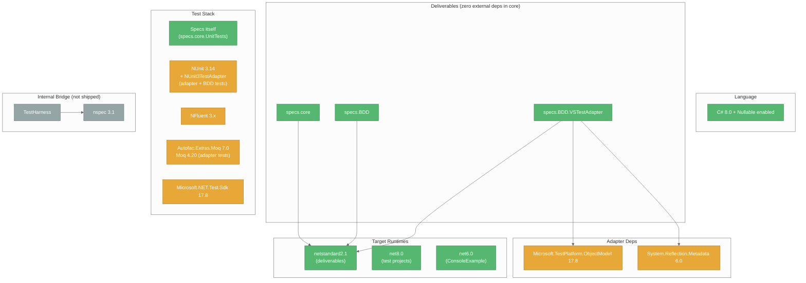
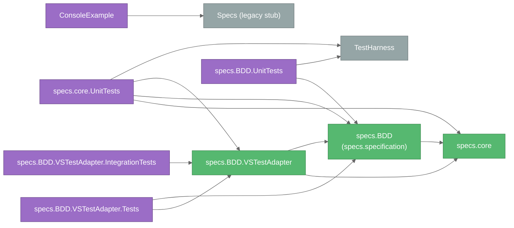

# Technical Context: Specs

## Tech Stack Overview



## Target Frameworks

| Project type | TFM | Notes |
|--------------|-----|-------|
| Deliverables (core, BDD, VSTestAdapter) | `netstandard2.1` | Broad compatibility — runs on .NET Core 3.0+, .NET 5+, .NET Framework support via netstandard2.1 polyfills |
| All test projects | `net8.0` | NUnit + NFluent + Microsoft.NET.Test.Sdk |
| ConsoleExample | `net6.0` | Demonstrates legacy `Spec` API with FluentAssertions |
| TestHarness (internal) | `netstandard2.1` | Bridges to nspec for internal scaffolding |

## Language

- **C# 8.0** (`<LangVersion>8.0</LangVersion>` on adapter; default on others)
- `<Nullable>enable</Nullable>` everywhere — all public APIs use nullable reference type annotations
- Async/await throughout
- No records / no `init` accessors (netstandard2.1 + C# 8 constraint)

## Project Dependency Graph



## Package References by Project

### Deliverables

| Project | Package references | Project references |
|---------|-------------------|--------------------|
| `specs.core` | **None** | — |
| `specs.specification` (specs.BDD) | **None** | `specs.core` |
| `specs.BDD.VSTestAdapter` | `Microsoft.TestPlatform.ObjectModel 17.8.0`, `System.Reflection.Metadata 6.0.0` | `specs.core`, `specs.specification` |

`InternalsVisibleTo("specs.BDD.VSTestAdapter")` is declared on both `specs.core` and `specs.specification` so the adapter can access `Specifications.CoreBuilder` and other internals without breaking the public surface.

### Test projects

| Project | Test framework | Assertions | Mocking | SDK |
|---------|---------------|------------|---------|-----|
| `specs.core.UnitTests` | 📌 **Specs itself** (`Specifications` + `[Context]`, run by `specs.BDD.VSTestAdapter`) | NFluent 3.1 | Autofac.Extras.Moq 7.0 | Microsoft.NET.Test.Sdk 17.8 |
| `specs.BDD.UnitTests` | NUnit 3.14 / NUnit3TestAdapter 5.0 | NFluent 3.1 | — | Microsoft.NET.Test.Sdk 17.8 |
| `specs.BDD.VSTestAdapter.Tests` | NUnit 3.14 / NUnit3TestAdapter 4.5 | NFluent 3.0 | 📌 Moq 4.20.72 (`Mock<IFrameworkHandle>` in `TestInvoker_Tests`; `Mock<IRunContext>` / `Mock<ITestCaseFilterExpression>` in `SpecsTestExecutor_Tests`) | Microsoft.NET.Test.Sdk 17.8 |
| `specs.BDD.VSTestAdapter.IntegrationTests` | — (uses the Specs VSTest adapter itself) | NFluent 3.1 📌 | — | Microsoft.NET.Test.Sdk 17.8 |

> 📌 **`specs.core.UnitTests` is now self-hosted.** `NUnit3TestAdapter` and `NUnit.Analyzers` were removed from the project; every test class derives from `Specifications` and declares `[Context]` methods, and the project takes a `ProjectReference` on `specs.BDD.VSTestAdapter` so VSTest can discover and run them. `NUnit.Framework` remains a global `Using` (reaching the project transitively through `TestHarness`) only for residual helper types.
>
> **📌 See**: `activeContext.md` section "Self-hosting migration".

## 📌 Adapter Configuration (`.runsettings`)

The adapter reads optional settings from the VSTest run settings, under a `SpecsBDD` element directly beneath `RunSettings`:

```xml
<RunSettings>
  <SpecsBDD>
    <SpecReporting>GroupedByRootContext</SpecReporting>
    <ShowSourceLocations>true</ShowSourceLocations>
    <ColorOutput>false</ColorOutput>
  </SpecsBDD>
</RunSettings>
```

| Key | Type | Default | Effect |
|-----|------|---------|--------|
| `SpecsBDD/SpecReporting` 📌 UPDATED | `SpecReporting` name (`Individual` / `GroupedByRootContext`, case-insensitive) | unset (→ `Individual`) | Lowest-priority reporting layer; overridden by assembly `[SpecReporting]`, class `[SpecReporting]`, or `[Context(Reporting = ...)]`. Replaces the former `GroupByRootContext` bool |
| `SpecsBDD/ShowSourceLocations` 📌 NEW | `bool` | `false` | Grouped reports add `at <file>:line <n>` under each `It` |
| `SpecsBDD/ColorOutput` 📌 NEW | `bool` | `true` | `false` forces plain `✓` / `✗` markers in grouped reports |

| Environment variable | Effect |
|----------------------|--------|
| `VSAPPIDNAME` 📌 NEW | When `devenv.exe` (Visual Studio host) and color is enabled, grouped reports use emoji markers (`✅` / `❌`) instead of ANSI escapes |

`GroupingSettings` parses the XML defensively — missing or malformed XML falls back to the defaults above. For `SpecReporting`, numeric strings and undefined names yield `null` and fall through to the default. `SpecReporting` is honoured both during discovery (`IDiscoveryContext.RunSettings`) and when `RunTests(sources, …)` re-discovers (`IRunContext` is forwarded); `ShowSourceLocations` / `ColorOutput` are read at execution time.

> **📌 See**: `systemPatterns.md` section "Grouped Root-Context Execution" for the full precedence chain.

### Internal bridge

| Project | Dependencies |
|---------|--------------|
| `TestHarness` | `nspec 3.1.0`, `NUnit 3.14.0`, `System.Text.Encodings.Web 9.0.11` |

### Example

| Project | Dependencies |
|---------|--------------|
| `ConsoleExample` | `FluentAssertions 6.12`, project ref to legacy `Specs.csproj` |

## Solution Layout

```
Specs/
├── src/
│   ├── Specs.sln
│   ├── Specs.csproj                        # legacy stub
│   ├── Spec.cs                             # legacy property-based API
│   ├── Global.cs
│   ├── Domain/                             # legacy runtime layer
│   │   ├── AbstractSpecDefinition.cs
│   │   ├── ActionRunner.cs
│   │   ├── ActionSpecDefinition.cs
│   │   ├── IndexedRunnerDelegate.cs
│   │   ├── IRunContext.cs
│   │   ├── IRunContainer.cs
│   │   ├── ISpecDefinition.cs
│   │   ├── Runner.cs
│   │   ├── TaskRunner.cs
│   │   ├── TaskSpecDefinition.cs
│   │   └── Exceptions/
│   │
│   ├── specs.core/                         # DELIVERABLE
│   │   └── Framework/
│   │       ├── Adapters/                   # ITestContextAdapter, ILoggingAdapter, ITestProviderAdapter, TestInstance
│   │       ├── ExceptionExtensions/
│   │       ├── Processors/
│   │       │   ├── TestCases/              # IContextualTestCase, builders, RunAll*
│   │       │   └── TestExecutors/          # TestCaseExecutor, TestCaseExecutorSettings
│   │       └── Settings/
│   │
│   ├── specs.specification/                # DELIVERABLE (asm: specs.BDD)
│   │   ├── Specifications.cs
│   │   ├── ContextBuilder.cs
│   │   ├── AssertBuilder.cs
│   │   ├── AssertBuilderAsync.cs
│   │   ├── IAssertProvider.cs
│   │   └── Attributes/ContextAttribute.cs, SpecReporting.cs, SpecReportingAttribute.cs
│   │
│   ├── specs.BDD.VSTestAdapter/            # DELIVERABLE
│   │   ├── Discovery/                      # SpecsTestDiscoverer, scanners, SuiteTreeBuilder,
│   │   │                                   #   GroupingSettings, TestStructureExtractor, PendingSpecs, SourceLocationReader
│   │   ├── Conversion/                     # SpecTest, TestCaseConverter, TestProperties
│   │   ├── Execution/                      # SpecsTestExecutor, TestInvoker, SelectionTreeWalker,
│   │   │                                   #   GroupedContextRunner, MarkerStyle, TestFinder, ResultReporter,
│   │   │                                   #   VSTestLoggingAdapter, VSTestTestProvider
│   │   └── Properties/AssemblyInfo.cs
│   │
│   ├── specs.core.UnitTests/               # Specs-hosted (Specifications + [Context])
│   ├── specs.specification.UnitTests/      # NUnit (asm: specs.BDD.UnitTests)
│   ├── specs.BDD.VSTestAdapter.Tests/      # NUnit
│   ├── specs.BDD.VSTestAdapter.IntegrationTests/  # VSTest via Specs adapter
│   └── TestHarness/                        # internal-only nspec bridge
│
├── Examples/ConsoleExample/                # net6.0 sample (legacy Spec API)
├── memory-bank/                            # documentation (this folder)
├── scripts/
├── .vscode/settings.json                   # dotnet.defaultSolution = src/Specs.sln
└── README.md
```

## Development Environment

### Prerequisites

- **.NET SDK 8.0+** (required for the test projects; SDK can build netstandard2.1 deliverables)
- **Visual Studio 2022 17.8+**, **VS Code with C#/C# Dev Kit**, or **Rider 2023+**
- **Git**

### Common commands

```powershell
# Restore + build everything
dotnet restore src\Specs.sln
dotnet build   src\Specs.sln -c Release

# Run all tests
dotnet test src\Specs.sln

# Run a single test project
dotnet test src\specs.core.UnitTests\specs.core.UnitTests.csproj
dotnet test src\specs.BDD.VSTestAdapter.Tests\specs.BDD.VSTestAdapter.Tests.csproj

# Run integration tests (exercises the Specs VSTest adapter end-to-end)
dotnet test src\specs.BDD.VSTestAdapter.IntegrationTests\specs.BDD.VSTestAdapter.IntegrationTests.csproj

# 📌 Run a subset of Specs tests (FullyQualifiedName, DisplayName, ContextMethod, ContextPath, TestDescription, IsPending)
dotnet test src\specs.BDD.VSTestAdapter.IntegrationTests\specs.BDD.VSTestAdapter.IntegrationTests.csproj --filter "FullyQualifiedName~Calculator"

# 📌 List only pending specs (or exclude them with IsPending=false)
dotnet test src\specs.BDD.VSTestAdapter.IntegrationTests\specs.BDD.VSTestAdapter.IntegrationTests.csproj --filter IsPending=true

# Pack deliverables
dotnet pack src\specs.core\specs.core.csproj -c Release
dotnet pack src\specs.specification\specs.BDD.csproj -c Release
dotnet pack src\specs.BDD.VSTestAdapter\specs.BDD.VSTestAdapter.csproj -c Release
```

### VS Code tasks

`build`, `build-tests`, `publish`, `watch`, `clean`, `test`, `test-with-coverage`, `restore` are pre-defined in `.vscode/tasks.json`. `test` is the default test task; `build` is the default build task.

## Technical Constraints

| Constraint | Reason |
|------------|--------|
| Deliverables must remain `netstandard2.1` | Broad consumer compatibility |
| `specs.core` must have **zero** external NuGet references | Keeps the core framework-agnostic and trivial to embed |
| Nullable reference types must be enabled | Better null safety for public API |
| `IContextualTestCase` must be immutable after `Build()` | Thread-safety, cacheability, predictability |
| All async hooks ultimately reduce to a synchronous `Action` | Uniform public surface; lifecycle ordering would otherwise be non-deterministic |
| Discovery must not execute user `BeforeAll`/`Act`/etc. | Safety; discovery may happen in IDE without setting up resources |
| Test FullyQualifiedName must be stable across runs | VSTest expects stable IDs for re-runs / filtering |
| 📌 `RunTests(sources)` must apply the VSTest filter itself | VSTest passes `--filter` to source-based runs only via `IRunContext.GetTestCaseFilter`; ignoring it runs the whole assembly |
| 📌 Discovery and execution must build the suite tree through `SuiteTreeBuilder` | Any divergence in node descriptions or ordering makes `TestFinder` / `SelectionTreeWalker` unable to match discovered `ContextPath` values |
| 📌 `TestStructureExtractor.PathSeparator` (`" → "`) must not appear in user context descriptions | It is the delimiter for `ContextPath` parsing on the execution side |
| 📌 Pending specs must never invoke any lifecycle action | A parked `xContext` may contain deliberately broken setup; execution derives pending state from the rebuilt tree, not the serialized `IsPending` flag |
| 📌 Pending state is keyed by spec description within a node | `ContextualTestCase.PendingTests` is an ordinal `HashSet<string>`; sibling specs must keep unique descriptions (already required by `TestFinder`) |

## Testing Strategy

- 📌 **Specs tests `specs.core` with Specs.** `specs.core.UnitTests` was migrated off NUnit fixtures onto `Specifications` + `[Context]` and is discovered/run by `specs.BDD.VSTestAdapter` — the framework is self-hosting for the core.
- **NUnit still covers the outer rings.** `specs.BDD.UnitTests` and `specs.BDD.VSTestAdapter.Tests` remain NUnit fixtures; the adapter cannot credibly test itself.
- **`specs.BDD.VSTestAdapter.IntegrationTests`** exercises the real VSTest pipeline end to end (`CalculatorSpecs` — class-level `[SpecReporting(GroupedByRootContext)]` with constructor-level `BeforeAll` — plus `StringSpecs`, `AsyncAndExceptionSpecs`, and 📌 `PendingSpecs`, whose pending bodies and pending-context `BeforeAll` throw to prove they never run).
- **TestHarness** provides an nspec-based scaffold from the era before the framework could test itself. It is *internal infrastructure only* and is now a retirement candidate.
- Test layout mirrors source layout (`Framework/Processors/TestCases/...` → `specs.core.UnitTests/Framework/Processors/TestCases/...`).
- Assertion style: NFluent (`Check.That(...).IsEqualTo(...)`) in the self-hosted core tests; NUnit constraint-based (`Assert.That(value, Is.EqualTo(...))`) in the NUnit projects.

## VSTest Adapter Deployment

The adapter behaves like any other VSTest extension:

1. A consuming test project adds a `PackageReference` (or `ProjectReference`) to `specs.BDD.VSTestAdapter`.
2. The adapter assembly is placed in the test project's output directory.
3. VSTest discovers the adapter via the `[FileExtension(".dll" / ".exe")]`, `[DefaultExecutorUri("executor://SpecsTestExecutor/v1")]`, and `[ExtensionUri("executor://SpecsTestExecutor/v1")]` attributes.
4. Test Explorer / `dotnet test` then call `DiscoverTests` and `RunTests` against it.

## Common Issues & Resolutions

| Issue | Cause | Fix |
|-------|-------|-----|
| `InvalidSpecificationException: Specifications subclass has no [Context] methods` at discovery | The suite class doesn't declare any `[Context]` method | Add at least one `[Context("...")]`-decorated `public void` method |
| Async hangs during a test | User code calls `.Result` / `.Wait()` on captured contexts without `ConfigureAwait(false)` | Use `ConfigureAwait(false)` in libraries under test, or use the `Func<Task>` overloads |
| "Go to source" navigates only to class | Source PDB missing or non-portable | Build with `<DebugType>portable</DebugType>` (default for SDK-style projects) |
| Test result missing from Test Explorer | The adapter assembly wasn't copied to the output directory | Ensure the test project references `specs.BDD.VSTestAdapter` directly or via a package |
| 📌 Test Explorer shows a flat list instead of a tree | The `TestCase.Hierarchy` (RFC-0033) property is missing or not exactly 4 elements | `TestCaseConverter.BuildHierarchy` must emit `[null, Namespace, Class, ContextPath]` |
| 📌 `"Test '...' no longer exists in the current build."` | Stale `TestCase` objects from a previous discovery no longer match the rebuilt suite tree | Re-run discovery (rebuild / refresh Test Explorer) |
| 📌 `BeforeAll` runs more than once for a partial selection | A code path bypassed `SelectionTreeWalker` and used the cascaded single-test lifecycle | Route suite runs through `TestInvoker.InvokeSuite` |
| 📌 Grouped output shows raw `ESC[32m` escape sequences | Host does not render ANSI escapes and was not detected as Visual Studio | Set `<SpecsBDD><ColorOutput>false</ColorOutput>` in `.runsettings` |
| 📌 `ItAsync[...]` "Go to Source" lands on the `[Context]` method | Async body sequence points live on the state machine `MoveNext`, and the wrapper hid the user lambda | Fixed: `AddTest(Func<Task>)` binds `RunSync` to the user delegate; `SourceLocationReader` follows `MoveNext` |
| 📌 `dotnet test --filter` runs every Specs test | Adapter versions before the filtering fix ignored `IRunContext.GetTestCaseFilter` in `RunTests(sources)` | Fixed: `SpecsTestExecutor` applies the filter; an invalid expression is logged as an error and runs nothing |
| 📌 Old `Grouped = true` / `[assembly: GroupSpecsByRootContext]` no longer compile | Replaced by the `SpecReporting` API | Use `Reporting = SpecReporting.GroupedByRootContext` / `[assembly: SpecReporting(SpecReporting.GroupedByRootContext)]` |
