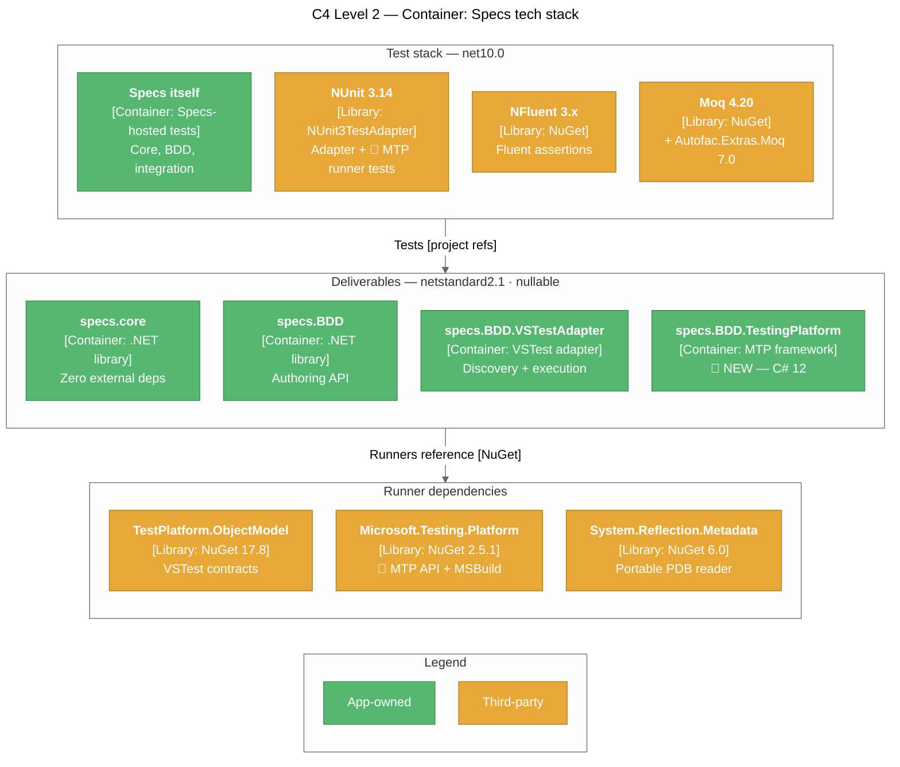
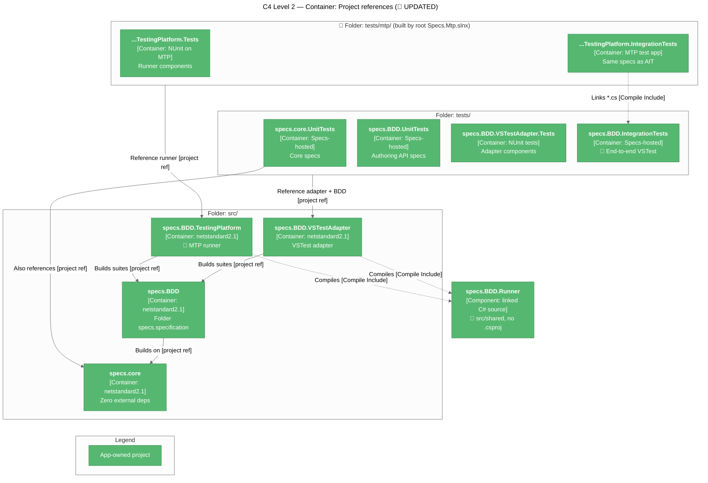

# Technical Context: Specs

## Tech Stack Overview



> 📌 UPDATED — the "Internal bridge" layer (`TestHarness` + `nspec 3.1`) was removed; see `systemPatterns.md` section "Test Hosting".
>
> 📌 NEW — every project also takes the build-time-only `MinVer 8.0.0` package (`PrivateAssets=all`) from the root `Directory.Build.props`; it computes the package version and adds no runtime dependency. See "Build Configuration" below.

## Target Frameworks

| Project type | TFM | Notes |
|--------------|-----|-------|
| Deliverables (core, BDD, VSTestAdapter, 📌 TestingPlatform) | `netstandard2.1` | Broad compatibility — runs on .NET Core 3.0+, .NET 5+, .NET Framework support via netstandard2.1 polyfills |
| All test projects | `net10.0` 📌 UPDATED (was `net8.0`) | NFluent + Microsoft.NET.Test.Sdk (NUnit in the adapter tests only); the redundant `System.Text.Encodings.Web` pin was dropped from `specs.core.UnitTests` and `specs.BDD.UnitTests`. 📌 The two MTP projects are `OutputType=Exe` test applications |

## Language

- 📌 UPDATED — **C# 10** on the deliverables: `<LangVersion>10</LangVersion>` in `specs.core`, `specs.BDD`, and `specs.BDD.VSTestAdapter` (the adapter was pinned to `8.0`; core and BDD used the netstandard2.1 default, C# 8). C# 10 is required because the root `Directory.Build.props` turns on `ImplicitUsings`, which generates `global using` directives. Test projects use the `net10.0` default.
- 📌 NEW — **C# 12** on `specs.BDD.TestingPlatform` (`<LangVersion>12</LangVersion>`): MTP's `TestNode` uses `required` members (C# 11). It also sets `NoWarn TPEXP` because `TreeNodeFilter` and `IClientInfo` are experimental MTP APIs (the MTP test project does the same)
- `<Nullable>enable</Nullable>` everywhere — all public APIs use nullable reference type annotations (📌 now also set centrally in `Directory.Build.props`)
- 📌 NEW — `<ImplicitUsings>enable</ImplicitUsings>` everywhere: `System`, `System.Collections.Generic`, `System.IO`, `System.Linq`, `System.Net.Http`, `System.Threading`, `System.Threading.Tasks` are global usings in every project
- 📌 NEW — `<GenerateDocumentationFile>true</GenerateDocumentationFile>` on the deliverables: XML docs ship in the packages, and a public member without a `///` comment raises CS1591 (the build is warning-free; test projects opt out)
- Async/await throughout
- No records / no `init` accessors — 📌 C# 10 allows the syntax, but `netstandard2.1` lacks `IsExternalInit`, so they would need a polyfill

## Project Dependency Graph



Every test project in `tests/` references `specs.BDD.VSTestAdapter` and — except `specs.BDD.IntegrationTests` — `specs.specification`; only `specs.core.UnitTests` references `specs.core` directly. 📌 The two `tests/mtp/` projects reference `specs.BDD.TestingPlatform` only (the tests project also has a build-order-only reference, `ReferenceOutputAssembly=false`, on the MTP integration app so it can launch it). No project references `TestHarness` (deleted).

## Package References by Project

### Deliverables

| Project | Package references | Project references |
|---------|-------------------|--------------------|
| `specs.core` | **None** at runtime (📌 `MinVer`, build-time only) | — |
| `specs.specification` (specs.BDD) | **None** at runtime (📌 `MinVer`, build-time only) | `specs.core` |
| `specs.BDD.VSTestAdapter` | `Microsoft.TestPlatform.ObjectModel 17.8.0`, `System.Reflection.Metadata 6.0.0` (📌 `MinVer`, build-time only) | `specs.core`, `specs.specification`; 📌 compiles `src/shared/specs.BDD.Runner/**/*.cs` |
| 📌 NEW — `specs.BDD.TestingPlatform` | `Microsoft.Testing.Platform 2.5.1` and `Microsoft.Testing.Platform.MSBuild 2.5.1` (both `PrivateAssets="none"` so consumers get the entry-point generation and IDE capability targets), `System.Reflection.Metadata 6.0.0` (`MinVer`, build-time only) | `specs.core`, `specs.specification`; compiles `src/shared/specs.BDD.Runner/**/*.cs`. Sets `IsTestingPlatformApplication=false` (MTP's targets otherwise treat it as a test app), `Description`, `PackageTags`, and packs `build/specs.BDD.TestingPlatform.props` into `build/` and `buildMultiTargeting/` |

📌 UPDATED — versions are no longer written in the `.csproj` files; they come from `Directory.Packages.props` (see "Build Configuration").

📌 UPDATED — `specs.specification` declares `InternalsVisibleTo` for **both runners** (`specs.BDD.VSTestAdapter`, 📌 `specs.BDD.TestingPlatform`) so they can read `Specifications.CoreBuilder`. `specs.BDD.TestingPlatform` grants its internals to `specs.BDD.TestingPlatform.Tests`. `specs.core` dropped its adapter grant: the adapter uses the public `TestCaseExecutor` / adapter-interface surface, and `specs.core` grants internals only to its test assemblies (`specs.core.UnitTests`, `specs.BDD.UnitTests`, `DynamicProxyGenAssembly2`) via `GlobalAttributes.cs`.

### Test projects

| Project | Test framework | Assertions | Mocking | SDK |
|---------|---------------|------------|---------|-----|
| `specs.core.UnitTests` | 📌 **Specs itself** (`Specifications` + `[Feature]`, run by `specs.BDD.VSTestAdapter`) | NFluent 3.1 | Autofac.Extras.Moq 7.0 | Microsoft.NET.Test.Sdk 17.8 |
| `specs.BDD.UnitTests` | 📌 UPDATED **Specs itself** (was NUnit3TestAdapter 5.0 + `TestHarness`/nspec) | NFluent 3.1 | — | Microsoft.NET.Test.Sdk 17.8 |
| `specs.BDD.VSTestAdapter.Tests` | NUnit 3.14 / NUnit3TestAdapter 4.5 | NFluent 3.1 📌 (was 3.0; unified by central package management) | 📌 Moq 4.20.72 (`Mock<IFrameworkHandle>` in `TestInvoker_Tests`; `Mock<IRunContext>` / `Mock<ITestCaseFilterExpression>` in `SpecsTestExecutor_Tests`) | Microsoft.NET.Test.Sdk 17.8 |
| `specs.BDD.IntegrationTests` 📌 RENAMED (was `specs.BDD.VSTestAdapter.IntegrationTests`; namespace now `specs.BDD.IntegrationTests`) | — (uses the Specs VSTest adapter itself) | NFluent 3.1 📌 | — | Microsoft.NET.Test.Sdk 17.8 |
| 📌 NEW — `specs.BDD.TestingPlatform.Tests` (`tests/mtp/`) | NUnit 3.14 on MTP (`EnableNUnitRunner`, `NUnit3TestAdapter` `VersionOverride="6.3.1"` — 6.x adds MTP 2 support) | NFluent 3.1 | Moq 4.20 | MTP (no Test SDK) |
| 📌 NEW — `specs.BDD.TestingPlatform.IntegrationTests` (`tests/mtp/`) | Specs MTP runner itself (MTP test app; compiles `..\..\specs.BDD.IntegrationTests\*.cs`) | NFluent 3.1 | — | MTP; imports `build/specs.BDD.TestingPlatform.props` directly (a project reference doesn't import package build props) |

> 📌 **`specs.core.UnitTests` and 📌 `specs.BDD.UnitTests` are self-hosted.** Neither references `NUnit`, `NUnit3TestAdapter`, `NUnit.Analyzers`, or `TestHarness`; every test class derives from `Specifications` and declares `[Feature]` methods, and each project takes a `ProjectReference` on `specs.BDD.VSTestAdapter` so VSTest can discover and run them. 📌 The leftover global `<Using Include="NUnit.Framework" />` was removed from both.
>
> **📌 See**: `systemPatterns.md` section "Test Hosting".

## 📌 NEW — Build Configuration

Shared MSBuild settings live in four files rather than in each `.csproj`. BEFORE/AFTER diagrams and rationale: `systemPatterns.md` section "Build Configuration & Release Pipeline" (decisions #34–35).

| File | Applies to | Settings |
|------|-----------|----------|
| `global.json` | SDK selection (local + CI) | SDK `10.0.400`, `rollForward: latestFeature`, `allowPrerelease: false` |
| 📌 `tests/mtp/global.json` | Everything run from `tests/mtp/` | Same SDK pin plus `"test": { "runner": "Microsoft.Testing.Platform" }`, which puts `dotnet test` in MTP mode |
| `Directory.Build.props` | Every project (auto-imported) | `Nullable`, `ImplicitUsings`; package metadata (`Authors` = Joe Cleland, `PackageLicenseExpression` = MIT, `RepositoryUrl` / `PackageProjectUrl` = github.com/yozepi/Specs); `MinVerTagPrefix` = `v`; `IncludeSymbols` + `SymbolPackageFormat` = `snupkg`; `GenerateDocumentationFile`; `ContinuousIntegrationBuild` when `GITHUB_ACTIONS == true`; `PackageReference` to `MinVer` (`PrivateAssets=all`) |
| `tests/Directory.Build.props` | The four test projects 📌 and the two `tests/mtp/` projects | Imports the root file (`GetPathOfFileAbove`), then `IsPackable=false` and `GenerateDocumentationFile=false` |
| `Directory.Packages.props` | Every project | `ManagePackageVersionsCentrally=true`; one `PackageVersion` per package (table below) |

Centrally managed versions:

| Package | Version | Used by |
|---------|---------|---------|
| `Microsoft.TestPlatform.ObjectModel` | 17.8.0 | Adapter |
| 📌 `Microsoft.Testing.Platform` / `.MSBuild` | 2.5.1 / 2.5.1 | MTP runner (flowed to consumers) |
| `System.Reflection.Metadata` | 6.0.0 | Adapter, 📌 MTP runner |
| `MinVer` | 8.0.0 | All projects (build-time) |
| `Microsoft.NET.Test.Sdk` | 17.8.0 | Test projects |
| `NFluent` | 3.1.0 | Test projects |
| `NUnit` / `NUnit3TestAdapter` | 3.14.0 / 4.5.0 | Adapter tests; 📌 MTP runner tests override the adapter to 6.3.1 |
| `Moq` | 4.20.72 | Adapter tests |
| `Autofac.Extras.Moq` | 7.0.0 | Core tests |
| `coverlet.collector` | 6.0.4 | Core + BDD tests |

Some `.csproj` files still repeat `Nullable` / `ImplicitUsings` / `IsPackable`. These copies are redundant but harmless. Per-package `PackageId` / `Description` / `PackageTags` belong in each deliverable's `.csproj` (📌 only `specs.BDD.TestingPlatform` sets `Description` / `PackageTags` so far, so package IDs default to the assembly names `specs.core`, `specs.BDD`, `specs.BDD.VSTestAdapter`, `specs.BDD.TestingPlatform`).

## 📌 NEW — Packaging & Release


| Workflow | Trigger | Steps |
|----------|---------|-------|
| `.github/workflows/ci.yml` | Push to `main`, any pull request | `checkout` (`fetch-depth: 0`) → `setup-dotnet` (`global-json-file`) → `restore` → `build -c Release` → `test` → 📌 `dotnet test --solution Specs.Mtp.slnx -c Release` in `tests/mtp` → `pack -o artifacts` → upload `packages` artifact |
| `.github/workflows/release.yml` | Push of a `v*` tag | Same build/test (📌 including the MTP step)/pack, then `NuGet/login@v1` (OIDC → 1-hour API key) → `dotnet nuget push artifacts/*.nupkg --skip-duplicate` (`.snupkg` go up alongside) → `gh release create <tag> --generate-notes` (`--prerelease` when the tag contains `-`) |

Versioning (MinVer, tag prefix `v`):

| Git state | Package version |
|-----------|-----------------|
| Commit tagged `v1.2.0` | `1.2.0` |
| Commit tagged `v1.3.0-beta.1` | `1.3.0-beta.1` (GitHub Release marked prerelease) |
| N commits after `v1.2.0` | `1.2.1-alpha.0.N` |
| No `v*` tag reachable (📌 current state) | `0.0.0-alpha.0.N` (e.g. a local pack produced `0.0.0-alpha.0.33`) |

One-time repo setup required before the first release:

- Repository secret `NUGET_USER` = the nuget.org **profile name** (not email).
- A nuget.org Trusted Publishing policy for this repository and `release.yml`. No API key is stored.
- Optional `nuget` GitHub environment with required reviewers as a manual approval gate (the job already targets `environment: nuget`).
- Workflow permissions: `contents: write` (GitHub Release) and `id-token: write` (OIDC), both declared in `release.yml`.

## 📌 Adapter Configuration (`.runsettings`)

The adapter reads optional settings from the VSTest run settings, under a `SpecsBDD` element directly beneath `RunSettings`:

```xml
<RunSettings>
  <SpecsBDD>
    <ReportingLevel>Feature</ReportingLevel>
    <ShowSourceLocations>true</ShowSourceLocations>
    <ColorOutput>false</ColorOutput>
  </SpecsBDD>
</RunSettings>
```

| Key | Type | Default | Effect |
|-----|------|---------|--------|
| `SpecsBDD/ReportingLevel` 📌 UPDATED | `ReportingLevel` name (`Test` / `Feature`, case-insensitive) | unset (→ `Test`) | Lowest-priority reporting-level layer; overridden by assembly `[ReportingLevel]`, class `[ReportingLevel]`, or `[Feature(Level = ...)]`. Renamed from `TestStructure` (earlier `SpecReporting`); the old key is no longer read |
| `SpecsBDD/ShowSourceLocations` 📌 NEW | `bool` | `false` | Grouped reports add `at <file>:line <n>` under each `It` |
| `SpecsBDD/ColorOutput` 📌 NEW | `bool` | `true` | `false` forces plain `✓` / `✗` markers in grouped reports |

| Environment variable | Effect |
|----------------------|--------|
| `VSAPPIDNAME` 📌 NEW | When `devenv.exe` (Visual Studio host) and color is enabled, grouped reports use emoji markers (`✅` / `❌`) instead of ANSI escapes |

`GroupingSettings` parses the XML defensively — missing or malformed XML falls back to the defaults above. For `ReportingLevel`, numeric strings and undefined names yield `null` and fall through to the default. `ReportingLevel` is honoured both during discovery (`IDiscoveryContext.RunSettings`) and when `RunTests(sources, …)` re-discovers (`IRunContext` is forwarded); `ShowSourceLocations` / `ColorOutput` are read at execution time.

> **📌 See**: `systemPatterns.md` section "Grouped Root-Context Execution" for the full precedence chain.

## 📌 NEW — MTP Runner Configuration

`specs.BDD.TestingPlatform` reads the same three settings from Microsoft.Testing.Platform configuration instead of `.runsettings`:

```json
// [appname].testconfig.json
{
  "SpecsBDD": {
    "ReportingLevel": "Feature",
    "ShowSourceLocations": true,
    "ColorOutput": false
  }
}
```

| Key | Environment variable | Default | Notes |
|-----|----------------------|---------|-------|
| `SpecsBDD:ReportingLevel` | `SpecsBDD__ReportingLevel` | unset (→ `Test`) | Parsed by the shared `GroupingSettings.ParseReportingLevel` (names only, case-insensitive); takes the `.runsettings` slot in the precedence chain |
| `SpecsBDD:ShowSourceLocations` | `SpecsBDD__ShowSourceLocations` | `false` | Per-`It` locations in grouped reports |
| `SpecsBDD:ColorOutput` | `SpecsBDD__ColorOutput` | `true` | `false` → plain markers in grouped reports and the console tree |

`VSAPPIDNAME=devenv.exe` selects emoji markers, as in the VSTest adapter.

Consumer setup: reference the `specs.BDD.TestingPlatform` package (instead of the VSTest adapter). Its `build/specs.BDD.TestingPlatform.props` sets `IsTestProject=true`, `IsTestingPlatformApplication=true`, `OutputType=Exe` (unless already set), and registers the `TestingPlatformBuilderHook` item (`specs.BDD.TestingPlatform.TestingPlatformBuilderHook`), so the MTP MSBuild package generates an entry point that calls `AddSpecsBDD()`. A hand-written entry point can call `builder.AddSpecsBDD()` directly.

Command-line usage (from a test app or an MTP-mode `dotnet test`):

```powershell
dotnet test --list-tests                                           # flat paths + indented tree
dotnet test --treenode-filter "/*/*/CartSpecs/Cart/**"             # a [Feature] and everything under it
dotnet test --treenode-filter "/*/*/*/*/when empty/*"              # specs directly in every 'when empty' context
dotnet test --treenode-filter "/*/*/CalculatorSpecs/Subtraction \(grouped\)"   # escape filter operators
```

## Solution Layout

📌 UPDATED — `Specs.sln` moved to the repo root; test projects moved from `src/` to `tests/`; `specs.specification.UnitTests/` folder renamed `specs.BDD.UnitTests/` (matching its assembly); `TestHarness/` deleted.

```
Specs/
├── Specs.sln                               # 📌 moved from src/
├── global.json                             # 📌 NEW — SDK 10.0.400 pin
├── Directory.Build.props                   # 📌 NEW — shared props, package metadata, MinVer
├── Directory.Packages.props                # 📌 NEW — central package versions
├── .github/workflows/                      # 📌 NEW — ci.yml, release.yml
├── artifacts/                              # 📌 pack output (gitignored)
├── src/                                    # deliverables only
│   ├── shared/specs.BDD.Runner/            # 📌 NEW — linked source compiled into both runners (no .csproj):
│   │                                       #   SuiteRunner, SelectionTreeWalker, GroupedSubtreeRunner,
│   │                                       #   ISpecRunListener, Selection*Adapter/Provider, SpecRunItem/Options,
│   │                                       #   GroupedReport, ReportMarkers, SpecExceptions + scanners,
│   │                                       #   SuiteTreeBuilder, GroupingSettings, PendingSpecs,
│   │                                       #   SourceLocationReader, TestFinder, ContextPathFormat, MarkerStyle
│   ├── specs.core/                         # DELIVERABLE
│   │   └── Framework/
│   │       ├── Adapters/                   # ITestContextAdapter, ILoggingAdapter, ITestProviderAdapter, TestInstance
│   │       ├── Assertions/                 # 📌 ActExceptionAssertions, ExpectedExceptionNotThrownException
│   │       ├── ExceptionExtensions/
│   │       ├── Processors/
│   │       │   ├── TestCases/              # IContextualTestCase, builders, RunAll*
│   │       │   └── TestExecutors/          # TestCaseExecutor, TestCaseExecutorSettings, 📌 ActExceptionContext
│   │
│   ├── specs.specification/                # DELIVERABLE (asm: specs.BDD)
│   │   ├── Specifications.cs
│   │   ├── ContextBuilder.cs
│   │   ├── AssertBuilder.cs
│   │   ├── AssertBuilderAsync.cs
│   │   ├── IAssertProvider.cs
│   │   └── Attributes/FeatureAttribute.cs, ReportingLevel.cs, ReportingLevelAttribute.cs
│   │
│   └── specs.BDD.VSTestAdapter/            # DELIVERABLE
│   │   ├── Discovery/                      # SpecsTestDiscoverer, SuiteTreeFlattener
│   │   ├── Conversion/                     # SpecTest, TestCaseConverter, TestProperties
│   │   ├── Execution/                      # SpecsTestExecutor, TestInvoker, GroupedContextRunner,
│   │   │                                   #   ResultReporter, 📌 VSTestRunListener
│   │   └── Properties/AssemblyInfo.cs
│   │
│   └── specs.BDD.TestingPlatform/          # 📌 NEW DELIVERABLE (MTP runner)
│       ├── SpecsTestFramework.cs, SpecsSettings.cs, TestApplicationBuilderExtensions.cs
│       ├── Discovery/                      # SpecTreeBuilder, SpecNode, SpecPath
│       ├── Execution/                      # SpecSelection, TestNodeFactory, MtpRunListener
│       ├── Output/                         # ConsoleTreeReport
│       └── build/specs.BDD.TestingPlatform.props   # packed to build/ + buildMultiTargeting/
│
├── tests/                                  # 📌 NEW — all test projects
│   ├── Directory.Build.props               # 📌 NEW — imports root, IsPackable=false
│   ├── specs.core.UnitTests/               # Specs-hosted (Specifications + [Feature])
│   ├── specs.BDD.UnitTests/                # 📌 Specs-hosted (was src/specs.specification.UnitTests, NUnit + nspec)
│   ├── specs.BDD.VSTestAdapter.Tests/      # NUnit
│   ├── specs.BDD.IntegrationTests/         # 📌 RENAMED (was specs.BDD.VSTestAdapter.IntegrationTests) — VSTest via Specs adapter
│   └── mtp/                                # 📌 NEW — MTP-mode folder
│       ├── global.json                     # test.runner = Microsoft.Testing.Platform
│       ├── (Specs.Mtp.slnx moved to the repo root 📌 UPDATED)
│       ├── specs.BDD.TestingPlatform.Tests/          # NUnit on MTP (+ end-to-end app tests)
│       └── specs.BDD.TestingPlatform.IntegrationTests/  # MTP app over specs.BDD.IntegrationTests/*.cs
│
├── memory-bank/                            # documentation (this folder)
├── scripts/
├── .vscode/settings.json                   # 📌 dotnet.defaultSolution = Specs.sln
└── README.md
```

## Development Environment

### Prerequisites

- **.NET SDK 10.0.400+** 📌 UPDATED — pinned by `global.json` (`rollForward: latestFeature`, no previews); required for the net10.0 test projects and can build the netstandard2.1 deliverables
- 📌 A **full git clone** (not shallow) when packing — MinVer derives the version from tags and commit height
- **Visual Studio 2022 17.8+**, **VS Code with C#/C# Dev Kit**, or **Rider 2023+**
- **Git**

### Common commands

```powershell
# Restore + build everything (📌 solution is at the repo root)
dotnet restore Specs.sln
dotnet build   Specs.sln -c Release

# Run all tests
dotnet test Specs.sln

# Run a single test project (📌 test projects live under tests\)
dotnet test tests\specs.core.UnitTests\specs.core.UnitTests.csproj
dotnet test tests\specs.BDD.UnitTests\specs.BDD.UnitTests.csproj
dotnet test tests\specs.BDD.VSTestAdapter.Tests\specs.BDD.VSTestAdapter.Tests.csproj

# Run integration tests (exercises the Specs VSTest adapter end-to-end; 📌 project renamed)
dotnet test tests\specs.BDD.IntegrationTests\specs.BDD.IntegrationTests.csproj

# 📌 Run a subset of Specs tests (FullyQualifiedName, DisplayName, ContextMethod, ContextPath, TestDescription, IsPending)
dotnet test tests\specs.BDD.IntegrationTests\specs.BDD.IntegrationTests.csproj --filter "FullyQualifiedName~Calculator"

# 📌 List only pending specs (or exclude them with IsPending=false)
dotnet test tests\specs.BDD.IntegrationTests\specs.BDD.IntegrationTests.csproj --filter IsPending=true

# 📌 NEW — MTP runner tests (tests/mtp/global.json switches dotnet test to MTP mode)
# 📌 UPDATED — Specs.Mtp.slnx now lives at the repo root, whose global.json stays in VSTest mode;
# ci.yml still runs `dotnet test --solution Specs.Mtp.slnx` from tests/mtp (stale path, see progress.md)
cd tests\mtp
dotnet test --project specs.BDD.TestingPlatform.Tests -c Release
cd ..\..

# 📌 UPDATED — Pack all deliverables (test projects are IsPackable=false) — same command CI uses
dotnet pack -c Release -o artifacts

# 📌 NEW — Cut a release (triggers .github/workflows/release.yml)
git tag v1.0.0
git push origin v1.0.0
```

### VS Code tasks

`build`, `build-tests`, `publish`, `clean`, `test`, `test-with-coverage`, `restore` are pre-defined in `.vscode/tasks.json` and point at the root `Specs.sln` / `tests\specs.core.UnitTests`. `test` is the default test task; `build` is the default build task. 📌 The `watch` task and the `.NET Core Launch (TestHarness)` launch configuration were removed with `TestHarness`.

## Technical Constraints

| Constraint | Reason |
|------------|--------|
| Deliverables must remain `netstandard2.1` | Broad consumer compatibility |
| `specs.core` must have **zero** external NuGet references | Keeps the core framework-agnostic and trivial to embed. 📌 Build-time-only packages with `PrivateAssets=all` (currently `MinVer`) are allowed — they never appear in the `.nuspec` |
| 📌 Package versions live only in `Directory.Packages.props` | Central package management is on; a `Version=` on a `PackageReference` fails restore (NU1008) |
| 📌 Package versions come only from `v*` git tags | MinVer computes `Version`; never set `<Version>` / `<PackageVersion>` in a project |
| 📌 Deliverables need `LangVersion` ≥ 10 | `ImplicitUsings` emits `global using` directives |
| 📌 Every public member of a deliverable needs an XML doc comment | `GenerateDocumentationFile` is on; missing docs raise CS1591 and the build is kept warning-free |
| Nullable reference types must be enabled | Better null safety for public API |
| `IContextualTestCase` must be immutable after `Build()` | Thread-safety, cacheability, predictability |
| All async hooks ultimately reduce to a synchronous `Action` | Uniform public surface; lifecycle ordering would otherwise be non-deterministic |
| Discovery must not execute user `BeforeAll`/`Act`/etc. | Safety; discovery may happen in IDE without setting up resources |
| 📌 UPDATED — `TestCase.Id` must be deterministic and unique per spec; the FQN must name the `[Feature]` method (`Class.DescribeMethod`) | VSTest tracks results by `Id` (its default `Id` is derived from the FQN, which is now shared per `[Feature]`); IDEs resolve CodeLens / navigation from the FQN and RFC-0017 `ManagedType` / `ManagedMethod`. See `systemPatterns.md` decision #43 |
| 📌 `RunTests(sources)` must apply the VSTest filter itself | VSTest passes `--filter` to source-based runs only via `IRunContext.GetTestCaseFilter`; ignoring it runs the whole assembly |
| 📌 Discovery and execution must build the suite tree through `SuiteTreeBuilder` | Any divergence in node descriptions or ordering makes `TestFinder` / `SelectionTreeWalker` unable to match discovered `ContextPath` values |
| 📌 NEW — Runner-agnostic code goes in `src/shared/specs.BDD.Runner/` and must not reference VSTest or MTP types | It is compiled into both runners; a host type there breaks the other runner's build |
| 📌 NEW — Shared-runner types stay `internal` | Each runner compiles its own copy; making them public would expose duplicate `specs.BDD.Runner.*` types from two assemblies |
| 📌 NEW — MTP tests run only from `tests/mtp/` | Its `global.json` selects MTP mode; `dotnet test` on `Specs.sln` stays in VSTest mode and does not include the MTP projects |
| 📌 NEW — `src/specs.BDD.TestingPlatform/build/` is shipped source, not build output | The MTP integration app imports `specs.BDD.TestingPlatform.props` and the package ships it as its MSBuild hook. A `[Bb]uild/` ignore rule (as in the deleted `src/.gitignore`) would drop it from clones and CI |
| 📌 NEW — MTP tree paths escape only `%` and `/` | Names keep spaces and punctuation so filters match them as written; `--treenode-filter` operators in names must be `\`-escaped by the caller |
| 📌 `ContextPathFormat.Separator` (`" → "`) must not appear in user context descriptions | It is the delimiter for `ContextPath` parsing on the execution side |
| 📌 Pending specs must never invoke any lifecycle action | A parked `xContext` may contain deliberately broken setup; execution derives pending state from the rebuilt tree, not the serialized `IsPending` flag |
| 📌 Pending state is keyed by spec description within a node | `ContextualTestCase.PendingTests` is an ordinal `HashSet<string>`; sibling specs must keep unique descriptions (already required by `TestFinder`) |
| 📌 Every execution path must run `Act` + test via `ActExceptionContext.Run(act, test)` | `ShouldThrow<T>` reads the ambient `Act` exception; a path that calls `Act()` directly makes exception specs fail and lets an `Act` throw skip teardown |
| 📌 Types that custom front-ends / runners need from `specs.core` must be `public` | `specs.core` is an extensibility library — `ActExceptionContext`, `ActExceptionAssertions`, 📌 `TestCaseExecutor`, `ITestContextAdapter`, `ITestProviderAdapter`, `TestContextAdapter`, and `TestInstance` are public rather than `internal` + `InternalsVisibleTo`; the adapter must not regain an IVT grant on `specs.core` |

## Testing Strategy

- 📌 **Specs tests `specs.core` and `specs.BDD` with Specs.** `specs.core.UnitTests` and 📌 `specs.BDD.UnitTests` derive from `Specifications` + `[Feature]` and are discovered/run by `specs.BDD.VSTestAdapter`.
- **NUnit covers only the runners.** `specs.BDD.VSTestAdapter.Tests` and 📌 `specs.BDD.TestingPlatform.Tests` are NUnit fixtures; a runner cannot credibly test itself.
- **`specs.BDD.IntegrationTests`** (📌 renamed from `specs.BDD.VSTestAdapter.IntegrationTests`) exercises the real VSTest pipeline end to end (`CalculatorSpecs` — 📌 class-level `[ReportingLevel(Test)]` with a `Subtraction (grouped)` `[Feature(Level = Feature)]` override and constructor-level `BeforeAll` — plus `StringSpecs`, `AsyncAndExceptionSpecs`, and 📌 `PendingSpecs`, whose pending bodies and pending-context `BeforeAll` throw to prove they never run). 📌 `CalculatorSpecs` (divide by zero) and `AsyncAndExceptionSpecs` (async `Act`) assert exceptions with `ShouldThrow<T>` instead of manual `try/catch`.
- 📌 NEW — **MTP runner**: `specs.BDD.TestingPlatform.Tests` (📌 70 NUnit tests on MTP) covers `SpecTreeBuilder`, `SpecSelection`, `TestNodeFactory`, `MtpRunListener`, `ConsoleTreeReport`, `SpecsSettings` / `ClientMode`, and `IntegrationApp_Tests`, which launches the built `specs.BDD.TestingPlatform.IntegrationTests` app (`dotnet <app>.dll --no-ansi --progress off …`) and checks totals (34 / 29 succeeded / 5 skipped, matching VSTest), `--list-tests` output, and `--treenode-filter` subsets. Fixtures live in `TestFixtures/TreeSpecs.cs`. The integration app itself reports 34 results through MTP.
- 📌 **TestHarness retired** — the nspec bridge and its `nspec` / `NUnit` dependencies were deleted once `specs.BDD.UnitTests` self-hosted.
- Test layout mirrors source layout (`src/specs.core/Framework/Processors/TestCases/...` → `tests/specs.core.UnitTests/Framework/Processors/TestCases/...`); 📌 test files and classes are named `<TypeUnderTest>_Tests`.
- Assertion style: NFluent (`Check.That(...).IsEqualTo(...)`) in the self-hosted projects; NUnit constraint-based (`Assert.That(value, Is.EqualTo(...))`) in `specs.BDD.VSTestAdapter.Tests`.

## VSTest Adapter Deployment

The adapter behaves like any other VSTest extension:

1. A consuming test project adds a `PackageReference` (or `ProjectReference`) to `specs.BDD.VSTestAdapter`.
2. The adapter assembly is placed in the test project's output directory.
3. VSTest discovers the adapter via the `[FileExtension(".dll" / ".exe")]`, `[DefaultExecutorUri("executor://SpecsTestExecutor/v1")]`, and `[ExtensionUri("executor://SpecsTestExecutor/v1")]` attributes.
4. Test Explorer / `dotnet test` then call `DiscoverTests` and `RunTests` against it.

## Common Issues & Resolutions

| Issue | Cause | Fix |
|-------|-------|-----|
| `InvalidSpecificationException: Specifications subclass has no [Feature] methods` at discovery | The suite class doesn't declare any `[Feature]` method | Add at least one `[Feature("...")]`-decorated `public void` method |
| Async hangs during a test | User code calls `.Result` / `.Wait()` on captured contexts without `ConfigureAwait(false)` | Use `ConfigureAwait(false)` in libraries under test, or use the `Func<Task>` overloads |
| "Go to source" navigates only to class | Source PDB missing or non-portable | Build with `<DebugType>portable</DebugType>` (default for SDK-style projects) |
| Test result missing from Test Explorer | The adapter assembly wasn't copied to the output directory | Ensure the test project references `specs.BDD.VSTestAdapter` directly or via a package |
| 📌 Test Explorer shows a flat list instead of a tree | The `TestCase.Hierarchy` (RFC-0033) property is missing or not exactly 4 elements | `TestCaseConverter.BuildHierarchy` must emit `[null, Namespace, Class, <[Feature]>]` (📌 first `ContextPath` segment) |
| 📌 NEW — MTP project builds as a library / no entry point | A `ProjectReference` to `specs.BDD.TestingPlatform` does not import the package's `build/` props | Import `build\specs.BDD.TestingPlatform.props` directly (as the MTP integration app does), or consume the NuGet package |
| 📌 NEW — `dotnet test` ignores `--treenode-filter` / runs MTP projects as VSTest | Not in MTP mode | Run from a folder whose `global.json` has `"test": { "runner": "Microsoft.Testing.Platform" }` (e.g. `tests/mtp`) |
| 📌 NEW — `--treenode-filter` matches nothing for a name with `(`, `)`, `*`, `\|`, `&`, `[`, `]` | Those are filter operators | Escape them with `\` (e.g. `Subtraction \(grouped\)`) |
| 📌 NEW — IDE warns "The run request matched none of the N discovered specs" | The client sent UIDs that no longer exist (stale discovery) | Rebuild / refresh the test explorer |
| 📌 `"Test '...' no longer exists in the current build."` | Stale `TestCase` objects from a previous discovery no longer match the rebuilt suite tree | Re-run discovery (rebuild / refresh Test Explorer) |
| 📌 `BeforeAll` runs more than once for a partial selection | A code path bypassed `SelectionTreeWalker` and used the cascaded single-test lifecycle | Route suite runs through `TestInvoker.InvokeSuite` |
| 📌 Grouped output shows raw `ESC[32m` escape sequences | Host does not render ANSI escapes and was not detected as Visual Studio | Set `<SpecsBDD><ColorOutput>false</ColorOutput>` in `.runsettings` |
| 📌 `ItAsync[...]` "Go to Source" lands on the `[Feature]` method | Async body sequence points live on the state machine `MoveNext`, and the wrapper hid the user lambda | Fixed: `AddTest(Func<Task>)` binds `RunSync` to the user delegate; `SourceLocationReader` follows `MoveNext` |
| 📌 `dotnet test --filter` runs every Specs test | Adapter versions before the filtering fix ignored `IRunContext.GetTestCaseFilter` in `RunTests(sources)` | Fixed: `SpecsTestExecutor` applies the filter; an invalid expression is logged as an error and runs nothing |
| 📌 Old `Grouped = true` / `[assembly: GroupSpecsByRootContext]` no longer compile | Replaced by the `ReportingLevel` API | Use `Level = ReportingLevel.Feature` / `[assembly: ReportingLevel(ReportingLevel.Feature)]` |
| 📌 `SpecReporting` / `Reporting =` / `[SpecReporting]` no longer compile; `<SpecReporting>` in `.runsettings` is ignored | Renamed to `TestStructure` (decision #32) | `Individual` → `PerSpec`, `GroupedByRootContext` → `PerDescribe`; `Reporting =` → `Structure =`; use `<SpecsBDD><TestStructure>` |
| 📌 A spec fails with the `Act` exception instead of its own assertion message | `Act` threw and the `It` did not verify it; the unverified `Act` exception replaces any `It` failure | Assert it with `It[...] = ShouldThrow<T>(...)`, or fix the `Act` |
| 📌 `ShouldThrow<T>` fails with `ExpectedExceptionNotThrownException` | `Act` threw nothing, or a type not assignable to `T` (see `InnerException`) | Check the `Act` under that context and the expected type |
| 📌 `ItAsync[...] = ShouldThrow<T>()` does not compile | `ShouldThrow` returns `Action`; there is no async variant by design | Use `It[...]` — the `Act` exception (sync or async) is already captured |
| 📌 NU1008 on restore | A `PackageReference` specifies `Version=` while central package management is on | Drop the attribute; add or bump the `PackageVersion` in `Directory.Packages.props` |
| 📌 NU1010 on restore | A new `PackageReference` has no matching `PackageVersion` | Add a `PackageVersion` to `Directory.Packages.props` |
| 📌 Packages built as `0.0.0-alpha.0.N` | No `v*` tag is reachable, or the clone is shallow | Tag the release commit `vX.Y.Z`; in CI keep `fetch-depth: 0` on `actions/checkout` |
| 📌 `global using` / C# 10 feature errors in a deliverable | Its `LangVersion` was lowered below 10 while `ImplicitUsings` is on | Keep `<LangVersion>10</LangVersion>` (or higher) |
| 📌 CS1591 "Missing XML comment for publicly visible type or member" | New public API in a deliverable without `///` docs | Document it; test projects are exempt (`tests/Directory.Build.props`) |
| 📌 `release.yml` fails at "NuGet login" | `NUGET_USER` secret missing or no nuget.org Trusted Publishing policy for the repo/workflow | Add the secret (profile name) and create the policy on nuget.org |
