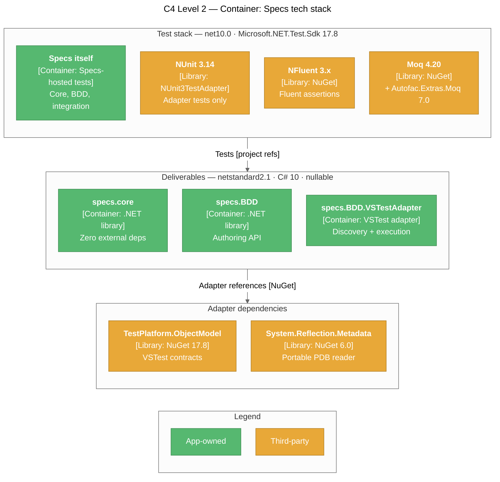
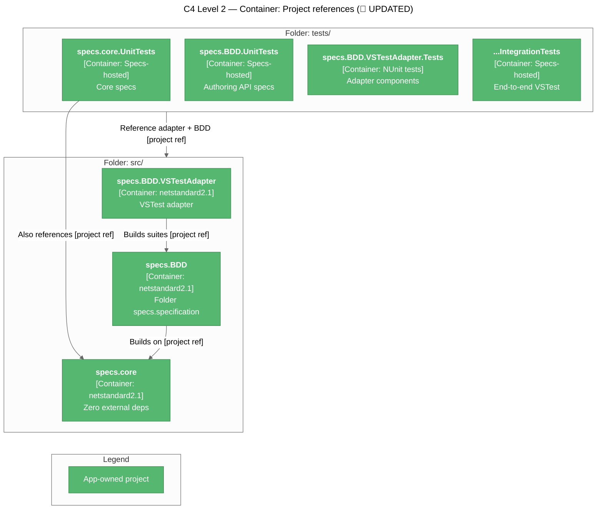
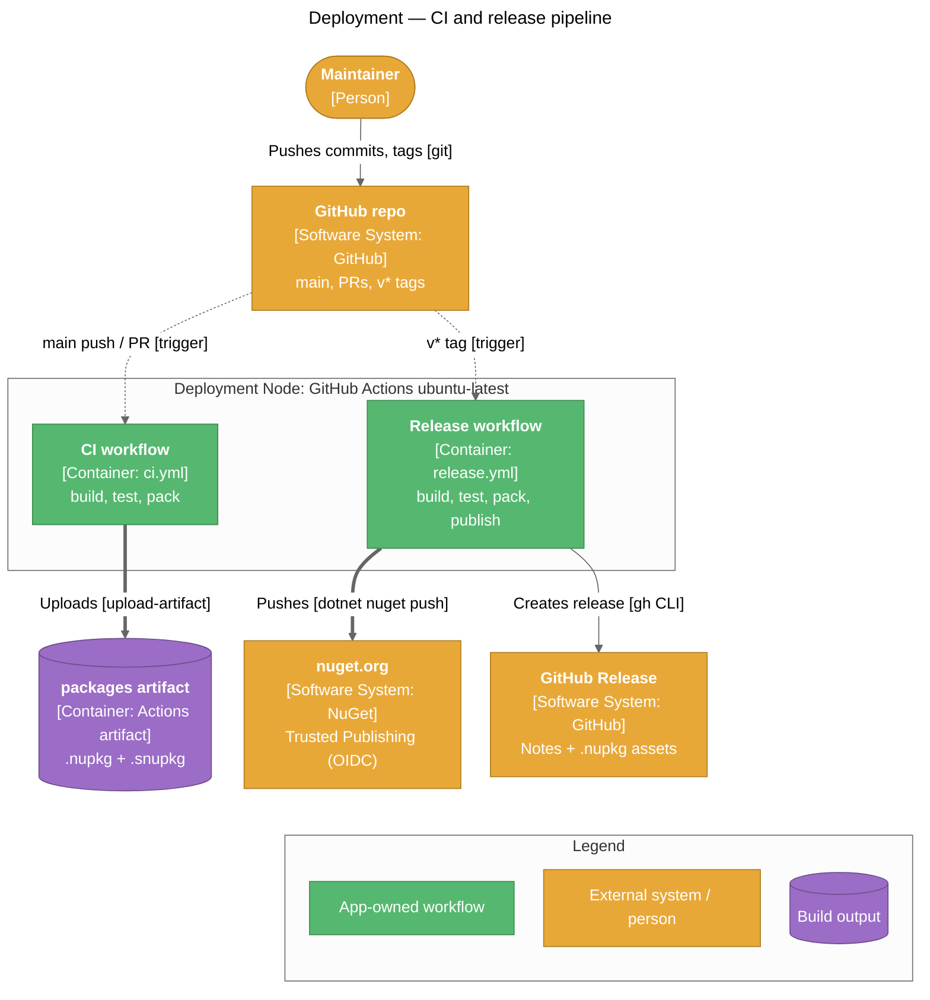

# Technical Context: Specs

## Tech Stack Overview



> 📌 UPDATED — the "Internal bridge" layer (`TestHarness` + `nspec 3.1`) was removed; see `systemPatterns.md` section "Test Hosting".
>
> 📌 NEW — every project also takes the build-time-only `MinVer 8.0.0` package (`PrivateAssets=all`) from the root `Directory.Build.props`; it computes the package version and adds no runtime dependency. See "Build Configuration" below.

## Target Frameworks

| Project type | TFM | Notes |
|--------------|-----|-------|
| Deliverables (core, BDD, VSTestAdapter) | `netstandard2.1` | Broad compatibility — runs on .NET Core 3.0+, .NET 5+, .NET Framework support via netstandard2.1 polyfills |
| All test projects | `net10.0` 📌 UPDATED (was `net8.0`) | NFluent + Microsoft.NET.Test.Sdk (NUnit in the adapter tests only); the redundant `System.Text.Encodings.Web` pin was dropped from `specs.core.UnitTests` and `specs.BDD.UnitTests` |

## Language

- 📌 UPDATED — **C# 10** on the deliverables: `<LangVersion>10</LangVersion>` in `specs.core`, `specs.BDD`, and `specs.BDD.VSTestAdapter` (the adapter was pinned to `8.0`; core and BDD used the netstandard2.1 default, C# 8). C# 10 is required because the root `Directory.Build.props` turns on `ImplicitUsings`, which generates `global using` directives. Test projects use the `net10.0` default.
- `<Nullable>enable</Nullable>` everywhere — all public APIs use nullable reference type annotations (📌 now also set centrally in `Directory.Build.props`)
- 📌 NEW — `<ImplicitUsings>enable</ImplicitUsings>` everywhere: `System`, `System.Collections.Generic`, `System.IO`, `System.Linq`, `System.Net.Http`, `System.Threading`, `System.Threading.Tasks` are global usings in every project
- 📌 NEW — `<GenerateDocumentationFile>true</GenerateDocumentationFile>` on the deliverables: XML docs ship in the packages, and a public member without a `///` comment raises CS1591 (the build is warning-free; test projects opt out)
- Async/await throughout
- No records / no `init` accessors — 📌 C# 10 allows the syntax, but `netstandard2.1` lacks `IsExternalInit`, so they would need a polyfill

## Project Dependency Graph



Every test project references `specs.BDD.VSTestAdapter` and — except `IntegrationTests` — `specs.specification`; only `specs.core.UnitTests` references `specs.core` directly. 📌 No project references `TestHarness` (deleted).

## Package References by Project

### Deliverables

| Project | Package references | Project references |
|---------|-------------------|--------------------|
| `specs.core` | **None** at runtime (📌 `MinVer`, build-time only) | — |
| `specs.specification` (specs.BDD) | **None** at runtime (📌 `MinVer`, build-time only) | `specs.core` |
| `specs.BDD.VSTestAdapter` | `Microsoft.TestPlatform.ObjectModel 17.8.0`, `System.Reflection.Metadata 6.0.0` (📌 `MinVer`, build-time only) | `specs.core`, `specs.specification` |

📌 UPDATED — versions are no longer written in the `.csproj` files; they come from `Directory.Packages.props` (see "Build Configuration").

📌 UPDATED — `InternalsVisibleTo("specs.BDD.VSTestAdapter")` is declared **only** on `specs.specification` (for `Specifications.CoreBuilder`). `specs.core` dropped it: the adapter uses the public `TestCaseExecutor` / adapter-interface surface, and `specs.core` grants internals only to its test assemblies (`specs.core.UnitTests`, `specs.BDD.UnitTests`, `DynamicProxyGenAssembly2`) via `GlobalAttributes.cs`.

### Test projects

| Project | Test framework | Assertions | Mocking | SDK |
|---------|---------------|------------|---------|-----|
| `specs.core.UnitTests` | 📌 **Specs itself** (`Specifications` + `[Describe]`, run by `specs.BDD.VSTestAdapter`) | NFluent 3.1 | Autofac.Extras.Moq 7.0 | Microsoft.NET.Test.Sdk 17.8 |
| `specs.BDD.UnitTests` | 📌 UPDATED **Specs itself** (was NUnit3TestAdapter 5.0 + `TestHarness`/nspec) | NFluent 3.1 | — | Microsoft.NET.Test.Sdk 17.8 |
| `specs.BDD.VSTestAdapter.Tests` | NUnit 3.14 / NUnit3TestAdapter 4.5 | NFluent 3.1 📌 (was 3.0; unified by central package management) | 📌 Moq 4.20.72 (`Mock<IFrameworkHandle>` in `TestInvoker_Tests`; `Mock<IRunContext>` / `Mock<ITestCaseFilterExpression>` in `SpecsTestExecutor_Tests`) | Microsoft.NET.Test.Sdk 17.8 |
| `specs.BDD.VSTestAdapter.IntegrationTests` | — (uses the Specs VSTest adapter itself) | NFluent 3.1 📌 | — | Microsoft.NET.Test.Sdk 17.8 |

> 📌 **`specs.core.UnitTests` and 📌 `specs.BDD.UnitTests` are self-hosted.** Neither references `NUnit`, `NUnit3TestAdapter`, `NUnit.Analyzers`, or `TestHarness`; every test class derives from `Specifications` and declares `[Describe]` methods, and each project takes a `ProjectReference` on `specs.BDD.VSTestAdapter` so VSTest can discover and run them. 📌 The leftover global `<Using Include="NUnit.Framework" />` was removed from both.
>
> **📌 See**: `systemPatterns.md` section "Test Hosting".

## 📌 NEW — Build Configuration

Shared MSBuild settings live in four files rather than in each `.csproj`. BEFORE/AFTER diagrams and rationale: `systemPatterns.md` section "Build Configuration & Release Pipeline" (decisions #34–35).

| File | Applies to | Settings |
|------|-----------|----------|
| `global.json` | SDK selection (local + CI) | SDK `10.0.400`, `rollForward: latestFeature`, `allowPrerelease: false` |
| `Directory.Build.props` | Every project (auto-imported) | `Nullable`, `ImplicitUsings`; package metadata (`Authors` = Joe Cleland, `PackageLicenseExpression` = MIT, `RepositoryUrl` / `PackageProjectUrl` = github.com/yozepi/Specs); `MinVerTagPrefix` = `v`; `IncludeSymbols` + `SymbolPackageFormat` = `snupkg`; `GenerateDocumentationFile`; `ContinuousIntegrationBuild` when `GITHUB_ACTIONS == true`; `PackageReference` to `MinVer` (`PrivateAssets=all`) |
| `tests/Directory.Build.props` | The four test projects | Imports the root file (`GetPathOfFileAbove`), then `IsPackable=false` and `GenerateDocumentationFile=false` |
| `Directory.Packages.props` | Every project | `ManagePackageVersionsCentrally=true`; one `PackageVersion` per package (table below) |

Centrally managed versions:

| Package | Version | Used by |
|---------|---------|---------|
| `Microsoft.TestPlatform.ObjectModel` | 17.8.0 | Adapter |
| `System.Reflection.Metadata` | 6.0.0 | Adapter |
| `MinVer` | 8.0.0 | All projects (build-time) |
| `Microsoft.NET.Test.Sdk` | 17.8.0 | Test projects |
| `NFluent` | 3.1.0 | Test projects |
| `NUnit` / `NUnit3TestAdapter` | 3.14.0 / 4.5.0 | Adapter tests |
| `Moq` | 4.20.72 | Adapter tests |
| `Autofac.Extras.Moq` | 7.0.0 | Core tests |
| `coverlet.collector` | 6.0.4 | Core + BDD tests |

Some `.csproj` files still repeat `Nullable` / `ImplicitUsings` / `IsPackable`. These copies are redundant but harmless. Per-package `PackageId` / `Description` / `PackageTags` belong in each deliverable's `.csproj` (none are set yet, so package IDs default to the assembly names `specs.core`, `specs.BDD`, `specs.BDD.VSTestAdapter`).

## 📌 NEW — Packaging & Release



| Workflow | Trigger | Steps |
|----------|---------|-------|
| `.github/workflows/ci.yml` | Push to `main`, any pull request | `checkout` (`fetch-depth: 0`) → `setup-dotnet` (`global-json-file`) → `restore` → `build -c Release` → `test` → `pack -o artifacts` → upload `packages` artifact |
| `.github/workflows/release.yml` | Push of a `v*` tag | Same build/test/pack, then `NuGet/login@v1` (OIDC → 1-hour API key) → `dotnet nuget push artifacts/*.nupkg --skip-duplicate` (`.snupkg` go up alongside) → `gh release create <tag> --generate-notes` (`--prerelease` when the tag contains `-`) |

Versioning (MinVer, tag prefix `v`):

| Git state | Package version |
|-----------|-----------------|
| Commit tagged `v1.2.0` | `1.2.0` |
| Commit tagged `v1.3.0-beta.1` | `1.3.0-beta.1` (GitHub Release marked prerelease) |
| N commits after `v1.2.0` | `1.2.1-alpha.0.N` |
| No `v*` tag reachable (📌 current state) | `0.0.0-alpha.0.N` (e.g. a local pack produced `0.0.0-alpha.0.33`) |

One-time repo setup required before the first release:

- Repository secret `NUGET_USER` = the nuget.org **profile name** (not email).
- A nuget.org Trusted Publishing policy for this repository and `release.yml`. No API key is stored.
- Optional `nuget` GitHub environment with required reviewers as a manual approval gate (the job already targets `environment: nuget`).
- Workflow permissions: `contents: write` (GitHub Release) and `id-token: write` (OIDC), both declared in `release.yml`.

## 📌 Adapter Configuration (`.runsettings`)

The adapter reads optional settings from the VSTest run settings, under a `SpecsBDD` element directly beneath `RunSettings`:

```xml
<RunSettings>
  <SpecsBDD>
    <TestStructure>PerDescribe</TestStructure>
    <ShowSourceLocations>true</ShowSourceLocations>
    <ColorOutput>false</ColorOutput>
  </SpecsBDD>
</RunSettings>
```

| Key | Type | Default | Effect |
|-----|------|---------|--------|
| `SpecsBDD/TestStructure` 📌 UPDATED | `TestStructure` name (`PerSpec` / `PerDescribe`, case-insensitive) | unset (→ `PerSpec`) | Lowest-priority test-structure layer; overridden by assembly `[TestStructure]`, class `[TestStructure]`, or `[Describe(Structure = ...)]`. Renamed from `SpecReporting` (which replaced the former `GroupByRootContext` bool) |
| `SpecsBDD/ShowSourceLocations` 📌 NEW | `bool` | `false` | Grouped reports add `at <file>:line <n>` under each `It` |
| `SpecsBDD/ColorOutput` 📌 NEW | `bool` | `true` | `false` forces plain `✓` / `✗` markers in grouped reports |

| Environment variable | Effect |
|----------------------|--------|
| `VSAPPIDNAME` 📌 NEW | When `devenv.exe` (Visual Studio host) and color is enabled, grouped reports use emoji markers (`✅` / `❌`) instead of ANSI escapes |

`GroupingSettings` parses the XML defensively — missing or malformed XML falls back to the defaults above. For `TestStructure`, numeric strings and undefined names yield `null` and fall through to the default. `TestStructure` is honoured both during discovery (`IDiscoveryContext.RunSettings`) and when `RunTests(sources, …)` re-discovers (`IRunContext` is forwarded); `ShowSourceLocations` / `ColorOutput` are read at execution time.

> **📌 See**: `systemPatterns.md` section "Grouped Root-Context Execution" for the full precedence chain.

## Solution Layout

📌 UPDATED — `Specs.sln` moved to the repo root; test projects moved from `src/` to `tests/`; `specs.specification.UnitTests/` folder renamed `specs.BDD.UnitTests/` (matching its assembly); `TestHarness/` deleted.

```
Specs/
├── Specs.sln                               # 📌 moved from src/
├── global.json                             # 📌 NEW — SDK 10.0.400 pin
├── Directory.Build.props                   # 📌 NEW — shared props, package metadata, MinVer
├── Directory.Packages.props                # 📌 NEW — central package versions
├── .github/workflows/                      # 📌 NEW — ci.yml, release.yml
├── artifacts/                              # 📌 pack output (gitignored)
├── src/                                    # deliverables only
│   ├── specs.core/                         # DELIVERABLE
│   │   └── Framework/
│   │       ├── Adapters/                   # ITestContextAdapter, ILoggingAdapter, ITestProviderAdapter, TestInstance
│   │       ├── Assertions/                 # 📌 ActExceptionAssertions, ExpectedExceptionNotThrownException
│   │       ├── ExceptionExtensions/
│   │       ├── Processors/
│   │       │   ├── TestCases/              # IContextualTestCase, builders, RunAll*
│   │       │   └── TestExecutors/          # TestCaseExecutor, TestCaseExecutorSettings, 📌 ActExceptionContext
│   │
│   ├── specs.specification/                # DELIVERABLE (asm: specs.BDD)
│   │   ├── Specifications.cs
│   │   ├── ContextBuilder.cs
│   │   ├── AssertBuilder.cs
│   │   ├── AssertBuilderAsync.cs
│   │   ├── IAssertProvider.cs
│   │   └── Attributes/DescribeAttribute.cs, TestStructure.cs, TestStructureAttribute.cs
│   │
│   └── specs.BDD.VSTestAdapter/            # DELIVERABLE
│       ├── Discovery/                      # SpecsTestDiscoverer, scanners, SuiteTreeBuilder,
│       │                                   #   GroupingSettings, SuiteTreeFlattener, PendingSpecs, SourceLocationReader
│       ├── Conversion/                     # SpecTest, TestCaseConverter, TestProperties, ContextPathFormat
│       ├── Execution/                      # SpecsTestExecutor, TestInvoker, SelectionTreeWalker,
│       │                                   #   GroupedContextRunner, MarkerStyle, TestFinder, ResultReporter,
│       │                                   #   VSTestLoggingAdapter, VSTestTestProvider
│       └── Properties/AssemblyInfo.cs
│
├── tests/                                  # 📌 NEW — all test projects
│   ├── Directory.Build.props               # 📌 NEW — imports root, IsPackable=false
│   ├── specs.core.UnitTests/               # Specs-hosted (Specifications + [Describe])
│   ├── specs.BDD.UnitTests/                # 📌 Specs-hosted (was src/specs.specification.UnitTests, NUnit + nspec)
│   ├── specs.BDD.VSTestAdapter.Tests/      # NUnit
│   └── specs.BDD.VSTestAdapter.IntegrationTests/  # VSTest via Specs adapter
│
├── memory-bank/                            # documentation (this folder)
├── scripts/
├── .vscode/settings.json                   # 📌 dotnet.defaultSolution = Specs.sln
└── README.md
```

## Development Environment

### Prerequisites

- **.NET SDK 10.0.400+** 📌 UPDATED — pinned by `global.json` (`rollForward: latestFeature`, no previews); required for the net10.0 test projects and can build the netstandard2.1 deliverables
- 📌 A **full git clone** (not shallow) when packing — MinVer derives the version from tags and commit height
- **Visual Studio 2022 17.8+**, **VS Code with C#/C# Dev Kit**, or **Rider 2023+**
- **Git**

### Common commands

```powershell
# Restore + build everything (📌 solution is at the repo root)
dotnet restore Specs.sln
dotnet build   Specs.sln -c Release

# Run all tests
dotnet test Specs.sln

# Run a single test project (📌 test projects live under tests\)
dotnet test tests\specs.core.UnitTests\specs.core.UnitTests.csproj
dotnet test tests\specs.BDD.UnitTests\specs.BDD.UnitTests.csproj
dotnet test tests\specs.BDD.VSTestAdapter.Tests\specs.BDD.VSTestAdapter.Tests.csproj

# Run integration tests (exercises the Specs VSTest adapter end-to-end)
dotnet test tests\specs.BDD.VSTestAdapter.IntegrationTests\specs.BDD.VSTestAdapter.IntegrationTests.csproj

# 📌 Run a subset of Specs tests (FullyQualifiedName, DisplayName, ContextMethod, ContextPath, TestDescription, IsPending)
dotnet test tests\specs.BDD.VSTestAdapter.IntegrationTests\specs.BDD.VSTestAdapter.IntegrationTests.csproj --filter "FullyQualifiedName~Calculator"

# 📌 List only pending specs (or exclude them with IsPending=false)
dotnet test tests\specs.BDD.VSTestAdapter.IntegrationTests\specs.BDD.VSTestAdapter.IntegrationTests.csproj --filter IsPending=true

# 📌 UPDATED — Pack all deliverables (test projects are IsPackable=false) — same command CI uses
dotnet pack -c Release -o artifacts

# 📌 NEW — Cut a release (triggers .github/workflows/release.yml)
git tag v1.0.0
git push origin v1.0.0
```

### VS Code tasks

`build`, `build-tests`, `publish`, `clean`, `test`, `test-with-coverage`, `restore` are pre-defined in `.vscode/tasks.json` and point at the root `Specs.sln` / `tests\specs.core.UnitTests`. `test` is the default test task; `build` is the default build task. 📌 The `watch` task and the `.NET Core Launch (TestHarness)` launch configuration were removed with `TestHarness`.

## Technical Constraints

| Constraint | Reason |
|------------|--------|
| Deliverables must remain `netstandard2.1` | Broad consumer compatibility |
| `specs.core` must have **zero** external NuGet references | Keeps the core framework-agnostic and trivial to embed. 📌 Build-time-only packages with `PrivateAssets=all` (currently `MinVer`) are allowed — they never appear in the `.nuspec` |
| 📌 Package versions live only in `Directory.Packages.props` | Central package management is on; a `Version=` on a `PackageReference` fails restore (NU1008) |
| 📌 Package versions come only from `v*` git tags | MinVer computes `Version`; never set `<Version>` / `<PackageVersion>` in a project |
| 📌 Deliverables need `LangVersion` ≥ 10 | `ImplicitUsings` emits `global using` directives |
| 📌 Every public member of a deliverable needs an XML doc comment | `GenerateDocumentationFile` is on; missing docs raise CS1591 and the build is kept warning-free |
| Nullable reference types must be enabled | Better null safety for public API |
| `IContextualTestCase` must be immutable after `Build()` | Thread-safety, cacheability, predictability |
| All async hooks ultimately reduce to a synchronous `Action` | Uniform public surface; lifecycle ordering would otherwise be non-deterministic |
| Discovery must not execute user `BeforeAll`/`Act`/etc. | Safety; discovery may happen in IDE without setting up resources |
| Test FullyQualifiedName must be stable across runs | VSTest expects stable IDs for re-runs / filtering |
| 📌 `RunTests(sources)` must apply the VSTest filter itself | VSTest passes `--filter` to source-based runs only via `IRunContext.GetTestCaseFilter`; ignoring it runs the whole assembly |
| 📌 Discovery and execution must build the suite tree through `SuiteTreeBuilder` | Any divergence in node descriptions or ordering makes `TestFinder` / `SelectionTreeWalker` unable to match discovered `ContextPath` values |
| 📌 `ContextPathFormat.Separator` (`" → "`) must not appear in user context descriptions | It is the delimiter for `ContextPath` parsing on the execution side |
| 📌 Pending specs must never invoke any lifecycle action | A parked `xContext` may contain deliberately broken setup; execution derives pending state from the rebuilt tree, not the serialized `IsPending` flag |
| 📌 Pending state is keyed by spec description within a node | `ContextualTestCase.PendingTests` is an ordinal `HashSet<string>`; sibling specs must keep unique descriptions (already required by `TestFinder`) |
| 📌 Every execution path must run `Act` + test via `ActExceptionContext.Run(act, test)` | `ShouldThrow<T>` reads the ambient `Act` exception; a path that calls `Act()` directly makes exception specs fail and lets an `Act` throw skip teardown |
| 📌 Types that custom front-ends / runners need from `specs.core` must be `public` | `specs.core` is an extensibility library — `ActExceptionContext`, `ActExceptionAssertions`, 📌 `TestCaseExecutor`, `ITestContextAdapter`, `ITestProviderAdapter`, `TestContextAdapter`, and `TestInstance` are public rather than `internal` + `InternalsVisibleTo`; the adapter must not regain an IVT grant on `specs.core` |

## Testing Strategy

- 📌 **Specs tests `specs.core` and `specs.BDD` with Specs.** `specs.core.UnitTests` and 📌 `specs.BDD.UnitTests` derive from `Specifications` + `[Describe]` and are discovered/run by `specs.BDD.VSTestAdapter`.
- **NUnit covers only the adapter.** `specs.BDD.VSTestAdapter.Tests` remains NUnit fixtures; the adapter cannot credibly test itself.
- **`specs.BDD.VSTestAdapter.IntegrationTests`** exercises the real VSTest pipeline end to end (`CalculatorSpecs` — 📌 class-level `[TestStructure(PerSpec)]` with a `Subtraction (grouped)` `[Describe(Structure = PerDescribe)]` override and constructor-level `BeforeAll` — plus `StringSpecs`, `AsyncAndExceptionSpecs`, and 📌 `PendingSpecs`, whose pending bodies and pending-context `BeforeAll` throw to prove they never run). 📌 `CalculatorSpecs` (divide by zero) and `AsyncAndExceptionSpecs` (async `Act`) assert exceptions with `ShouldThrow<T>` instead of manual `try/catch`.
- 📌 **TestHarness retired** — the nspec bridge and its `nspec` / `NUnit` dependencies were deleted once `specs.BDD.UnitTests` self-hosted.
- Test layout mirrors source layout (`src/specs.core/Framework/Processors/TestCases/...` → `tests/specs.core.UnitTests/Framework/Processors/TestCases/...`); 📌 test files and classes are named `<TypeUnderTest>_Tests`.
- Assertion style: NFluent (`Check.That(...).IsEqualTo(...)`) in the self-hosted projects; NUnit constraint-based (`Assert.That(value, Is.EqualTo(...))`) in `specs.BDD.VSTestAdapter.Tests`.

## VSTest Adapter Deployment

The adapter behaves like any other VSTest extension:

1. A consuming test project adds a `PackageReference` (or `ProjectReference`) to `specs.BDD.VSTestAdapter`.
2. The adapter assembly is placed in the test project's output directory.
3. VSTest discovers the adapter via the `[FileExtension(".dll" / ".exe")]`, `[DefaultExecutorUri("executor://SpecsTestExecutor/v1")]`, and `[ExtensionUri("executor://SpecsTestExecutor/v1")]` attributes.
4. Test Explorer / `dotnet test` then call `DiscoverTests` and `RunTests` against it.

## Common Issues & Resolutions

| Issue | Cause | Fix |
|-------|-------|-----|
| `InvalidSpecificationException: Specifications subclass has no [Describe] methods` at discovery | The suite class doesn't declare any `[Describe]` method | Add at least one `[Describe("...")]`-decorated `public void` method |
| Async hangs during a test | User code calls `.Result` / `.Wait()` on captured contexts without `ConfigureAwait(false)` | Use `ConfigureAwait(false)` in libraries under test, or use the `Func<Task>` overloads |
| "Go to source" navigates only to class | Source PDB missing or non-portable | Build with `<DebugType>portable</DebugType>` (default for SDK-style projects) |
| Test result missing from Test Explorer | The adapter assembly wasn't copied to the output directory | Ensure the test project references `specs.BDD.VSTestAdapter` directly or via a package |
| 📌 Test Explorer shows a flat list instead of a tree | The `TestCase.Hierarchy` (RFC-0033) property is missing or not exactly 4 elements | `TestCaseConverter.BuildHierarchy` must emit `[null, Namespace, Class, ContextPath]` |
| 📌 `"Test '...' no longer exists in the current build."` | Stale `TestCase` objects from a previous discovery no longer match the rebuilt suite tree | Re-run discovery (rebuild / refresh Test Explorer) |
| 📌 `BeforeAll` runs more than once for a partial selection | A code path bypassed `SelectionTreeWalker` and used the cascaded single-test lifecycle | Route suite runs through `TestInvoker.InvokeSuite` |
| 📌 Grouped output shows raw `ESC[32m` escape sequences | Host does not render ANSI escapes and was not detected as Visual Studio | Set `<SpecsBDD><ColorOutput>false</ColorOutput>` in `.runsettings` |
| 📌 `ItAsync[...]` "Go to Source" lands on the `[Describe]` method | Async body sequence points live on the state machine `MoveNext`, and the wrapper hid the user lambda | Fixed: `AddTest(Func<Task>)` binds `RunSync` to the user delegate; `SourceLocationReader` follows `MoveNext` |
| 📌 `dotnet test --filter` runs every Specs test | Adapter versions before the filtering fix ignored `IRunContext.GetTestCaseFilter` in `RunTests(sources)` | Fixed: `SpecsTestExecutor` applies the filter; an invalid expression is logged as an error and runs nothing |
| 📌 Old `Grouped = true` / `[assembly: GroupSpecsByRootContext]` no longer compile | Replaced by the `TestStructure` API | Use `Structure = TestStructure.PerDescribe` / `[assembly: TestStructure(TestStructure.PerDescribe)]` |
| 📌 `SpecReporting` / `Reporting =` / `[SpecReporting]` no longer compile; `<SpecReporting>` in `.runsettings` is ignored | Renamed to `TestStructure` (decision #32) | `Individual` → `PerSpec`, `GroupedByRootContext` → `PerDescribe`; `Reporting =` → `Structure =`; use `<SpecsBDD><TestStructure>` |
| 📌 A spec fails with the `Act` exception instead of its own assertion message | `Act` threw and the `It` did not verify it; the unverified `Act` exception replaces any `It` failure | Assert it with `It[...] = ShouldThrow<T>(...)`, or fix the `Act` |
| 📌 `ShouldThrow<T>` fails with `ExpectedExceptionNotThrownException` | `Act` threw nothing, or a type not assignable to `T` (see `InnerException`) | Check the `Act` under that context and the expected type |
| 📌 `ItAsync[...] = ShouldThrow<T>()` does not compile | `ShouldThrow` returns `Action`; there is no async variant by design | Use `It[...]` — the `Act` exception (sync or async) is already captured |
| 📌 NU1008 on restore | A `PackageReference` specifies `Version=` while central package management is on | Drop the attribute; add or bump the `PackageVersion` in `Directory.Packages.props` |
| 📌 NU1010 on restore | A new `PackageReference` has no matching `PackageVersion` | Add a `PackageVersion` to `Directory.Packages.props` |
| 📌 Packages built as `0.0.0-alpha.0.N` | No `v*` tag is reachable, or the clone is shallow | Tag the release commit `vX.Y.Z`; in CI keep `fetch-depth: 0` on `actions/checkout` |
| 📌 `global using` / C# 10 feature errors in a deliverable | Its `LangVersion` was lowered below 10 while `ImplicitUsings` is on | Keep `<LangVersion>10</LangVersion>` (or higher) |
| 📌 CS1591 "Missing XML comment for publicly visible type or member" | New public API in a deliverable without `///` docs | Document it; test projects are exempt (`tests/Directory.Build.props`) |
| 📌 `release.yml` fails at "NuGet login" | `NUGET_USER` secret missing or no nuget.org Trusted Publishing policy for the repo/workflow | Add the secret (profile name) and create the policy on nuget.org |
