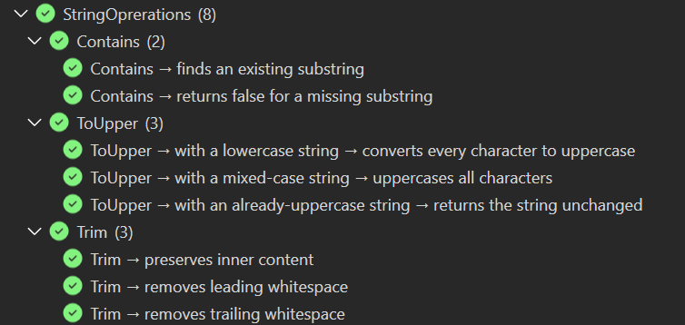
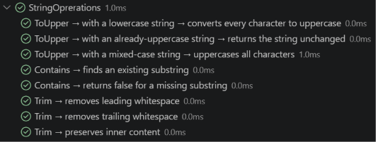

# specs.BDD.MTP

[](https://www.nuget.org/packages/specs.BDD.MTP)
[](https://github.com/yozepi/Specs/blob/main/LICENSE)

The [Microsoft.Testing.Platform](https://learn.microsoft.com/dotnet/core/testing/microsoft-testing-platform-intro) (MTP) runner for [Specs](https://github.com/yozepi/Specs), an RSpec-style BDD framework for .NET. Write `describe` / `context` / `it` specs in C# or VB. This package discovers and runs them as a fully nested tree (namespace › class › `[Feature]` › contexts › specs) in Visual Studio, VS Code, `dotnet test`, and `dotnet run`, and supports `--treenode-filter`.

## Which package do I need?

Reference **one** runner package per test project. Each one brings the `Specifications` authoring API and `specs.core` along with it.

| Package | Use it when |
|---|---|
| `specs.BDD.MTP` | You want the whole spec tree as nodes in your IDE, filtering by path, a console tree report, or a test project you can `dotnet run` |
| `specs.BDD.VSTest` | You want the classic VSTest setup, or you rely on `--filter` and `.runsettings` |
| `specs.BDD.Templates` | You want `dotnet new specs-mtp` / `specs-vstest` project templates |
| `specs.core` | You're building your own runner or host and want the same lifecycle semantics as the built-in runners |

Your specs behave the same on both hosts, so switching later only means swapping the package.

More: [Pick a Test Host](https://github.com/yozepi/Specs/wiki/Usage-Guide#pick-a-test-host)

## Installation

Start from a template:

```shell
dotnet new install specs.BDD.Templates
dotnet new specs-mtp -n MyApp.Specs              # add -lang VB for Visual Basic
```

Or add the runner to an existing project:

```shell
dotnet add package specs.BDD.MTP
dotnet add package NFluent          # optional: use any assertion library you like
```

The package turns your project into a test application (`OutputType=Exe`, `IsTestProject=true`) and generates its entry point, so you don't need `Microsoft.NET.Test.Sdk`.

If you want `dotnet test` to use MTP on the .NET 10 SDK, add this to the `global.json` that covers your project:

```json
{
  "test": {
    "runner": "Microsoft.Testing.Platform"
  }
}
```

More: [From the Command Line](https://github.com/yozepi/Specs/wiki/Usage-Guide#from-the-command-line)

## Quick Start

```csharp
using NFluent;
using specs.BDD;
using specs.BDD.Attributes;

namespace MyApp.Specs;

public class CalculatorSpecs : Specifications
{
    int num1;
    int num2;
    int result;

    public CalculatorSpecs()
    {
        BeforeEach(() => num1 = num2 = result = 0);
    }

    [Feature("Addition")]
    public void describe_addition()
    {
        Act(() => result = num1 + num2);

        Context["when adding two positive numbers"] = () =>
        {
            BeforeEach(() => { num1 = 2; num2 = 3; });

            It["returns the sum"] = () => Check.That(result).IsEqualTo(5);
        };
    }
}
```

```vb
Imports NFluent
Imports specs.BDD
Imports specs.BDD.Attributes

Public Class CalculatorSpecs
    Inherits Specifications

    Private num1 As Integer
    Private num2 As Integer
    Private result As Integer

    Public Sub New()
        BeforeEach(
            Sub()
                num1 = 0
                num2 = 0
                result = 0
            End Sub)
    End Sub

    <Feature("Addition")>
    Public Sub describe_addition()
        Act(Sub() result = num1 + num2)

        Context("when adding two positive numbers") =
            Sub()
                BeforeEach(
                    Sub()
                        num1 = 2
                        num2 = 3
                    End Sub)

                It("returns the sum") = Sub() Check.That(result).IsEqualTo(5)
            End Sub
    End Sub
End Class
```

```shell
dotnet run          # or dotnet test, with the global.json runner setting
```

Every suite needs at least one `[Feature]` method, or Specs won't discover it.

More: [Writing Specs](https://github.com/yozepi/Specs/wiki/Usage-Guide#writing-specs)

## Usage

### Run in your IDE

In Visual Studio's Test Explorer, specs nest as namespace › class › `[Feature]`, and the rest of the path (`Feature → context → spec`) is shown in each test's name. Double-click a spec to jump to its `It` line, and use the CodeLens links above each `[Feature]` method to run or debug it.



In VS Code (with C# Dev Kit), specs sit under their class with the full `describe → context → spec` path as their name.



More: [In Visual Studio](https://github.com/yozepi/Specs/wiki/Usage-Guide#in-visual-studio) · [In VS Code](https://github.com/yozepi/Specs/wiki/Usage-Guide#in-vs-code)

### Filter by tree path

Every spec has a path: `/<assembly>/<namespace>/<class>/<Feature>/<context>/…/<spec>`. Use `*` for one level and `**` for any depth.

```shell
dotnet run -- --list-tests                                          # show every path
dotnet run -- --treenode-filter "/*/*/CalculatorSpecs/Addition/**"  # a whole [Feature]
dotnet test --treenode-filter "/*/*/*/*/when dividing by zero/*"    # one scenario everywhere
```

In names, escape `(`, `)`, `*`, `|`, `&`, `[`, `]` with `\`, write `/` as `%2F`, and write `%` as `%25`.

More: [Filtering on MTP](https://github.com/yozepi/Specs/wiki/Usage-Guide#filtering-on-mtp---treenode-filter)

### Group a feature into one result

Set a `[Feature]`, class, or assembly to `ReportingLevel.Feature` to report it as a single result with an indented pass/fail tree in its output.

```csharp
[Feature("Subtraction (grouped)", Level = ReportingLevel.Feature)]
public void describe_subtraction() { /* ... */ }
```

```vb
<Feature("Subtraction (grouped)", Level:=ReportingLevel.Feature)>
Public Sub describe_subtraction()
    ' ...
End Sub
```

More: [Reporting Levels](https://github.com/yozepi/Specs/wiki/Usage-Guide#reporting-levels)

### Write your own entry point

By default the package generates `Main` for you. To host the framework yourself, set `<GenerateTestingPlatformEntryPoint>false</GenerateTestingPlatformEntryPoint>` in your project and call `AddSpecsBDD()`:

```csharp
using Microsoft.Testing.Platform.Builder;
using specs.BDD.TestingPlatform;

var builder = await TestApplication.CreateBuilderAsync(args);
builder.AddSpecsBDD();
using var app = await builder.BuildAsync();
return await app.RunAsync();
```

`AddSpecsBDD()` registers the Specs test framework for the entry assembly and enables `--treenode-filter`.

## Configuration

Put settings in a `[appname].testconfig.json` next to your test app (e.g. `MyApp.Specs.testconfig.json`), or set them as `SpecsBDD__*` environment variables.

```json
{
  "SpecsBDD": {
    "ReportingLevel": "Feature",
    "ShowSourceLocations": true,
    "ColorOutput": false
  }
}
```

| Setting | Environment variable | Default | Description |
|---|---|---|---|
| `SpecsBDD:ReportingLevel` | `SpecsBDD__ReportingLevel` | unset (→ `Test`) | Fallback reporting level (`Test` or `Feature`) when no attribute sets one |
| `SpecsBDD:ShowSourceLocations` | `SpecsBDD__ShowSourceLocations` | `false` | Adds `at <file>:line <n>` under each spec in grouped reports |
| `SpecsBDD:ColorOutput` | `SpecsBDD__ColorOutput` | `true` | Set to `false` for plain markers when your log shows escape codes |

Full list: [Runner Settings on MTP](https://github.com/yozepi/Specs/wiki/Usage-Guide#on-mtp)

## Compatibility

- Package target framework: `netstandard2.1`. Templates target `net10.0`.
- Built on Microsoft.Testing.Platform 2.5.1.
- `dotnet test` in MTP mode needs the .NET 10 SDK and the `global.json` runner setting. `dotnet run` works without it.
- Nullable annotations and XML docs included. Symbols are published as `.snupkg` with SourceLink.

## Learn More

- [Wiki home](https://github.com/yozepi/Specs/wiki)
- [Usage Guide](https://github.com/yozepi/Specs/wiki/Usage-Guide)
- [Troubleshooting MTP](https://github.com/yozepi/Specs/wiki/Troubleshooting#microsofttestingplatform)
- [Release notes](https://github.com/yozepi/Specs/releases)

## License

MIT — see [LICENSE](https://github.com/yozepi/Specs/blob/main/LICENSE).
