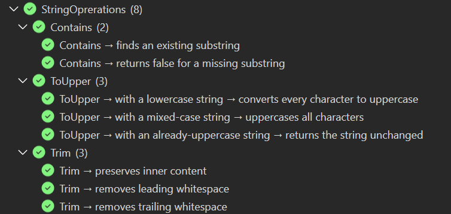
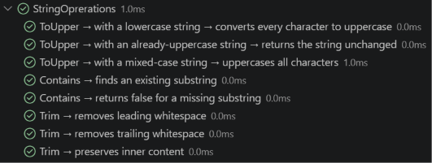

# specs.BDD.VSTest

[](https://www.nuget.org/packages/specs.BDD.VSTest)
[](https://github.com/yozepi/Specs/blob/main/LICENSE)

The VSTest adapter for [Specs](https://github.com/yozepi/Specs), an RSpec-style BDD framework for .NET. Write `describe` / `context` / `it` specs in C# or VB. This package discovers and runs them in Visual Studio Test Explorer, VS Code, and `dotnet test`, with source navigation, a nested Test Explorer hierarchy, `--filter` support, and `.runsettings` configuration.

## Which package do I need?

Reference **one** runner package per test project. Each one brings the `Specifications` authoring API and `specs.core` along with it.

| Package | Use it when |
|---|---|
| `specs.BDD.VSTest` | You want the classic VSTest setup, or you rely on `--filter` and `.runsettings` |
| `specs.BDD.MTP` | You want the whole spec tree as nodes in your IDE, filtering by path, a console tree report, or a test project you can `dotnet run` |
| `specs.BDD.Templates` | You want `dotnet new specs-vstest` / `specs-mtp` project templates |
| `specs.core` | You're building your own runner or host and want the same lifecycle semantics as the built-in runners |

Your specs behave the same on both hosts, so switching later only means swapping the package.

More: [Pick a Test Host](https://github.com/yozepi/Specs/wiki/Usage-Guide#pick-a-test-host)

## Installation

Start from a template:

```shell
dotnet new install specs.BDD.Templates
dotnet new specs-vstest -n MyApp.Specs           # add -lang VB for Visual Basic
```

Or add the adapter and the test SDK to an existing project:

```shell
dotnet add package Microsoft.NET.Test.Sdk
dotnet add package specs.BDD.VSTest
dotnet add package NFluent          # optional: use any assertion library you like
```

Mark the project as a test project:

```xml
<PropertyGroup>
  <IsTestProject>true</IsTestProject>
</PropertyGroup>
```

More: [From the Command Line](https://github.com/yozepi/Specs/wiki/Usage-Guide#from-the-command-line)

## Quick Start

```csharp
using NFluent;
using specs.BDD;
using specs.BDD.Attributes;

namespace MyApp.Specs;

public class CalculatorSpecs : Specifications
{
    int num1;
    int num2;
    int result;

    public CalculatorSpecs()
    {
        BeforeEach(() => num1 = num2 = result = 0);
    }

    [Feature("Addition")]
    public void describe_addition()
    {
        Act(() => result = num1 + num2);

        Context["when adding two positive numbers"] = () =>
        {
            BeforeEach(() => { num1 = 2; num2 = 3; });

            It["returns the sum"] = () => Check.That(result).IsEqualTo(5);
        };
    }
}
```

```vb
Imports NFluent
Imports specs.BDD
Imports specs.BDD.Attributes

Public Class CalculatorSpecs
    Inherits Specifications

    Private num1 As Integer
    Private num2 As Integer
    Private result As Integer

    Public Sub New()
        BeforeEach(
            Sub()
                num1 = 0
                num2 = 0
                result = 0
            End Sub)
    End Sub

    <Feature("Addition")>
    Public Sub describe_addition()
        Act(Sub() result = num1 + num2)

        Context("when adding two positive numbers") =
            Sub()
                BeforeEach(
                    Sub()
                        num1 = 2
                        num2 = 3
                    End Sub)

                It("returns the sum") = Sub() Check.That(result).IsEqualTo(5)
            End Sub
    End Sub
End Class
```

```shell
dotnet test
```

Every suite needs at least one `[Feature]` method, or Specs won't discover it.

More: [Writing Specs](https://github.com/yozepi/Specs/wiki/Usage-Guide#writing-specs)

## Usage

### Run in your IDE

In Visual Studio's Test Explorer, specs nest as namespace › class › `[Feature]`, and the rest of the path (`Feature → context → spec`) is shown in each test's name. Double-click a spec to jump to its `It` line, and use the CodeLens links above each `[Feature]` method to run or debug it.



In VS Code (with C# Dev Kit), specs sit under their class with the full `describe → context → spec` path as their name.



More: [In Visual Studio](https://github.com/yozepi/Specs/wiki/Usage-Guide#in-visual-studio) · [In VS Code](https://github.com/yozepi/Specs/wiki/Usage-Guide#in-vs-code)

### Filter with `--filter`

| Property | Matches |
|---|---|
| `FullyQualifiedName` | `Namespace.Class.FeatureMethod` (every spec in a `[Feature]` shares it) |
| `ContextMethod` | The `[Feature]` method's name |
| `ContextPath` | The `Feature → context → …` path |
| `TestDescription` | The spec's own description |
| `DisplayName` | The whole path, spec included |
| `IsPending` | `true` / `false` |

```shell
dotnet test --filter "FullyQualifiedName~CalculatorSpecs.describe_addition"  # a whole [Feature]
dotnet test --filter "ContextPath~when dividing by zero"                     # one scenario
dotnet test --filter IsPending=true                                          # what's left to write
```

`FullyQualifiedName` stops at the `[Feature]` method, so use `ContextPath` or `TestDescription` to target contexts or specs. An invalid filter reports an error and runs nothing.

More: [Filtering on VSTest](https://github.com/yozepi/Specs/wiki/Usage-Guide#filtering-on-vstest---filter)

### Group a feature into one result

Set a `[Feature]`, class, or assembly to `ReportingLevel.Feature` to report it as a single result with an indented pass/fail tree in its output.

```csharp
[Feature("Subtraction (grouped)", Level = ReportingLevel.Feature)]
public void describe_subtraction() { /* ... */ }
```

```vb
<Feature("Subtraction (grouped)", Level:=ReportingLevel.Feature)>
Public Sub describe_subtraction()
    ' ...
End Sub
```

More: [Reporting Levels](https://github.com/yozepi/Specs/wiki/Usage-Guide#reporting-levels)

## Configuration

Put settings in a `<SpecsBDD>` section of a `.runsettings` file:

```xml
<RunSettings>
  <SpecsBDD>
    <ReportingLevel>Feature</ReportingLevel>
    <ShowSourceLocations>true</ShowSourceLocations>
    <ColorOutput>false</ColorOutput>
  </SpecsBDD>
</RunSettings>
```

```shell
dotnet test --settings specs.runsettings
```

| Setting | Default | Description |
|---|---|---|
| `ReportingLevel` | unset (→ `Test`) | Fallback reporting level (`Test` or `Feature`) when no attribute sets one |
| `ShowSourceLocations` | `false` | Adds `at <file>:line <n>` under each spec in grouped reports |
| `ColorOutput` | `true` | Set to `false` for plain markers when your log shows escape codes |

Missing or invalid values fall back to the default.

Full list: [Runner Settings on VSTest](https://github.com/yozepi/Specs/wiki/Usage-Guide#on-vstest)

## Compatibility

- Package target framework: `netstandard2.1`. Templates target `net10.0`.
- Built on Microsoft.TestPlatform.ObjectModel 17.8.0. Requires `Microsoft.NET.Test.Sdk` in the test project.
- Works with `dotnet test`, Visual Studio Test Explorer, and VS Code with C# Dev Kit.
- Nullable annotations and XML docs included. Symbols are published as `.snupkg` with SourceLink.

## Learn More

- [Wiki home](https://github.com/yozepi/Specs/wiki)
- [Usage Guide](https://github.com/yozepi/Specs/wiki/Usage-Guide)
- [Troubleshooting](https://github.com/yozepi/Specs/wiki/Troubleshooting)
- [Release notes](https://github.com/yozepi/Specs/releases)

## License

MIT — see [LICENSE](https://github.com/yozepi/Specs/blob/main/LICENSE).
